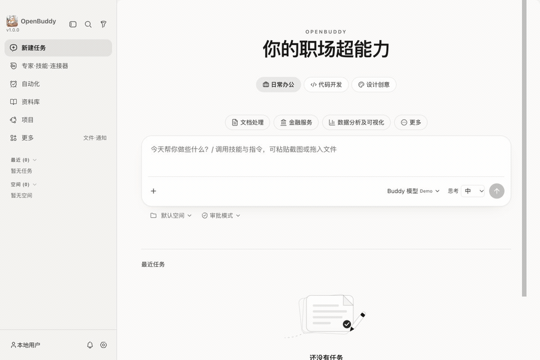
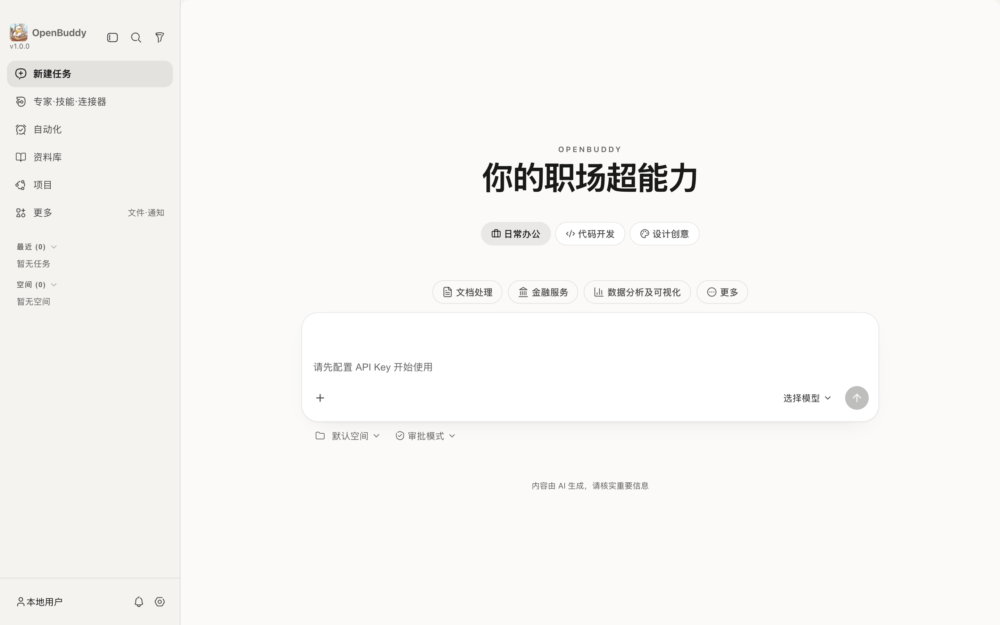
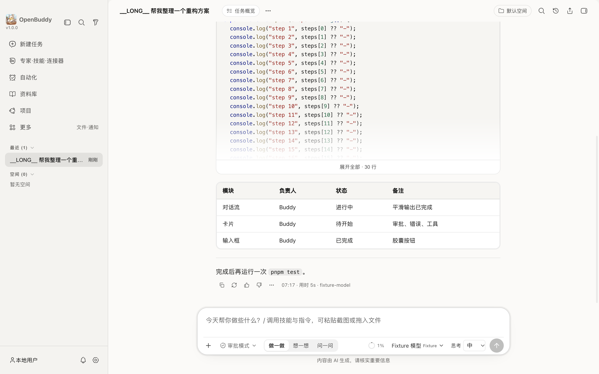
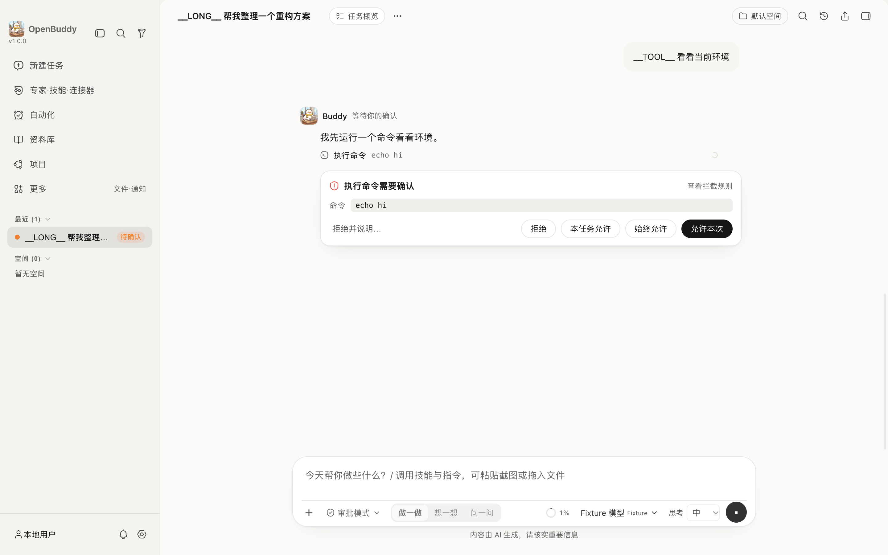
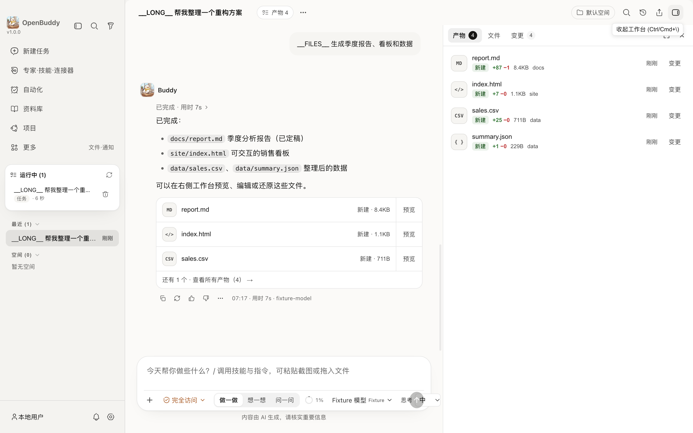
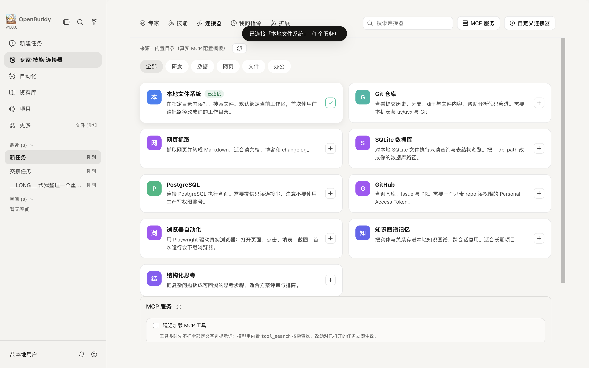
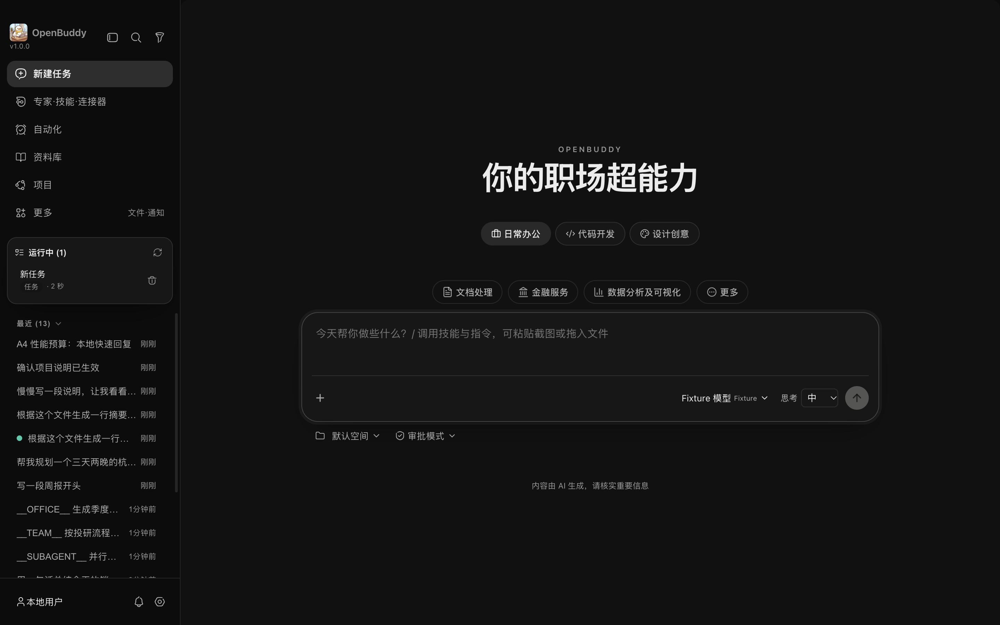
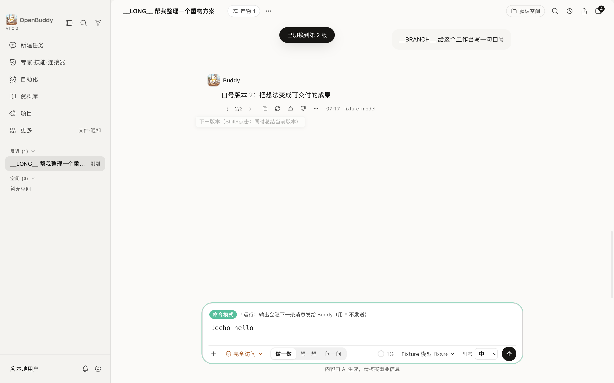
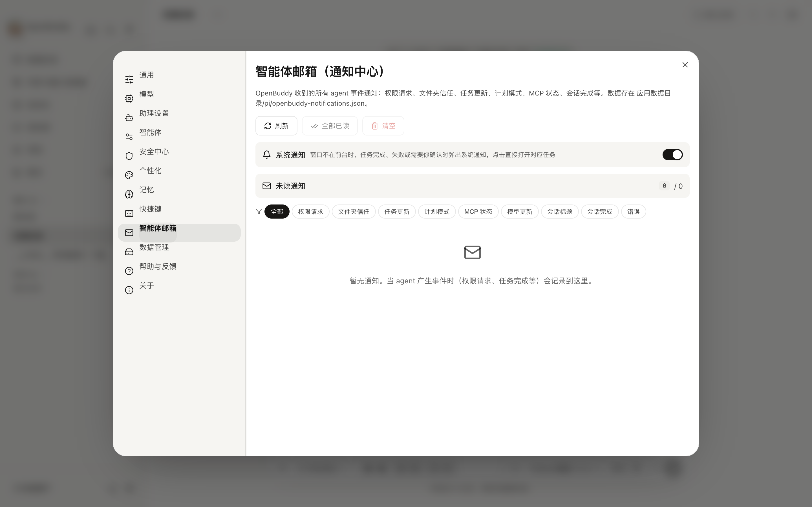
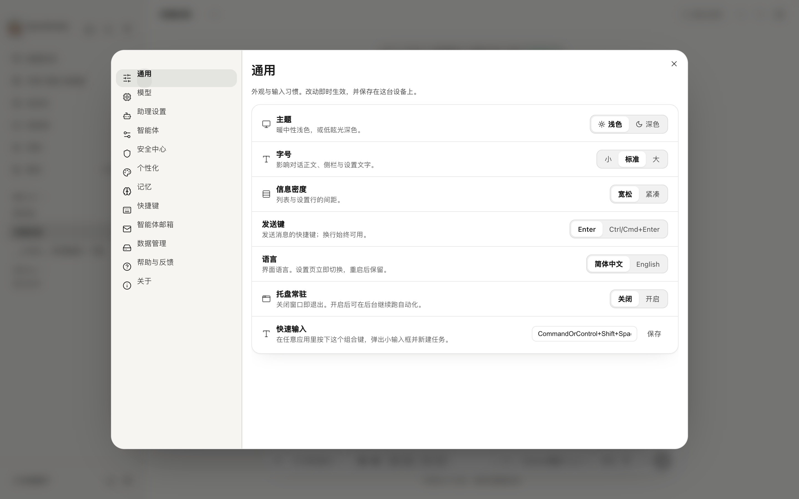

<p align="center">
  
</p>

<h1 align="center">OpenBuddy</h1>

<p align="center">
  <strong>Your buddy. On your machine.</strong><br>
  A local-first desktop AI workspace — your buddy, your data, your keys.
</p>

<p align="center">
  <a href="README.md">简体中文（默认）</a> · <a href="docs/user-guide.md">User guide</a> · <a href="docs/FEATURE-STATUS.md">Feature status</a> · <a href="docs/VISION.md">Vision</a>
</p>

<p align="center">
  <a href="https://github.com/louloulin/OpenBuddy/actions/workflows/release.yml"></a>
  <a href="LICENSE"></a>
  
</p>

> [!IMPORTANT]
> **Unsigned preview build.** The `1.0.0` in package.json is a version number, not a published release; CI only produces review artifacts. For what actually works, see the [feature status matrix](docs/FEATURE-STATUS.md) — it is the source of truth when docs disagree.

<p align="center">
  <a href="docs/demo.gif"></a>
</p>
<p align="center"><sub>36-second real demo: pick a template → ask → tool approval → artifacts in the workbench (real Electron build + local fixture, no real credentials)</sub></p>

## Why OpenBuddy

Most AI tools are one-shot chats: close the window and they forget you, while your data lives on someone else's server. OpenBuddy is built to be a **long-term companion that belongs to you**:

- **Yours**: sessions, projects, artifacts and snapshots stay on your machine. BYOK — API keys are encrypted in the OS keychain and never enter logs or data exports.
- **Remembers you**: project notes, expert personas, skills and checkpoints accumulate across tasks.
- **Gets things done**: reads/writes files, calls tools, talks to MCP servers; results land in the workbench.
- **Knows its limits**: every tool call needs approval; protected paths such as `.env`, `.ssh`, `*.pem` are always denied.
- **Works offline**: point it at a local model (llama.cpp / OpenAI-compatible endpoint) and no request leaves your device.

## Get started in 60 seconds

### Option A: preview build

Grab a review artifact from [Releases](https://github.com/louloulin/OpenBuddy/releases). The build is unsigned, so on macOS use **right-click → Open** the first time.

### Option B: from source

```sh
# Node >= 22.19.0 (24 recommended), pnpm 10.29.3
pnpm install --frozen-lockfile
pnpm dev:electron
```

### Your first task

1. Open **Settings → Models**, add a provider Base URL and API key (or configure a local model).
2. Click **New task** and type something concrete, e.g. "Read the README and list three risks."
3. Approve the tool card ("This time" / "This session" / "Deny").
4. Artifacts appear in the right-hand workbench — preview, edit, restore or download them.

> `pnpm dev` is a browser-only preview without native capabilities. Use `dev:electron` for files, dialogs and the keychain.

## What your buddy can do

| Scenario | What you get |
| :--- | :--- |
| Research & notes | Reads folders, extracts key points, writes Markdown reports you can preview |
| Code collaboration | Edits code, runs commands, shows diffs, restores from checkpoints |
| Office output | Generates real `docx` / `xlsx` / `pptx` (OOXML) behind permission gates |
| Custom personas | Bind an expert, import WorkBuddy expert packs, run sub-session teams |
| Scheduled work | Daily / weekly / monthly / hourly or file-triggered runs with retry |
| Phone access | Pair through the Gateway for mobile approvals and notifications (bring your own gateway) |

See the [feature status matrix](docs/FEATURE-STATUS.md) for limits and the [user guide](docs/user-guide.md) for step-by-step instructions.

## Screenshots

> Captured from local fixture UI-verification runs; no real user data or credentials. Original sets live in `docs/plan/shots-20261121-penguin/`, curated copies in `docs/screenshots/`.

<p align="center">
  
</p>
<p align="center"><sub>Home: scenario templates, task entry, model and permission status</sub></p>

| Chat & Markdown | Tool approval |
| :---: | :---: |
|  |  |
| Long turns, code blocks, tables | Explicit confirmation before commands, with tiered grants |

| Workbench | Connectors & MCP |
| :---: | :---: |
|  |  |
| Artifacts, file changes, previews | Connector catalog and MCP services |

| Dark theme | Command mode |
| :---: | :---: |
|  |  |
| Full light / dark switching | `!`-prefixed inline commands and skill calls |

| Notifications | Settings |
| :---: | :---: |
|  |  |
| Permission requests, task updates, MCP status | General, models, security, data and help |

## How it differs

| | Web chat | IDE plugin | OpenBuddy |
| :--- | :--- | :--- | :--- |
| Data stays local | No | Partial | Yes (sessions / artifacts / snapshots) |
| Bring your own key / local model | Rare | Partial | Yes (BYOK + OpenAI-compatible endpoints) |
| Approval before tool calls | None | Config-dependent | Yes (tiered grants + protected paths) |
| Accumulate persona and skills across tasks | Weak | Weak | Yes (experts / skills / project notes) |
| Artifact workbench and checkpoints | No | Partial | Yes |

## Documentation

**Product & status**

- [Vision: a buddy for everyone](docs/VISION.md)
- [Feature status matrix (source of truth)](docs/FEATURE-STATUS.md)
- [Growth and discovery plan](docs/GROWTH.md)

**Using it**

- [User guide](docs/user-guide.md) (Chinese)
- [FAQ](docs/faq.md) (Chinese)
- [Troubleshooting](docs/troubleshooting.md) (Chinese)
- [Privacy](docs/privacy.md) (Chinese)
- [Release notes](docs/release-notes.md) (Chinese)

**Developing**

- [Architecture and verification](docs/architecture.md)
- [Changelog](CHANGELOG.md)
- [Pre-release checks](TODO.md)

## Contributing

OpenBuddy is MIT licensed. Good starting points:

- Improve docs and translations: [user guide](docs/user-guide.md), [feature status](docs/FEATURE-STATUS.md)
- Contribute buddy templates, expert packs and skills (see the [vision](docs/VISION.md) roadmap)
- Pick up a `good first issue`: [Issues](https://github.com/louloulin/OpenBuddy/issues)

Before submitting: `pnpm test`, `pnpm check:docs`, `pnpm audit:ipc`.

## License

MIT; see [LICENSE](LICENSE).
