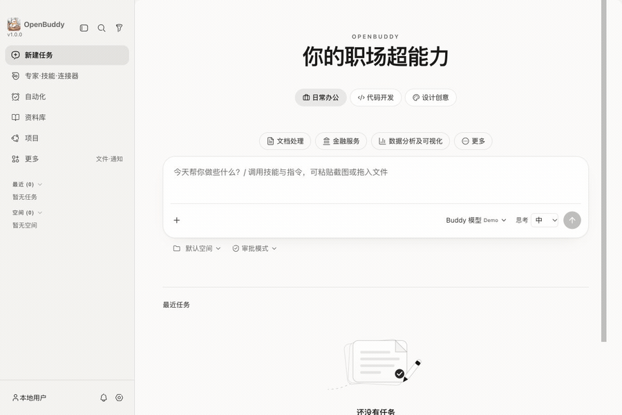
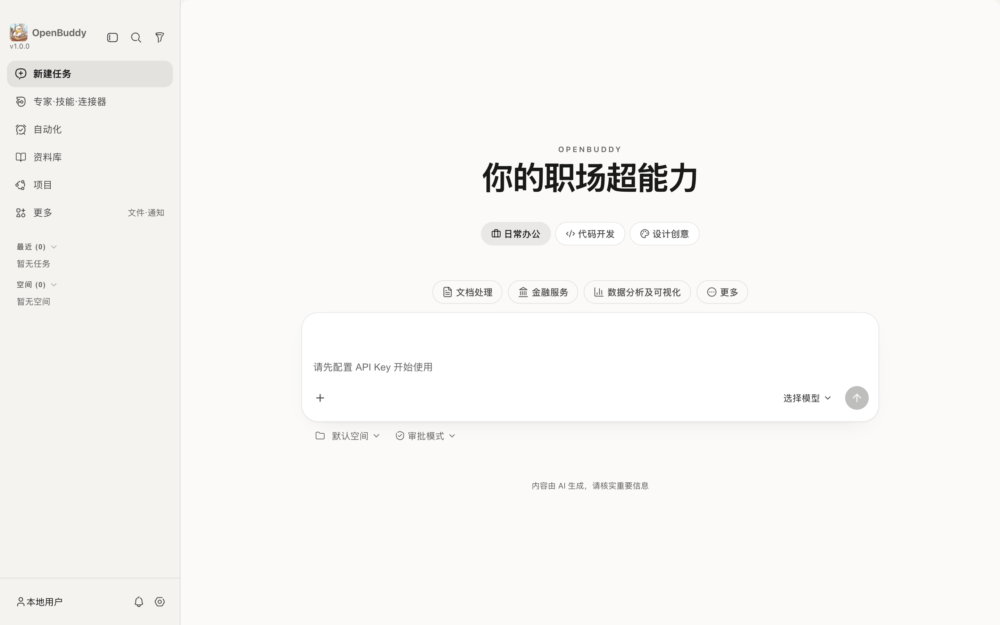
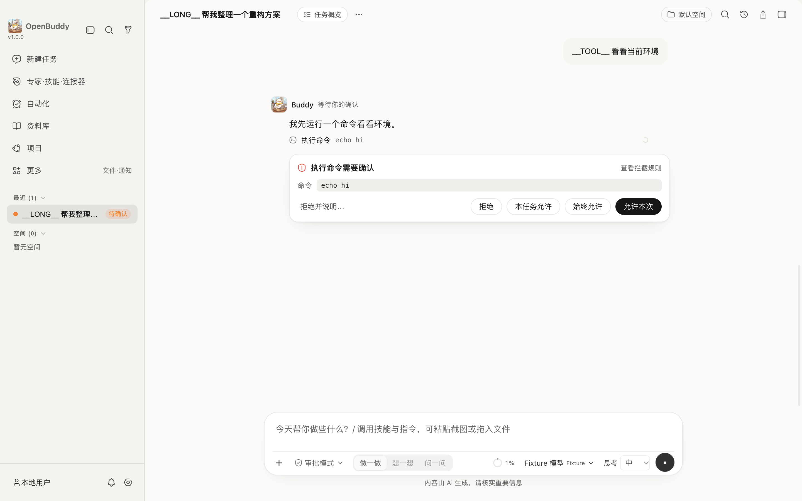
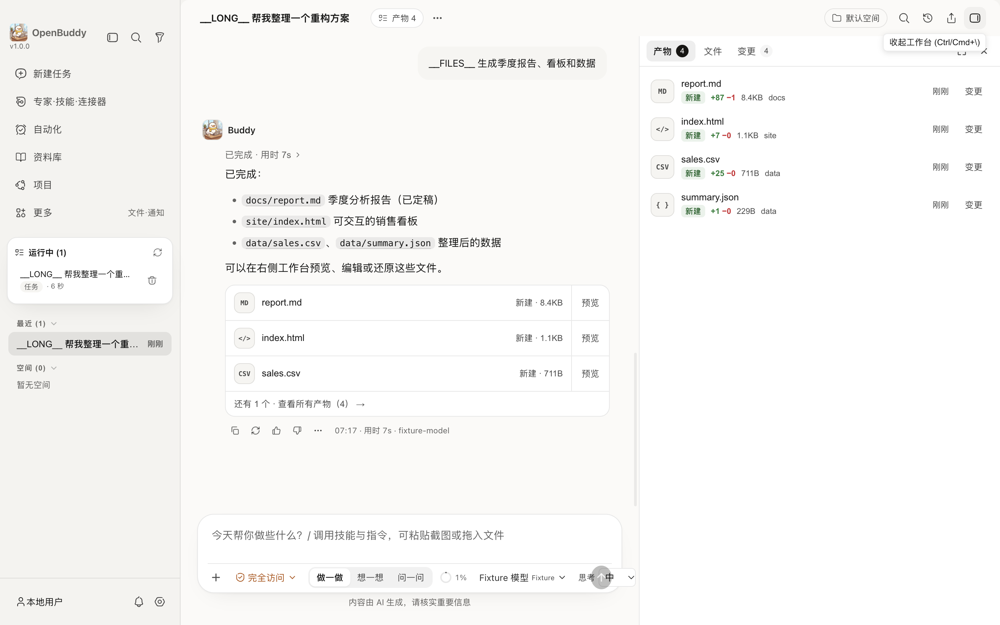
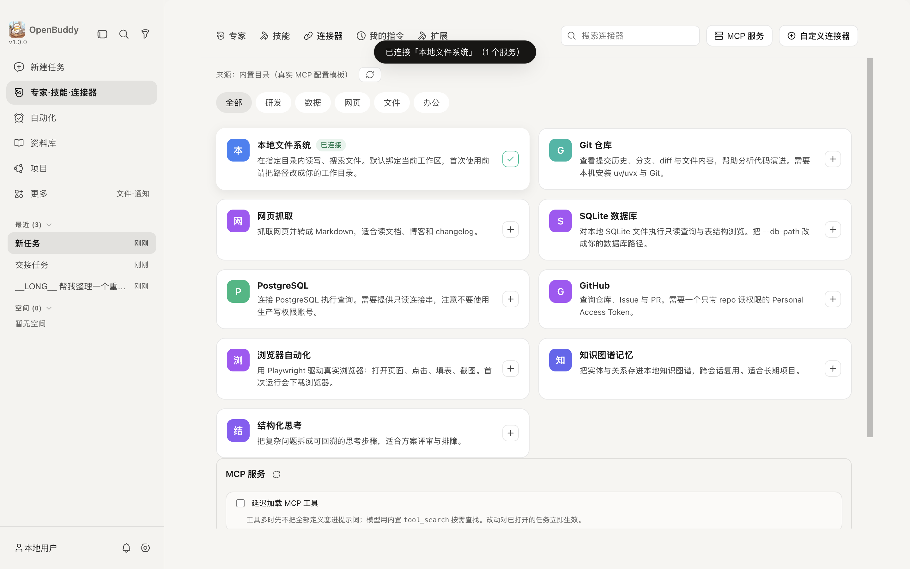
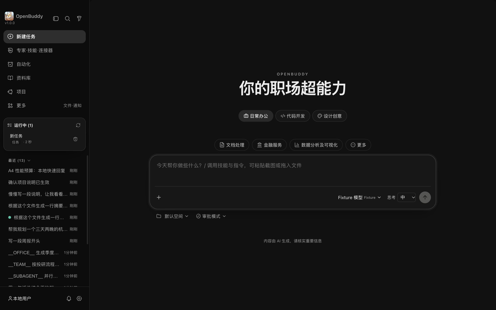

<p align="center">
  
</p>

<h1 align="center">OpenBuddy</h1>

<p align="center">
  <strong>让每个人都能拥有自己的 Buddy</strong><br>
  本地优先的桌面 AI 工作台 —— 你的 Buddy、你的数据、你的钥匙。
</p>

<p align="center">
  <a href="README.en.md">English</a> · <a href="docs/user-guide.md">用户手册</a> · <a href="docs/FEATURE-STATUS.md">功能状态</a> · <a href="docs/VISION.md">产品主张</a>
</p>

<p align="center">
  <a href="https://github.com/louloulin/OpenBuddy/actions/workflows/release.yml"></a>
  <a href="LICENSE"></a>
  
  <a href="https://github.com/louloulin/OpenBuddy/issues"></a>
</p>

> [!IMPORTANT]
> **当前状态：未签名预览版。** `1.0.0` 是版本号，不代表已发布正式版；CI 只生成审核产物。功能是否可用请看 [功能状态总表](docs/FEATURE-STATUS.md)——文档之间若有出入，以该表为准。

<p align="center">
  <a href="docs/demo.gif"></a>
</p>
<p align="center"><sub>36 秒真实演示：选模板 → 提问 → 工具审批 → 产物落在工作台（真实 Electron 构建 + 本地 fixture，无真实凭据）</sub></p>

## 为什么是 OpenBuddy

大多数 AI 工具是"一次性聊天"：关掉窗口就忘了你是谁，数据留在别人的服务器上。OpenBuddy 想做的是一位**长期属于你的搭档**：

- **属于你**：会话、项目、产物、快照都在本机；BYOK，密钥由系统钥匙串加密，不进日志、不进导出包。
- **记得你**：项目说明、专家人设、技能与检查点积累下来，下次不用从头解释。
- **能动手**：读写文件、调用工具、连接 MCP，产物直接出现在右侧工作台。
- **有边界**：每个工具调用都要审批；`.env`、`.ssh`、`*.pem` 等路径任何模式下都拒绝写入。
- **可离线**：配好本地模型（llama.cpp / OpenAI 兼容端点）后，全程不联网。

一句话：**Your buddy. On your machine.**

## 60 秒拥有你的第一个 Buddy

### 方式 A：使用预览产物

从 [Releases](https://github.com/louloulin/OpenBuddy/releases) 获取审核包。当前构建未签名，macOS 首次打开需要「右键 → 打开」。

### 方式 B：从源码运行

```sh
# 需要 Node >= 22.19.0（建议 24）与 pnpm 10.29.3
pnpm install --frozen-lockfile
pnpm dev:electron          # 原生桌面开发
```

### 第一个任务

1. 左下角「设置 → 模型」填入服务商 Base URL 与 API Key（或配置本地模型）。
2. 侧栏「新建任务」，输入一句具体的话，例如「读一下 README，列出三个风险点」。
3. 弹出审批卡片时选择「允许本次 / 本会话允许 / 拒绝」。
4. 产物出现在右侧工作台，可预览、编辑、还原或下载。

> `pnpm dev` 只启动浏览器预览，不提供原生能力；需要文件 / 对话框 / 密钥时请用 `dev:electron`。

## Buddy 能做什么

| 场景 | 你会得到什么 |
| :--- | :--- |
| 资料整理 | 读文件夹、提炼要点、生成 Markdown 报告，产物可直接预览 |
| 代码协作 | 改代码、跑命令、看 diff，检查点可一键还原 |
| 办公产物 | 生成真实 `docx` / `xlsx` / `pptx`（OOXML），走权限门与产物刷新 |
| 专属人设 | 绑定专家、导入 WorkBuddy 专家包、组建子会话团队 |
| 定时干活 | 按日/周/月/小时或文件变化触发，失败可一键重试 |
| 手机接入 | 通过 Gateway 配对，在手机上审批与查看通知（需自配网关） |

能力细节与限制见 [功能状态总表](docs/FEATURE-STATUS.md)；上手步骤见 [用户手册](docs/user-guide.md)。

## 界面预览

> 以下截图来自本地 fixture 的 UI 验证流程，不包含真实用户数据或凭据。原始图集位于 `docs/plan/shots-20261121-penguin/`，此处为便于阅读挑选并归档到 `docs/screenshots/`。

<p align="center">
  
</p>
<p align="center"><sub>首页：场景模板、任务入口、模型与权限状态</sub></p>

| 对话与 Markdown | 工具审批 |
| :---: | :---: |
|  |  |
| 长回合、代码块与表格渲染 | 命令执行前显式确认，支持分级授权 |

| 产物工作台 | 连接器与 MCP |
| :---: | :---: |
|  |  |
| 产物列表、文件变更与预览 | 连接器目录、已连接状态与 MCP 服务 |

| 深色主题 | 命令模式 |
| :---: | :---: |
|  |  |
| 完整的浅色 / 深色主题切换 | `!` 前缀内联命令与技能调用 |

| 通知中心 | 设置面板 |
| :---: | :---: |
|  |  |
| 权限请求、任务更新与 MCP 状态通知 | 通用、模型、安全、数据与帮助等设置分组 |

## 和别的 AI 工具有什么不同

| | 网页聊天 | IDE 插件 | OpenBuddy |
| :--- | :--- | :--- | :--- |
| 数据留在本地 | 否 | 部分 | 是（会话 / 产物 / 快照） |
| 自己带密钥 / 本地模型 | 少见 | 部分 | 是（BYOK + OpenAI 兼容端点） |
| 工具调用前审批 | 无 | 依赖配置 | 是（分级授权 + 受保护路径） |
| 可以跨任务积累人格与技能 | 弱 | 弱 | 是（专家 / 技能 / 项目说明） |
| 产物工作台与检查点 | 无 | 部分 | 是 |

## 文档

**产品与状态**

- [产品主张：让每个人都能拥有自己的 Buddy](docs/VISION.md)
- [功能状态总表（唯一事实来源）](docs/FEATURE-STATUS.md)
- [增长与传播计划](docs/GROWTH.md)

**使用**

- [用户手册](docs/user-guide.md)
- [常见问题](docs/faq.md)
- [故障排查](docs/troubleshooting.md)
- [隐私说明](docs/privacy.md)
- [更新说明](docs/release-notes.md)

**开发与迁移**

- [技术架构与验证](docs/architecture.md)
- [更新日志](CHANGELOG.md)
- [发布前检查](TODO.md)

## 参与共建

OpenBuddy 是 MIT 许可的开源项目。欢迎从以下方式开始：

- 修复文档、补充中文 / 英文表达：[用户手册](docs/user-guide.md)、[功能状态总表](docs/FEATURE-STATUS.md)
- 贡献 Buddy 模板、专家包与技能配置（路线图见 [产品主张](docs/VISION.md)）
- 认领 `good first issue`：[Issues](https://github.com/louloulin/OpenBuddy/issues)

改动前后请跑一遍：`pnpm test`、`pnpm check:docs`、`pnpm audit:ipc`。

## 许可证

MIT，见 [LICENSE](LICENSE)。
