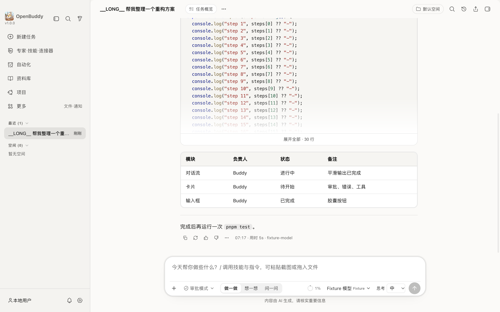
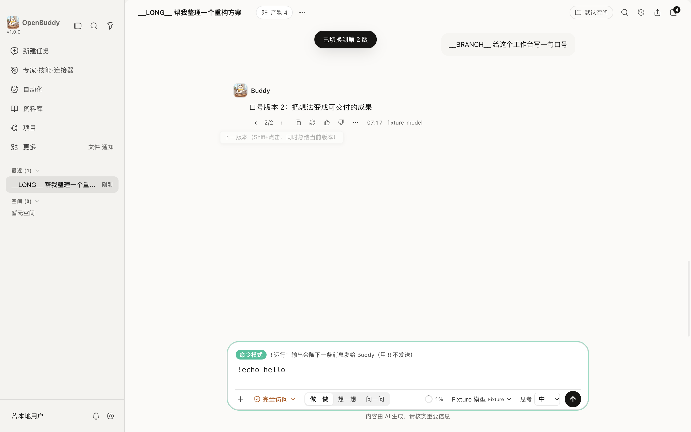
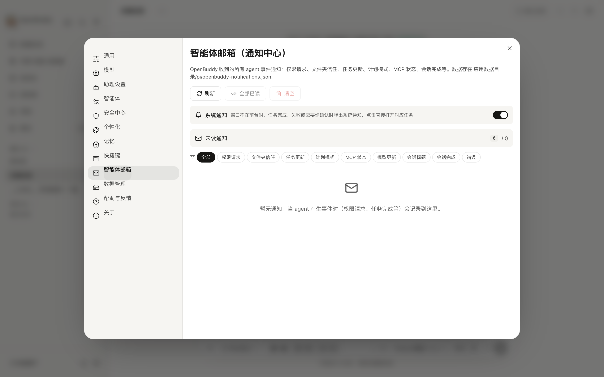
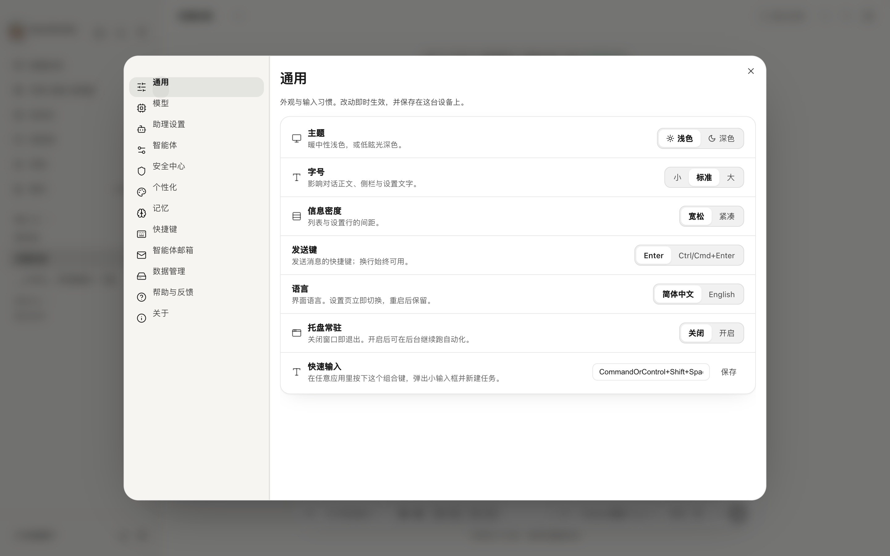
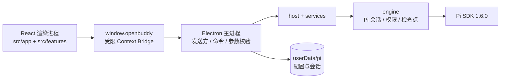

<p align="center">
  
</p>

<h1 align="center">OpenBuddy</h1>

<p align="center">
  <strong>由 Pi 驱动的本地优先桌面工作区</strong><br>
  <span>中文（默认） · <a href="README.en.md">English</a></span>
</p>

> [!NOTE]
> 当前分支是 Electron 模块化重构实现。`package.json` 中的 `1.0.0` 只是版本号，**不代表已发布正式版**；当前 CI 只生成未签名的审核产物，不自动创建发布。

## 概览

OpenBuddy 将 Pi 编码代理放进 Electron 桌面外壳，提供统一的聊天、会话、工具、文件与模型管理体验。渲染层使用 React，主进程承载 Pi 会话引擎；所有本地能力都经过受限的 IPC 桥接与显式授权。

- **对话与会话**：连续回合、Markdown / 代码块 / 表格渲染、会话恢复、空闲分叉与消息队列。
- **工具与审批**：命令、文件等操作在执行前展示明确确认卡片，支持本次允许、任务内允许、始终允许或拒绝。
- **产物与工作台**：文件变更、预览、差异与检查点集中在右侧工作台，便于审阅和回溯。
- **模型与 BYOK**：按「提供商 + 模型」完整身份选择，模型能力决定思考档位；密钥由 Electron `safeStorage` 加密保存。
- **工作区文件**：原生文件选择 / 拖放授权、真实图片解码、文本与图片附件限制清晰可控。
- **MCP 与扩展**：提供技能、连接器与 MCP 服务配置入口；扩展默认禁用，需显式添加路径并启用。

## 界面预览

> 以下截图来自本地 fixture 的 UI 验证流程，不包含真实用户数据或凭据。原始图集位于 `docs/plan/shots-20261121-penguin/`，此处为便于阅读挑选并归档到 `docs/screenshots/`。

<p align="center">
  
</p>
<p align="center"><sub>首页：场景模板、任务入口、模型与权限状态</sub></p>

| 对话与 Markdown | 工具审批 |
| :---: | :---: |
|  |  |
| 长回合、代码块与表格渲染 | 命令执行前显式确认，支持分级授权 |

| 产物工作台 | 连接器与 MCP |
| :---: | :---: |
|  |  |
| 产物列表、文件变更与预览 | 连接器目录、已连接状态与 MCP 服务 |

| 深色主题 | 命令模式 |
| :---: | :---: |
|  |  |
| 完整的浅色 / 深色主题切换 | `!` 前缀内联命令与技能调用 |

| 通知中心 | 设置面板 |
| :---: | :---: |
|  |  |
| 权限请求、任务更新与 MCP 状态通知 | 通用、模型、安全、数据与帮助等设置分组 |

## 快速开始

### 环境要求

| 依赖 | 版本 |
| :--- | :--- |
| Node.js | `>= 22.19.0`（建议 Node 24） |
| pnpm | `10.29.3` |
| Electron | `45.3.0`（已精确固定） |
| Pi SDK | `@earendil-works/pi-coding-agent` `1.6.0`（已精确固定） |

本机 arm64 二进制实测环境为 Electron `45.3.0` / Node `24.22.2` / Chromium `156.0.8078.96`。

### 开发与构建

```sh
pnpm install --frozen-lockfile
pnpm dev:electron      # 原生桌面开发（需要本地能力时使用）
pnpm test              # 单元测试与边界检查
pnpm build:electron    # 构建主进程与渲染层
pnpm pack:electron     # 生成免安装目录产物
pnpm dist:electron     # 按当前平台生成安装包
```

`pnpm dev` 只启动浏览器 Vite 预览，不提供原生平台能力；修改主进程或 preload 后需要重启 `pnpm dev:electron`。打包默认使用当前平台：`pnpm dist:mac` 生成 DMG，`pnpm dist:win` 生成 NSIS，产物输出到 `release/`。

### 常用检查

```sh
pnpm typecheck          # 渲染层 + 主进程类型检查
pnpm check:boundaries   # 模块边界对照基线检查
pnpm audit:ipc          # IPC 契约审计
pnpm check:docs         # 用户文档链接与结构检查
pnpm verify:e2e         # 真实 Electron 走查（需先构建；Linux 需 xvfb）
```

## 核心能力

### 对话与会话

模型按「提供商 + 模型」完整身份选择，思考档位由当前模型的真实能力决定，切换或恢复会话时会读取引擎保存的模型状态。Pi 扩展发起的 `input` / `select` / `confirm` / `editor` 请求会转成桌面表单；`steering` / `follow-up` 队列与空闲会话分叉使用 SDK 原生能力。自定义 TUI 组件暂不支持。

### 工具与审批

工具调用在执行前展示命令、目标与授权范围。用户可以选择拒绝、仅本次允许、当前任务允许或始终允许；拦截规则可点击查看。审批状态同时反映在左侧运行任务列表与通知中心。

### 产物与工作台

对话生成的文件会汇总到产物列表，包含新建 / 变更状态、大小与所属目录。右侧工作台支持预览、编辑与还原；检查点用于回溯回合状态。文件变更与产物在同一视图中对齐，便于逐项确认。

### 文件与附件

附件必须来自原生文件选择器或真实的 File 拖放授权，并通过魔数校验、实际解码与文件身份检查。限制为：单张图片 10 MiB、图片总量 20 MiB、最多 8 个附件，单个 UTF-8 文本文件 256 KiB。导出文件必须使用原生保存对话框授权的路径。

### 模型、密钥与数据位置

API Key 使用 Electron `safeStorage` 加密；配置文件不能当作凭据备份。Pi 会话与配置保存在 Electron `userData/pi/`，默认不读取 `~/.pi`。旧 Tauri / ACP 会话目前没有自动导入功能。

### MCP、技能与扩展

设置中提供专家、技能、连接器与 MCP 服务入口，可查看内置模板、已连接状态与延迟加载开关。扩展默认禁用，必须由用户主动选择本地路径并显式启用；未知的项目扩展不会自动执行。连接器 CLI、插件与云协作仍在暂缓范围。

## 架构与安全



渲染进程启用 `contextIsolation` 与 `sandbox`，关闭 `nodeIntegration`，由 CSP 限制脚本执行；导航与弹窗被拦截，外链只允许 HTTP/HTTPS。主进程在调用服务前校验发送窗口、顶层 frame、命令白名单与参数结构。

### 代码结构

仓库是 pnpm workspace。各包以 TypeScript 源码形式被引用：`tsconfig.base.json` 的 paths（主进程 esbuild 也读取）和对应的 Vite / Vitest 别名把 `@openbuddy/<包>[/<子路径>]` 映射到 `packages/<包>/src/…`，没有单独的包构建步骤。

```text
apps/desktop      Electron 宿主：main/、preload/、ipc/register.ts、scripts/
apps/web          React 渲染层：src/app（外壳、命令面板、路由）、src/features/*、src/shared/*
apps/mobile       移动端壳与相关验证脚本
packages/protocol IPC 契约（命令、事件）与 DTO 类型
packages/kernel   宿主端口（事件、shell、密钥、时钟、日志）与参数校验（纯 TS）
packages/services 配置、模型提供商、MCP、技能、文件、预览（Node）
packages/engine   Pi 会话引擎、权限、扩展 UI 桥、检查点、产物（Node）
packages/host     IPC 命令处理与文件 / 工作区访问校验（Node）
packages/client   渲染层 IPC 客户端
packages/chat-core 无 UI 的对话逻辑：回合分组、工具摘要、diff、导出、错误文案
packages/platform 平台工具（剪贴板、平台识别）
packages/ui       图标、Toast、ImageLightbox、ThemeProvider、LetterAvatar、设计 token
packages/markdown Markdown 渲染管线与代码块操作
tools/            边界检查、搬家 codemod、IPC 审计、验证脚本
```

依赖方向由 `tools/check-boundaries.mjs` 约束，并在 `pnpm test` 中执行。分层、禁用模块、直接访问桥接、跨功能依赖、循环、不可达文件、超长文件任一类别超过 `tools/boundaries-baseline.json` 基线时测试失败。Electron 专属 API 只能放在 `apps/desktop`；`protocol`、`client`、`chat-core` 不依赖 Node 与 React，便于 Web 或移动端外壳复用。

## 验证与质量

```sh
pnpm audit:ipc
pnpm build:electron
pnpm test:electron-ui
pnpm test:electron-ui --main=release/mac-arm64/OpenBuddy.app/Contents/Resources/app.asar/dist-electron/main.js
```

覆盖矩阵写到 `release/contract-matrix.json`，区分静态调用、路由可达性与运行验证。`test:electron-ui` 会启动真实 Electron 进程，使用临时 bootstrap 与独立 userData，加载指定的 main 模块，并通过本地 HTTP fixture 验证模型选择、思考、提问、图片、队列与分叉；它不使用用户凭据，也不等同于安装、公证或 Gatekeeper 验收。`--native-dialogs` 需要操作者现场确认真实原生对话框。

独立启动真实可执行文件时，可用 `OPENBUDDY_SMOKE_TEST=1` 做自动启动冒烟，截图与日志会标注临时目录。

## 当前边界

- 专家 / 市场、自动化、连接器 CLI、插件、云存储、团队 / 子代理、计划模式与 rewind 暂缓；不可用命令返回明确的 `not_implemented` 错误。
- 自定义 TUI 组件不支持。
- Electron 版安装包体积与内存占用高于旧 Rust 外壳。
- macOS 签名 / 公证、Windows 签名需要单独配置凭据并实际安装验证。
- 本文不声称公证、签名、跨平台安装或付费模型对话已经成功。

## 文档索引

- [用户手册](docs/user-guide.md)
- [常见问题](docs/faq.md)
- [故障排查](docs/troubleshooting.md)
- [隐私说明](docs/privacy.md)
- [更新说明](docs/release-notes.md)
- [迁移说明](CHANGELOG.md)
- [发布前检查](TODO.md)

## 许可证

MIT，见 [LICENSE](LICENSE)。
