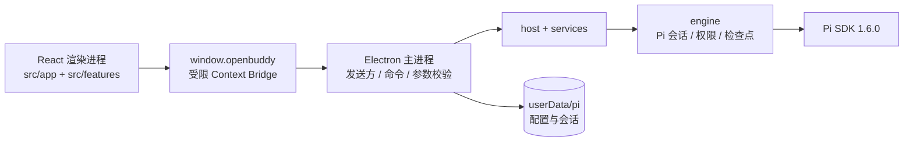

# 技术架构与验证

> 本文从 README 下沉而来，面向想理解实现、参与共建或排查边界问题的读者。产品定位见 [根目录 README](../README.md)，功能可用性见 [功能状态总表](FEATURE-STATUS.md)。

## 分层



渲染进程启用 `contextIsolation` 与 `sandbox`，关闭 `nodeIntegration`，由 CSP 限制脚本执行；导航与弹窗被拦截，外链只允许 HTTP/HTTPS。主进程在调用服务前校验发送窗口、顶层 frame、命令白名单与参数结构。

能力发现是运行时完成的：渲染层调用 `host_capabilities` 获取当前宿主支持的命令 / 事件集合，界面只展示宿主真能服务的入口（`apps/web/src/app/state/capabilities-store.ts`）。浏览器预览没有宿主，入口隐藏属预期行为。

## 代码结构

仓库是 pnpm workspace。各包以 TypeScript 源码形式被引用：`tsconfig.base.json` 的 paths（主进程 esbuild 也读取）和对应的 Vite / Vitest 别名把 `@openbuddy/<包>[/<子路径>]` 映射到 `packages/<包>/src/…`，没有单独的包构建步骤。

```text
apps/desktop      Electron 宿主：main/、preload/、ipc/register.ts、scripts/
apps/web          React 渲染层：src/app（外壳、命令面板、路由）、src/features/*、src/shared/*
apps/mobile       移动端壳与相关验证脚本
packages/protocol IPC 契约（命令、事件）与 DTO 类型
packages/kernel   宿主端口（事件、shell、密钥、时钟、日志）与参数校验（纯 TS）
packages/services 配置、模型提供商、MCP、技能、文件、预览（Node）
packages/engine   Pi 会话引擎、权限、扩展 UI 桥、检查点、产物（Node）
packages/host     IPC 命令处理与文件 / 工作区访问校验（Node）
packages/client   渲染层 IPC 客户端
packages/chat-core 无 UI 的对话逻辑：回合分组、工具摘要、diff、导出、错误文案
packages/platform 平台工具（剪贴板、平台识别）
packages/ui       图标、Toast、ImageLightbox、ThemeProvider、LetterAvatar、设计 token
packages/markdown Markdown 渲染管线与代码块操作
tools/            边界检查、搬家 codemod、IPC 审计、验证脚本
```

依赖方向由 `tools/check-boundaries.mjs` 约束，并在 `pnpm test` 中执行。分层、禁用模块、直接访问桥接、跨功能依赖、循环、不可达文件、超长文件任一类别超过 `tools/boundaries-baseline.json` 基线时测试失败。Electron 专属 API 只能放在 `apps/desktop`；`protocol`、`client`、`chat-core` 不依赖 Node 与 React，便于 Web 或移动端外壳复用。

各包自己的 README（`packages/*/README.md`）记录了搬迁阶段与端口细节；重构计划见 `docs/plan/20261115-md.md`。

## 环境与构建

| 依赖 | 版本 |
| :--- | :--- |
| Node.js | `>= 22.19.0`（建议 Node 24） |
| pnpm | `10.29.3` |
| Electron | `45.3.0`（已精确固定） |
| Pi SDK | `@earendil-works/pi-coding-agent` `1.6.0`（已精确固定） |

本机 arm64 二进制实测环境为 Electron `45.3.0` / Node `24.22.2` / Chromium `156.0.8078.96`。

```sh
pnpm install --frozen-lockfile
pnpm dev:electron      # 原生桌面开发（需要本地能力时使用）
pnpm test              # 单元测试与边界检查
pnpm build:electron    # 构建主进程与渲染层
pnpm pack:electron     # 生成免安装目录产物
pnpm dist:electron     # 按当前平台生成安装包
```

`pnpm dev` 只启动浏览器 Vite 预览，不提供原生平台能力；修改主进程或 preload 后需要重启 `pnpm dev:electron`。打包默认使用当前平台：`pnpm dist:mac` 生成 DMG，`pnpm dist:win` 生成 NSIS，产物输出到 `release/`。

## 常用检查

```sh
pnpm typecheck          # 渲染层 + 主进程类型检查
pnpm check:boundaries   # 模块边界对照基线检查
pnpm audit:ipc          # IPC 契约审计
pnpm check:docs         # 用户文档链接与结构检查
pnpm verify:e2e         # 真实 Electron 走查（需先构建；Linux 需 xvfb）
```

## 验证闭环

```sh
pnpm audit:ipc
pnpm build:electron
pnpm test:electron-ui
pnpm test:electron-ui --main=release/mac-arm64/OpenBuddy.app/Contents/Resources/app.asar/dist-electron/main.js
```

覆盖矩阵写到 `release/contract-matrix.json`，区分静态调用、路由可达性与运行验证。`test:electron-ui` 会启动真实 Electron 进程，使用临时 bootstrap 与独立 userData，加载指定的 main 模块，并通过本地 HTTP fixture 验证模型选择、思考、提问、图片、队列与分叉；它不使用用户凭据，也不等同于安装、公证或 Gatekeeper 验收。`--native-dialogs` 需要操作者现场确认真实原生对话框。

独立启动真实可执行文件时，可用 `OPENBUDDY_SMOKE_TEST=1` 做自动启动冒烟，截图与日志会标注临时目录。

## 当前边界

- 云存储、团队云协作、自定义 TUI 组件暂缓；不可用命令返回明确的 `not_implemented` 错误。
- Electron 版安装包体积与内存占用高于旧 Rust 外壳。
- macOS 签名 / 公证、Windows 签名需要单独配置凭据并实际安装验证。
- CI 只产出未签名审核包；tag 构建会挂载 Release 产物，但不等于完成公证与跨平台验收。
