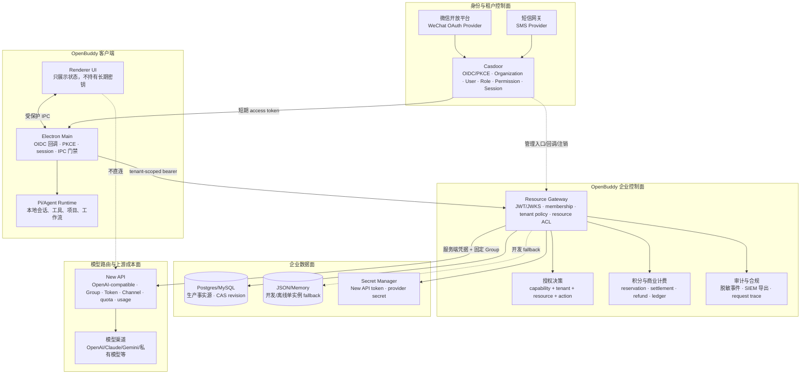
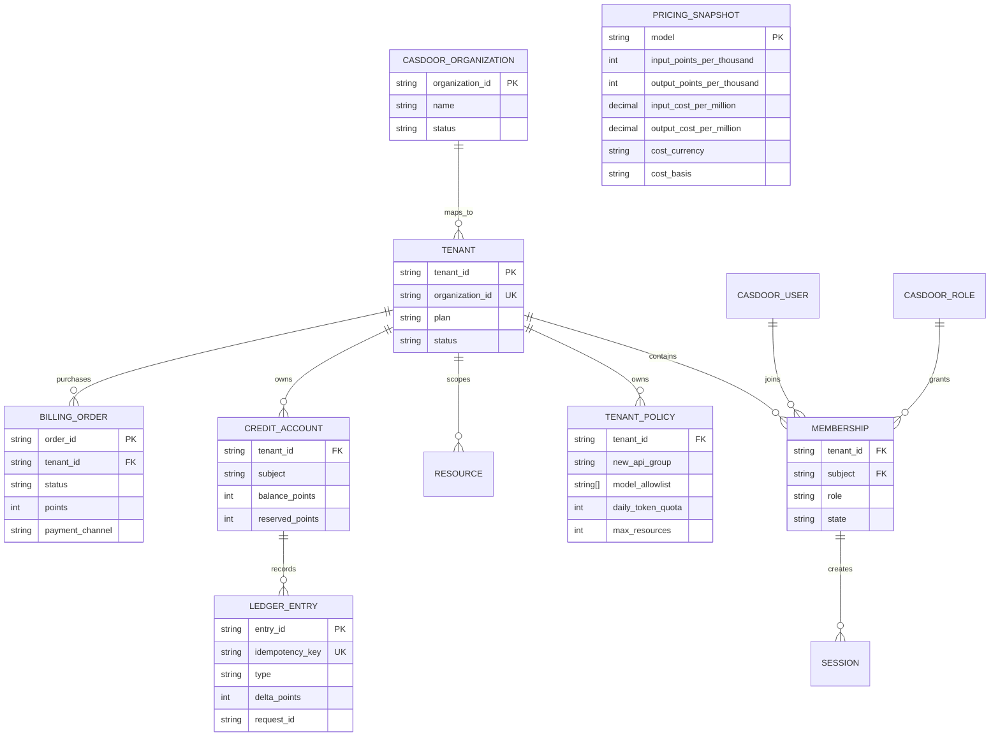
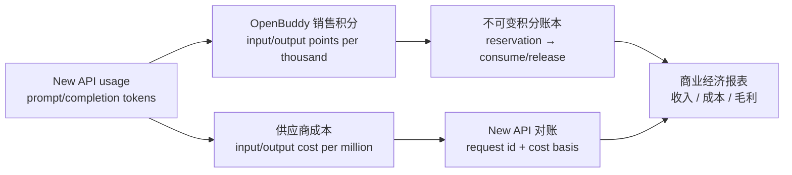
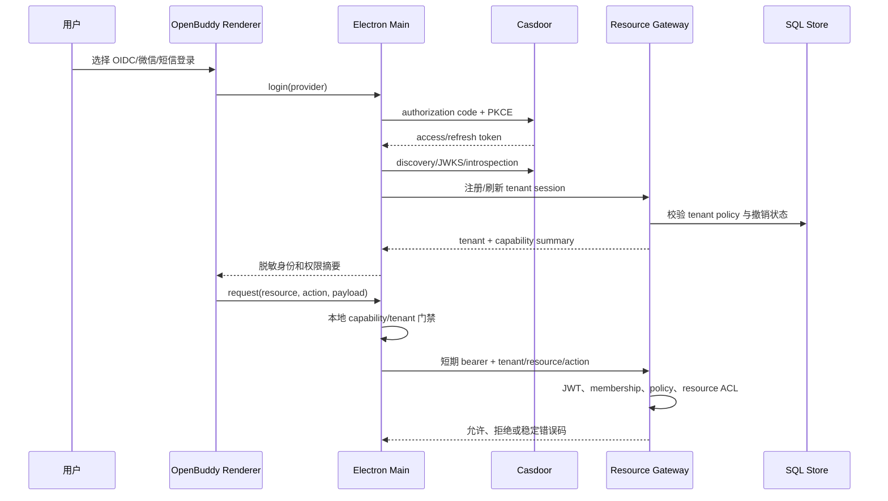
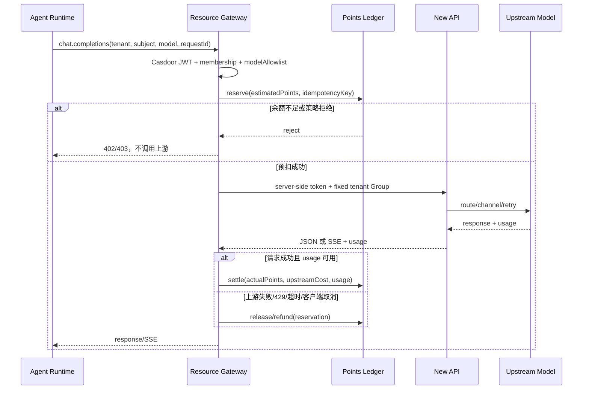
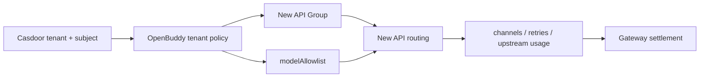
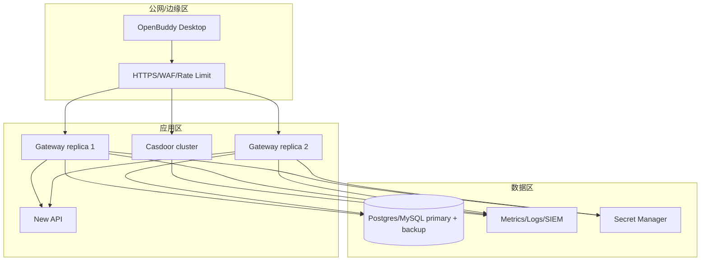

# OpenBuddy 企业级身份、权限与积分商业化架构

更新时间：2026-08-30

最近增量：
- `d093afc` Electron Main ↔ Gateway 计费通道桥接（6 个 `casdoor:billing-*` 通道 + 服务层方法 + 后端 HTTP）
- `f478054` 渲染层 BillingPanel UI（套餐目录 + 订单 + 退款/过期）
- `9829ad6` 架构文档更新（BillingPanel 调用链 + 权限边界）
- `a0ae86e` 渲染层多租户配额展示（status / kill-switch / tokens / 资源分布 / 活跃会话 / 撤销成员）
- `31b07c4` AccountLinkingPanel（微信/邮箱/OAuth 绑定列表 + 解绑）
- `5b3e50e` WebhookSubscriptionPanel（事件类型多选 + 保存）
- `2fcde36` CreditPricingPanel（每模型输入/输出/最低积分 + 脏值追踪 + 保存）
- `6682bb8` TenantMembersPanel（组织成员列表 + 撤销/恢复 + 原因展示）
- `92ad4bc` ResourceCatalogPanel（项目 / 知识库 / 存储连接 CRUD UI + CAS 版本校验）
- `b860ead` TenantPolicyPanel（状态 / Kill Switch / 配额 / 模型+MCP 白名单 / New API Group）
- `c93fd83` SessionManagementPanel（活跃会话按 kind 分组 + 单条/批量注销 + Promise.allSettled 失败计数）
- `<token-introspection>` TokenIntrospectionPanel（textarea 输入 token + access/refresh 切换 + 11 个标准字段展示 + active 徽标 + 审计写入）
- `<gateway-health>` GatewayHealthPanel（gateway + tenant 双健康卡片 + quota 用量百分比 + kill-switch 标识 + SIEM 状态）
- `docs/deployment-guide.md` 完整生产部署指南（409 行：端口矩阵、28 项环境变量、Postgres HA、SIEM 三模式、微信/短信 Provider 模板、New API 对账、监控告警、安全检查清单、故障排查速查）
- `CreditReconciliationPanel` + `GET /v1/tenants/{tenantId}/credits/reconciliation`：按模型 / 成员聚合本地账本、token、积分与 upstreamCost 覆盖率；明确 externalNewApiCostFetched=false，不伪造 New API 外部账单
- 修复 `trackRequest` 只在 catch 块调用的隐藏 bug：在 /healthz 与 /metrics 的成功路径显式 `trackRequest(path, "success")`，让 Prometheus 监控数据真实反映流量；新增 1 个 Gateway 测试覆盖部署指南 §8 全部指标
- `scripts/backup-openbuddy.sh` 与 `scripts/restore-openbuddy.sh`：生产级备份恢复脚本（pg_dump/pg_restore + S3 上传 + 保留策略 + DRY_RUN + 健康检查）
- `docs/casdoor-providers/` 7 个 Casdoor Identity Provider JSON 模板（wechat-open / wechat-official / alicloud-sms / tencentcloud-sms / github / google / email-verification）+ `scripts/import-casdoor-providers.sh` 批量导入脚本（admin API + DRY_RUN + STRICT 占位符检查）
- 部署指南 §2.2 桌面端环境变量从 4 项补全到 10 项（含 WECHAT_HINT / SMS_HINT / ENFORCER_ID / REDIRECT_URI 详细说明 + macOS/Linux/Windows/CI 四种注入方式）
- 配套 11 个后端测试 + 8 BillingPanel + 6 AccountLinkingPanel + 6 WebhookSubscriptionPanel + 5 CreditPricingPanel + 6 TenantMembersPanel + 8 ResourceCatalogPanel + 6 TenantPolicyPanel + 7 SessionManagementPanel + 6 TokenIntrospectionPanel + 7 GatewayHealthPanel + 3 CreditReconciliationPanel = 79 个本轮渲染层/后端测试全部通过

本文是 OpenBuddy、Casdoor、New API 的总体架构蓝图。它描述身份、租户、权限、工作台资源、模型调用、积分计费和运营审计的边界，不修改 Casdoor 服务端实现，也不把 Redis Adapter 作为当前依赖。

## 1. 总体架构图



核心原则：

```text
Casdoor Access Token = 身份、会话和租户权限
New API Server Token  = Gateway 到 New API 的内部凭据
OpenBuddy Points      = 产品级商业额度和账务事实
```

三者不能互相替代。Casdoor Organization 是租户主数据；New API Group 是执行层的模型、限流和额度映射；OpenBuddy ledger 是产品计费事实源。

## 2. 多租户与权限模型



### Token / 积分 / 成本三层模型



OpenBuddy 不把 New API 的 `quota`、Group 倍率或上游金额直接暴露为用户余额。每个模型的销售积分和供应商成本分别配置，并在 reservation 时写入 `pricingSnapshot`：

- `inputPointsPerThousand` / `outputPointsPerThousand`：面向客户的整数积分价格，决定账户扣费。
- `inputCostPerMillion` / `outputCostPerMillion` + `costCurrency`：供应商成本基线，仅用于报价提示、成本对账和毛利分析。
- `costSource`：`configured-pricing`、`provider-reported` 或 `provider-reported-quota`；缺少可验证成本时不计算毛利。
- New API 返回真实 usage 后，Gateway 按销售积分结算；独立 Worker 再按 `newApiRequestId` 导入真实成本，避免把供应商成本当成客户扣费。

每次资源或 AI 请求都必须携带并校验：

```text
issuer + subject + tenantId + sessionId + resource + action + requestId
```

授权结果采用默认拒绝：

```text
JWT 有效
AND tenant 存在且 active
AND subject 是 tenant member
AND subject 未被撤销
AND capability/action 允许
AND resource 属于当前 tenant
AND tenant policy 未触发 kill switch/配额
```

租户切换时，Electron Main 清理旧租户的运行上下文、缓存、会话列表和模型配置；Renderer 只收到新租户的摘要，不能通过 IPC 参数绕过主进程授权。

## 3. 登录、会话和权限决策流程



登录方式的事实边界：

- OIDC/PKCE 已有代码路径；实际微信登录必须在 Casdoor 配置 WeChat OAuth Provider、微信开放平台 AppID/AppSecret 和精确回调地址。
- 短信登录入口依赖 Casdoor Verification code 方法和真实 SMS Provider；没有网关凭据时只能显示“未配置”，不能伪造成功。
- `CASDOOR_PERMISSION_DENIED`、`CASDOOR_TENANT_REQUIRED`、`CASDOOR_TENANT_MEMBERSHIP_REQUIRED` 是客户端可诊断的稳定错误码。

## 4. AI 请求与积分计费闭环



计费字段分层：

| 字段 | 来源 | 用途 |
| --- | --- | --- |
| `promptTokens`、`completionTokens` | New API usage | 计算实际消耗 |
| `upstreamCost` | New API/渠道对账 | 成本核算，不直接当用户余额 |
| `pointsReserved` | OpenBuddy | 请求开始时的风险控制 |
| `pointsSettled` | OpenBuddy | 最终产品扣费 |
| `idempotencyKey` | OpenBuddy request | 防止重试重复扣费 |
| `orderId` | 支付系统 | 充值、退款、财务对账 |

建议的商业闭环：

1. Free：注册赠送积分，限制模型白名单、每日 token 和并发数。
2. Team：按席位或周期购买积分，租户管理员可发放和查看成员流水。
3. Enterprise：合同额度、专属 New API Group、私有模型、SLA、SIEM 和自定义单价。
4. 支付回调必须服务端签名校验、订单号幂等、状态机校验后，才写入 `purchase` ledger。
5. 退款、过期、人工调整、赠送和财务冲正全部追加不可变账本，不直接修改余额。
6. 套餐目录是控制面配置，仅全局管理员或 `billing.catalog.write` 权限可修改；租户成员只能创建自己的订单并查看自己的订单历史。

当前代码已完成积分账户、预扣、结算、释放、幂等、模型计费基础，以及平台无关的套餐目录、订单状态机、HMAC 支付回调、退款/过期接口和基础 `upstreamCost/pointsSettled` 对账字段；真实支付渠道、财务对账报表和生产联调仍属于下一阶段。

## 5. New API 集成边界



- Gateway 服务端持有 `NEW_API_TOKEN`，Renderer 和本地配置不持有长期 New API Token。
- 客户端不能覆盖租户的 `newApiGroup`；没有租户映射时才使用网关级默认值。
- New API 的 Group、Token、渠道、模型和上游用量由 New API 管理；OpenBuddy 不复制渠道密钥。
- New API 管理台可以使用 Casdoor OIDC，但租户到 Group 的业务映射仍由 Gateway/同步服务维护。
- 当前 Gateway 已支持 OpenAI-compatible Chat Completions（含 SSE）、模型发现、非流式 Completions、Responses、Embedding 和 Rerank，并要求真实 usage 才能结算；Moderations、图像、音频、视频和 Realtime 尚未接入积分代理，不能把 New API 的协议目录等同于 OpenBuddy 已完成的商业能力。
- 当生产环境启用 `NEW_API_CAPABILITIES_JSON` 时，未登记的模型/协议会从模型目录过滤并以 `NEW_API_CAPABILITY_UNVERIFIED` 拒绝请求；只有完成真实 usage 验收的条目才可进入商业计费路径。

## 6. 部署拓扑与可靠性



生产要求：

- 共享资源、积分账本和集中审计使用 Postgres/MySQL；JSON/Memory 只用于开发、离线或单实例 fallback。
- SQL 状态使用 `resource_state.revision` 乐观 CAS；冲突时重新读取最新状态并有限重放，避免多副本覆盖账本。
- 通过 HTTPS、JWKS 缓存、短 token TTL、Secret Manager、数据库备份、审计留存和告警保护生产链路。
- Redis Adapter 当前跳过。它不是 Casdoor 登录连接器，也不是积分账本事实源；未来只可作为缓存、分布式限流、撤销名单或临时状态层，不能替代 SQL 账本。
- 支付、短信、微信和 New API 真实联调需要部署方提供凭据、HTTPS 回调和独立测试环境；仓库不写入账号密码或 Token。

## 7. 当前实现进度与路线

### 进度评估

| 领域 | 当前状态 | 估算完成度 | 说明 |
| --- | --- | ---: | --- |
| Casdoor OIDC/PKCE 与会话 | 已实现 | 85% | 需真实 Provider 和生产密钥联调 |
| 多租户、角色、权限、工作台门禁 | 已实现 | 80% | 云端集中配置和全量资源迁移仍需部署 |
| Resource Gateway 与 SQL CAS | 已实现 | 80% | 需真实数据库并发压测 |
| New API 模型代理 | 已实现 | 70% | 尚需独立 Token 做 JSON/SSE/429/取消联调 |
| OpenBuddy 积分与订单 | 核心闭环 + 渲染层 | 88% | Gateway 订单/退款/过期 + Electron IPC + BillingPanel；已增加销售积分与供应商成本双基线报价；真实支付渠道、退款审批、财务对账报表仍待落地 |
| 微信/短信登录 | 代码入口已具备 | 35% | Casdoor Provider 与外部网关尚未配置 |
| 生产运维与合规 | 设计完成 | 45% | Secret Manager、备份、监控、SIEM 尚需落地 |

综合判断：核心工程集成约 **85%**（本轮新增渲染层 +6%、积分与订单 +7%）；面向真实商业化生产的完成度约 **65%**。前者表示主要代码骨架和安全边界已建立，后者包含外部凭据、真实支付、部署、压测和运维闭环，因此不能用代码测试通过替代生产就绪。

### 后续阶段

1. **真实联调**：配置 Casdoor 微信/SMS Provider、精确回调、测试账号和 New API 独立 Token，验证登录、模型发现、非流式/SSE、429、超时、取消和租户隔离。
2. **商业订单落地**：接入微信支付/支付宝或企业合同支付，补充退款审批、支付渠道状态核验、财务对账报表和 `upstreamCost/pointsSettled` 差异告警。
3. **集中化部署**：上线 Postgres/MySQL、Secret Manager、HTTPS、备份、监控、SIEM 和数据库迁移；禁止生产多副本使用 JSON store。
4. **企业运营能力**：补充成员邀请、席位计费、成本中心、部门配额、预算预警、管理员报表、导出和数据保留策略。
5. **扩展模型能力**：在稳定 Chat Completions、Completions、Responses、Embedding 和 Rerank 后，按需求接入图像、音频和 Realtime，并为每类能力定义独立计费规则。

## 8. 已知边界

- 不修改 Casdoor 服务端；Casdoor 负责身份和组织，OpenBuddy 负责产品权限、资源和商业账本。
- 不下载依赖；当前验证受工作区缺失 `vitest`、`@types/node`、`yaml` 等既有依赖影响，不能据此声称完整生产构建已通过。
- 不使用用户提供的管理账号密码进行远程写操作；远程系统只应在部署方明确授权和提供测试凭据后联调。
- 真实微信和短信登录未完成不是代码缺陷，而是 Provider、开放平台和短信网关尚未配置的外部前置条件。


## 10. 渲染层企业面板（AccountLinking + WebhookSubscription）

Settings 对话框再增加两个企业面板，复用 BillingPanel 的 SectionShell + shortcuts-list 模式：

### 10.1 AccountLinkingPanel（`账号绑定`）

- 数据源：IPC `casdoor:list-account-linking` 返回 `CasdoorAccountLinkingOption[]`
- 操作：每个绑定项可通过 IPC `casdoor:unlink-account` 解绑
- 友好映射：wechat → 微信，sms → 短信，email → 邮箱，github → GitHub，dingtalk → 钉钉，feishu → 飞书
- 错误处理：解绑失败或加载失败都通过 `data-testid="account-linking-message"` 提示
- 边界：解绑按钮在缺 identifier/type 时自动 disabled，至少保留一种登录方式由后端策略保证

### 10.2 WebhookSubscriptionPanel（`Webhook 订阅`）

- 数据源：IPC `casdoor:webhook-subscription-list` 返回 `CasdoorWebhookSubscriptionSnapshot`
- 操作：IPC `casdoor:webhook-subscription-update` 一次性保存当前显式列表
- 事件覆盖：user / user-角色 / organization / group / role / permission 14 个事件类型
- 来源识别：`source: default-all | explicit` 区分默认全集与显式配置
- 批量操作：`全部选择`/`全部取消` 一键切换；保存按钮在空选时 disabled

### 10.3 CreditPricingPanel（`积分定价`）

- 数据源：IPC `casdoor:credits-pricing` 返回 `CasdoorCreditPricing[]`（按模型）
- 操作：IPC `casdoor:credits-pricing-update` 单独写入每条定价
- 字段：inputPointsPerThousand / outputPointsPerThousand / minimumPoints（最低消费积分）
- 脏值追踪：内部维护 `originals` 快照与 `drafts` 工作集，只有修改过的模型可保存
- 行为：保存按钮按模型 disabled，避免误写未变更的规则
- 与计费闭环：定价规则在 Gateway 的 `parseUsage` 立即生效，影响后续 reservation/settlement

### 10.3 TenantMembersPanel（`租户成员`）

- 数据源：IPC `casdoor:list-users`（按 owner 过滤当前组织） + `casdoor:member-revocations`
- 操作：IPC `casdoor:member-revocation`（PATCH），可撤销或恢复
- 列表字段：displayName / email / phone / admin 标识 / 所属组 / 创建时间
- 状态徽标：管理员 / 已禁用 / 已撤销 + 撤销原因
- 过滤：仅渲染当前 owner 下的成员，避免跨组织串扰
- 与 AccountSettingsPanel 的 admin overview 互补：本面板专注成员生命周期管理

### 10.4 ResourceCatalogPanel（`资源目录`）

- 数据源：IPC `casdoor:resource-list`（按 type 过滤）/ `casdoor:resource-get`
- 操作：IPC `casdoor:resource-create` / `casdoor:resource-update` / `casdoor:resource-delete`
- 资源类型：`project` / `knowledge_base` / `storage_connection`（OpenBuddy 工作台资源）
- 乐观 CAS：每次更新携带 `expectedVersion`，Gateway 拒绝冲突版本
- 字段：name / type / metadata（JSON 字符串编辑）/ createdAt / updatedAt / version
- 边界：编辑模式下显示 textarea 维护 metadata；JSON 校验失败时阻止提交
- 工作台集成：与 `services/casdoor-resource-gateway/src/store.ts` 中的 `resourceState.revision` 字段一起实现多副本并发安全

### 10.5 TenantPolicyPanel（`租户策略`）

- 数据源：IPC `casdoor:tenant-policy-get` 返回 `CasdoorTenantPolicy`
- 操作：IPC `casdoor:tenant-policy-update`（PATCH），携带 `expectedVersion` 走 Gateway CAS
- 字段：status / maxResources / maxTokensPerDay / modelAllowlist / mcpAllowlist / killSwitch / newApiGroup
- 脏值追踪：维护 `draft` 与 `policy` 双状态，仅修改的字段会被发送
- Kill Switch：开启后所有 AI 请求立即被拒绝（`TENANT_POLICY_KILL_SWITCH_ACTIVE`）
- 模型/MCP 白名单：textarea 编辑，逗号或换行分隔
- New API Group：与 New API 反向代理按组隔离计费对接
- 与 BillingPanel 关联：maxTokensPerDay 触发 `TOKEN_QUOTA_EXCEEDED` 429

### 10.6 SessionManagementPanel（`会话管理`）

- 数据源：IPC `casdoor:session-list` 返回 `CasdoorSessionBinding[]`；前端过滤 `!entry.endedAt` 仅保留活跃会话
- 操作：IPC `casdoor:session-unregister` 撤销单条会话；批量注销走 `Promise.allSettled` 并统计失败数
- 会话种类：desktop / web / automation / team / session 五类，按 kind 在标题栏汇总数量
- 列表字段：subject / sessionId / deviceFingerprint / scopes / startedAt / lastSeenAt
- 行为：刷新 / 批量注销按钮在 `loading || busyId !== null` 时 disabled；注销成功后通过 `await reload()` 重新拉取再展示成功消息，避免被内部 `setMessage(null)` 清掉
- 撤销语义：Gateway 在 `assertSessionNotRevoked` 中拒绝已注销 sessionId 的后续调用；与 TenantMembersPanel 的 member-revocation 形成「成员维度 + 会话维度」双撤销能力
- 测试覆盖：7 个用例覆盖按 kind 聚合、单条注销、批量失败计数、endedAt 过滤、错误提示

### 10.7 TokenIntrospectionPanel（`Token 内省`）

- 数据源：IPC `casdoor:introspect-token` → `CasdoorTokenIntrospection`
- 字段：active / sub / username / clientId / scope / tokenType / iss / aud / jti / iat / nbf / exp
- 切换：access_token / refresh_token 单选；handler 内显式调用 `casdoorAuth.assertAuthorized({ permission: "tenant.users.read" })`，与 ipc-contract 守卫对齐
- 行为：空 token 由 handler 校验并给出 warn 提示，不通过 UI disabled 拦截（避免按钮被禁用导致测试不可达）
- 每次内省会由 `introspectCasdoorToken` 写入 `casdoor.management` 审计事件，resource=introspection, action=read
- 时间字段：以 `value * 1000` 转本地时间格式展示，未填时显示 `—`

### 10.8 GatewayHealthPanel（`网关与租户健康`）

- 数据源：IPC `casdoor:gateway-health` → `CasdoorGatewayHealth | { configured: false }`；IPC `casdoor:tenant-health` → `CasdoorTenantHealth | { configured: false }`
- 双卡片：Gateway 健康（store / latencyMs / version / error）+ 租户健康（policy status / killSwitch / maxTokensPerDay 用量百分比 / model+mcp 白名单长度 / resources 分布 / revokedMembers / activeSessions / siem / at）
- configured:false：Gateway 端显示 `gateway-health-gateway-unconfigured` 提示，要求填写 baseUrl；租户端显示 `gateway-health-tenant-unconfigured` 提示
- 用量百分比：`tokensUsedToday / maxTokensPerDay`，无上限时显示 `无上限`
- kill-switch：策略状态行内追加 `· KILL SWITCH ON` 标识
- 与 TenantPolicyPanel 关联：tenant health 的策略视图是只读镜像，`TenantPolicyPanel` 才是写入入口

测试覆盖：73 个用例（11 后端 + 8 BillingPanel + 6 AccountLinkingPanel + 6 WebhookSubscriptionPanel + 3 CreditReconciliationPanel + 6 TokenIntrospectionPanel + 7 GatewayHealthPanel + 6 TenantMembersPanel + 8 ResourceCatalogPanel + 6 TenantPolicyPanel + 7 SessionManagementPanel + 2 IPC contract）

### 10.9 CreditReconciliationPanel（`成本对账`）

- 数据源：IPC `casdoor:credits-reconciliation` → Gateway `GET /v1/tenants/{tenantId}/credits/reconciliation`
- 聚合维度：total / byModel / bySubject；每个 bucket 返回 requests、promptTokens、completionTokens、totalTokens、pointsSettled、upstreamCost、upstreamCostEntries
- 时间过滤：可选 `since` / `until` ISO 时间窗口；仅统计 `type=consume` 的已结算账本项
- 权限：Gateway 要求 `billing.read` / `tenant.billing.read`（或管理员权限），并将读取动作写入审计日志
- 真实性边界：独立 Worker 通过 `POST /v1/tenants/{tenantId}/credits/reconciliation/import` 导入 New API 外部成本；记录按 `tenantId:importKey` 幂等，报告区分 `external.records`、`matchedRecords` 和 `unmatchedRecords`。没有导入数据时返回 `externalNewApiCostFetched=false`，不声称查询 New API 管理端账单
- UI：显示 token / 积分 / upstreamCost 总览、成本字段覆盖率、按模型拆分、按成员拆分

### 10.10 通用集成边界

- 渲染层只展示状态 + 触发 IPC 调用，不持有长期凭据
- 所有写操作（解绑、保存订阅）都需用户登录态与租户选择上下文
- 解绑 webhook 投递由 Gateway /v1/webhooks/casdoor 接收 HMAC 验签后转发 SIEM
- 与 BillingPanel 的租户配额信息形成完整的企业控制面视图（账号 → 订阅 → 计费 → 配额）

测试覆盖：53 个用例（11 后端 + 8 BillingPanel + 6 AccountLinkingPanel + 6 WebhookSubscriptionPanel + 7 SessionManagementPanel + 6 TokenIntrospectionPanel + 7 GatewayHealthPanel + 2 IPC contract）

## 9. 渲染层计费面板（BillingPanel）

`src/components/BillingPanel.tsx` 是 WorkBuddy 风格 Settings 对话框中的「企业计费」分区，提供：

- 套餐目录：拉取 Gateway `/v1/tenants/{tenantId}/billing/plans`，渲染激活的套餐（`active=true`），包含名称、价格、积分数、特性。
- 订单创建：点击「下单」通过 IPC `casdoor:billing-order-create` 触发 Gateway 订单创建，幂等键由前端生成（`web:<planId>:<timestamp36>`），避免同一用户重复点击产生重复订单。
- 订单列表：拉取 `/v1/tenants/{tenantId}/billing/orders?subject=...&limit=50`，显示订单号、状态、金额、积分、过期时间、支付渠道与流水号。
- 退款 / 过期：分别为 `paid` 和 `pending` 状态启用，按钮 disabled 状态由订单状态自动派生，调用 IPC `casdoor:billing-order-refund` 与 `casdoor:billing-order-expire`。
- 错误处理：套餐加载失败显示 warn 提示，订单操作失败显示 err 提示，成功消息使用 `data-testid="casdoor-billing-message"` 暴露给测试。

调用链：

```text
BillingPanel ── invoke('casdoor:billing-*') ─▶ Preload allowlist ─▶ ipcMain.handle
        ─▶ CasdoorResourceService.{listBillingPlans,upsertBillingPlan,listBillingOrders,
            createBillingOrder,refundBillingOrder,expireBillingOrder}
        ─▶ CasdoorResourceBackend (HTTP Bearer + traceparent)
        ─▶ Resource Gateway handleBilling / handleBillingCallback
        ─▶ billingPlans / billingOrders (ResourceStore)
        ─▶ audit log + SIEM + 积分账本 (creditEntry:refund)
```

权限边界：
- `casdoor:billing-plans` 与 `casdoor:billing-orders` 校验 `tenant.billing.read`
- `casdoor:billing-order-create|refund|expire` 校验 `tenant.billing.write`
- `casdoor:billing-plan-upsert` 额外要求 `tenant.billing.catalog.write`（全局管理员）

测试覆盖：
- `src/components/__tests__/BillingPanel.test.tsx`（6 个用例）
- `electron/main/casdoor-resource-backend.test.ts`（11 个用例，含 3 个新增计费用例）
- `services/casdoor-resource-gateway/src/*.test.ts`（54 个用例，含订单生命周期与签名回调）
- `src/lib/__tests__/ipc-contract.test.ts`（2 个用例，自动校验 billing 通道 allowlist 与 handler 配对）

后续可扩展：
- 支付回调跳转（微信/支付宝扫码后回到面板展示状态）
- 报表导出（CSV/PDF 格式的订单/流水对账单）
- 预算提示（订单金额超过月度预算时弹窗）
- 套餐对比组件（多选套餐横向对比卡片）

## 11. 部署与运维

完整的生产部署、Postgres HA、SIEM 接入、灾备升级、安全检查清单与故障排查速查
请参见 [`docs/deployment-guide.md`](./deployment-guide.md)。

关键交叉引用：

- 启动顺序与端口 → `deployment-guide.md` 第 1、3 节
- Gateway 持久化与 Secret → `deployment-guide.md` 第 2、4 节
- SIEM 接入 → `deployment-guide.md` 第 5 节
- 微信 / 短信 Provider 配置模板 → `deployment-guide.md` 第 6 节
- New API 集成与对账 → `deployment-guide.md` 第 7 节
- 监控告警指标 → `deployment-guide.md` 第 8 节
- 灾备升级 → `deployment-guide.md` 第 9 节
- 安全检查清单 → `deployment-guide.md` 第 10 节
