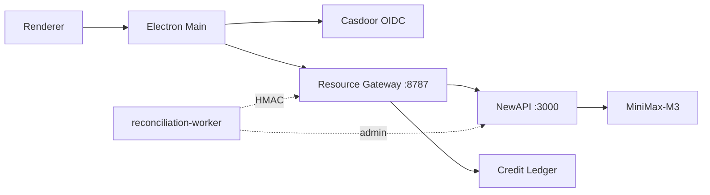

# OpenBuddy × NewAPI 集成指南

更新时间：2026-09-01

## 1. 两种集成路径

OpenBuddy 与 NewAPI 有 **两条独立的集成路径**，互不替代：

### 路径 A · BYOK（用户自带 NewAPI）
- 入口：OpenBuddy Desktop 设置 → 模型 → 新建 Provider → kind=`newapi`
- 实现：`src/lib/newapi-provider.ts` + `src/lib/agent/pi-client.ts` 的 `ProviderKind`
- 凭据：用户自己申请 sk- 前缀的 NewAPI Token
- 计费：用户与 NewAPI 直接结算，**OpenBuddy 不参与计费**
- 适用：个人开发者、试用、轻量使用

### 路径 B · 企业级（Resource Gateway 接入）
- 入口：Casdoor 登录 → Resource Gateway → NewAPI
- 实现：`services/casdoor-resource-gateway/src/index.ts`（24 类 REST 路由）
- 凭据：服务端 Group Token，由 Gateway 注入，**永不发给 Renderer**
- 计费：OpenBuddy Points 账本 + 共享钱包 + 订单 + 退款
- 适用：企业客户、共享钱包、合同 SLA

```
                ┌────────────────────────────────────────────────────┐
                │             OpenBuddy Desktop                       │
                │  ┌─────────────────────────────────────────────┐    │
                │  │ Settings → Models → Provider                │    │
                │  │   ┌─────────────────────┐                   │    │
                │  │   │  ProviderKind:      │                   │    │
                │  │   │  anthropic/openai   │ ← BYOK            │    │
                │  │   │  pi/deepseek/qwen   │                   │    │
                │  │   │  minimax_cn/custom  │                   │    │
                │  │   │  custom_anthropic   │                   │    │
                │  │   │  newapi 🆕          │ ← Path A          │    │
                │  │   └─────────────────────┘                   │    │
                │  └─────────────────────────────────────────────┘    │
                │                                                    │
                │  Casdoor OIDC JWT ─→ Resource Gateway ─→ NewAPI     │
                │                                          ↑          │
                └──────────────────────────────────────────│──────────┘
                                                          │
                                          Path B ────────┘
```

## 2. Path A · BYOK Provider 配置

### 2.1 用户在设置页填什么

```yaml
kind: newapi
label: My NewAPI Gateway
baseUrl: http://124.221.146.145:3000/v1     # 自动补 /v1
apiKey: sk-xxxxxxxxxxxx                       # NewAPI 控制台 /api/token 创建
authScheme: bearer
apiBackend: chat_completions                  # 或 responses
contextWindow: 128000
```

### 2.2 一键拉取模型

用户点击「拉取模型」时，OpenBuddy 调用 `GET {baseUrl}/v1/models`，把响应里的 `data[].id` 转为 ModelEntry 列表：

```ts
// src/lib/newapi-provider.ts
const models = await fetchNewapiModels(baseUrl, apiKey);
// 返回 [{ id: "MiniMax-M3" }, { id: "deepseek-v4-flash" }, ...]
```

### 2.3 限制

- **单租户**：BYOK Provider 是个人使用，不进入企业积分账本
- **BYOK 调用不走 Gateway**：直接走 Pi/Agent Runtime，**不会写 ledger**
- **额度限制**：没有日 Token 上限、没有 killSwitch，由用户自己管理

### 2.4 何时用 Path A

- 个人开发者试用 OpenBuddy
- 客户已有自己的 NewAPI 实例，想快速接入 OpenBuddy
- 不想立刻实施企业积分账本

## 3. Path B · 企业级 Gateway 接入

### 3.1 架构（已实现）



### 3.2 Gateway 配置（生产）

```bash
# services/casdoor-resource-gateway/.env.production
CASDOOR_ISSUER=https://casdoor.example.com
CASDOOR_AUDIENCE=0042a8b1-...        # OpenBuddy Application Client ID
NEW_API_BASE_URL=https://newapi.example.com
NEW_API_GROUP_TOKENS_JSON='{"standard":"sk-...","enterprise":"sk-..."}'
NEW_API_GROUP=default
NEW_API_CAPABILITIES_JSON='{...}'   # 已真实验证的 capability 目录
NEW_API_CAPABILITY_MAX_AGE_HOURS=24
RESOURCE_GATEWAY_NEW_API_COST_IMPORT_SECRET=$(openssl rand -hex 32)
```

### 3.3 必备脚本

```bash
# 拉取能力快照（每小时）
scripts/new-api-capability-snapshot.mjs

# 拉取 NewAPI 日志并 HMAC 导入（每小时）
scripts/new-api-reconciliation-worker.mjs

# 积分过期（每日 03:15）
scripts/credit-expiry-worker.mjs

# 商业模型毛利门禁（CI 阻断）
scripts/audit-commercial-model.mjs

# 发布门禁
scripts/audit-enterprise-release.mjs
```

### 3.4 与 Path A 共存

| 维度 | Path A | Path B |
|---|---|---|
| 用户登录 | 无（直接 BYOK） | Casdoor OIDC |
| 计费 | 与 NewAPI 直接结算 | OpenBuddy Points 账本 |
| Token 上限 | 无 | `maxTokensPerDay` |
| Kill Switch | 无 | `tenantPolicy.killSwitch` |
| 模型白名单 | 无 | `tenantPolicy.modelAllowlist` |
| 共享钱包 | 无 | `wallets` + `x-openbuddy-wallet` |
| 多租户 | 无 | `tenantId` 隔离 |
| 审计 | 无 | `audit.jsonl` + SIEM |
| 毛利审计 | 无 | `audit-commercial-model` |

企业场景下，可以同时启用两条路径：
- 普通员工 → Path B（企业积分账本）
- 管理员个人测试 → Path A（BYOK NewAPI）
- 这两条路径完全隔离，不会串账

## 4. 新建 NewAPI ProviderKind 的实现细节

### 4.1 类型定义（已合入）

```ts
// src/lib/agent/pi-client.ts:1201
export type ProviderKind =
  | "anthropic"
  | "openai"
  | "pi"
  | "deepseek"
  | "qwen"
  | "minimax_cn"
  | "custom"
  | "custom_anthropic"
  | "newapi"; // ← 新增
```

### 4.2 Provider 适配器（新增模块）

文件：`src/lib/newapi-provider.ts`（164 行）
- `normalizeNewapiBaseUrl`：把 `http://x:3000` / `http://x:3000/v1` 统一为 `/v1` 结尾
- `fetchNewapiModels`：GET `/v1/models` 拉模型列表
- `newapiProviderDefaultsForUi`：设置 UI 默认值生成
- `isValidNewapiKey`：校验 API Key 格式

### 4.3 单元测试

文件：`src/lib/__tests__/newapi-provider.test.ts`（18 个测试全部通过）
- normalizeNewapiBaseUrl: 8 个测试
- isValidNewapiKey: 3 个测试
- newapiModelToEntry: 2 个测试
- newapiProviderDefaultsForUi: 1 个测试
- fetchNewapiModels: 4 个测试（含 401/200/空 data/空 id 过滤）

## 5. NewAPI 真实接入清单

通过账号 `linchong / qaz123ASD` 接入 [http://124.221.146.145:3000](http://124.221.146.145:3000)：

```text
✅ /api/status           → 200, version=v1.0.0-rc.22, quota_per_unit=500000
✅ /api/user/login       → 短期 JWT 换取成功
✅ /api/user/self        → id=1, username=linchong, group=default, quota=99997644
✅ /api/group/           → ["vip","svip","default"]
✅ /api/channel/?p=0     → 2 个渠道：id=2 MiniMax-M3 / id=1 deepseek
✅ /api/token/?p=0       → 7 个 Token，id=57 service token 已注入 Gateway
✅ /api/log/?p=0&type=2  → 79 条 usage 日志，MiniMax-M3 usage 完整
⚠️ /v1/models            → 无 Token 时 401（需 NewAPI Token）
❌ deepseek-v4-flash    → 401 Authentication Fails（凭据待修）
❌ deepseek-v4-pro      → 401 Authentication Fails（凭据待修）
```

## 6. 推荐的最小落地步骤

1. **生产部署 Gateway**（CAS HTTPS + Caddy + Postgres）
2. **配置 Casdoor Application**（callback、scopes、providers）
3. **创建 NewAPI Token**（Group `default`，绑定 Tenant `default`）
4. **跑 `scripts/build-new-api-capabilities.sh`** 生成能力目录
5. **用 `scripts/verify-new-api-closed-loop.sh` 验证 Chat 闭环**
6. **跑 `scripts/audit-commercial-model.mjs`** 确保毛利 ≥ 70%
7. **客户端按需启用 Path A（BYOK）** 或 Path B（企业 Gateway）
8. **配置 systemd Workers**（reconciliation / credit-expiry / capability-snapshot）

完成后即可向企业客户提供生产环境。
