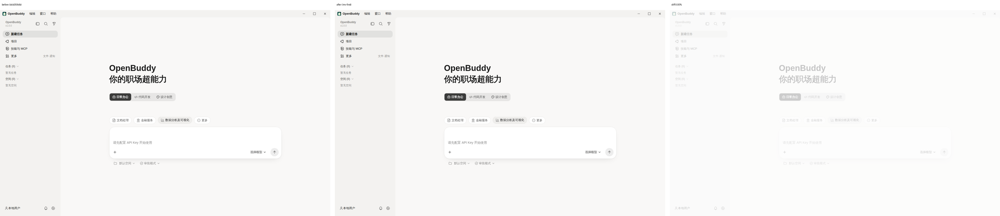
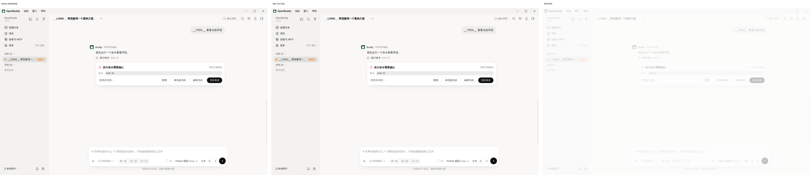
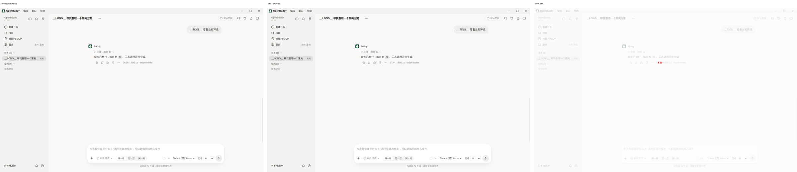
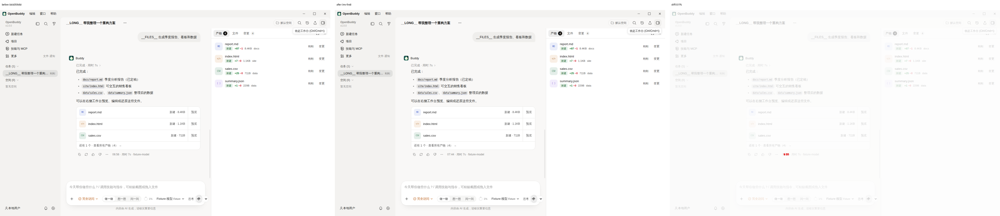
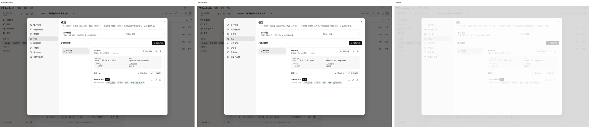
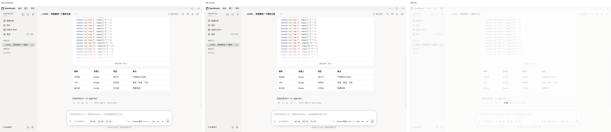
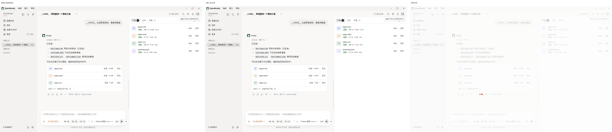
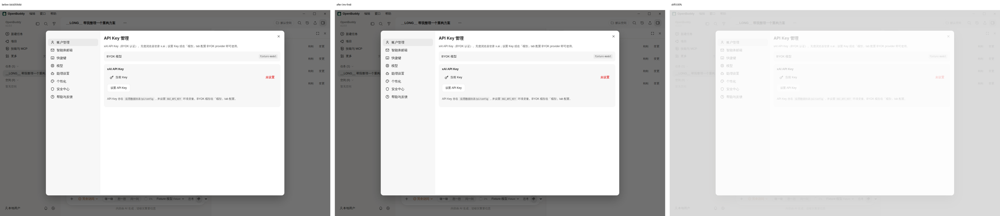
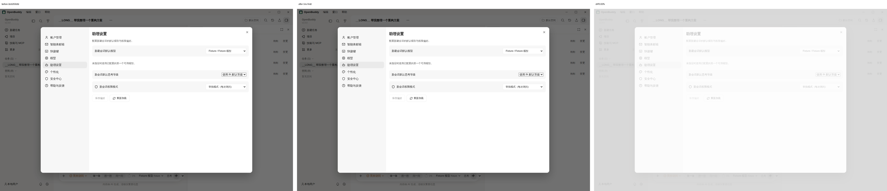
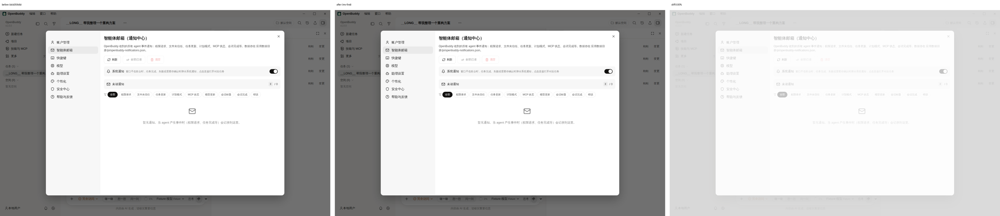

# 20261115-md — OpenBuddy 模块化重构：拆成最佳模块，为分布式 / 移动端 / SaaS 打地基

> **日期**：2026-11-14 起草（文件名按约定记为 20261115-md）
> **基线**：分支 `refactor/modularization`，从 `feat/electron-pi` @ `dcb359db` 切出（`dcb359db` 即起草时的未提交工作区）。单测 **107 个文件 / 1032 项全绿**（2026-11-14 本机 `npx vitest run`，耗时 36s）。
> **与前序文档的关系**：
> - `20261115.md` 管功能补完，`20261115-ui.md` 管对话与产物体验，`20261116-p2p.md` 管本地推理和 P2P。
> - 本文只管**代码怎么组织**，是另外三份的地基。P2P 的 iroh 隧道、SaaS、移动端都要求两件事：**引擎和宿主解耦**，**协议和传输解耦**。这正是本文的目标。
>
> **方法**：**先搬家，后装修（mv-first）**。
> 1. 先用 `git mv` 把文件原样移到目标模块，只改 import 路径，逻辑零改动。每一步测试全绿再提交。
> 2. 再在新位置上逐个模块改造。
>
> **范围**：
> - 本文是计划，不含代码改动。
> - P0–P3 是本轮要执行的。
> - P4–P6（Web/SaaS、移动端、分布式）只定义接口预留和验收口径，执行时另写计划。
>
> **注意**：`docs/` 在 `.gitignore` 第 32 行。本文件要入库需要 `git add -f`。
>
> **实施状态（2026-11-14，分支 `refactor/modularization` @ `bcf2a6f3`，未推送）**：在本文架构上完成了 `20261116-pii.md` 第一轮（18 项产品功能，见该文 §10.1），顺带推进 R1 / R5 / R8；此前 @ `47686bd0`：**P1 纯搬家已完成并真机验证；M12 已把文件对齐到 §6 的最终落点；P2 的 R1–R8 都已完成第一批（第二轮新增 R2 / R5 / R6 / R7），见下方"进度总览"与 §13.10、§13.11。截图展示页：https://claude.ai/artifact/KnPiq3DDFsRWHJJBVGMe51**（如 `pi.ts` → `pi-engine.ts`、`services/*` 分子目录、`main.ts` → `main/index.ts`、后端测试进各包 `test/`），同样只 mv。`electron/` 与 `src/` 已不存在，全部代码 `git mv` 到 `apps/{desktop,web}` 和 9 个 `packages/*`，只改了 import 路径。
> - 全程闸门：每步测试 107 个文件 / 1033 项全绿；IPC 契约摘要逐字节不变；渲染层 57 个构建产物的内容哈希与重构前**完全一致**；主进程 bundle 去掉路径注释后 0 行差异；真机 Electron 端到端走查通过，截图前后像素对比只差时间戳。
> - 按用户要求**不删除任何代码**：P0.3 / P0.4 改为把不可达文件原样搬入对应模块，由边界检查持续跟踪。
> - P3.1 边界门禁已进入 `pnpm test`（阻断）；P3.2 超长文件改为显式上限清单；P3.6 README 增加代码结构说明。
> - P2 仍遵守"不删代码"：拆分只把代码块搬进新文件；需要删除的条目（如删包装函数、删硬编码数组、删 preload 专属逻辑）继续推迟。
> - 标记：✅ 已实现并验证 · ◐ 部分完成 · ⏳ 未开始 · ⤳ 调整（见 §13.7）。证据与截图见 **§13**。


## 进度总览（截至 2026-11-16，W4 轮）

**一句话**：目录层面的模块化（P0 + P1 + M12）已经完成，全部代码在 `apps/*` 和 10 个 `packages/*` 的最终位置；"在新位置改造"（P2）的 R1–R8 都已完成第一批：宿主按 §5.3 模块化，引擎主文件 1238 → 378 行，协议拆分并加了 `host_capabilities`，新建 `kernel` 端口包，客户端拆成 `api/*`，消息模型与 reducer 进入 chat-core，Markdown 改为宿主注入，大文件拆分，循环依赖与 `electron` 禁用引用清零，分层倒挂 20 → 1。R9 数据回收没开始。全程没有删除代码，界面从最初基线到现在逐像素一致（只差消息时间）。

**pii 第一轮（`519e228b` → `bcf2a6f3`，见 `20261116-pii.md` §10.1）**：产品计划按本文 §5 的五段落点在新架构上接通了 18 项功能（W0 全部、W1.1–W1.6、W2.1–W2.3、W3.1–W3.3），同时推进了本文三项：R1 的错误模型接入、渲染层按能力显隐；R5 的 `api/host.ts`、新命令一律走 `client/api/<模块>.ts`、`PENDING_COMMANDS` 55 → 40；R8 的 FeatureRegistry。新代码没有让边界检查的任何一类增长，unreachable 47 → 43（不可达的 PlanPanel、SearchOverlay 等被接通）；独立审查发现的 10 个问题（含 4 个安全问题）已全部复现并修复。整体进度约 **59%**（上一轮 56%）：P0 90%、P1 95%、P2 36%（R1 55、R2 30、R3 45、R4 40、R5 45、R6 25、R7 30、R8 55、R9 0）、P3 67%。

**pii 第五轮（`8f24c0ec` → `0e9d0dd5`，见 `20261116-pii.md` §10.1.7）**：接通记忆全链路（W5.1–W5.3）、技能目录与我的指令（W2.7）、MCP 测试连接与即时连接卡（W2.4 主体 / W2.5）、扩展中心（W2.6）、子代理（W3.4）。对本文的意义：所有新代码仍落在 §5 的五段落点（services 的 `memory` / `prompts` / `skills` / `mcp`，engine 的 `builtin/*` 与 `features/*`，host 的模块，protocol 的独立 DTO 文件），边界门禁 `BOUNDARIES_OK`；`dto.ts` 用拆出 `protocol/src/mcp.ts`、`protocol/src/subagent.ts` 回到 938 行上限内；R5 的 `PENDING_COMMANDS` 40 → 36（`mcp_test` 直接进契约；memory / skills_catalog / prompts 由 deferred 改为真实实现），R1 新增 `agent://connector-needed`、`agent://subagent` 两个事件；R4 的 `extensions` / `mcp` 模块各增 2 / 1 条命令。整体进度约 **66%**（上一轮 59%）：P0 90%、P1 95%、P2 45%、P3 67%。

**pii 第六轮（`de724621`，见 `20261116-pii.md` §10.1.8）**：灵感改为静态场景卡（不再依赖未实现的 `inspiration_generate`）、专家团以「我的指令」+ `ob_subagent` chain 实现、资料库知识源持久化到 `library.json`（新增 `library` host 模块）、用量改由宿主 `usage_snapshot` 汇总真实 `getSessionStats()`（新增 `usage` service）。落点仍是 §5：`services/{agents,library,usage}`、`host/modules/{experts,library,host}`、`protocol/{teams,library,usage}`；引擎在 `agent_settled` 记录用量，未新增跨层依赖。边界 `BOUNDARIES_OK`，`PENDING_COMMANDS` 仍为 36（新命令直接进契约）。整体进度约 **71%**（上一轮 66%）：P0 90%、P1 95%、P2 52%、P3 67%。

**pii 第七轮（2026-11-16/17，见 `20261116-pii.md` §10.1.9）**：自动化调度与执行接通（W4.1–W4.3），随后接通运行中视图（W4.5）、通知渠道主进程化（W4.6）与文件触发（W4.7）。落点仍按 §5：`services/automation`（频率计算 + 运行记录 + 文件 watcher）、`services/notifications`（渠道配置 + 发送）、`host/modules/automation`（30 秒 tick、后台会话执行、专家 / 技能 / 连接器 / 权限按任务配置）、engine 的 `Permissions` 增加会话级完全访问放行与待确认计数、`Slot` 增加 `busySince` / `automation` 标记、`newSession` 增加 `background` 开关（后台运行不抢焦点）、`running()` 输出任务类型 / 用时 / 待确认 / 父会话、`protocol` 新增自动化命令、`agent://automation` / `agent://background-notice` 事件与独立的 `protocol/src/notifications.ts`、`client/api/automations.ts` 与 `api/notifications.ts` 转真实实现且 deferred 改为 re-export。`TasksPanel` 从不可达死组件变为侧栏「运行中」区块（`task_kill` 对 `!命令` 走 bash abort）；通知渠道的 webhook 发送从渲染层整体搬到主进程（渲染层文件改为 re-export），新增 4 条 `notify_channels_*` 命令，入口 `requires` 改为 `notify_channels_list`；文件触发复用 Pi `file-trigger` 示例扩展的思路（目录监听 + 签名判断 + 5 秒防抖 + 内容注入），`nextRunAt` 为空的自动化由文件变化驱动。R4 的 host 模块仍为 16 个，R5 的 `PENDING_COMMANDS` 36 → **24**，unreachable 76 → 75，未新增跨层依赖；边界 `BOUNDARIES_OK`，全量 183 文件 / 1471 项全绿，真机 E2E_PASS（43 步，含真实 webhook POST 与文件变化触发一次运行）。同轮按 Grok 的阅读列与安静表面补齐了功能页面板（居中 860px、18px 卡片、胶囊按钮、聚焦光环、状态点呼吸动画），差距主要剩统一页头与导航转场。**随后进入 W6 安全中心**：引擎新增受保护路径硬边界（`protectedPathOf`，写 / 改 / 删类工具命中即拒，完全访问与 always-approve 都不能绕过），`permission_protected_get / set` 让安全中心可增删 / 恢复默认；安全中心重写为受保护路径 + 分类规则两张卡片（读取 / 写入 / 删除 / 命令 / MCP / 其他，行内允许 / 询问 / 拒绝即时保存，可撤销“始终允许”）。R4 的 approvals 模块 +2 条命令；边界 `BOUNDARIES_OK`，全量 185 文件 / 1480 项全绿，真机 E2E_PASS（44 步）。整体进度约 **83%**（上一轮 76%）：P0 90%、P1 95%、P2 64%、P3 67%。

**截图展示页**：https://claude.ai/artifact/KnPiq3DDFsRWHJJBVGMe51 （阶段进度、边界指标、14 个场景的改动前 / 改动后 / 差异切换，以及"最初基线 → 现在"的对比；私有链接，需要从页面的 Share 菜单分享给他人）

| 阶段 | 状态 | 已完成 | 未完成 |
|---|---|---|---|
| P0 清场与基线 | ✅（0.3/0.4 ⤳） | 基线、边界检查、codemod、e2e 截图工具 | 删除死代码按用户要求改为搬入模块；冷启动等性能未测 |
| P1 纯搬家 M0–M11 | ✅（M2 ⤳ R2，M11 ◐） | `electron/`、`src/` 全部 `git mv` 到 2 个 app + 9 个包，构建产物逐字节不变 | CSS 内容按 feature 拆分并入 R8 |
| M12 落点对齐 | ✅ | §6 的 P1 落点全部落实（3 处有意例外） | — |
| P2 R1 协议 | ◐ 65% | 拆成 commands/events/types/validate；`PROTOCOL_VERSION`；`host_capabilities`（报实际提供的命令和事件）；**pii 轮**：错误模型接入（`ProtocolError` 类、`parseProtocolError`、渲染层按 code 映射中文文案），渲染层按能力显隐（W0.1/W0.2），新 DTO 一律放独立文件（`branches` / `bash` / `files-search` / `search` / `agent-settings` / `experts` / `plan` / **`mcp` / `subagent`**） | `defineCommand` 数据驱动、`prompt-markup`、事件 `seq`、已有推迟功能类型迁出 `dto.ts` |
| P2 R2 端口与仓储 | ◐ 本轮 | 新建 `packages/kernel`：`Emit`/`EventSink`、`HostShell`（含 `trash`）、`SafeStorage`、`Clock`、`Logger` 端口和 4 个校验工具；废纸篓改为宿主注入，引擎不再引用 `electron` | 7 个仓储、单写者队列、`principal`、`DocumentStore` / `SecretVault` / `WorkspaceBackend` / `AuthorizationPolicy` |
| P2 R3 引擎 | ◐ | `pi-engine.ts` 1238 → 378 行，分出事件管线 / 会话池 / 运行态 / 目录 / 7 个 feature；集成测试一行未改通过 | `AgentRuntime` 接口、去全局焦点和 cwd、会话池与管线单测、删除 `PiEngine` 外壳 |
| P2 R4 宿主 | ◐ | 命令表拆成 16 个模块（含 `automation` / `host`）；`register.ts` 140 → 55 行；原生命令进 `native/*`；`main` 拆出通知、菜单、窗口；**第七轮**：`automation` 模块自带 30 秒调度器与会话执行器 | 调度管线、`createHost`、`AuthorizationPolicy`、强制脱敏阶段、CSP 单一来源、preload 清理、无头集成测试 |
| P2 R5 客户端 SDK | ◐ 55% | `agent-client.ts` 1223 行 → `api/*` 15 个文件 + `api/deferred/*`（55 个未实现命令包装，保留不删），汇总导出 178 个名字不变；`Transport` 接口 + `ElectronTransport` + `MemoryTransport`（17 项测试）；问题卡片类型移入 client；**pii 轮**：`api/host.ts`（`host_capabilities`）、`api/experts.ts`、`api/plan.ts` 等新模块，旧 `deferred/experts`、`deferred/assistants` 改为转发真实实现；未实现命令 55 → 40 → 36（第五轮：memory / skills_catalog / prompts 转真实实现，`mcp_test` 直接进契约）→ **24（第七轮：自动化 7 条命令转真实实现，`automation_tick` 直接进契约）** | API 切到 Transport（`createClient`）、断线续传、组件直接调 IPC（`bridge` 27）清零、`agent-client.ts` 移除、未实现包装去留（需确认） |
| P2 R6 平台适配 | ◐ 本轮 | `MarkdownHost` 接口 + Provider：markdown 包不再依赖 client / web / platform，实现原样移到 `apps/web/src/shared/markdown-host.ts` | `PlatformAdapter`（剩余 1 条倒挂 `platform → client`）、`FileRef`、`TitleBar` 按能力显示、纯浏览器启动 |
| P2 R7 会话核心 | ◐ 本轮 | 消息类型（`ChatMessage` 等 7 个）与纯函数 reducer 移进 `packages/chat-core`；chat-core 不再依赖 web（11 条倒挂清零） | 用例层、vanilla store、`App.tsx` ≤ 250 行、`prompt-markup`、store 测试迁入 chat-core |
| P2 R8 Web 切片 | ◐ 55% | `SettingsSections` 1362 → 11 个分区文件；`ModelsSettingsPanel` 805 → 306；`Sidebar` 1013 → 528；`ChatView` 724 → 649；experts 循环依赖消除；**pii 轮**：FeatureRegistry（`app/routing/registry.ts`，侧栏 / 更多 / 设置分区 / 占位页都由它生成，`requires` 按命令名），`Composer` 698 → 647（拆出 `useInputHistoryKeys`、`useBangCommand`、`FileMentionPopover`），`App.tsx` 1041 → 1015 | HashRouter、`Composer` / `ChatView` 主体继续拆、CSS 按 feature 拆 |
| P2 R9 数据回收 | ⏳ | — | projects / feedback / usage / policy 迁到后端 |
| P3 守护 | 3.1 ✅ 3.2 ✅ 3.3 ◐ 3.4 ✅ 3.5 ⏳ 3.6 ◐ | 边界门禁阻断、行数上限清单、模块 / 能力 / 原生命令 / Transport 测试、README 架构说明 | 每条命令的校验正反例、electron-builder 迁移评估、`docs/architecture.md` |
| P4–P6 服务端 / 手机 / SaaS | ⏳ | 已具备的接缝：纯 TS `protocol` 与 `kernel` 端口、按模块组织的 `host`、`host_capabilities`、`PROTOCOL_VERSION`、`Transport`（含内存实现）、`MarkdownHost` 注入、无 web 依赖的 `chat-core` | 各自另立计划 |

**边界指标的变化**（`tools/check-boundaries.mjs`，只许减少）：

| 类别 | P0（`dcb359db`） | P1 结束（`9c25ea56`） | P2 第一批（`dcdd92d1`） | P2 第二轮（`47686bd0`） | pii 第一轮（`bcf2a6f3`） | 剩余由谁消除 |
|---|---|---|---|---|---|---|
| layer 分层倒挂 | — | 20 | 20 | **1**（`platform/clipboard → client/ipc`） | 1 | R6 |
| forbidden 禁用模块 | — | 1 | 1 | **0** | 0 | — |
| cycle 循环依赖 | 1 | 1 | 0 | 0 | 0 | — |
| size 超长文件 | 12 | 12 | 8 个上限条目 | **7 个上限条目**（另 3 个推迟功能文件豁免） | 7（新文件均 ≤ 600 行） | R1/R2/R7/R8 |
| bridge 直接访问 IPC | 31 | 28 | 28 | **27** | 27 | R5 |
| feature-deep / feature-edge | — | 45 / 21 | 45 / 21 | 45 / 21 | 45 / 21 | R7/R8 |
| unreachable 不可达 | 47 | 47 | 47 | 47（按用户要求保留） | **43**（接通了不可达组件） | 待决定 |

（P0 时还在旧目录，没有分层，所以 layer / feature 类为"—"。）

**各模块体量**（只算 `.ts/.tsx/.mjs/.cjs` 代码，不含 CSS；源码 / 测试，行数）：

| 模块 | 源文件 | 源码行 | 测试文件 | 测试行 |
|---|---|---|---|---|
| `apps/desktop` | 16 | 1,120 | 3 | 141 |
| `apps/web` | 196 | 33,367 | 76 | 7,964 |
| `packages/protocol` | 8 | 1,113 | 2 | 141 |
| `packages/kernel`（新） | 7 | 55 | 0 | 0 |
| `packages/services` | 7 | 1,584 | 3 | 635 |
| `packages/engine` | 21 | 2,082 | 4 | 1,623 |
| `packages/host` | 19 | 749 | 3 | 147 |
| `packages/client` | 25 | 1,458 | 2 | 260 |
| `packages/chat-core` | 19 | 2,340 | 14 | 1,630 |
| `packages/platform` | 2 | 24 | 1 | 47 |
| `packages/ui` | 213 | 3,682 | 2 | 33 |
| `packages/markdown` | 19 | 2,530 | 4 | 165 |

渲染层（`apps/web`）仍占代码的约 66%，是后半程（R6–R8）的主战场。超过 600 行的源文件还剩 10 个：3 个推迟功能（automation，豁免），2 个不可达的旧文件（`ToolSidePanel`、`AssistantsPanel`，按用户要求保留），其余是 `App.tsx` 1042（R7）、`dto.ts` 938（R1）、`Composer.tsx` 699 / `ChatView.tsx` 658（R8）、`providers.ts` 611（R2）。

**建议的下一步**（不删代码时可做的）：R7 用例层（`App.tsx` 瘦身）→ R6 `PlatformAdapter`（清掉最后 1 条倒挂）→ R5 组件改走客户端 API（`bridge` 27 → 0）→ R2 仓储与单写者队列。需要删除的条目（R5 删 55 个未实现命令包装、R1 删 `App.tsx:415` 硬编码数组、R4 清理 preload）要等用户确认。
---

## §0 结论先行

1. **现状：一个应用，两个大目录。**
   - `electron/`：主进程，20 个源文件，4,560 行。
   - `src/`：渲染层，TS/TSX 共 43,881 行，CSS 另有 16,230 行。
   - 根 `package.json` 是单包。`pnpm-workspace.yaml` 只列了 `'.'`。
   - `packages/`（10 组、40 多个目录）和 `apps/` 是旧分支留下的空壳：里面只有 `node_modules`，**git 没有跟踪其中任何文件**。

2. **好消息：后端天然接近"宿主无关"。**
   - `electron/agent/**` 和 `electron/services/**` 里只有一处 `import("electron")`：`pi.ts:246`，用来调 `shell.trashItem`。其余代码只用 `node:` 标准库和 Pi SDK。
   - Pi SDK 的 bash、read、write、edit、grep、find、ls 工具都支持可插拔的 `*Operations` 接口（`node_modules/@earendil-works/pi-coding-agent/dist/core/tools/bash.d.ts:32`，原文 "Pluggable operations for the bash tool"）。执行环境可以换成容器、远端节点或沙箱。
   - 结论：**把引擎抽成独立包，再跑到 Node 服务端（SaaS），成本很低。**

3. **坏消息：有四个地方把"单机、单窗口、单用户"写死了。它们才是分布式、移动端和 SaaS 的真正障碍。**
   - **a. 引擎有全局的"焦点"和"当前目录"。**
     - 位置：`focusedId` / `currentCwd`（`pi.ts:218`、`pi.ts:1153`）。
     - 文件命令、技能列表、命令列表都隐式依赖它（`ipc/handlers/agent.ts:297`、`agent.ts:381`；`pi.ts:1091`、`pi.ts:1115`）。
     - `agent_init` 会改写全局 cwd（`pi.ts:261-262`）。
     - 后果：两个客户端同时连上，状态会互相串。
   - **b. 事件只有一个出口。**
     - `main.ts:48` 把所有事件用 `webContents.send` 发给唯一的窗口。
     - 没有订阅范围，没有序号，断线后无法续传。
   - **c. 配置全塞在一个 JSON 文件里。**
     - `settings.ts:110-164`：权限规则、默认模型、会话元数据、通知、信任目录都在 `openbuddy.json`。
     - 写入是"读-改-写"且不加锁（`agent.ts:78` 的 `update()`）。
     - 多进程或多实例同时写，必然丢数据。
   - **d. 安全授权绑定在 BrowserWindow 和原生对话框上。**
     - `register.ts` 里的 `FileAccess`、`exportGrants`、`WorkspaceAccess` 都是这样。
     - Web 和手机没有原生对话框，必须换成"按主体（principal）授权"的策略接口。

4. **渲染层的问题是"没有模块边界"。**
   - **上帝文件**：
     - `App.tsx` 1041 行：初始化、约 20 个事件处理、模型/会话/发送编排都在这里。
     - `agent-client.ts` 1222 行：178 个导出，其中约 55 个命令后端根本没有实现。
     - `SettingsSections.tsx` 1362 行，`Sidebar.tsx` 1012 行。
     - 后端的 `pi.ts` 1238 行：会话池、事件瘦身与合流、标题、元数据、检查点、产物、模式、队列、分叉、回溯、导出全在一个类里。
   - **绕过客户端层**：27 个文件直接 `import "@/lib/ipc"`，直接调 Electron 桥（`dialog` / `win` / `getPathForFile`）。
   - **分层倒挂**：
     - `lib/` 反向依赖 `stores/`：`export-markdown`、`extract-text`、`file-changes`、`tool-summary`、`session-artifacts` 等都依赖 `session-store`。
     - `agent-client.ts:43` 依赖 `stores/question-store`。
     - `markdown-host.ts:4` 依赖 `components/AppDialog`。
   - **路由靠中文标签字符串**：
     - `App.tsx:415` 用一个硬编码数组把 6 个入口拦成 toast。
     - `PlaceholderPage.tsx:81-98` 用 `if (label === "项目")` 分发页面。
     - 新增入口、按平台或套餐开关功能，都没有落脚点。
     - `react-router-dom` 在依赖里，但全仓没有引用。
   - **提示词标记格式写了三遍**：`<attachment name>`、`<skill name>`、`<openbuddy-plan-mode>`、`EXPERT_PERSONA` 这些标记事实上就是协议。
     - 生成：主进程 `file-access.ts`、渲染层 `App.tsx:454`。
     - 解析：`pi.ts:134-160` 和 `user-text.ts:22-80`，正则各写一份。
   - **用户数据存在 localStorage**：`projects-store.ts:78`（项目/计划/任务）、`feedback-store`、`usage-quota`、`policy-engine`。换设备或上 SaaS，这些数据就丢了。
   - **样式**：一个 12,398 行的全局 `app.css`。

5. **死代码约占一成。** ⤳ 按用户要求**不删除**：这些文件已原样搬入对应模块，由边界检查的 `unreachable` 项（47）持续跟踪，是否删除留给后续单独决定（见附录 A、§13.7）。
   - 37 个源文件（6,468 行）从 `main.tsx` 出发不可达，另有 16 个测试文件只测它们。
   - 207 个图标组件里有 108 个没人引用。
   - `agent-client.ts` 里约 55 个命令后端没有实现（见附录 B）。

6. **目标结构：pnpm monorepo，10 个包加 2 个应用。** 以后再加 `server` 和 `mobile` 两个应用。不走旧分支 71 个包那种碎片化路线。
   - 服务端一侧：`protocol`（线协议）→ `kernel`（端口）→ `services` / `engine`（Node 业务）→ `host`（命令路由，与传输无关）→ `apps/desktop`（Electron 宿主，只剩窗口、菜单和原生能力）。
   - 客户端一侧：`client`（与传输无关的 SDK）→ `chat-core`（无 UI 的会话状态和用例，手机端可复用）→ `ui` / `markdown` → `apps/web`（按 feature 切片）。

7. **执行顺序**：

   | 阶段 | 内容 | 估时 |
   |---|---|---|
   | P0 | 清场与基线 | 约 2 天 |
   | P1 | 纯搬家 M0–M11，每步零逻辑变更、测试数不变 | 约 1.5–2 周 |
   | P2 | 在新位置改造 R1–R9 | 3–4 周 |
   | P3 | 边界门禁改为阻断，与 P1/P2 并行 | 约 3 天 |
   | P4–P6 | Web/SaaS、移动端、分布式 | 各自另立计划 |

   以上估时均为粗估。

---

## §1 方法与基线

### 1.1 证据来源

| 来源 | 内容 |
|---|---|
| 逐文件阅读 | `electron/**` 全部；`src/App.tsx`、`src/lib/{ipc,agent-client,types,user-text}.ts`、`src/stores/*`、`src/components/PlaceholderPage.tsx`；Pi SDK 的 `.d.ts` |
| 依赖图 | 自写脚本解析全部 `import` / `export from` / 动态 `import()`，解析 `@/` 别名，算出可达性、扇入和分层倒挂。脚本会放进 P0 的 `tools/check-boundaries.mjs` |
| 契约比对 | 渲染层所有 `invoke("xxx")` 的命令名（共 149 个），对照 `electron/shared/contract.ts` 的 `COMMANDS`（103 个）和 `EVENTS`（26 个） |
| 运行 | `npx vitest run`：107 个文件，1032 项，全部通过 |

### 1.2 规模基线（P1 结束时重新测一次，用来对比）

| 指标 | 值 |
|---|---|
| git 跟踪文件 | 573 |
| `electron/` 源码 | 20 个文件 / 4,560 行；测试 2,514 行 |
| `src/` TS/TSX（不含测试） | 423 个文件 / 43,881 行；测试 9,837 行 |
| CSS | 16,230 行，其中 `app.css` 12,398 行 |
| 图标组件 | 207 个 / 3,136 行，其中 108 个未引用 |
| IPC 契约 | 103 个命令 / 26 个事件 |
| 超过 1000 行的源文件 | `SettingsSections` 1362、`pi.ts` 1238、`agent-client` 1222、`AutomationPanel` 1099、`automation/controls` 1055、`App` 1041、`Sidebar` 1012 |
| 被引用最多的文件（扇入） | `Icon.tsx` 208、`agent-client` 62、`types` 59、`session-store` 29、`ipc` 27、`AppDialog` 16 |
| **P1 结束（`9c25ea56`）** | 602 个路径变化：580 个重命名、14 个新增（工具/配置/包骨架）、7 个修改（配置）；1 个"删除"是 `src/main.tsx` 被 git 记为删+增（11 行里大半是 import，低于 50% 相似度，内容原样在 `apps/web/src/app/main.tsx`）。测试 108 个文件 / 1034 项（多出的 1 项是 P3.1 边界门禁） |

---

## §2 现状架构地图

```
┌──────────────────────── Renderer (React 18, zustand ×14) ────────────────────────┐
│ App.tsx (Shell 上帝组件) ─ Sidebar / HomePage / ChatView / SettingsPanel / Placeholder│
│        │                        │ 27 个组件直连                                    │
│        ▼                        ▼                                                │
│ lib/agent-client.ts (178 导出) ─▶ lib/ipc.ts ─▶ window.openbuddy (preload 桥)     │
│ stores/* ◀──── lib/* (倒挂)     localStorage: 项目/反馈/用量/策略/草稿…            │
└──────────────────────────────────┬───────────────────────────────────────────────┘
                     openbuddy:invoke / 26 个事件 (Electron IPC)
┌──────────────────────────────────▼──────────── Main process ────────────────────┐
│ main.ts: 窗口/菜单/CSP/通知/退出确认/ob-preview 协议/smoke                         │
│ ipc/register.ts: 发送方校验 + payload 校验 + 本地命令(dialog/window/clipboard/导出) │
│                  + 附件内联(FileAccess) + 工作区授权(WorkspaceAccess)              │
│ ipc/handlers/agent.ts: 103 个命令 → 引擎/服务；redact 包裹；配置读-改-写            │
│ agent/pi.ts: PiEngine(会话池+事件管线+标题+元数据+模式+队列+分叉+回溯+导出)         │
│ agent/{permissions,ui,checkpoints,artifacts}.ts                                  │
│ services/{settings,providers,mcp,mcp-auth,skills,files,preview-protocol}.ts      │
│              │                                                                   │
│              ▼  @earendil-works/pi-coding-agent 1.5.2（进程内）                   │
│ userData/pi/{openbuddy.json, credentials.enc.json, mcp.json, sessions/*.jsonl,   │
│              checkpoints/, inbox/}                                               │
└──────────────────────────────────────────────────────────────────────────────────┘
```

**数据流的关键点**：

- **命令**：`preload.cjs` 白名单 → `register.ts` 校验 → `handlers` → `PiEngine` 或服务 → `redact` 后返回。
- **事件**：`PiEngine.emit` → `redact` → `main.ts` 的 `emit` → `webContents.send` 发给唯一窗口，并顺路交给 `notifier`。
- **会话快照已经有了**：`agent_load_session` 返回 `SessionSnapshot`，包含 `messages`、`status`、`queue`（`agent-client.ts` 里的 `SessionSnapshot`）。这是多端同步和断线续传的现成基础，只差事件序号。

---

## §3 问题诊断

### 3.1 后端

| # | 问题 | 证据 | 对未来形态的影响 |
|---|---|---|---|
| B1 | `PiEngine` 是上帝类：会话池、单会话运行态、事件瘦身与 16ms 合流、标题、元数据、检查点、产物、模式、队列、分叉、回溯、导出全在一处 | `pi.ts:207-1219` | 无法单独替换或测试某一层；也没法把"会话放到别的节点"这一层单独抽出来 |
| B2 | 全局焦点和全局 cwd | `pi.ts:218,555,1153`；`agent.ts:297,381` | 多客户端互相干扰；SaaS 多用户共用一个引擎实例时会越权 |
| B3 | 事件广播没有范围、没有序号 | `main.ts:48`；`contract.ts` 的 `EVENTS` | 手机和 Web 断线重连会丢事件；多端订阅同一会话无从谈起 |
| B4 | 配置是一个 JSON 大文件，读-改-写不加锁 | `settings.ts:110-164`；`agent.ts:78` | 多进程或多实例丢写；SaaS 必须换成数据库，但现在没有仓储接口可以替换 |
| B5 | 授权绑定窗口和原生对话框 | `register.ts:35-38,93-104,114-123`；`workspace-access.ts` | Web 和手机没有原生对话框 |
| B6 | 宿主逻辑散落在三处：附件内联和工作区校验在 `register.ts`，通知策略在 `main.ts:100-131`，命令专属的授权等待在 `preload.cjs:15-24` | 同左 | 换宿主（服务端或 utilityProcess）时要把这三处重写一遍 |
| B7 | 命令处理把校验、业务、配置写入、发事件混在一起 | `agent.ts` 394 行，单个函数 | 不能按模块启停（例如 SaaS 版不要 `browse_directory`） |
| B8 | 错误是"中文字符串 + 偶尔的 code 前缀" | `"会话未加载"`、`"model_not_found: 请先配置…"` | 多语言做不了；客户端只能靠正则匹配 |
| B9 | CSP 定义了两份 | `main.ts:166`、`scripts/build-electron.mjs:11` | 改一处忘一处 |
| B10 | 提示词标记的解析是重复实现 | `pi.ts:134-160` 和 `user-text.ts:22-80` | 协议漂移 |
| B11 | 遗留代码：`account_get_api_key` / `provider:grok` | `agent.ts` | 噪音 |

### 3.2 渲染层

| # | 问题 | 证据 |
|---|---|---|
| F1 | `App.tsx` 的 `Shell` 是上帝组件：初始化、20 个事件回调接线、模型偏好推导、会话选择、发送和压缩、用量记录、遥测 | `App.tsx:119-1041` |
| F2 | `agent-client.ts` 是一个 178 导出的大杂烩，约 55 个命令后端不存在 | 附录 B |
| F3 | 27 个文件直接用 `@/lib/ipc`，平台能力（对话框、窗口、拖放路径）没有抽象 | §0 第 4 条 |
| F4 | 分层倒挂：lib → stores、lib → components | `agent-client.ts:43`、`markdown-host.ts:4-5`、`export-markdown` 等 |
| F5 | 路由靠中文标签，入口开关是硬编码 | `App.tsx:415`、`PlaceholderPage.tsx:81-98` |
| F6 | 按 feature 切片后会形成跨 feature 依赖：`ChatView → bench/Workbench → ToolCallCard`，同时 `chat/TurnView → ToolCallCard`；`Composer ↔ home-scenes ↔ HomePage`。（勘误：P0.5 的依赖图显示当前文件级真正的环只有 1 个，在 `experts-panel/connectors` 里；其余是切片后才会出现的 feature 间依赖，P1 结束时为 21 条 `feature-edge`，见 §13.6） | 依赖图 |
| F7 | 业务状态和 UI 绑死：会话转录的归并逻辑写在 zustand store 里（`session-store.ts` 437 行），无法在 React Native 或 Node 里复用 | `session-store.ts` |
| F8 | 用户域数据在 localStorage | 见 §4.3 表 |
| F9 | 全局 CSS 单文件，类名前缀即模块（`.models-settings` 103 条、`.sidebar` 66 条、`.automation-panel` 59 条……） | `app.css` |
| F10 | `types.ts` 937 行混装：已实现命令的 DTO 和推迟功能（自动化、专家、连接器、市场、插件、灵感、记忆、子代理）的类型放在一起 | `types.ts` |

### 3.3 工程

| # | 问题 | 证据 |
|---|---|---|
| E1 | 主进程靠 `tsc` 逐文件编译到 `dist-electron/`。抽成 workspace 包以后，Node 不能直接跑 `node_modules` 里的 TS 源码，必须改成打包 | `tsconfig.electron.json`、`build-electron.mjs` |
| E2 | `build-electron.mjs` 从 `dist-electron/shared/contract.js` 读命令表来注入 preload。改成打包后，这个文件不再单独产出 | `build-electron.mjs:2` |
| E3 | 没有任何依赖边界检查；CI 只跑 `pnpm test` 和 `dist:electron` | `.github/workflows/release.yml:24-26` |
| E4 | 测试环境统一是 jsdom，Node 侧的测试也在 jsdom 里跑。（勘误：主进程的 10 个测试文件都已带 `// @vitest-environment node`，无需拆项目；M0 因此没有引入 `vitest.workspace.ts`） | `vite.config.ts` 的 `test.environment` |
| E5 | 已删除模块还留着 mock：`App.test.tsx:6` mock 了死代码 `sandbox-init` | 同左 |

---

## §4 从未来形态倒推需要的"接缝"

### 4.1 四种形态的拓扑

| 形态 | 拓扑 | 引擎在哪 | 传输 | 授权来源 |
|---|---|---|---|---|
| 桌面（现在） | renderer ↔ preload ↔ main(host+engine) | 本机主进程（以后可以挪到 `utilityProcess`） | Electron IPC / MessagePort | 原生对话框授予的路径 |
| Web / SaaS | 浏览器 ↔ HTTPS/WS ↔ server(host+engine) | 服务端，按租户隔离 | WebSocket | 登录主体 + 租户工作区根目录 |
| 移动端 | 手机 ↔ SaaS，或 手机 ↔ 中继/P2P ↔ 自己的桌面 | 服务端或桌面，**手机不跑引擎** | WS / iroh 流（`20261116-p2p.md`） | 配对令牌 + 逐项审批 |
| 分布式 | 客户端 ↔ 网关 ↔ 消息总线 ↔ worker(host+engine) | 多个 worker，会话有亲和性 | WS + 总线 | 网关鉴权，worker 信任网关 |

### 4.2 由此推出的接缝（本文要落地的抽象）

| 接缝 | 抽象 | 桌面实现 | 未来实现 |
|---|---|---|---|
| **线协议** | `@openbuddy/protocol`：命令表、事件表、DTO、校验、错误码、协议版本、提示词标记 | 现有 `contract.ts` 演进 | 所有客户端和宿主共享 |
| **传输** | 客户端 `Transport`、宿主 `dispatch/subscribe` | `ElectronTransport` | `WsTransport`、`MemoryTransport`（测试）、`IrohTransport` |
| **宿主能力** | `HostModule` 注册表 + 调度管线（校验 → 授权 → 前置钩子 → 处理 → 脱敏） | 11 个业务模块 + 桌面专属 `native` 模块 | Server 按租户和套餐装配不同模块 |
| **存储** | `DocumentStore`、`SecretVault`、各个 Repository | 继续用原 JSON 文件（不迁数据）+ safeStorage | SQLite / Postgres + KMS |
| **执行环境** | `WorkspaceBackend` → Pi `*Operations` | 本机 FS 和 shell | 容器沙箱、远端节点 |
| **授权** | `AuthorizationPolicy`（主体 × 资源 × 动作） | 原生对话框授予 | 租户根目录约束、配对设备 |
| **事件** | `EventSink` + 信封 `{ seq, sessionId, event, payload }` | 直接发给窗口 | 总线扇出 + 环形缓冲续传 |
| **会话放置** | `AgentRuntime` 接口（open / send / steer / cancel / snapshot / subscribe） | 进程内 `PiRuntime` | 远端 worker、A2A 远程助手（p2p 文档） |
| **平台能力（客户端）** | `PlatformAdapter`：对话框、窗口、剪贴板、拖放/粘贴文件、外链、通知 | `window.openbuddy` | 浏览器 File/上传、Capacitor 插件 |
| **无 UI 会话核心** | `chat-core`：转录归并、回合分组、用例（发送、插话、取消、载入……） | 被 web 绑定成 React hooks | React Native 或 Capacitor 复用 |
| **功能注册** | `FeatureRegistry`：导航、路由、设置分区、斜杠命令、`requires`（所需命令）、`platforms` | 替换掉 `App.tsx:415` 和 `PlaceholderPage` | 按平台、套餐、宿主能力自动开关 |

### 4.3 渲染层持久化数据归属

| 位置 | 数据 | 归属 | 处理 |
|---|---|---|---|
| `projects-store.ts`（`openbuddy.projects`） | 项目、计划卡、任务、资产、成员、关联会话 | 用户域 | R9 迁到后端 `projects` 模块，首启一次性导入 |
| `feedback-store.ts` | 👍👎 反馈 | 用户域 | R9 迁到后端 `feedback` 模块 |
| `usage-quota.ts` | 用量统计（渲染层自己累加） | 用户域，应以引擎数据为准 | R9 改为引擎聚合 `agent_session_usage` |
| `policy-engine.ts` / `PolicySettingsPanel` | 策略 | 管理域 | R9 迁到后端 `policy` 模块（SaaS 管理员可下发） |
| `sessions-store.ts`（`openbuddy.drafts`） | 草稿 | 设备级 | 留在本地 |
| `input-history.ts` | 输入历史 | 设备级 | 留在本地，以后可选同步 |
| `ui-prefs-store`、`ThemeProvider`、`unseen-store`、`Workbench` 布局 | UI 偏好 | 设备级 | 留在本地 |
| `experts-panel/*Tab.tsx` | 目录缓存、收藏 | 用户域 | 跟着功能实现时一起迁到后端 |

---

## §5 目标架构

### 5.1 目录结构

```
OpenBuddy/
├─ apps/
│  ├─ desktop/            @openbuddy/desktop   Electron 宿主：窗口/菜单/CSP/通知/原生命令/IPC 传输/preload
│  ├─ web/                @openbuddy/web       React 渲染层（桌面加载它的构建产物；SaaS 直接托管它）
│  ├─ server/   [P4]      @openbuddy/server    Node：HTTP + WS 网关 + host + 多租户
│  └─ mobile/   [P5]      @openbuddy/mobile    Capacitor 壳（推荐，见 §12）
├─ packages/
│  ├─ protocol/           纯 TS，0 依赖：命令/事件/DTO/校验/错误码/版本/提示词标记
│  ├─ kernel/   [R2]      纯 TS：端口接口(Storage/Secrets/Shell/EventSink/Clock/Logger/Workspace/Policy)、参数校验工具、Result/错误（没有可"纯搬"的文件，R2 再建）
│  ├─ services/           Node：settings(仓储)/providers/mcp(+oauth)/skills/files/notifications/preview
│  ├─ engine/             Node + Pi：会话池/会话运行态/事件管线/会话目录/权限/扩展UI/检查点/产物/模式/队列/回溯/分叉/导出
│  ├─ host/               Node：HostModule 注册 + 调度管线 + 11 个业务模块 + 安全(FileAccess/WorkspaceAccess)
│  ├─ client/             纯 TS：Transport 接口 + Electron/Memory(/WS) 传输 + 按模块分组的 typed API + 重连续传
│  ├─ chat-core/          纯 TS（zustand/vanilla）：转录 reducer、回合分组、工具摘要、diff、导出、错误文案、用例
│  ├─ platform/           DOM：PlatformAdapter 接口 + electron/web 实现
│  ├─ ui/                 React DOM：Icon、AppDialog、Toast、ImageLightbox、ThemeProvider、设计 token
│  └─ markdown/           React DOM：Markdown 渲染、remark/rehype 插件、mermaid/katex、代码块动作（宿主通过 context 注入）
├─ tools/                 check-boundaries.mjs、codemod-move.mjs、audit-contract.mjs、move-map/*.json
└─ docs/plan/
```

**为什么是 10 个包，而不是更多或更少**：

- **只为"跨应用复用"或"运行环境不同"建包。**
  - `protocol`、`client`、`chat-core` 要被 web、mobile、server 测试共用。
  - `services`、`engine`、`host` 要被 desktop 和 server 共用。
  - `ui`、`markdown`、`platform` 要被 web 和 mobile（Capacitor）共用。
- **功能模块先做目录、后做包。** feature 放在 `apps/web/src/features/*`，用 `index.ts` 作为公开 API，由边界检查约束。出现第二个消费方时再提升成 `packages/feature-*`。
- **旧分支的教训**：`20261031.md` §1 记录了 71 个包（`packages/ui` 下 38 个），边界门禁却全部不阻断。包多不等于有边界。

### 5.2 依赖规则（P3 起阻断）

```
protocol          ← 不依赖任何内部包；禁止 node:*、DOM、react
kernel            → protocol                         禁止 electron、DOM、react
services          → kernel, protocol, pi-sdk         禁止 electron、DOM、react
engine            → services, kernel, protocol, pi-sdk   禁止 electron、DOM、react
host              → engine, services, kernel, protocol   禁止 electron、DOM、react
apps/desktop      → host (+ electron)；preload 只依赖 protocol 生成的白名单
apps/server       → host (+ http/ws)
client            → protocol                         禁止 node:*、react
chat-core         → client, protocol, zustand/vanilla 禁止 react、DOM
platform          → protocol                         禁止 react
ui                → (react, react-dom)               禁止 client、chat-core
markdown          → ui                               宿主能力只通过 MarkdownHost context 注入
apps/web          → chat-core, client, platform, ui, markdown；禁止直接访问 window.openbuddy
```

**apps/web 内部规则**：

- 依赖方向：`app/` → `features/*`（只经各自的 `index.ts`）→ `shared/*` → packages。
- feature 之间只允许下列边（必须是有向无环图）：

| feature | 允许依赖 |
|---|---|
| chat | composer、approvals、workbench、models |
| home | composer、models |
| composer | approvals、models |
| sessions | approvals |
| settings | models、agent-resources |
| workbench | 不依赖其他 feature（`ToolCallCard` 下沉到 `shared/agent-ui`） |
| projects / experts / automation / library / assistant | composer、models |

### 5.3 宿主模块划分（拆 `agent.ts` 的依据）

| 模块 | 命令（现有线上名不变） | 运行于 |
|---|---|---|
| `session` | agent_init, agent_new_session, agent_load_session, agent_list_sessions, agent_list_workspaces, agent_delete_session, agent_rename_session, agent_set_session_pinned, agent_set_session_archived, agent_session_info, agent_session_usage, agent_fork_session, tasks_list, task_kill, rewind_points, rewind_execute, agent_regenerate, agent_compact, agent_export_html, agent_set_mode, agent_abort_retry, agent_shutdown | 全部 |
| `turn` | agent_send, agent_steer, agent_follow_up, agent_cancel, agent_get_queue, agent_clear_queue, agent_set_queue | 全部 |
| `model` | agent_set_model, agent_get_model_state, agent_set_thinking_level, agents_defaults_get, agents_defaults_save | 全部 |
| `providers` | providers_*, agent_auth_status, account_get_api_key / account_set_api_key（遗留，R4 评估删除） | 全部（SaaS 可由管理员托管） |
| `approvals` | agent_resolve_permission, agent_resolve_ui, agent_resolve_question, permission_list, permission_save, permission_mode_get, permission_mode_set, folder_trust_respond | 全部 |
| `extensions` | agent_extensions_list / add / remove / set_enabled | 桌面；SaaS 默认关闭 |
| `skills` | skills_list / add / remove / toggle, commands_list | 全部 |
| `mcp` | mcp_list / upsert / toggle / delete, mcp_config_read / save / path, mcp_auth_trigger / status | 全部（OAuth 回调方式随宿主不同） |
| `notifications` | notification_list / append / mark_read / mark_all_read / clear, notification_prefs_get / set | 全部 |
| `artifacts` | artifacts_list, checkpoint_list / read / restore, turn_revert, artifact_save | 全部 |
| `files` | read_text_file, write_text_file, read_file_base64, list_dir, path_stat, open_path, open_url, reveal_in_folder, browse_directory | open_path / reveal / browse 仅桌面 |
| `native`（apps/desktop） | dialog_open / save / ask, window_*, clipboard_write_text, clipboard_save_image, export_text_file | 仅桌面 |
| `host`（新增） | host_capabilities | 全部 |

---

## §6 搬家映射表（P1 的执行清单）

> 规则：
> - 左列是现路径，右列是 P1 的落点。
> - "R 阶段拆分" 列写的是 P2 在新位置上怎么拆。
> - 映射表会落成 `tools/move-map/*.json`，由 codemod 脚本驱动，可以重放（见 §7）。
>
> **状态**：✅ P1（M1–M10）+ M12 之后，本节"P1 落点"列已全部落实，例外只有三处：`services/settings.ts` 里要剪切出的 kernel 片段（⤳ R2）；`AppDialog`、`ThumbImg` 仍在 `apps/web/src/shared/ui`（分别依赖 workbench 和 client，进 `packages/ui` 会违反 §5.2，留给 R6/R8）；CSS 只整文件搬家（M11 ◐）。

### 6.1 后端：`electron/` → packages + apps/desktop

| 现路径 | P1 落点 | R 阶段拆分 |
|---|---|---|
| `electron/shared/contract.ts` | `packages/protocol/src/contract.ts` | R1：拆成 `commands/`、`events/`、`validate/`、`errors.ts`、`version.ts` |
| `electron/shared/contract.test.ts`、`contract-gate.test.ts` | `packages/protocol/test/` | |
| `services/settings.ts` 里的 `object/text/bool/unsupported`、`SafeStorage` 接口 | ⤳ R2：`packages/kernel/src/validate.ts`、`ports/secrets.ts`（需要剪切粘贴，不属于纯 mv，P1 不做） | |
| `agent/permissions.ts` 里的 `Emit` 类型 | `packages/kernel/src/ports/events.ts` | R2：改为 `EventSink` |
| `services/files.ts` 里的 `DesktopShell` 接口 | `packages/kernel/src/ports/shell.ts` | R2：`HostShell`，补上 `trash` |
| `electron/services/settings.ts` | `packages/services/src/settings/settings.ts` | R2：拆成 `json-store.ts`、`secret-store.ts`、`repos/*.ts` |
| `electron/services/providers.ts`（610 行） | `packages/services/src/providers/providers.ts` | R2：拆成 `catalog.ts`、`fetch-models.ts`、`probe.ts`、`thinking-map.ts` |
| `electron/services/mcp.ts`、`mcp-auth.ts` | `packages/services/src/mcp/` | R2：回环登录监听改成端口（桌面用回环地址，服务端用 redirect URL） |
| `electron/services/skills.ts` | `packages/services/src/skills/skills.ts` | |
| `electron/services/files.ts` | `packages/services/src/files/files.ts` | R3：去掉隐式的 currentCwd |
| `electron/services/preview-protocol.ts` | `packages/services/src/preview/preview.ts` | 纯 Node 响应构造器；桌面注册成 `ob-preview://`，服务端挂成 HTTP 路由 |
| `electron/agent/pi.ts` | `packages/engine/src/pi-engine.ts` | R3：拆成 `session-pool`、`session-runtime`、`event-pipeline`、`session-catalog`、`features/*`、`agent-runtime.ts` |
| `electron/agent/permissions.ts` | `packages/engine/src/permissions/permissions.ts` | |
| `electron/agent/ui.ts` | `packages/engine/src/extension-ui/bridge.ts` | |
| `electron/agent/checkpoints.ts` | `packages/engine/src/checkpoints/store.ts` | |
| `electron/agent/artifacts.ts` | `packages/engine/src/artifacts/collect.ts` | |
| `electron/agent/__tests__/{engine.integration,ui,artifacts-checkpoints}.test.ts` | `packages/engine/test/` | |
| `electron/agent/__tests__/{providers,services,mcp-oauth}.test.ts` | `packages/services/test/` | |
| `electron/ipc/handlers/agent.ts` | `packages/host/src/handlers.ts` | R4：拆成 `modules/<11 个模块>.ts` |
| `electron/ipc/handlers/index.ts` | `packages/host/src/index.ts`（`createHost`） | |
| `electron/shared/file-access.ts`（+test） | `packages/host/src/security/file-access.ts` | 图片校验器本来就是注入的（`register.ts:29`） |
| `electron/shared/workspace-access.ts`（+test） | `packages/host/src/security/workspace-access.ts` | R2：并入 `AuthorizationPolicy` 的桌面实现 |
| `electron/ipc/register.ts`（+test） | `apps/desktop/src/ipc/register.ts` | R4：拆成 `electron-transport.ts`（约 60 行）和 `native/{dialog,window,clipboard,export}.ts` |
| `electron/main.ts` | `apps/desktop/src/main/index.ts` | R4：拆成 `window.ts`、`menu.ts`、`notifier.ts`、`security/csp.ts`、`security/permissions.ts`、`smoke.ts` |
| `electron/preload.cjs` | `apps/desktop/src/preload/preload.cjs` | R4：删掉命令专属逻辑 |
| `electron/shared/preload.test.ts` | `apps/desktop/test/` | |
| `scripts/{build-electron,dev-electron,electron-ui-check}.mjs`、`scripts/ui-explore/` | `apps/desktop/scripts/` | |
| `scripts/audit-contract.mjs` | `tools/audit-contract.mjs` | |
| `tsconfig.electron.json` | `apps/desktop/tsconfig.json` | |
| `electron-builder.yml`、`build/` | **P1 留在根目录** | P3 再评估迁到 `apps/desktop`（见 §11 风险 R3） |

### 6.2 渲染层：`src/` → apps/web + packages

**packages（跨应用复用）**

| 现路径 | P1 落点 |
|---|---|
| `src/lib/ipc.ts` | `packages/client/src/ipc.ts`（R5 拆成 `transports/electron.ts`；dialog/window/getPathForFile 移到 `platform`） |
| `src/lib/agent-client.ts` | `packages/client/src/agent-client.ts`（R5 拆成 `api/<模块>.ts`） |
| `src/lib/types.ts` | `packages/protocol/src/dto.ts`（R1：已实现命令的 DTO 留下；推迟功能的类型移到各自 feature 的 `types.ts`） |
| `src/lib/{platform,clipboard}.ts` | `packages/platform/src/` |
| `src/lib/{user-text,unified-diff,error-format,tool-summary,export-markdown,share,extract-text,file-changes,session-artifacts,command-risk}.ts` | `packages/chat-core/src/`（R7 消除对 session-store 的依赖） |
| `src/components/chat/turns.ts` | `packages/chat-core/src/turns.ts` |
| `src/foundation/components/Icon/**` | `packages/ui/src/icon/`（P0 先删掉 108 个未引用的图标） |
| `src/components/{AppDialog,Toast,ImageLightbox,ThemeProvider}.tsx`、`experts-panel/shared/{ThumbImg,LetterAvatar}.tsx` | `packages/ui/src/` |
| `src/styles/{tokens,global}.css` | `packages/ui/src/styles/` |
| `src/components/markdown/**`、`src/lib/{markdown-blocks,markdown-host}.ts` | `packages/markdown/src/`（R6 改成宿主 context 注入） |

**apps/web/src/app（应用壳）**

| 现路径 | 落点 |
|---|---|
| `src/main.tsx`、`src/App.tsx` | `app/main.tsx`、`app/App.tsx`（R7/R8 拆成 `bootstrap/`、`routing/`、`shell/`） |
| `src/components/PlaceholderPage.tsx` | `app/routing/PlaceholderPage.tsx`（R8 由 FeatureRegistry 取代） |
| `src/components/{TitleBar,TopbarTitle,TopbarActions}.tsx` | `app/shell/` |
| `src/components/ShortcutsPanel.tsx`（SearchPalette + ShortcutsPanel） | `app/palette/` |
| `src/lib/{app-version,telemetry-contract,loading-tips}.ts` | `app/` 或 `shared/` |
| `src/lib/shortcuts.ts`、`src/components/use-horizontal-scroll.ts` | `shared/lib/`、`shared/hooks/` |
| `src/components/home-scenes.ts` | `shared/content/scenes.ts`（打破 Composer 和 Home 之间的环） |
| `src/components/ToolCallCard.tsx` | `shared/agent-ui/ToolCallCard.tsx`（打破 chat 和 workbench 之间的环） |
| `src/lib/{drop-utils,file-kind,file-utils,doc-preview,zip-reader}.ts` | `shared/lib/files/` |
| `src/stores/{ui-prefs-store,unseen-store}.ts` | `app/state/` |
| `src/styles/{app,chat,polish,automation-wb,composer-wb-align}.css` | M11 按类名前缀拆到各个 feature 的 `styles/` |

**apps/web/src/features（按功能切片）**

| feature | 现文件 | 状态 |
|---|---|---|
| `chat` | `ChatView`、`chat/{TurnView,UserBubble,ErrorCard,FeedbackButtons,PromptHistory,ArtifactCards,icons}`、`LoadingRow`、`FindBar`、`ShareMenu`、`FeedbackDialog`、`lib/use-smooth-text`、`stores/{session-store,feedback-store}` | 已上线 |
| `composer` | `Composer`、`SlashCommands`、`InputAddMenu`、`WorkspacePicker`、`ContextUsagePill`、`QueuePanel`、`lib/input-history`、`stores/pi-queue-store` | 已上线 |
| `approvals` | `PermissionDialog`、`PermissionPicker`、`QuestionInlineCard`、`FolderTrustDialog`、`stores/{permission-store,question-store,extension-ui-store}` | 已上线 |
| `sessions` | `Sidebar`、`stores/sessions-store`、`lib/ensure-session`（R7 移到 chat-core） | 已上线 |
| `workbench` | `bench/*`、`FilePreview`、`BrowserPreview`、`workspace-panel/{FileTreeView,file-tab-icon}`、`lib/browser-preview`、`stores/artifacts-store` | 已上线 |
| `models` | `ModelSelector`、`models-settings/*`、`stores/agent-model-store` | 已上线 |
| `settings` | `SettingsPanel`、`SettingsSections`、`AboutDialog`、`NotifyChannelsPanel`、`PolicySettingsPanel`、`UsageQuotaPanel`、`lib/{notify-channels,policy-engine,usage-quota}` | 已上线 |
| `agent-resources` | `AgentResourcesPanel`、`TrustedExtensionsPanel` | 已上线 |
| `home` | `HomePage` | 已上线 |
| `projects` | `ProjectsPanel`、`ProjectDetailView`、`project-picker`、`project-tabs`、`stores/projects-store` | 已上线（数据在本地） |
| `assistant` | `LocalAssistantView` | 已上线 |
| `experts` | `experts-panel/**`、`MarketplacePanel`、`PluginsPanel`、`DiscoverPanel`、`stores/pending-expert-store` | 推迟（被 `App.tsx:415` 拦截） |
| `automation` | `AutomationPanel`、`automation/**` | 推迟 |
| `library` | `ResourcesPanel`、`MyFilesPanel`、`KnowledgeBasePanel`、`CloudStoragePanel`、`InspirationPanel`、`lib/{knowledge-base,local-kb-provider,desktop-kb-reader,cloud-storage}` | 推迟 |

**P0 直接删除，不搬**：见附录 A。

---

## §7 迁移方法：先搬家，后装修

### 7.1 一步搬家的固定流程

1. **映射表**：在 `tools/move-map/Mx.json` 里写 `{ "from": "...", "to": "..." }`。
2. **`tools/codemod-move.mjs`**：
   - 对每条映射执行 `git mv`，保留文件历史（`git log --follow` 可追溯）。
   - 重写全仓的 import 说明符，覆盖相对路径、`@/` 别名、`vi.mock(...)` 路径，以及包入口 `@openbuddy/<pkg>`。
   - 新包生成 `package.json`（`"exports": { ".": "./src/index.ts" }`，源码直出，不需要构建步骤）和 `tsconfig.json`。
3. **闸门**（每步都跑）：
   - `pnpm test`：文件数和用例数与上一步一致。
   - `tsc --noEmit`，覆盖 web、desktop 和全部包。
   - `pnpm build:electron`。
   - `pnpm test:electron-ui`。
   - `pnpm audit:ipc`：契约矩阵逐字节一致。
   - `tools/check-boundaries.mjs --report`：违规数**不增加**。
4. **提交**：一个 M 步一个提交，提交信息写 `refactor(mv): Mx …`。**这个提交只含移动和 import 改写。**评审时用 `git diff -M --stat` 确认是纯重命名。
5. **冲突处理**：如果同期有功能分支改了被搬的文件，先 rebase 功能分支，再**重跑 codemod**。映射表是幂等的，不需要手工合并。

### 7.2 装修期的纪律

- 每个 R 项在**新位置**上改，一个 R 项可以拆成多个提交。
- 先补"锁行为"的测试（特别是 `engine.integration.test.ts` 和 contract gate），再动结构。
- 线上命令名和事件名**不改**。只做加法，比如事件信封加 `seq`、新增 `host_capabilities`。

---

## §8 分阶段计划

### P0 清场与基线（约 2 天）

| # | 任务 | 验收 |
|---|---|---|
| 0.1 | ✅ **落地当前未提交的工作**（57 个修改、30 多个未跟踪文件）。在脏工作区上搬家风险太高。已提交为 `dcb359db`，并切出 `refactor/modularization` | `git status` 干净 |
| 0.2 | ✅ 清理 `packages/*`、`apps/*` 下旧分支留下的 `node_modules` 空壳（确认没有任何文件后删除；它们不在 git 里） | 两个目录为空，随后由 M0 建立新的包骨架 |
| 0.3 | ⤳ ~~删除附录 A 的 37 个死文件和 16 个对应测试~~。曾提交为 `4844a7f0`，**按用户要求以 `25b2f487` 撤销**；改为在 M7–M10 中把它们原样搬进对应模块（新位置见附录 A） | 测试保持 107 个文件；`unreachable` 由边界检查跟踪（47） |
| 0.4 | ⤳ ~~删除未引用的图标~~。同上撤销；207 个图标组件全部原样搬到 `packages/ui/src/icon/icons/` | — |
| 0.5 | ✅ `tools/check-boundaries.mjs`：依赖图、分层、禁用模块、桥接调用、feature 边、环、可达性、行数预算 | P0 时：unresolved 0、cycle 1、bridge 31、size 12、unreachable 47 |
| 0.6 | ◐ 记录了构建产物（渲染层 57 个文件及哈希、主 chunk 946.91 kB）、测试耗时（约 36–42s）、e2e 走查耗时（约 22s）；冷启动、长会话、安装包体积未测（未运行 electron-builder，见 §13.7） | §13.3 |

### P1 纯搬家（约 1.5–2 周，M0–M11，逻辑零改动）

| 步 | 内容 | 要点 |
|---|---|---|
| **M0** ✅ | 脚手架，不搬文件（`036c9352`） | `pnpm-workspace.yaml` 改为 `['.', 'apps/*', 'packages/*']`；加 `tsconfig.base.json`；`vitest.workspace.ts` 分 `node` 和 `web` 两个项目；**主进程改用 esbuild 打包**（入口 `electron/main.ts` → `dist-electron/main.js`，ESM，external 为 `electron`、`@earendil-works/*` 和全部 `dependencies`，内部包打进 bundle）；`build-electron.mjs` 改为从源码取 COMMANDS/EVENTS。**验收**：`pack:electron` 产物用 `OPENBUDDY_SMOKE_TEST=1` 冒烟通过；`PI_VERSION` 向上查找 `node_modules`（`pi.ts:1224-1238`）在 asar 里仍然能找到；1032 项（P0 后的数量）在新的测试环境划分下全绿 |
| **M1** ✅ | `protocol`（后端 agent，`7ae0c688`） | 搬 `contract.ts` 和两个测试；主进程改为 import `@openbuddy/protocol` |
| **M2** ⤳ | `kernel`：并入 R2（剪切粘贴不属于纯 mv） | 把 `object/text/bool/unsupported`、`SafeStorage`、`Emit`、`DesktopShell` 剪切粘贴过去（只移动，不改语义） |
| **M3** ✅ | `services`（`2267ca40`） | 搬 `electron/services/*` 和 3 个测试 |
| **M4** ✅ | `engine`（`84103d01`） | 搬 `electron/agent/*` 和 3 个测试 |
| **M5** ✅ | `host`（`90b7632b`） | 搬 `ipc/handlers/*`、`file-access`、`workspace-access` |
| **M6** ✅ | `apps/desktop`（`e651ac64` + `89ab2d5e`） | 搬 `main.ts`、`preload.cjs`、`register.ts` 和脚本；根 `package.json` 的脚本名不变，内部转调；打包配置留在根目录；`electron/` 目录消失 |
| **M7** ✅ | `client`（主控，`914cf058`） | 搬 `ipc.ts`、`agent-client.ts`；`types.ts` 整体移到 `protocol/src/dto.ts` |
| **M8** ✅ | `platform`、`ui`、`markdown`（`78941218`） | 搬平台工具、UI 原子组件、Icon、token、markdown 全家 |
| **M9** ✅ | `chat-core`（`83afd7f4`） | 搬纯逻辑库和 `turns.ts`。对 `session-store` 的类型依赖暂时保留，在边界报告里登记，R7 消除 |
| **M10** ✅ | `apps/web`（`40f39bfb`） | `src/` → `apps/web/src/`，再按 §6.2 落到 `app/`、`features/`、`shared/`；`vite.config.ts` 移进 `apps/web`，`outDir` 指回根目录 `dist/`（`main.ts` 加载 `../dist/index.html` 的路径不变）；`@/` 别名指向 `apps/web/src` |
| **M11** ◐ | CSS：文件已整体搬家（`tokens/global.css` → `packages/ui`，其余 → `apps/web/src/styles`，`models-settings.css` 随 feature）；按类名前缀**拆内容**不是 mv，并入 R8 | 按"类名前缀 → feature"映射表，把 `app.css` 机械切到各个 feature 的 `styles/*.css`；入口 import 顺序与原文件顺序一致，保证层叠不变。**验收**：`scripts/ui-explore` 截图前后像素对比，差异为 0 |
| **M12** ✅ | 对齐 §6 落点（P1 补齐）：渲染层 `9f0cdd9f`，后端 `816cb000`（合并 `5b0d60a0`） | 26 个文件 `git mv`：`services/*` → `settings/ providers/ mcp/ skills/ files/ preview/` 子目录；`pi.ts` → `pi-engine.ts`，`permissions/ extension-ui/bridge.ts checkpoints/store.ts artifacts/collect.ts`；`host/src/handlers.ts` + `index.ts`；`apps/desktop/src/main/index.ts`、`preload/preload.cjs`；后端测试进 `packages/*/test/`、`apps/desktop/test/`；`tsconfig.electron.json` → `apps/desktop/tsconfig.json`；`LetterAvatar` → `packages/ui`；`home-scenes` → `shared/content/scenes.ts`。**验收**：PURITY_OK、用例名逐条不变、`dist/` 与基线逐字节一致、主进程 bundle 去注释后不变、契约摘要不变、真机 e2e 通过 |

**P1 总验收**：

- ✅ 用例数与基线一致：每步 107 个文件 / 1033 项。
- ✅ `audit:ipc` 矩阵不变：摘要每步都是 `e5592a9768cb42c4`。
- ◐ 真机 Electron e2e 通过（6 步走查，0 页面错误、0 被拒 IPC、0 `not_implemented`）；**安装包冒烟未做**（未运行 electron-builder）；`test:electron-ui` 在无钥匙串的无头 Linux 上本来就失败（重构前同样失败，属环境问题）。
- ⤳ 边界违规"不增加"改为"不新增依赖边"：codemod 每步证明依赖图逐边不变（PURITY_OK 1282 条边）。搬家把原有的倒挂依赖暴露成 `layer` / `feature-edge` 等计数，作为 P1 结束时的基线（§13.6），此后由 P3.1 门禁保证只减不增。
- ✅ `electron/` 和 `src/` 目录都不再存在。

### P2 在新位置改造（3–4 周，R1–R9）

#### R1 协议成型（`protocol`）

> **状态 ◐**（`cf46c8cf`、`67e20780`、`dcdd92d1`）：✅ `contract.ts` 拆成 `commands.ts` / `events.ts` / `types.ts` / `validate.ts`（`contract.ts` 保留为汇总导出，导入方不变）；✅ `version.ts`（`PROTOCOL_VERSION = 1`）与 `errors.ts`（`ProtocolErrorCode` / `ProtocolError` 类型，尚未接入）；✅ `host_capabilities`，契约矩阵只多出这一行；返回宿主实际提供的命令（宿主模块 + 桌面原生命令）和事件（`agent://*` + 桌面事件），桌面上正好是整张契约表。✅ **pii 第一轮**（`9d15ab39`、`e9051305` 及合并 `bb360c64`）：`ProtocolError` 改为类，消息保持 `code: detail` 线格式；`parseProtocolError` 从 Electron 包装中读回 code；`chat-core/error-format.ts` 按 code 给出中文文案和建议动作（18 个 code）；渲染层启动时读取 `host_capabilities`，FeatureRegistry 按命令名显隐入口，`App.tsx:415` 的数组停用并保留为 `LEGACY_BLOCKED_VIEWS`（未删除）。⏳ 其余：`defineCommand` 数据驱动、`prompt-markup`（会合并重复实现，涉及删除）、事件 `seq`、已有推迟功能类型迁出 `dto.ts`（新 DTO 已全部放独立文件）。

- 把命令表改成"数据驱动"：每个命令一条 `defineCommand({ name, module, scope, validate })`。preload 白名单、`audit:ipc` 矩阵、宿主路由表都从这里生成。
- 新增 **`prompt-markup.ts`**：附件、技能、模式、专家人设这几种标记的**唯一**构造和解析实现。主进程 `file-access`（生成附件块）、`engine`（`deriveTitle`）、`chat-core`（`parseUserText`）和发送用例都改用它。
- **错误模型**：`ProtocolError { code, message?, details? }`，并枚举错误码（`not_implemented`、`invalid_payload`、`session_not_loaded`、`workspace_not_authorized`、`model_not_found`、`model_auth_missing`、`extension_load_failed`、`export_path_not_authorized` 等）。中文文案保留为默认 message，渲染层的 `error-format` 按 code 映射，为多语言做准备。
- 新增 `host_capabilities`，返回 `{ protocolVersion, platform, commands, events, features }`。
- `agent://event` 增加 `seq`（每个会话单调递增），这是向后兼容的加字段。导出常量 `PROTOCOL_VERSION`。
- 推迟功能的类型从 `dto.ts` 移到各自 feature 的 `types.ts`。

**验收**：

- 契约矩阵只多出 `host_capabilities`。
- 两份 `deriveTitle` 的既有测试改到共享实现上后全绿。
- 渲染层按 capabilities 显示或隐藏入口，`App.tsx:415` 的硬编码数组删除。

#### R2 端口与仓储（`kernel` + `services`）

> **状态 ◐**（`df91a986`、`17fbd47a`）：✅ 新建 `packages/kernel`（`@openbuddy/kernel`，纯 TS）：`ports/events.ts`（`Emit` / `EventSink`，原在 engine `permissions.ts`）、`ports/shell.ts`（`HostShell`，原 services `DesktopShell`，新增可选 `trash`）、`ports/secrets.ts`（`SafeStorage`）、`ports/clock.ts`、`ports/logger.ts`；`validate.ts`（`object` / `text` / `bool` / `unsupported`，原在 `settings.ts`）。原位置全部保留转发。✅ 引擎的废纸篓改为宿主注入：`PiEngine` 接收可选 `hostTrash`，桌面传 `shell.trashItem`，未注入时沿用原来的 `<dir>/trash` 回退（5 项新测试，其中 2 项回退测试在旧代码上同样通过）；`forbidden` 1 → 0，services → engine 两条倒挂清零。⏳ 其余：7 个仓储与单写者队列（会改变持久化行为）、`principal`、`DocumentStore` / `SecretVault` / `WorkspaceBackend` / `AuthorizationPolicy`、用旧版 `openbuddy.json` 做夹具与并发写测试。

- **端口**：`DocumentStore`、`SecretVault`、`HostShell`（openExternal / openPath / reveal / trash）、`EventSink`、`Clock`、`Logger`、`WorkspaceBackend`（产出 Pi 的 `*Operations`）、`AuthorizationPolicy`。
- 删掉 `pi.ts:246` 的 `import("electron")`，改为 `HostShell.trash`。
- **配置改为仓储**：`ConfigRepo`（权限模式、默认值、通知偏好）、`RuleRepo`、`TrustRepo`、`SessionMetaRepo`、`NotificationRepo`、`ExtensionRepo`、`SkillPathRepo`。
  - 桌面 FS 实现**仍然读写原来的 `openbuddy.json`，不迁移数据**。
  - 写入经过单写者队列串行化，修掉进程内的读-改-写竞态。
- 仓储方法都带 `principal` 参数，桌面固定传 `local`。

**验收**：

- `services` 和 `engine` 对 `electron` 零依赖（边界检查）。
- 用一份真实的旧版 `openbuddy.json` 做夹具，加载结果一致。
- 并发写测试不丢数据。

#### R3 引擎拆分（`engine`）

> **状态 ◐**（`4c1f4d9f`）：✅ `pi-engine.ts` 1238 → 378 行（≤ 400），分出 `event-pipeline.ts`、`session-runtime.ts`、`session-pool.ts`、`session-catalog.ts`、`titles.ts`、`types.ts`、`version.ts`、`features/{rewind,fork,compact,export,mode,artifacts,checkpoints}.ts`；方法改为接收 `EngineContext` 的函数，类里保留一行委托，公开 API 不变；✅ `engine.integration.test.ts` 一行未改通过。⏳ 其余：`load`/`snapshot`/模型状态等仍在类里；`PiEngine` 外壳尚未去掉（验收要求"pi-engine.ts 不再存在"）；`AgentRuntime` 接口；去全局焦点和 cwd；会话池与事件管线的新单测。

- 把 `pi-engine.ts`（1238 行）拆成：
  - `session-pool.ts`：slots、opening、LRU 淘汰、限额、lost 列表与 reload。
  - `session-runtime.ts`：单个会话的 busy / generation / cancel / finalError / 模式 / 队列。
  - `event-pipeline.ts`：`slimEvent`、`smallArgs`、`partialToolArgs`、16ms 增量合流、工具参数进度、`seq`、脱敏钩子。
  - `session-catalog.ts`：list / all / resolve、列表缓存和模型缓存、元数据、标题、重命名、删除。
  - `features/{rewind,fork,compact,export,mode,artifacts,checkpoints}.ts`。
- 新增 **`AgentRuntime` 接口**，`PiRuntime` 实现它。以后可以有远端 worker 运行时，也可以接 A2A 远程助手（`20261116-p2p.md` 的 `openbuddy/a2a/1`）。
- **去掉全局焦点和全局 cwd**：
  - `files` 系列命令、`skills_list`、`commands_list` 改为显式接收 `cwd` 或 `sessionId`。
  - 客户端在 R5 里补上这些参数，过渡期缺省时回落到旧行为。
  - "焦点"改为客户端提示 `session_focus`，带租约语义：只用来保护会话不被淘汰，支持多个客户端同时聚焦。

**验收**：

- `pi-engine.ts` 不再存在，每个文件 ≤ 400 行。
- `engine.integration.test.ts`（1156 行）**一行不改**也能通过。
- 新增会话池和事件管线的单测。
- 模拟两个客户端聚焦不同会话，互不干扰。

#### R4 宿主与模块化路由（`host` + `apps/desktop`）

> **状态 ◐**（`0b3e702b`、`1dd6a877`、`67e20780`）：✅ `HostModule { id, commands }`，命令表按 §5.3 拆成 `packages/host/src/modules/` 下 12 个模块（含新增 `host`），处理函数代码逐字不变，命令集合运行时比对一致；✅ `register.ts` 140 → 55 行（≤ 100），原生命令进 `apps/desktop/src/native/{dialog,window,clipboard,export}.ts`；✅ `main/index.ts` 181 → 116 行，拆出 `notifier.ts`、`menu.ts`、`window.ts`；✅ `audit:ipc` 只多 `host_capabilities`。⏳ 其余（会改变结构或行为）：调度管线与 `createHost`、`AuthorizationPolicy`、强制脱敏阶段、前置钩子、`electron-transport.ts` 改名、notifier 订阅 host 事件、CSP 单一来源、preload 清理、无头 MemoryTransport 集成测试、R4b。

- `HostModule { id, commands, init?, dispose? }`。按 §5.3 把 `handlers.ts` 拆成 11 个模块文件，再加 `host` 模块。
- **调度管线**：解码 → 协议校验 → 授权（scope × principal × `AuthorizationPolicy`）→ 前置钩子 → 处理 → 脱敏 → 错误编码。
  - 前置钩子包括附件内联和工作区授权检查，从 `register.ts:114-123` 移过来。
  - 脱敏是**强制阶段**，替代 `agent.ts:383-392` 的循环包裹。
- `createHost({ ports, modules, policy })` 返回 `{ dispatch(cmd, payload, ctx), subscribe(principal, filter, sink), dispose }`。
- 桌面侧：
  - `electron-transport.ts` 只做发送方校验和 dispatch。
  - `native` 模块承载对话框、窗口、剪贴板、导出。
  - `notifier` 改为订阅 host 事件。
  - CSP 只保留一份（`apps/desktop/src/security/csp.ts`），`main` 和构建脚本共用。
- `preload.cjs` 删掉 `agent_extensions_add` 和附件授权等待的专属逻辑（`preload.cjs:15-24`），改由 platform 适配层在发送前等待授权完成。
- **R4b（可选实验）**：host 和 engine 挪进 Electron `utilityProcess`，主进程与它之间走 MessagePort 传输。好处：引擎崩溃不拖垮窗口；桌面拓扑与服务端拓扑一致。

**验收**：

- `register.ts` ≤ 100 行。
- **无头集成测试**：MemoryTransport + host + engine（假模型提供商）跑通完整一轮：发送、工具审批、完成。
- `audit:ipc` 不变。

#### R5 客户端 SDK（`client`）

> **状态 ◐**（`be9c2210`、`14031fde`、`73806dcc`）：✅ `agent-client.ts` 1223 行 → 27 行汇总导出，内容按 §5.3 分到 `api/{session,turn,model,providers,approvals,extensions,skills,mcp,notifications,artifacts,files,native,events}.ts`；55 个未实现命令的包装**原样保留**在 `api/deferred/{assistants,automations,connectors,experts,skills-catalog,memory,marketplace,misc}.ts`；178 个导出名与类型逐一相同；`vi.mock` 拦截路径不变。✅ `transport.ts`：`Transport` 接口、`ElectronTransport`（委托 `ipc.ts`）、`MemoryTransport`，17 项契约测试；尚未接入 API（避免改变测试 mock 的调用路径）。✅ `QuestionRequest` / `UiDismissReason` 移入 client，client → web 倒挂清零。✅ **pii 第一轮**：`api/host.ts`（`host_capabilities` 包装）、`api/experts.ts`、`api/plan.ts`，以及 `session` / `turn` / `files` / `model` 模块里的新命令包装；`deferred/experts.ts`、`deferred/assistants.ts` 改为转发真实实现；未实现命令 55 → 40。⏳ 其余：`createClient(transport)` 与 `client.session.*` 风格、断线续传、组件直接调 IPC（`bridge` 27）清零、移除 `agent-client.ts`、未实现包装去留（删除需确认）。

- `Transport` 接口，实现 `ElectronTransport` 和 `MemoryTransport`。`WsTransport` 在 P4 实现，R5 先定义接口和契约测试。
- `agent-client.ts` 按模块拆成 `api/<module>.ts`，以协议命令表为类型来源，调用形如 `client.session.send(...)`。
- 删掉约 55 个未实现命令的包装函数。推迟功能如果还需要，就在自己 feature 的 `api.ts` 里通过 `client.call(name)` 调用，并由 `requires` 守卫。
- 重连：传输层重新打开后，对已打开的会话调用 `agent_load_session` 拿快照，再从快照的 `seq` 之后续接事件。
- 组件不再直接接触传输层：`@/lib/ipc` 的引用数降到 0。

**验收**：`agent-client.ts` 不再存在；边界检查确认 feature 只依赖 `client` 的公开 API。

#### R6 平台适配（`platform` + `markdown`）

> **状态 ◐**（`2d67c465`、`47686bd0`）：✅ `packages/markdown/src/host.tsx` 定义 `MarkdownHost`（复制、打开链接、打开/定位本地路径、路径信息、读写文本、产物保存、导出、保存/询问对话框、确认框）与 `MarkdownHostProvider` / `get/setMarkdownHost` / `useMarkdownHost`；原来调用 `invoke` / `ask` / `save` / `AppDialog` / `copyText` 的实现原样移到 `apps/web/src/shared/markdown-host.ts`，在 `app/main.tsx` 由最外层 Provider 安装（嵌套 Provider 只影响自己的子树，不改全局），测试在 `test-setup.ts` 里安装同一实现；markdown → client / web / platform 的 5 条倒挂清零。真机走查确认代码块"复制"仍恰好触发 1 次 `clipboard_write_text`。⏳ 其余：`PlatformAdapter`（剩余倒挂 `platform/clipboard → client/ipc`）、`FileRef` 与 `attachment_upload` 预留、`TitleBar` 按 `platform.window` 显示、纯浏览器 `pnpm dev`。

- `PlatformAdapter { kind, dialog, window?, clipboard, files.fromDrop / fromPaste, openExternal, notify? }`，实现 `ElectronPlatform` 和 `WebPlatform`。
- `FileRef = { kind: 'native-path', path } | { kind: 'upload', id }`。在协议里**预留** `attachment_upload`（P4 实现），Web 和手机的附件走上传。
- `TitleBar` 通过 `platform.window` 判断：没有窗口控制能力时（Web、手机）不渲染。
- `markdown-host` 改为 `MarkdownHost` context 注入，`packages/markdown` 不再 import client 和 AppDialog。

**验收**：`pnpm dev`（纯浏览器）能用 `WebPlatform` 加 MemoryTransport 假宿主正常启动，不再抛 "Electron preload bridge is unavailable"。

#### R7 无 UI 会话核心（`chat-core`）

> **状态 ◐**（`ac82f22d`、`6587dbc0`）：✅ `MessageMeta`、`ChatMessage`、`MessagePart`、`ToolCallView`、`Usage`、`RetryState`、`SessionTranscript` 从 `session-store.ts` 移到 `packages/chat-core/src/transcript.ts`；纯函数 reducer（`reduce` 等，另导出别名 `reduceTranscript`）移到 `transcript-reducer.ts`；`extOf` 移到 `file-ext.ts`；原位置转发；chat-core → web 的 11 条倒挂清零。zustand store 本身未改。⏳ 其余：用例层（`sendPrompt` 等）与 `App.tsx` ≤ 250 行（仍 1042）、vanilla store、`user-text` 改用 `prompt-markup`、store 测试迁入 chat-core。

- 从 `session-store.ts` 抽出纯函数 `reduceTranscript(state, update)`。批处理调度留在 web 的绑定层。
- **用例层**：`sendPrompt`、`steer`、`followUp`、`cancel`、`loadSession`、`selectSession`、`compact`、`ensureSession`。它们接收 `client` 和 vanilla store。`App.tsx` 里的编排逻辑移到这里。
- 用 `zustand/vanilla` 建这些 store：transcripts、sessions、approvals（permission / question / extension-ui）、models、queue。web 侧用 `useStore` 绑定。
- `user-text` 改用 `protocol/prompt-markup`。

**验收**：

- `chat-core` 不依赖 react 和 DOM，测试在 node 环境里跑。
- `App.tsx` ≤ 250 行。
- 已有 store 测试迁到 `chat-core` 后全绿。

#### R8 Web 应用切片（`apps/web`）

> **状态 ◐**（`d1ff9535`、`c9b6f8f1`、`d099b653`、`2f58f224`、`cc1f2d8a`）：✅ `SettingsSections` 1362 行 → `settings/sections/` 11 个分区文件 + 共享 `SectionShell`（原文件保留为汇总导出）；✅ `ModelsSettingsPanel` 805 → 306；✅ `Sidebar` 1013 → 528（`sidebar-parts/`）；✅ `ChatView` 724 → 658（`chat-view/`）；✅ 循环依赖（experts/connectors）消除，`cycle` 1 → 0；✅ F6 的 `ToolCallCard` → `shared/agent-ui`、`home-scenes` → `shared/content/scenes.ts` 已在 P1/M12 完成。✅ **pii 第一轮**（`e9051305`）：FeatureRegistry——`app/routing/registry.ts` + `features.tsx` + `capability-features.ts`，侧栏、更多、设置分区、`PlaceholderPage` 都由注册表生成，`requires` / `requiresEvents` 对应 `host_capabilities`；`Composer` 698 → 647、`ChatView` 658 → 649、`App.tsx` 1041 → 1015（拆出 hook 和小组件）。⏳ 其余：HashRouter、`Composer` / `ChatView` 主体继续拆、`ThumbImg` → `ui`（依赖 client，等 R5/R6）、CSS 按 feature 拆。

- **`app/`**：
  - `bootstrap/`：init 和事件接线。
  - `routing/`：FeatureRegistry，采用依赖里已有的 `react-router-dom`，用 HashRouter，路由形如 `#/session/:id`、`#/settings/:section`、`#/f/:feature`。HashRouter 在 `file://`、Web 和 Capacitor 里都能用；系统通知点击后的 `app://focus-session` 直接转成路由跳转。
  - `shell/`、`palette/`。
- **FeatureRegistry 条目**：`{ id, nav?, route?, settingsSections?, slashCommands?, requires: CommandName[], platforms }`。
  - 推迟功能声明自己的 `requires`。宿主不支持时自动隐藏，或者显示"即将推出"。
  - `PlaceholderPage` 的中文标签分发删除。
- **拆大文件**：
  - `SettingsSections`（1362 行）：每个分区一个文件，经注册表挂载。
  - `Sidebar`（1012 行）：拆成 list / group / item / actions。
  - `Composer`（698 行）：拆成 input / attachments / toolbar。
  - `ChatView`（723 行）：拆成 layout / scroller / overlays。
  - 推迟功能的大文件（`AutomationPanel`、`automation/controls`）只搬不拆，列为豁免。
- 打破 §3.2 F6 的循环：`ToolCallCard` → `shared/agent-ui`，`home-scenes` → `shared/content`，`ThumbImg` → `ui`。

**验收**：

- 除豁免清单外，没有超过 600 行的源文件。
- feature 依赖图符合 §5.2 的有向无环图。
- `scripts/ui-explore` 走查截图与 P1 结束时一致。

#### R9 用户域数据回收到后端

> **状态 ⏳**：未开始。

- 新增 host 模块：`projects`（替代 `projects-store` 的 localStorage）、`feedback`、`usage`（聚合引擎用量）、`policy`。
- 升级后首次启动时，渲染层把旧的 localStorage 数据推给 `*_import` 命令，成功后打上已迁移标记，**原数据保留一个版本**再清理。设备级数据留在本地（见 §4.3）。

**验收**：

- 清空渲染层存储后项目不丢。
- 迁移幂等：重复执行不会产生重复数据。

### P3 守护（与 P1、P2 并行，约 3 天）

| # | 任务 | 验收 |
|---|---|---|
| 3.1 ✅ | `tools/boundaries.test.mjs` 在 `pnpm test` 里运行 `check-boundaries --check`（`9c25ea56`）；已验证注入违规时失败、移除后通过 | 在 `pnpm test` 和 CI 里**阻断** |
| 3.2 ✅ | 文件行数预算：源文件 ≤ 600 行，豁免清单显式维护。`923d1631`：12 个既有超长文件各自记录上限（不许再变长），其他文件超过 600 行即失败；基线 `size` 12 → 0；已双向验证（`providers.ts` 加一行失败、新增 601 行文件失败） | 同上 |
| 3.3 ◐ | 每个 HostModule 的契约测试：每条命令的 validate 正反例；`host_capabilities` 与注册表一致。`modules.test.ts` 检查模块清单、92 个命令互不重复、`host_capabilities` 只报实际提供的命令和事件；`apps/desktop/test/native-commands.test.ts` 检查原生命令清单与注册一致、宿主 + 原生正好覆盖契约表；每条命令的校验正反例未做 | 同上 |
| 3.4 ✅ | CI 增加 `pnpm typecheck`、`pnpm audit:ipc`、边界检查。核对 `release.yml` 后**不需要新增步骤**：`pnpm test` 已含边界门禁和契约门禁（`contract-gate.test.ts`）；`pnpm dist:electron` → `build:electron` 已运行 web 与 electron 两份 `tsc`；`audit:ipc` 只生成报告、永远以 0 退出，加进 CI 不起阻断作用 | `release.yml` 里新增步骤 |
| 3.5 | 评估把 `electron-builder` 迁到 `apps/desktop`。pnpm workspace 下需要验证 `node-linker`、依赖收集和 `asarUnpack` | 出结论；不通过就继续留在根目录 |
| 3.6 ◐ | 更新 `README` / `README.zh-CN` 的架构章节，新增 `docs/architecture.md`（分层图 + 规则）。`4a3b1ff2`、`d05773cf`：两份 README 增加"代码结构"小节（目录、依赖规则、守护命令）；`docs/architecture.md` 未建（`docs/` 被 gitignore，分层与规则目前以本文 §5 为准） | 文档入库 |

### P4–P6（只定接口预留和验收口径，各自另立计划）

| 阶段 | 要做什么 | 依赖本文的哪些接缝 | 验收口径 |
|---|---|---|---|
| **P4 Web / SaaS** | 新建 `apps/server`：WsTransport、OIDC 登录、principal → 租户、仓储换成 SQLite 再到 Postgres、`SecretVault` 换成 KMS、`WorkspaceBackend` 换成容器沙箱（Pi `*Operations`）、`attachment_upload`、限流与配额、`ob-preview` 改为独立域名；`apps/web` 作为静态站点托管 | protocol、host、kernel 端口、client、platform/web | 同一套 web UI 在浏览器里连 `apps/server`，在沙箱工作区里跑通完整一轮；协议契约测试在 Electron 和 WS 两种传输上都通过 |
| **P5 移动端** | `apps/mobile`（推荐 Capacitor，复用 `apps/web` 并加紧凑布局）；连接 SaaS，或者经配对加中继/iroh 连接自己的桌面（桌面把 host 暴露成 WS，复用 `20261116-p2p.md` 的网络层）；手机端 PlatformAdapter（相册/相机 → 上传、推送审批） | client 重连续传、chat-core、FeatureRegistry 的 `platforms`、`AuthorizationPolicy` 的配对设备实现 | 在手机上批准桌面上正在运行的任务的工具审批 |
| **P6 分布式** | 无状态网关（鉴权、WS 扇出）+ 多个 worker（host + engine）；`SessionDirectory`（sessionId → worker，租约）；总线（NATS 或 Redis Streams）传带 `seq` 的信封；会话 JSONL 放共享存储或对象存储；worker 故障时从存储重新打开会话 | `AgentRuntime`、`EventSink`、事件 `seq`、仓储、去全局状态 | 杀掉一个空闲的 worker 后，会话在另一个 worker 上恢复；客户端按 `seq` 续传，不丢事件 |

---

## §9 关键接口草案

> 只用来对齐思路，最终签名以 R 阶段的实现为准。

```ts
// packages/protocol
export const PROTOCOL_VERSION = 1;
export type Scope = 'session' | 'user' | 'admin' | 'local-only';
export interface CommandSpec<Req = Payload, Res = unknown> {
  name: CommandName; module: ModuleId; scope: Scope;
  validate(input: unknown): Req;            // 由现有 validateCommandPayload 拆分而来
  readonly __res?: Res;                     // 仅用于类型推导
}
export interface EventEnvelope<T = unknown> {
  v: 1; event: EventName; sessionId?: string; seq?: number; payload: T;
}
export interface ProtocolError { code: ErrorCode; message?: string; details?: unknown }
```

```ts
// packages/kernel —— 端口
export interface DocumentStore { read<T>(key: string, fallback: () => T): Promise<T>; write<T>(key: string, value: T): Promise<void>; update<T>(key: string, fn: (v: T) => T, fallback: () => T): Promise<T> }
export interface SecretVault { get(id: string): string | undefined; set(id: string, v?: string): void; has(id: string): boolean; redact<T>(v: T): T }
export interface HostShell { openExternal(url: string): Promise<void>; openPath(p: string): Promise<string>; reveal(p: string): void; trash(p: string): Promise<void> }
export interface EventSink { emit(e: EventEnvelope): void }
export interface WorkspaceBackend { operations(cwd: string): PiToolOperations /* bash/read/write/edit/grep/find/ls */ }
export interface AuthorizationPolicy { allows(principal: Principal, action: 'workspace' | 'file' | 'export' | 'extension', target: string): Promise<boolean>; grant?(principal: Principal, action: string, target: string): Promise<void> }
export interface Principal { id: string; tenantId?: string; device?: string }   // 桌面固定为 { id: 'local' }
```

```ts
// packages/host
export interface HostModule { id: ModuleId; commands: Partial<Record<CommandName, CommandHandler>>; init?(ctx: HostContext): Promise<void>; dispose?(): Promise<void> }
export type CommandHandler = (payload: Payload, ctx: CommandContext) => unknown | Promise<unknown>;
export interface CommandContext { principal: Principal; transport: 'ipc' | 'ws' | 'memory' | 'p2p'; signal?: AbortSignal }
export function createHost(opts: { ports: Ports; modules: HostModule[]; policy: AuthorizationPolicy }): {
  dispatch(command: string, payload: unknown, ctx: CommandContext): Promise<unknown>;
  subscribe(principal: Principal, filter: { sessionIds?: string[]; events?: EventName[] }, sink: EventSink): () => void;
  capabilities(): HostCapabilities; dispose(): Promise<void>;
};
```

```ts
// packages/engine
export interface AgentRuntime {
  open(ref: SessionRef, opts?: OpenOptions): Promise<SessionSnapshot>;
  send(id: string, prompt: PromptInput): Promise<void>;
  queue(id: string, kind: 'steer' | 'followUp', prompt: PromptInput): Promise<void>;
  cancel(id: string): Promise<void>;
  snapshot(id: string): SessionSnapshot;          // 含 seq，供续传
  subscribe(listener: (e: EventEnvelope) => void): () => void;
  close(id: string): Promise<void>;
}
```

```ts
// packages/client
export interface Transport {
  invoke(command: string, payload?: unknown): Promise<unknown>;
  subscribe(listener: (e: EventEnvelope) => void): () => void;
  state(): 'connecting' | 'open' | 'closed';
  onState(cb: (s: 'connecting' | 'open' | 'closed') => void): () => void;
}
export function createClient(t: Transport): OpenBuddyClient;   // client.session.* / client.turn.* / …
```

```ts
// packages/platform
export interface PlatformAdapter {
  kind: 'electron' | 'web' | 'mobile';
  dialog: { openFiles(o?: OpenOpts): Promise<FileRef[] | null>; openDirectory(o?: OpenOpts): Promise<string | null>; save(o?: SaveOpts): Promise<string | null>; confirm(msg: string, o?: AskOpts): Promise<boolean> };
  window?: WindowControls;                        // Web 和手机上不提供
  clipboard: { writeText(t: string): Promise<void>; readImage?(): Promise<FileRef | null> };
  files: { fromDrop(f: File): Promise<FileRef>; };
  openExternal(url: string): void;
}
```

---

## §10 安全不变量（任何一步都不能回退）

1. **渲染层永远碰不到密钥。** 所有返回值和事件都必须脱敏。现在由 `agent.ts:383-392` 的循环包裹和 `emit` 包裹完成，R4 起改为调度管线里的强制阶段，事件经 `EventSink` 统一脱敏。
2. **渲染层不能直接提交图片字节。** 依据是 `contract.ts` 中 `'images' in payload` 直接拒绝。远端客户端的上传必须进附件存储，并沿用 `FileAccess` 的同一套校验：真实图片解码，单图 10 MiB、总计 20 MiB、最多 8 个附件、文本文件 256 KiB。
3. **工作区、扩展路径、导出路径都必须显式授权。** 桌面靠原生对话框授予，服务端靠租户根目录约束。`AuthorizationPolicy` 只是换了实现，语义不放宽。
4. **调用方校验不能丢。** 桌面上是发送方校验（`register.ts:35-38`）；WS 上是已认证主体 + Origin 校验 + 防 CSRF。
5. **CSP 只能有一份**，并且不能放宽。`ob-preview` 在服务端必须用独立的源。
6. **扩展默认关闭。** 未信任目录不加载上下文文件和扩展（`pi.ts` 的 `open()`）。这个规则留在 engine 里，不随宿主变化。
7. **每一步都要过 `contract-gate.test.ts` 和 `audit:ipc`。**

---

## §11 风险与对策

| # | 风险 | 对策 |
|---|---|---|
| R1 | 搬家和进行中的功能开发冲突 | P0 先落地未提交的工作；搬家期间约定冻结窗口；一步一提交；codemod 由映射表驱动、可重放 |
| R2 | 主进程从 tsc 改成 esbuild 打包：Pi 的动态加载、`createRequire`、wasm、`asarUnpack`、`PI_VERSION` 向上查找都可能出问题 | M0 单独做，并且只做这件事；验证 `pack:electron`、安装包冒烟、`test:electron-ui` 后再继续 |
| R3 | electron-builder 与 pnpm workspace 配合：符号链接和依赖收集 | P1 不动打包根；内部包都打进 `main.js`，electron-builder 看不到 workspace 包；P3 再评估 |
| R4 | 测试环境从 jsdom 切成 node/jsdom 两个项目后，个别测试行为变化 | M0 单独验证，用例数必须一致 |
| R5 | ESM 循环依赖在搬家后改变初始化顺序 | 边界脚本报告循环；P1 不拆循环但禁止新增；R8 统一拆 |
| R6 | 改造期性能回退（事件管线、store 拆分） | 每个 R 项结束都对比 P0.6 的性能基线，超过 5% 视为不通过 |
| R7 | localStorage 迁移丢数据 | 迁移幂等，原数据保留一个版本，补迁移测试 |
| R8 | 过度模块化 | 包数量上限 10；feature 先做目录，有第二个消费方才提升成包；每新增一个包需要在本文 §5 登记理由 |
| R9 | 去掉全局 cwd 后，旧客户端调用不带 cwd | 过渡期由 host 回落到旧行为，并打日志计数；计数归零后删除回落逻辑 |

---

## §12 不做什么 / 待决策

### 不做

- 不改任何线上命令名和事件名，只做加法。
- 不加新功能（推迟功能照旧推迟，只换成由注册表开关）。
- 桌面端不引入数据库，仓储的 FS 实现继续读写原 JSON 文件。
- 本轮不写 `apps/server` 和 `apps/mobile` 的代码，只预留接口。
- 不恢复旧分支 71 个包的结构。
- 不换状态库（继续用 zustand，核心层改用 `zustand/vanilla`），不换 UI 框架。

### 待决策（附推荐）

| # | 问题 | 推荐 | 理由 |
|---|---|---|---|
| D1 | 移动端技术路线 | **Capacitor + 复用 apps/web**；需要原生性能时再考虑 React Native | 现有 4.4 万行 React DOM 代码可以直接复用；`chat-core` 无 UI，两条路线都能接 |
| D2 | 命令校验库 | **继续手写校验**，按命令拆分到 `defineCommand` | 现有校验很严（长度、正则、禁用键），换库有回归风险，也会让 protocol 多一个依赖 |
| D3 | 主进程打包工具 | **esbuild 脚本**（vite 已经间接带了它） | 比 electron-vite 侵入小，能保留现有 dev/build 流程 |
| D4 | host 和 engine 是否挪进 `utilityProcess`（R4b） | 先做实验，用数据决定 | 收益是崩溃隔离和拓扑统一；代价是 MessagePort 序列化开销，需要实测长会话 |
| D5 | 路由 | **react-router-dom HashRouter**（已在依赖里） | `file://`、Web、Capacitor 通用；支持深链和通知跳转 |
| D6 | SaaS 服务端框架（P4） | Fastify + ws，或 Hono | P4 计划里再定，本文不锁定 |

---

## §13 实施与验证记录

> 每完成一个 M 或 R 项，在这里追加：提交哈希、闸门结果（测试数、tsc、build、e2e、audit:ipc、边界违规数）、性能对比。
> 本节记录 P0 + P1（纯搬家）+ P3.1，分支 `refactor/modularization`，基线 `dcb359db`，2026-11-14。**未推送。**

### 13.1 团队分工与流程

| 角色 | 负责 | 工作方式 |
|---|---|---|
| 主控（lead） | P0 工具链、M0 脚手架、渲染层 M7–M10、所有合并、逐步闸门、终验、本文 | 主工作区 |
| 后端 agent | M1、M3–M6（`electron/` → `packages/{protocol,services,engine,host}` + `apps/desktop`） | 独立 git worktree，按 move-map 执行；主控按提交逐个合并 |
| 独立审查 agent | 对 `036c9352..89ab2d5e` 做只读审计：有无删除、有无非路径改动、每个改写后的 import 是否指向同一个文件 | 只读，不看主控结论，自写脚本（文本归一化 + TypeScript AST 归一化 + 全量解析） |

每一步（一个 M）固定流程：

1. 用 `tools/move-map/M*.json` 写下"从哪到哪"。渲染层的映射由 `gen-renderer.mjs` 按 §6.2 的规则生成，测试跟着被测文件进入同目录的 `__tests__/`。
2. `node tools/codemod-move.mjs <map>`：先改写所有引用（TS/TSX/MJS/CSS `@import`/`vi.mock`/`vi.importActual`/`typeof import()`/`require`），再 `git mv`，最后做**纯度证明**：把搬家后的依赖图按映射表逆映射回旧路径，与搬家前逐边比较，必须输出 `PURITY_OK`（渲染层每步 1282 条边全部保留，未解析数前后都是 5）。
3. 闸门：`vitest run`、`tsc`（web + electron）、`vite build`、`audit:ipc` 摘要、边界检查；关键节点（基线、M0、M10、M6 合并后、终态）跑真机 e2e。
4. 全部通过才提交，一步一个提交。

### 13.2 提交与逐步闸门

| 项 | 状态 | 提交 | 测试（文件 / 用例） | 契约摘要 | 其他闸门 |
|---|---|---|---|---|---|
| 基线 | — | `dcb359db` | 107 / 1033 ¹ | `e5592a9768cb42c4` | e2e 通过；截图 `before/` |
| P0.1 | ✅ | `dcb359db` | — | — | 工作区干净；切出 `refactor/modularization` |
| P0（删除） | ↩ | `4844a7f0` → 撤销 `25b2f487` | — | — | 用户要求不删代码，整体撤销 |
| M0 | ✅ | `036c9352` | 107 / 1033 | 不变 | tsc ×2、build、e2e 通过；主进程改为 esbuild 打包 |
| 映射表 | ✅ | `d20718f6`、`a50e9f51` | — | — | 后端 M1/M3–M6、渲染层 M7–M10 |
| — | ✅ | `2bd189a4` | 107 / 1033 | — | vitest 排除 `.claude/**`（agent worktree），避免重复收集 |
| M1 protocol | ✅ | `7ae0c688`（合并 `a5578843`） | 107 / 1033 | 不变 | 后端 agent |
| M7 client | ✅ | `914cf058` | 107 / 1033 | 不变 | PURITY_OK |
| M8 platform/ui/markdown | ✅ | `78941218` | 107 / 1033 | 不变 | PURITY_OK；207 个图标原样搬入 |
| M3 services | ✅ | `2267ca40` | 107 / 1033 | 不变 | 后端 agent |
| M4 engine | ✅ | `84103d01` | 107 / 1033 | 不变 | 后端 agent |
| M5 host | ✅ | `90b7632b`（合并 `59856816`） | 107 / 1033 | 不变 | 后端 agent |
| M9 chat-core | ✅ | `83afd7f4` | 107 / 1033 | 不变 | PURITY_OK，另手工补 1 处 codemod 漏掉的 `vi.importActual<typeof import(...)>`，随后修正了 codemod 正则 |
| M10 web | ✅ | `40f39bfb` | 107 / 1033 | 不变 | PURITY_OK；e2e 通过 |
| M6 desktop | ✅ | `e651ac64`（合并 `cf56aa6a`）+ `89ab2d5e` | 107 / 1033 | 不变 | e2e 通过；`convert-icons` 移入 `tools/` |
| P3.1 | ✅ | `9c25ea56` | 108 / 1034 | 不变 | 边界门禁进入 `pnpm test`；注入违规时失败 |
| 审查收尾 | ✅ | `7cf88cfb` | 108 / 1034 | 不变 | tsc ×2、边界 OK；`dist/` 120 个文件与基线逐字节一致；终态 e2e 通过、截图 `after/` |
| M12 web | ✅ | `9f0cdd9f` | 108 / 1034 | 不变 | PURITY_OK；`dist/` 逐字节一致；主进程 bundle 不变 |
| M12 backend | ✅ | `816cb000`（合并 `5b0d60a0`） | 108 / 1034 | 不变 | 后端 agent；PURITY_OK；`tsc --listFilesOnly` 只差改名；bundle 去注释后不变 |
| P3.2 | ✅ | `923d1631` | 108 / 1034 | 不变 | 边界基线 `size` 12 → 0（显式上限） |
| P3.6 | ◐ | `4a3b1ff2`、`d05773cf` | — | — | README 中英文"代码结构"小节；按审查意见修正措辞 |

¹ 早先一次基线运行记为 1032；之后在干净 worktree 里重跑 `dcb359db` 得到 1033，且与 HEAD 的用例名逐条对比：除新增的边界门禁外**完全相同**（没有丢失、没有改名）。以 1033 为准。

### 13.3 等价性证据（"只搬家、没改逻辑"）

| 维度 | 方法 | 结果 |
|---|---|---|
| 代码没有删除 | `git diff -M30% dcb359db HEAD`；审查 agent 逐文件配对 | 580 个重命名。显示为删除的只有两处：`src/main.tsx`（11 行里大半是 import，相似度 43%，内容在 `apps/web/src/app/main.tsx`）和 `scripts/build-electron.mjs`（M0 改为 esbuild，随后搬到 `apps/desktop/scripts/`）。基线里的每个文件在 HEAD 都有对应文件 |
| 只改了路径 | 审查 agent 对 568 个源文件做两种归一化（文本 + TypeScript AST） | 除 10 个**预期内**的文件（构建脚本、driver、`index.html`、`vite.config.ts`、contract-gate 测试、audit 脚本里的根目录/路径计算）外，所有差异都只在模块路径上 |
| import 指向不变 | codemod 纯度证明 + 审查 agent 全量解析 2,022 个模块路径 | 694 个被改写的路径，旧路径（旧别名）解析出的文件经映射后 = 新路径（新别名）解析出的文件，**694/694 一致** |
| 测试 | 每步 `vitest run` | 107 / 1033 全绿；终态 108 / 1034（+边界门禁） |
| 类型 | `tsc -p tsconfig.json`、`tsc -p tsconfig.electron.json` | 每步通过 |
| IPC 契约 | `pnpm audit:ipc` → `tools/verify/contract-digest.mjs`（与位置无关的摘要） | 每步 `{"wired_static":96,"deferred_not_whitelisted":55,"handler_without_ui_entry":7}`，158 行，摘要 `e5592a9768cb42c4` |
| 渲染层构建产物 | `dcb359db` 与 HEAD 各自 `pnpm build`，对 `dist/` 下全部文件算 sha256 | **120/120 个文件逐字节一致**（含 `index-CeAItFsp.js` 946.91 kB、全部 CSS、字体、图标、`index.html`） |
| 主进程 bundle | M0 与 HEAD 各自 `build-electron`，去掉 esbuild 的 `// 路径` 注释后比较 | 4016 行，**0 差异**；`preload.cjs` 逐字节一致。`dcb359db` → M0 的构建方式切换（tsc 逐文件 → esbuild 单文件）由 M0 的 e2e 验证 |
| 真机行为 | `tools/verify/e2e-shots.mjs`：真 Electron + 构建产物 + 一次性 profile + 本地 SSE 夹具，无真实密钥 | 基线与 HEAD 都通过：0 页面错误、0 被拒 IPC、0 `not_implemented`、6 次夹具请求；**按命令统计的 IPC 调用直方图完全相同**（20 个命令，共 55 次）² |

² 调用总数会随轮询时机波动（同一基线两次运行分别是 56 和 55），所以终验在 `e2e-shots.mjs` 里加了按命令统计（`byCommand`），在同一台机器上对 `dcb359db` 与 HEAD 各跑一次比较。

**独立审查发现与处理**（审查结论：无删除、无逻辑改动、无运行时回归）：

| 发现 | 处理 |
|---|---|
| `apps/web/index.html` 的 favicon `./openbuddy-logo.svg` 在基线解析到仓库根的文件（产出带哈希的资源），搬家后找不到该文件，退回到 `public/` 下的同名副本。字节相同，但 `dist/index.html` 不同 | ✅ 改为 `../../openbuddy-logo.svg`（重新指向同一个文件）；重建后 `dist/` 120 个文件与基线**逐字节一致** |
| `tools/audit-contract.mjs` 的 `nativeEntries` 标签仍写旧路径（只出现在报告文字里） | ✅ 更新为新路径；契约摘要不变 |
| `ui-explore/driver.mjs` 头部注释"repo is two levels up"过时 | ✅ 注释更正 |
| `vitest.config.ts` 增加了 `.claude/**` 排除 | 已知，见 `2bd189a4`；只是不收集 agent worktree 里的重复副本 |
| 19 处 `packages/*` 通过深层相对路径引用 `apps/web/src`（16 处仅类型） | 既有依赖，P2 处理（见 13.6） |
| Vite `root` 变为 `apps/web`，`envDir`/`cacheDir` 随之移动 | 项目不使用 `import.meta.env`、没有 `.env`，无影响 |

### 13.4 截图说明（真机 Electron，前后对比）

截图由 `tools/verify/e2e-shots.mjs` 在 Xvfb（1600×1000）下自动走查生成：首页 → 配置夹具模型 → 发送 `__LONG__` 得到 Markdown 回答 → `__TOOL__` 触发工具审批并点"允许本次" → `__FILES__` 让 agent 写文件并展开工作台 → 打开设置。`before/` 拍于基线 `dcb359db`，`after/` 拍于终态（P1 + 审查收尾）。`compare/` 每张图依次是 **搬家前 | 搬家后 | 差异掩码**（红色 = 有像素差异，通道差 > 16）。

| # | 场景 | 搬家前 | 搬家后 | 对比 | 差异像素 | 差异位置 |
|---|---|---|---|---|---|---|
| 01 | 首页 | [before](shots-20261115-md/before/01-home.png) | [after](shots-20261115-md/after/01-home.png) | [compare](shots-20261115-md/compare/compare-01-home.png) | 0.0000% | 无 |
| 02 | 对话 + Markdown 回答 | [before](shots-20261115-md/before/02-chat-markdown.png) | [after](shots-20261115-md/after/02-chat-markdown.png) | [compare](shots-20261115-md/compare/compare-02-chat-markdown.png) | 0.0150% | 消息脚注的时间和"用时 Ns" |
| 03 | 工具审批卡片 | [before](shots-20261115-md/before/03-approval.png) | [after](shots-20261115-md/after/03-approval.png) | [compare](shots-20261115-md/compare/compare-03-approval.png) | 0.0000% | 无 |
| 04 | 工具执行完成 | [before](shots-20261115-md/before/04-tool-done.png) | [after](shots-20261115-md/after/04-tool-done.png) | [compare](shots-20261115-md/compare/compare-04-tool-done.png) | 0.0111% | 消息脚注时间 |
| 05 | agent 写文件 + 工作台 | [before](shots-20261115-md/before/05-workbench.png) | [after](shots-20261115-md/after/05-workbench.png) | [compare](shots-20261115-md/compare/compare-05-workbench.png) | 0.0111% | 消息脚注时间 |
| 06 | 设置 | [before](shots-20261115-md/before/06-settings.png) | [after](shots-20261115-md/after/06-settings.png) | [compare](shots-20261115-md/compare/compare-06-settings.png) | 0.0000% | 无 |

差异只出现在消息脚注一行（如 `06:56 · 用时 4s` 对 `07:44 · 用时 5s`），是两次运行的时钟和耗时不同；布局、样式、图标、文案没有任何变化。数值见 `shots-20261115-md/compare/compare.json`，两次走查的完整记录见 `before/e2e-report.json`、`after/e2e-report.json`。








### 13.5 当前目录（M12 之后）

```
apps/
  desktop/src/{main/index.ts, preload/preload.cjs, ipc/register.ts}   test/   tsconfig.json
  desktop/scripts/{build-electron, dev-electron, electron-ui-check}.mjs, ui-explore/
  web/index.html, vite.config.ts, public/
  web/src/app/{main.tsx, App.tsx, shell/, palette/, routing/, state/}
  web/src/features/{chat, composer, approvals, sessions, workbench, models, settings,
                    agent-resources, home, projects, assistant, experts, automation, library}
  web/src/shared/{ui(AppDialog, ThumbImg), agent-ui, hooks, lib, content/scenes.ts, auth, telemetry, security}   web/src/styles/
packages/
  protocol/{src/{contract.ts, dto.ts}, test/}
  services/{src/{settings/, providers/, mcp/{mcp, mcp-auth}, skills/, files/, preview/}, test/}
  engine/{src/{pi-engine.ts, permissions/, extension-ui/bridge.ts, checkpoints/store.ts, artifacts/collect.ts}, test/}
  host/src/{index.ts, handlers.ts, security/}   client/src/{ipc.ts, agent-client.ts}
  chat-core/src/*   platform/src/{platform.ts, clipboard.ts}   ui/src/{icon/, styles/, Toast, LetterAvatar…}   markdown/src/*
tools/{codemod-move.mjs, check-boundaries.mjs, boundaries.test.mjs, audit-contract.mjs, convert-icons.mjs, move-map/, verify/}
```

包以 TS 源码形式被消费：`tsconfig.base.json` 的 `paths`，加上 Vite / Vitest / esbuild 的别名，把 `@openbuddy/<包>[/<子路径>]` 映射到 `packages/<包>/src/…`。`dist/`、`dist-electron/`、根 `package.json` 的 `main`、`electron-builder.yml`、`release.yml` 位置不变。

### 13.6 搬家暴露出的既有依赖（P2 的输入，P3.1 门禁只许减少）

P1 结束时的边界基线：`{"unresolved":0,"layer":20,"forbidden":1,"bridge":28,"feature-deep":45,"feature-edge":21,"cycle":1,"unreachable":47,"size":12}`。M12 后各类数量不变（逐条按映射表对应）；P3.2 把 `size` 改为显式上限清单后基线为 `size: 0`。

| 类别 | 数量 | 内容 | 归属 |
|---|---|---|---|
| layer | 20 | `chat-core` → web 的 `session-store`/`drop-utils`（11）；`client` → web `question-store`；`markdown-host` → `client`/`AppDialog`；`CodeBlockActions` → `platform/clipboard`；`clipboard` → `client/ipc`；`services/mcp*` → `engine/permissions` 的 `Emit` 类型 | R7、R6、R2 |
| forbidden | 1 | `engine/pi.ts` 动态 `import("electron")` | R2 |
| bridge | 28 | 组件直接 import `@openbuddy/client/ipc` | R5 / R6 |
| feature-deep / feature-edge | 45 / 21 | 大多指向 sessions / chat 的 store | R7 / R8 |
| cycle | 1 | `experts/connectors`：ConnectorCard ↔ ConnectorDetailModal ↔ ConnectorsTab | R8 |
| unreachable | 47 | 附录 A 的 37 个文件 + 10 个未被 `icons/index.ts` 导出的图标文件（按用户要求保留） | 待决定 |
| size | 12 → 上限清单 | 超过 600 行：`SettingsSections` 1363、`pi-engine.ts` 1239、`agent-client` 1223、`App.tsx` 1042、`Sidebar` 1013、`dto.ts` 938 …（`tools/check-boundaries.mjs` 的 `SIZE_CEILING`，只许变短） | R3、R5、R8 |

### 13.7 偏离计划之处与未验证项

偏离（均已在上文对应位置用 ⤳ 标出）：

- **不删除代码**（用户要求）：P0.3 / P0.4 的删除提交 `4844a7f0` 已用 `25b2f487` 撤销；死文件和未用图标原样搬入模块，由 `unreachable` 计数跟踪。附录 B 末尾"P0 删死代码时一并删除"的两个包装函数同样保留。
- **M2 kernel 并入 R2**：kernel 的内容需要从 `settings.ts` 等文件里剪切，不是整文件 mv。
- **E4 无需拆 vitest 项目**：主进程测试本来就带 `@vitest-environment node`。
- **P1 先保留原文件名**：`services/` 扁平、`pi.ts` 未改名，`types.ts` 是唯一改名的文件（→ `protocol/src/dto.ts`，内容逐字节相同）。✅ 已由 M12 按 §6 落点补齐（13.9）。
- `LetterAvatar` 已在 M12 移入 `packages/ui`；`AppDialog`（依赖 `features/workbench/DiffBlock`）和 `ThumbImg`（依赖 client）仍在 `apps/web/src/shared/ui`，进 `packages/ui` 会违反 §5.2，R6/R8 解耦后再移；`convert-icons.mjs` 放在 `tools/`。
- **M11 只完成整文件搬家**，按前缀拆 CSS 内容并入 R8。
- 打包配置（`electron-builder.yml`）保留在仓库根。

未验证（如实记录）：

- **安装包**：没有运行 `electron-builder`（`pack:electron` / `dist:*`），安装包冒烟与体积未测。依据：`electron-builder.yml` 的 `files` 列表（`dist/**`、`dist-electron/**`、根 `package.json`、几条 `node_modules` 规则）引用的路径都没有变化；主进程 bundle 把 npm 依赖保留为 external，仍从 `node_modules` 加载。
- **`pnpm test:electron-ui`**：在无钥匙串的无头 Linux 上报"安全密钥存储不可用"，重构前（`dcb359db`）同样失败，是环境问题；改用自带 safeStorage 垫片的 ui-explore driver（即 `verify:e2e`）完成真机验证。
- **性能**（P0.6）：冷启动、长会话、安装包体积未测；已知构建产物与基线逐字节一致，主进程从多文件改为单文件 bundle（`dist-electron/main.js` 约 172 KB）。

### 13.8 复现命令

```bash
pnpm install --frozen-lockfile
pnpm test                       # 108 个文件 / 1034 项，含边界门禁
pnpm typecheck                  # web + electron
pnpm check:boundaries           # BOUNDARIES_OK
pnpm audit:ipc && node tools/verify/contract-digest.mjs   # 摘要 e5592a9768cb42c4
pnpm build:electron && pnpm verify:e2e docs/plan/shots-20261115-md/after
python3 tools/verify/compare-shots.py docs/plan/shots-20261115-md/{before,after,compare}
```


### 13.9 第二轮：M12 落点对齐 + P3.2 / P3.4 / P3.6（2026-11-14）

**范围判断**：P1 结束后，计划里剩下能"只 mv、不删代码"完成的，是 §6 的 P1 落点里当时为求稳没有做的改名和分目录。P2 的 R1–R9 多数条目本身就包含删除（如 R1 删 `App.tsx:415` 的硬编码数组、R4 删 preload 专属逻辑、R5 删约 55 个未实现命令的包装函数、R8 删 `PlaceholderPage` 的标签分发）或逻辑改动，按用户要求本轮不做；P3 里纯增量的守护项一并完成。

**分工**：主控做 M12 渲染层、P3.2 / P3.6、合并与全部验证；后端 agent 在独立 worktree 做 M12 后端（交付 `816cb000`，由主控合并）；独立审查 agent 只读审计 `7cf88cfb..4a3b1ff2`。

**M12 的移动**（映射表 `tools/move-map/M12-web.json`、`M12-backend.json`）：

| 原位置 | 新位置 |
|---|---|
| `packages/services/src/{settings,providers,skills,files}.ts` | `packages/services/src/{settings,providers,skills,files}/<同名>.ts` |
| `packages/services/src/{mcp,mcp-auth}.ts` | `packages/services/src/mcp/` |
| `packages/services/src/preview-protocol.ts` | `packages/services/src/preview/preview.ts` |
| `packages/engine/src/pi.ts` | `packages/engine/src/pi-engine.ts` |
| `packages/engine/src/{permissions,ui,checkpoints,artifacts}.ts` | `permissions/permissions.ts`、`extension-ui/bridge.ts`、`checkpoints/store.ts`、`artifacts/collect.ts` |
| `packages/host/src/handlers/{agent,index}.ts` | `packages/host/src/{handlers,index}.ts`（`@openbuddy/host` 即宿主入口） |
| `apps/desktop/src/{main.ts, preload.cjs}` | `apps/desktop/src/main/index.ts`、`apps/desktop/src/preload/preload.cjs` |
| 后端 11 个测试文件 | `packages/{protocol,services,engine}/test/`、`apps/desktop/test/` |
| `tsconfig.electron.json` | `apps/desktop/tsconfig.json`（`extends`/`include`/`exclude` 改为相对新位置） |
| `apps/web/src/shared/ui/LetterAvatar.tsx` | `packages/ui/src/LetterAvatar.tsx` |
| `apps/web/src/shared/content/home-scenes.ts` | `apps/web/src/shared/content/scenes.ts` |

非路径改动只有路径计算：`build-electron.mjs`（入口、preload 源、esbuild 的 tsconfig）、`dev-electron.mjs` 与 `package.json` 的 `typecheck:electron`（tsconfig 路径）、`preload.test.ts`（preload 源路径）、`audit-contract.mjs`（处理器文件列表）、`codemod-move.mjs`（`packages/<包>/test/` 下的文件视为本包，包内引用保持相对路径）。

**闸门结果**：

| 维度 | 结果 |
|---|---|
| codemod 纯度 | 两步都是 `PURITY_OK 1282 edges preserved, unresolved 5/5` |
| 测试 | 108 个文件 / 1034 项全绿，用例名与 P1 结束时**逐条相同**（只是 11 个测试文件换了路径） |
| 类型 | `pnpm typecheck` 通过；`apps/desktop/tsconfig.json` 与旧 `tsconfig.electron.json` 检查的源文件集合一致（20 个，只差改名） |
| 渲染层产物 | `dist/` 120 个文件与基线 `dcb359db` **逐字节一致** |
| 主进程 bundle | 与 P1 结束时去掉路径注释后 0 差异（4016 行）；`preload.cjs` 逐字节一致 |
| IPC 契约 | 摘要 `e5592a9768cb42c4` 不变 |
| 边界 | 各类数量不变；P3.2 后 `size` 0；`BOUNDARIES_OK` |
| 真机 e2e | 通过：0 页面错误、0 被拒、0 `not_implemented`、6 次夹具请求 |

**IPC 调用次数**：M12 首次走查 56 次，与基线运行相比只有 `artifacts_list` 多 1 次（6 → 7），其余 19 个命令次数完全相同。为确认是否时序波动，对**同一份构建**再跑两次，`artifacts_list` 都是 8 次，其余不变。这个命令在 agent 写文件时随事件刷新，次数取决于事件到达的时机；结合"渲染层产物逐字节一致、主进程 bundle 不变"，判定为时序波动而非行为变化。

**截图（基线 `dcb359db` 对 M12 之后）**：`after-m12/` 拍于 `4a3b1ff2`，`compare-m12/` 每张图依次为搬家前 | 搬家后 | 差异掩码。

| # | 场景 | 搬家前 | M12 后 | 对比 | 差异像素 | 差异位置 |
|---|---|---|---|---|---|---|
| 01 | 首页 | [before](shots-20261115-md/before/01-home.png) | [after-m12](shots-20261115-md/after-m12/01-home.png) | [compare](shots-20261115-md/compare-m12/compare-01-home.png) | 0.0000% | 无 |
| 02 | 对话 + Markdown | [before](shots-20261115-md/before/02-chat-markdown.png) | [after-m12](shots-20261115-md/after-m12/02-chat-markdown.png) | [compare](shots-20261115-md/compare-m12/compare-02-chat-markdown.png) | 0.0084% | 消息脚注时间 |
| 03 | 工具审批 | [before](shots-20261115-md/before/03-approval.png) | [after-m12](shots-20261115-md/after-m12/03-approval.png) | [compare](shots-20261115-md/compare-m12/compare-03-approval.png) | 0.0000% | 无 |
| 04 | 工具完成 | [before](shots-20261115-md/before/04-tool-done.png) | [after-m12](shots-20261115-md/after-m12/04-tool-done.png) | [compare](shots-20261115-md/compare-m12/compare-04-tool-done.png) | 0.0084% | 消息脚注时间 |
| 05 | 写文件 + 工作台 | [before](shots-20261115-md/before/05-workbench.png) | [after-m12](shots-20261115-md/after-m12/05-workbench.png) | [compare](shots-20261115-md/compare-m12/compare-05-workbench.png) | 0.0084% | 消息脚注时间 |
| 06 | 设置 | [before](shots-20261115-md/before/06-settings.png) | [after-m12](shots-20261115-md/after-m12/06-settings.png) | [compare](shots-20261115-md/compare-m12/compare-06-settings.png) | 0.0000% | 无 |

差异框都是 22×8 像素的时间文字（如 `06:56` 对 `08:32`）。

**独立审查结论**（`7cf88cfb..4a3b1ff2`，只读）：**无删除、无逻辑改动**。

| 检查 | 结果 |
|---|---|
| 文件配对 | 649 → 651 个文件；28 个重命名（含 `tsconfig.electron.json` → `apps/desktop/tsconfig.json`，相似度 40%）、21 个原地修改、2 个新增（两份映射表）、**0 个无对应文件的删除**；合并提交 `5b0d60a0` 本身没有额外改动 |
| 非路径改动 | 用 TypeScript 解析两端所有文件、屏蔽模块路径后逐 token 比较（含注释），只剩上文列出的路径计算、`SIZE_CEILING` 和 README 新增；**没有意外改动** |
| 重放 | 用提交里的 codemod 和两份映射表在 `7cf88cfb` 的干净副本上重放，两步均 `PURITY_OK 1282`，结果与提交逐字节一致（手工路径修正除外） |
| 模块路径解析 | 2037 个路径全部检查，60 个被改写，**2037/2037 指向同一文件**，0 歧义、0 未解析 |
| tsconfig 范围 | 新旧配置检查的项目文件相同（20 个，按改名对应）；注入假测试文件验证 exclude 仍排除全部测试 |
| 陈旧引用 | 除 `docs/`、映射表和 `check-boundaries.mjs` 里有意保留的旧入口（不存在即跳过）外，没有指向旧路径的引用 |
| 上限清单 | 12 个上限与合并时的 12 个超长文件逐一相等；变长失败、变短通过、600 行通过、601 行失败、改名失败、测试文件忽略 |

审查提出的低风险点与处理：

| 风险 | 处理 |
|---|---|
| `apps/desktop/**` 现在由 `apps/desktop/tsconfig.json` 参与 Vite/Vitest 转译（以前是根配置），目前影响转译的选项等价 | 记录；`apps/desktop` 下出现 `.tsx` 或新增编译选项时需要留意 |
| `@openbuddy/host`（参数 `userData`）与 `@openbuddy/host/handlers`（参数 `userDataDir`）各导出一个同名的 `createEngineHandlers` | 搬家前就是这样（原 `handlers/index.ts` 与 `handlers/agent.ts`），改名属于逻辑改动，列入 R4 |
| 后端测试不被任何 tsconfig 类型检查 | 搬家前同样如此，列入 P3.4 后续 |
| 上限只防变长，文件变短后可以再长回原上限 | 记录；P2 拆分某个文件后同步把它从清单删除或调低 |
| README 措辞（esbuild 用的是 tsconfig paths；ui 一行漏了 LetterAvatar） | ✅ `d05773cf` 已修正 |





### 13.10 第三轮：P2 第一批（R1 / R3 / R4 / R8）+ `host_capabilities`（2026-11-14）

**约束**：继续"不删代码"。拆分 = 把代码块原样搬进新文件；允许的改动只有 import/export、缩进、把闭包变量改成从上下文对象取（`const { engine } = ctx`）、`this.` → `engine.`、一行委托、`private` → `/** @internal */`。唯一的行为变化是新增命令 `host_capabilities`（纯加法）。

**分工**（三个实现 agent 各自在独立 worktree 并行，基点都是 `a9a435fa`）：

| 角色 | 负责 | 交付 |
|---|---|---|
| 主控 | 设置分区截图基线（`a9a435fa`）、合并三条线、`host_capabilities`、全部闸门、真机走查与截图、本文 | `a9a435fa`、`67e20780`、`dcdd92d1` 及 3 个合并提交 |
| 宿主 agent | R4：命令表按 §5.3 拆模块；`register.ts`、`main` 拆分 | `0b3e702b`、`1dd6a877`（合并 `6b38a749`） |
| 引擎/协议 agent | R3：拆 `pi-engine.ts`；R1：拆 `contract.ts`，加版本与错误码类型 | `cf46c8cf`、`4c1f4d9f`（合并 `b2723ac1`） |
| 渲染层 agent | R8：拆 `SettingsSections`、`ModelsSettingsPanel`、`Sidebar`、`ChatView`；打破循环依赖 | `d1ff9535`、`c9b6f8f1`、`d099b653`、`2f58f224`、`cc1f2d8a`（合并 `023962ea`） |
| 独立审查 agent | 只读审计 `a9a435fa..67e20780` | 见下 |

三条线互不改同一文件，合并零冲突。

**"没有丢代码"的证据**（各 agent 用脚本按行区间搬运，再用独立脚本核对）：

| 拆分 | 核对方法 | 结果 |
|---|---|---|
| R3 `pi-engine.ts` | 原文件每个非空、非 import 行在新文件中按多重集查找（还原 `this.`/函数头/`export`/`@internal` 这些机械改写） | 1209/1209 找到；新增非 import 行恰为 50 个委托 + 4 行插入的 `engine: EngineContext,` |
| R1 `contract.ts` | 同上 | 143/143 找到；新增仅 2 行 `import type` |
| R4 宿主与原生命令 | TypeScript AST 比较每个处理函数的代码文本（忽略空白） | 宿主 82/82、原生 12/12 逐字相同；运行时调用 `createEngineHandlers` 比对：91 个命令、返回成员完全相同 |
| R8 七个渲染层文件 | 去掉 import/再导出/空行后按多重集比较 | 两边各 4182 行代码；差异仅 27 处新增的 `export` |

**闸门结果**（合并后、加 `host_capabilities` 前 → 后）：

| 维度 | 结果 |
|---|---|
| 测试 | 109 个文件 / 1035 项 → 终态 110 个文件 / 1038 项全绿；M12 时的用例名**一个不少**，新增 4 项（宿主模块清单、`host_capabilities` 返回值、原生命令清单、宿主 + 原生覆盖契约表） |
| `engine.integration.test.ts` | 一行未改，通过 |
| 类型 / 构建 | `pnpm typecheck`、`pnpm build:electron` 通过 |
| IPC 契约 | 加命令前摘要仍为 `e5592a9768cb42c4`；加命令后 158 → 159 行，**只多 `host_capabilities`**（`handler_without_ui_entry` 7 → 8），其余 158 行完全相同 |
| preload | 加命令前逐字节不变；加命令后白名单多一项 |
| 边界 | `cycle` 1 → 0，其余不变；`SIZE_CEILING` 从 12 条降到 8 条（`pi-engine.ts`、`SettingsSections`、`ModelsSettingsPanel`、`Sidebar` 移出，`ChatView` 上限 724 → 658） |
| 渲染层产物 | 只有主 JS chunk 和引用它的 `index.html` 变化（模块拆分后打包顺序不同）；CSS 和其他 chunk 逐字节不变 |

**真机走查**（终态 `dcdd92d1`）：通过，0 页面错误、0 被拒、0 `not_implemented`、6 次夹具请求；`host_capabilities` 经真实渲染层 → preload → IPC 返回 `protocolVersion: 1`、`platform: "desktop"`、104 个命令（含原生 `dialog_open`）、26 个事件（含 `window://resized`）。IPC 调用直方图与改动前（`a9a435fa`，同样走完 8 个设置分区）相比，**只多了走查主动调用的 1 次 `host_capabilities`**，其余 24 个命令次数完全一致。

**截图**（`before-p2/` 拍于 `a9a435fa`，`after-p2/` 拍于终态 `dcdd92d1`；新增 8 个设置分区，覆盖 R8 拆出的每个分区文件）：

| # | 场景 | 改动前 | 改动后 | 对比 | 差异像素 | 差异位置 |
|---|---|---|---|---|---|---|
| 01 | 首页 | [before](shots-20261115-md/before-p2/01-home.png) | [after](shots-20261115-md/after-p2/01-home.png) | [compare](shots-20261115-md/compare-p2/compare-01-home.png) | 0.0000% | 无 |
| 02 | 对话 + Markdown | [before](shots-20261115-md/before-p2/02-chat-markdown.png) | [after](shots-20261115-md/after-p2/02-chat-markdown.png) | [compare](shots-20261115-md/compare-p2/compare-02-chat-markdown.png) | 0.0104% | 消息脚注时间 |
| 03 | 工具审批 | [before](shots-20261115-md/before-p2/03-approval.png) | [after](shots-20261115-md/after-p2/03-approval.png) | [compare](shots-20261115-md/compare-p2/compare-03-approval.png) | 0.0000% | 无 |
| 04 | 工具完成 | [before](shots-20261115-md/before-p2/04-tool-done.png) | [after](shots-20261115-md/after-p2/04-tool-done.png) | [compare](shots-20261115-md/compare-p2/compare-04-tool-done.png) | 0.0104% | 消息脚注时间 |
| 05 | 写文件 + 工作台 | [before](shots-20261115-md/before-p2/05-workbench.png) | [after](shots-20261115-md/after-p2/05-workbench.png) | [compare](shots-20261115-md/compare-p2/compare-05-workbench.png) | 0.0104% | 消息脚注时间 |
| 06 | 设置（默认分区） | [before](shots-20261115-md/before-p2/06-settings.png) | [after](shots-20261115-md/after-p2/06-settings.png) | [compare](shots-20261115-md/compare-p2/compare-06-settings.png) | 0.0000% | 无 |
| 07a | 设置 · 账户管理 | [before](shots-20261115-md/before-p2/07-settings-account.png) | [after](shots-20261115-md/after-p2/07-settings-account.png) | [compare](shots-20261115-md/compare-p2/compare-07-settings-account.png) | 0.0000% | 无 |
| 07b | 设置 · 智能体邮箱 | [before](shots-20261115-md/before-p2/07-settings-agent-mail.png) | [after](shots-20261115-md/after-p2/07-settings-agent-mail.png) | [compare](shots-20261115-md/compare-p2/compare-07-settings-agent-mail.png) | 0.0000% | 无 |
| 07c | 设置 · 快捷键 | [before](shots-20261115-md/before-p2/07-settings-shortcuts.png) | [after](shots-20261115-md/after-p2/07-settings-shortcuts.png) | [compare](shots-20261115-md/compare-p2/compare-07-settings-shortcuts.png) | 0.0000% | 无 |
| 07d | 设置 · 模型 | [before](shots-20261115-md/before-p2/07-settings-model.png) | [after](shots-20261115-md/after-p2/07-settings-model.png) | [compare](shots-20261115-md/compare-p2/compare-07-settings-model.png) | 0.0000% | 无 |
| 07e | 设置 · 助理设置 | [before](shots-20261115-md/before-p2/07-settings-assistant.png) | [after](shots-20261115-md/after-p2/07-settings-assistant.png) | [compare](shots-20261115-md/compare-p2/compare-07-settings-assistant.png) | 0.0000% | 无 |
| 07f | 设置 · 个性化 | [before](shots-20261115-md/before-p2/07-settings-personalize.png) | [after](shots-20261115-md/after-p2/07-settings-personalize.png) | [compare](shots-20261115-md/compare-p2/compare-07-settings-personalize.png) | 0.0000% | 无 |
| 07g | 设置 · 安全中心 | [before](shots-20261115-md/before-p2/07-settings-security.png) | [after](shots-20261115-md/after-p2/07-settings-security.png) | [compare](shots-20261115-md/compare-p2/compare-07-settings-security.png) | 0.0000% | 无 |
| 07h | 设置 · 帮助与反馈 | [before](shots-20261115-md/before-p2/07-settings-help.png) | [after](shots-20261115-md/after-p2/07-settings-help.png) | [compare](shots-20261115-md/compare-p2/compare-07-settings-help.png) | 0.0000% | 无 |

终态这次走查里 8 个设置分区全部 0 差异。之前在 `67e20780` 的两次走查中，曾分别在账户管理页、智能体邮箱页出现 27 个像素的差异，位置都是设置弹窗右上角关闭按钮"×"（10×7 像素，最大通道差 17，肉眼不可见）；`SettingsPanel.tsx` 本轮未改动，差异随机出现在不同分区，判定为按钮过渡动画的截图时机。

**独立审查结论**（`a9a435fa..67e20780`，只读，在两端的临时副本里重跑测试、审计和构建）：**无缺陷；没有丢代码；除 `host_capabilities` 外没有行为变化。**

| 检查 | 结果 |
|---|---|
| 没有丢代码 | 按原文件非空、非 import 行逐个核对：`handlers.ts` 381 行、`register.ts` 133、`main/index.ts` 164、`SettingsSections` 1210、connectors 671、`ModelsSettingsPanel` 720、`Sidebar` 918、`ChatView` 663、`contract.ts` 143、`pi-engine.ts` 1209；"找不到"的只有被替换掉的组装行和函数头（如 `const handlers = {`、50 个方法头），均按声明的方式替换 |
| 结构核对 | 50 个委托都指向函数体（`this.` → `engine.` 后）逐字相同的函数；参数和默认值一致；原来 `async` 的仍是 `async`，委托本身不是 `async`；原类里没有 `function` 表达式，`this` 改写安全；getter 仍是 getter；`PI_VERSION` 仍在同目录解析；宿主 82 + 文件服务 9 = 91 个键无冲突、`files` 仍最后；原生 12 个处理函数逐字相同；`confirmQuit` 读取 `runningTasks` 的时机不变；三个合并提交没有额外改动 |
| 契约 / preload | 矩阵 158 → 159 行，只多 `host_capabilities`，其他行忽略位置后完全相同；preload 白名单 103 → 104，只多这一项，顺序不变 |
| 产物 | 生产 CSS 逐字节相同；未压缩 JS 的行集合相同，只是语句顺序变化 |
| 测试 / 边界 | 1034 个旧用例名全部存在并通过；`cycle` 1 → 0，其余不变；上限只降不升 |

审查提出的低风险点与处理：

| 发现 | 处理 |
|---|---|
| `host_capabilities` 报的是整张契约表，而不是宿主实际提供的；将来服务端宿主会误报 `dialog_open` 等桌面原生命令 | ✅ `dcdd92d1`：改为宿主已注册命令 + 桌面通过 `platform` 传入的原生命令；事件为 `agent://*` + 桌面事件；新增两条测试；真机走查确认桌面仍报 104 个命令、26 个事件 |
| `PiEngine` 有 11 个字段、约 21 个方法从 `private` 改为 `/** @internal */`，类型层面不再阻止外部修改（目前只有未改动的测试在访问） | 记录，列入 R3 后续：去掉 `PiEngine` 外壳、让外部只通过 `EngineContext` / 公开 API 访问后恢复封装 |
| `ChatView` 拆分后，`UserBubble` 与 `ImageLightbox` 的 zustand store 比 `PermissionDialog` 先加载（只是 store 创建略早，二者都不引入 CSS） | 记录；生产 CSS 逐字节相同，截图一致 |
| 说明：脱敏包裹只作用于宿主处理函数（原生命令前后都没有包裹）；`ConnectorAuthState` 不再从 `ConnectorsTab` 导出（只是类型，无引用方） | 与搬家前一致，记录 |

审查未覆盖：真机 e2e（需要显示环境，由主控完成，见上）、每个中间提交能否单独构建。






### 13.11 第四轮：P2 第二批（R2 / R5 / R6 / R7）（2026-11-14）

**约束**：继续"不删代码"，把类型 / 函数原样搬到正确的层并在原位置转发；只在明确的地方用注入替换直接依赖（废纸篓、Markdown 宿主能力），注入的实现就是搬过去的原代码。

**分工**（三个实现 agent 并行，基点 `056b42c9`）：

| 角色 | 负责 | 交付 |
|---|---|---|
| 主控 | 走查增加"代码块复制 → 主进程剪贴板"检查并拍改动前基线（`056b42c9`）；合并三条线并解决边界基线冲突；全部闸门；真机走查与截图；审查修复；展示页；本文 | `056b42c9`、`47686bd0`、3 个合并提交 |
| 后端 agent | R2：`packages/kernel`、废纸篓注入 | `df91a986`、`17fbd47a`（合并 `50f683ef`） |
| 客户端 agent | R5：拆 `agent-client.ts`、Transport、问题卡片类型 | `be9c2210`、`14031fde`、`73806dcc`（合并 `a45bd445`） |
| 渲染核心 agent | R7：消息模型与 reducer 进 chat-core；R6：Markdown 宿主注入 | `ac82f22d`、`2d67c465`、`6587dbc0`（合并 `6432e677`） |
| 独立审查 agent | 只读审计 `056b42c9..6432e677` | 见下 |

两次合并只在 `tools/boundaries-baseline.json` 冲突（各条线都调低了 `layer`），按合并后实测值写入：`layer` 1、`forbidden` 0、`bridge` 27。

**"没有丢代码"的证据**：

| 拆分 | 核对方法 | 结果 |
|---|---|---|
| R2 kernel | 从 `056b42c9` 取每个声明的原文，在 kernel 文件中查找；确认旧文件不再声明 | 4 组声明全部逐字找到（`DesktopShell` 以 `HostShell` 名找到同一主体）；`git diff` 的每个删除行都是被移走的声明、替换的 import 或旧的 `import("electron")` 行 |
| R5 `agent-client.ts` | 原文件 960 个非 import 行按多重集查找；179 个顶层语句（含注释）作为连续块查找；TypeScript 程序对比导出名与类型 | 0 缺失；178 个导出（123 函数、27 常量、21 接口、7 类型）完全一致 |
| R7 / R6 | 搬运脚本先断言锚点行再按区间复制；第二个脚本对比前后全部行 | 缺失行只有声明的改写（12 处调用改为 `getMarkdownHost().xxx`、`CodeBlockActions` 用 `useMarkdownHost()`、import 行） |

**闸门结果**：

| 维度 | 结果 |
|---|---|
| 测试 | 110 个文件 / 1038 项 → 终态 115 个文件 / 1068 项全绿；上一轮用例名**一个不少**，新增 33 项（废纸篓注入 5、Transport 17、reducer 2、Markdown 宿主 4、Provider 嵌套 2 等） |
| 类型 / 构建 / 锁文件 | `pnpm typecheck`、`pnpm build:electron` 通过；`pnpm install --frozen-lockfile --lockfile-only` 通过（13 个 workspace 项目） |
| IPC 契约 | 计数不变（96 / 55 / 8，159 行）；摘要 `66f46d9a493610a2` → `b0ac2dd655ed0121`，逐行比对：159 条命令的白名单、处理函数、状态、可达性**全部不变**，只有 7 条（`export_text_file`、`open_path`、`open_url`、`path_stat`、`read_text_file`、`reveal_in_folder`、`write_text_file`）的调用者归属从 markdown 包里的函数变成 web 注入的 `webMarkdownHost`，这正是 R6 的搬移 |
| 边界 | `layer` 20 → 1、`forbidden` 1 → 0、`bridge` 28 → 27（markdown 包那一处移到了 web）；上限清单 8 → 7 条（`agent-client.ts` 移出） |
| 渲染层产物 | 只有主 JS chunk 与引用它的 `index.html` 变化；CSS 与其他 chunk 逐字节不变 |

**真机走查**：通过，0 页面错误、0 被拒、0 `not_implemented`；**IPC 调用直方图与改动前完全相同**（68 次、26 个命令，零差异）；新增的检查——点击代码块"复制"后按钮变为"已复制"，且恰好多 1 次 `clipboard_write_text`——在改动前后都通过，说明 Markdown 宿主改为注入后行为不变；`host_capabilities` 仍报桌面 104 个命令、26 个事件。

**截图**（`before-p3/` 拍于 `056b42c9`，`after-p3/` 拍于终态 `47686bd0`）：

| # | 场景 | 改动前 | 改动后 | 对比 | 差异像素 | 差异位置 |
|---|---|---|---|---|---|---|
| 01 | 首页 | [before](shots-20261115-md/before-p3/01-home.png) | [after](shots-20261115-md/after-p3/01-home.png) | [compare](shots-20261115-md/compare-p3/compare-01-home.png) | 0.0000% | 无 |
| 02 | 对话 + Markdown | [before](shots-20261115-md/before-p3/02-chat-markdown.png) | [after](shots-20261115-md/after-p3/02-chat-markdown.png) | [compare](shots-20261115-md/compare-p3/compare-02-chat-markdown.png) | 0.0066% | 消息脚注时间 |
| 03 | 工具审批 | [before](shots-20261115-md/before-p3/03-approval.png) | [after](shots-20261115-md/after-p3/03-approval.png) | [compare](shots-20261115-md/compare-p3/compare-03-approval.png) | 0.0000% | 无 |
| 04 | 工具完成 | [before](shots-20261115-md/before-p3/04-tool-done.png) | [after](shots-20261115-md/after-p3/04-tool-done.png) | [compare](shots-20261115-md/compare-p3/compare-04-tool-done.png) | 0.0066% | 消息脚注时间 |
| 05 | 写文件 + 工作台 | [before](shots-20261115-md/before-p3/05-workbench.png) | [after](shots-20261115-md/after-p3/05-workbench.png) | [compare](shots-20261115-md/compare-p3/compare-05-workbench.png) | 0.0066% | 消息脚注时间 |
| 06 | 设置（默认分区） | [before](shots-20261115-md/before-p3/06-settings.png) | [after](shots-20261115-md/after-p3/06-settings.png) | [compare](shots-20261115-md/compare-p3/compare-06-settings.png) | 0.0000% | 无 |
| 07a | 设置 · 账户管理 | [before](shots-20261115-md/before-p3/07-settings-account.png) | [after](shots-20261115-md/after-p3/07-settings-account.png) | [compare](shots-20261115-md/compare-p3/compare-07-settings-account.png) | 0.0000% | 无 |
| 07b | 设置 · 智能体邮箱 | [before](shots-20261115-md/before-p3/07-settings-agent-mail.png) | [after](shots-20261115-md/after-p3/07-settings-agent-mail.png) | [compare](shots-20261115-md/compare-p3/compare-07-settings-agent-mail.png) | 0.0000% | 无 |
| 07c | 设置 · 快捷键 | [before](shots-20261115-md/before-p3/07-settings-shortcuts.png) | [after](shots-20261115-md/after-p3/07-settings-shortcuts.png) | [compare](shots-20261115-md/compare-p3/compare-07-settings-shortcuts.png) | 0.0000% | 无 |
| 07d | 设置 · 模型 | [before](shots-20261115-md/before-p3/07-settings-model.png) | [after](shots-20261115-md/after-p3/07-settings-model.png) | [compare](shots-20261115-md/compare-p3/compare-07-settings-model.png) | 0.0000% | 无 |
| 07e | 设置 · 助理设置 | [before](shots-20261115-md/before-p3/07-settings-assistant.png) | [after](shots-20261115-md/after-p3/07-settings-assistant.png) | [compare](shots-20261115-md/compare-p3/compare-07-settings-assistant.png) | 0.0000% | 无 |
| 07f | 设置 · 个性化 | [before](shots-20261115-md/before-p3/07-settings-personalize.png) | [after](shots-20261115-md/after-p3/07-settings-personalize.png) | [compare](shots-20261115-md/compare-p3/compare-07-settings-personalize.png) | 0.0000% | 无 |
| 07g | 设置 · 安全中心 | [before](shots-20261115-md/before-p3/07-settings-security.png) | [after](shots-20261115-md/after-p3/07-settings-security.png) | [compare](shots-20261115-md/compare-p3/compare-07-settings-security.png) | 0.0000% | 无 |
| 07h | 设置 · 帮助与反馈 | [before](shots-20261115-md/before-p3/07-settings-help.png) | [after](shots-20261115-md/after-p3/07-settings-help.png) | [compare](shots-20261115-md/compare-p3/compare-07-settings-help.png) | 0.0000% | 无 |

**从最初基线到现在**（`before/` 拍于重构开始前的 `dcb359db`，对比 `after-p3/`）：首页、工具审批、设置 0 差异；对话、工具完成、工作台各 0.0131%，都只是消息脚注的时间文字。也就是说，经过 P1、M12、P2 两批改造，主要界面没有任何变化。

**独立审查结论**（`056b42c9..6432e677`，只读，在临时副本里重跑测试、审计、构建和三次合并）：**没有丢代码，没有行为变化。**

| 检查 | 结果 |
|---|---|
| Markdown 宿主 | 12 处替换的调用命令和参数完全一致（含 `cwd ?? null`、键顺序、4 MiB 上限、`origin` 位置）；宿主方法直接返回原 promise，时序和错误处理不变；Provider 在 `<App/>` 之前；非 React 调用在调用时才读宿主 |
| 废纸篓注入 | `shell.trashItem` 以方法调用、`this` 保留；缺失 / 拒绝 / 同步抛错都回退到原来的 `<dir>/trash`；构造参数位置传 `undefined` 仍用默认池上限；主进程 bundle 差异恰好是声明的几处 |
| session-store | 移出的 reducer 是纯函数；`seq`/`nextId` 只有一份实例；store 未改 |
| client 拆分 | 唯一的模块内工具函数 `clean` 只在 `api/providers.ts` 使用；生产代码不直接 import `api/*`，`vi.mock` 汇总导出仍能拦截 |
| 没有丢代码 | 各搬移单元按行多重集比对并用 TypeScript 比对导出名与类型：全部完整；其余 12 个被改动模块的导出列表两端相同 |
| 契约 / preload | 159 条命令白名单、处理函数、状态、可达性全部不变；7 行调用者归属改为 `webMarkdownHost`，UI 入口列表也随之变化（静态审计跟不进 `getMarkdownHost()`）；生成的 `preload.cjs` 两端逐字节相同 |
| 测试 / 合并 / 锁文件 | 两端 1038 / 1066 全过，旧用例名全部存在；重放三次合并得到相同的树（除边界基线冲突）；`pnpm` 能重新生成逐字节相同的锁文件 |

审查提出的低风险点与处理：

| 发现 | 处理 |
|---|---|
| `MarkdownHostProvider` 渲染时改写全局宿主：将来若有第二个 Provider（如预览面板），主界面的链接、路径、写入文件会悄悄改用它，卸载也不恢复 | ✅ `47686bd0`：只有最外层 Provider 安装全局宿主，嵌套 Provider 只影响自己的子树；新增 2 项测试 |
| 没有测试渲染 `main.tsx`，删掉 Provider 时单元测试仍全绿 | 根 Provider 现在同时负责 context 和全局宿主，真机走查的"代码块复制"检查要求恰好 1 次 `clipboard_write_text`，Provider 缺失时会失败（回退到浏览器剪贴板，不产生 IPC） |
| 桌面 `HostShell` 包装只转发第一个参数 | 现有调用都只传一个参数，记录 |

审查未覆盖：Electron 运行时（由主控的真机走查覆盖）、打包后的系统废纸篓、Windows 路径大小写、React 并发渲染下的行为（只读代码）。

**展示页**：https://claude.ai/artifact/KnPiq3DDFsRWHJJBVGMe51 ——可以在 14 个场景之间切换，看改动后 / 改动前 / 差异（差异位置用红框标出），也可以切到"最初基线 → 现在"。


---

## 附录 A：从入口不可达的文件（P0 原计划删除；⤳ 按用户要求不删，已原样搬入模块）

**组件（23 个）**：
`components/{AssistantsPanel, FileChangesPanel, Markdown, PlanPanel, SearchOverlay, SecondarySidebar, TasksPanel, ToolSidePanel}.tsx`、
`components/experts-panel/data/skills-catalog.ts`、`components/experts-panel/skills/SkillCard.tsx`、
`components/home/{HomeComposer, HomeHeader, HomePage, PracticeCases, SceneTabs}.tsx`、
`components/sidebar/{AutomationPanel, ColleaguesPanel, ConversationList, PinnedSection, SkillRecommendBar, WorkspaceGroup}.tsx`、
`components/workspace-panel/{ArtifactTabsBar, ViewSelector}.tsx`

**lib（13 个）**：
`lib/{container-executor, content-blocks, mcp-capabilities, oidc-auth, otlp-exporter, plan-utils, sandbox-guard, sandbox-init, timeline-utils, token-estimate, tool-renderers, use-unified-tabs, voice-contract}.ts`

**stores（1 个）**：`stores/message-queue-store.ts`

**对应测试（16 个）**：
`components/__tests__/{FileChangesPanel, PlanPanel}.test.tsx`、
`lib/__tests__/{container-executor, content-blocks, mcp-capabilities, oidc-auth, otlp-exporter, plan-utils, sandbox-guard, sandbox-init, timeline-utils, token-estimate, tool-renderers, use-unified-tabs, voice-contract}.test.ts`、
`stores/__tests__/message-queue-store.test.ts`

**合计**：37 个文件 / 6,468 行，外加 16 个测试文件。另有 108 个未引用的图标组件（清单由 P0.5 的脚本生成）。

> 删除前再跑一次可达性分析。如果 P0 之前有新提交引用了其中某个文件，就把它移出清单。

**P1 后的新位置**（`W` = `apps/web/src`；测试随被测文件进入同目录的 `__tests__/`）：

| 原文件 | 新位置 |
|---|---|
| `AssistantsPanel` | `W/features/assistant/` |
| `FileChangesPanel`、`ToolSidePanel`、`workspace-panel/{ArtifactTabsBar,ViewSelector}`、`lib/use-unified-tabs` | `W/features/workbench/` |
| `PlanPanel` | `W/features/chat/` |
| `SearchOverlay` | `W/app/palette/` |
| `SecondarySidebar`、`TasksPanel`、`sidebar/*` | `W/features/sessions/`（`sidebar/` 保留子目录） |
| `home/*` | `W/features/home/parts/` |
| `experts-panel/data/skills-catalog`、`experts-panel/skills/SkillCard` | `W/features/experts/` |
| `components/Markdown.tsx`（旧入口垫片） | `W/shared/Markdown.tsx` |
| `lib/{oidc-auth}` | `W/shared/auth/` |
| `lib/{otlp-exporter}` | `W/shared/telemetry/` |
| `lib/{sandbox-guard,sandbox-init,container-executor}` | `W/shared/security/` |
| `lib/mcp-capabilities` | `W/features/agent-resources/` |
| `lib/voice-contract`、`stores/message-queue-store` | `W/features/composer/`（store 在 `state/`） |
| `lib/{content-blocks,plan-utils,timeline-utils,token-estimate,tool-renderers}` | `packages/chat-core/src/` |
| 全部 207 个图标组件（含原计划删除的 108 个未引用图标） | `packages/ui/src/icon/icons/` |

## 附录 B：渲染层调用、但主进程契约里没有的命令（约 55 个）

按功能归组。R5 删除它们在 `client` 里的包装；功能实现时再由对应的 host 模块补上。

| 功能 | 命令 |
|---|---|
| 助理 / 子代理 | agents_list, agents_get, agents_save, agents_delete, agents_template, agent_set_session_expert, agent_clear_session_expert, subagents_config_get, subagents_config_save |
| 自动化 | automations_snapshot, automations_save, automations_delete, automations_run, automations_set_status, automation_records_archive, automation_records_delete |
| 连接器 | connectors_load, connectors_list_roots, connectors_default_root, connectors_icon, connectors_read_mcp_config, connectors_cli_status, connectors_cli_auth, connectors_cli_auth_cancel, connectors_cli_unauth, connectors_cli_skills_dir |
| 专家 | experts_load, experts_list_roots, experts_default_root, experts_thumbnail, experts_image_bytes, experts_read_agent_prompt, experts_link_agents |
| 技能目录 | skills_catalog_load, skills_catalog_list_roots, skills_catalog_default_root, skills_catalog_read_skill |
| 记忆 | memory_list, memory_get, memory_save, memory_delete, memory_rewrite, memory_flush |
| 市场 / 插件 | marketplace_list, marketplace_action, plugins_list, plugins_action |
| 其他 | inspiration_generate, internal_reload, prompt_history, session_fork, session_search, toggle_plan_mode, web_search_config_get, web_search_config_save |

> 其中 `session_fork` 的包装函数 `sessionFork` 没有调用方，`toggle_plan_mode` 的包装 `togglePlanMode` 只被死代码 `PlanPanel` 调用；对应功能已由 `agent_fork_session`、`agent_set_mode` 实现。~~这两个在 P0 删死代码时一并删除~~ ⤳ 按用户要求保留，R5 再处理。
