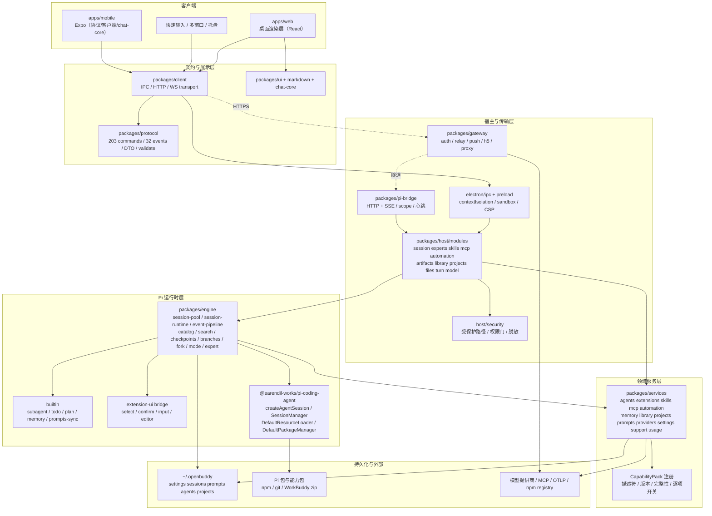
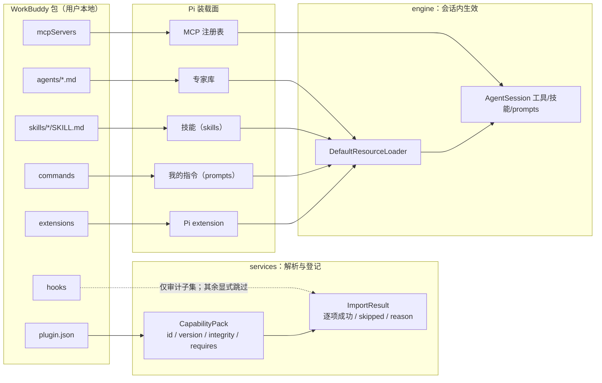
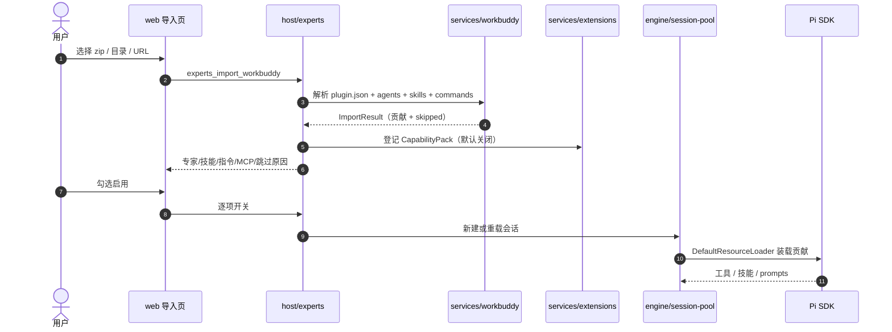
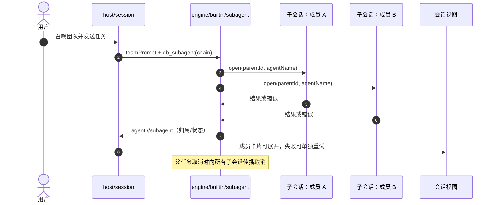
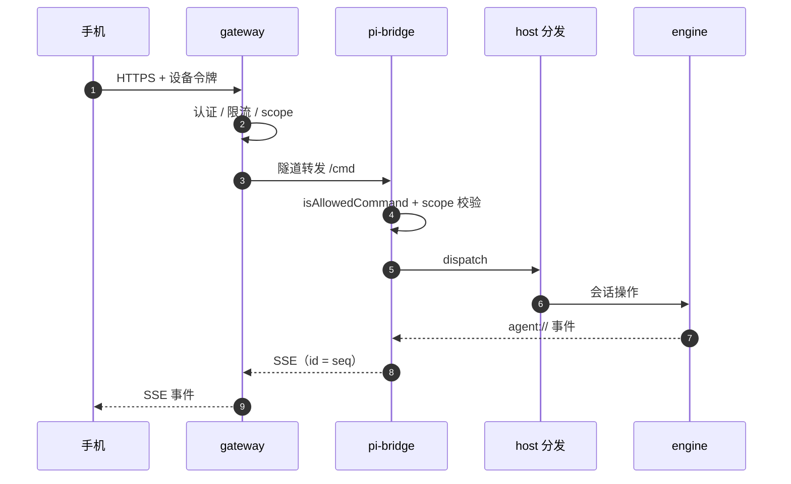
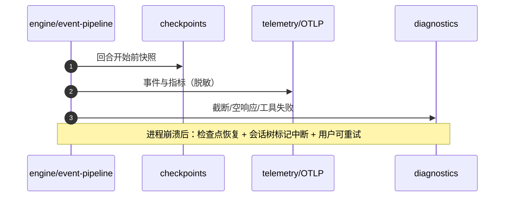
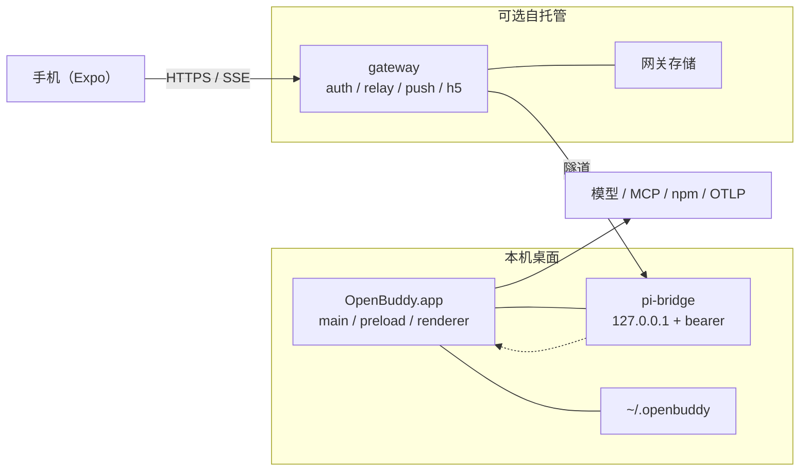

# 20261119 — OpenBuddy 下一阶段计划（Beta → GA）

> **日期**：2026-11-19
> **基线**：分支 `refactor/modularization`；工作区包含 S14–S21 与移动端并行改动（部分未提交）。
> **方法**：代码/配置实测 + 全量测试 / 类型检查 / 边界门禁 / IPC 契约 + 真机 Electron E2E + 既有计划（`20261118.md`、`20261117-mobile.md`）交叉验证 + WorkBuddy 5.11.3 静态产物对照。
> **关系**：`20261118.md` 记录评估与 S14–S21 实施；本文只定义**下一阶段计划**，不重复已完成项。
> **说明**：`docs/` 在 `.gitignore` 中，本文件入库需要 `git add -f`。本文不含代码改动。
> **度量口径**：百分比按计划条目加权估算，不是时间/工作量承诺；"计划完成度"与"GA 就绪"不是一回事。

---

## §0 结论先行

**一句话**：OpenBuddy 的功能面与 Pi 插件生态已到 **Beta+（单用户可用、可演示、可内部试点）**；距离公开 GA 仍差 **可观测、可恢复、可分发** 三件工程化的事。

**当前进度（加权，详见 §6）**

| 维度 | 完成度 |
|---|---:|
| 核心功能 | 95% |
| Pi 插件生态 | 94% |
| WorkBuddy 专家兼容 | 89% |
| UI 对标 WorkBuddy | 78% |
| 质量门禁 | 94% |
| 可观测 / 数据恢复（P0） | 82% |
| 发布工程（P0） | 50% |
| i18n / 无障碍 | 85% |
| 文档与支持 | 70% |
| **加权总体** | **约 84%** |

**下一阶段策略：双线并行，P0 为主**

1. **主线（P0，阻塞 GA）**：可观测 → 数据恢复 → 签名/自动更新 → 性能预算 → 三平台发布流程。
2. **并行线（P1，限时/限额）**：Pi 生态收尾、WorkBuddy 深度兼容、UI 系统化、i18n/无障碍、文档与支持。
3. **P2 差异化**：市场后端、协作、企业、移动/P2P、创意产物、SaaS —— P0 完成前不投入主要精力。

**三个必须先解决的 P0**

1. **可诊断（O1 已完成，§10.24）**：应用级 ErrorBoundary、主进程崩溃捕获、结构化日志与轮转、脱敏诊断包。
2. **可恢复（R1 已完成，§10.25）**：schemaVersion + 顺序迁移、升级前快照、损坏自愈、全量导出/恢复。
3. **可分发（更新检查 + 下载校验已完成；签名/自动安装待证书与渠道）**：macOS 签名/公证、Windows 签名、自动更新、灰度与回滚、关于页。

---

## §1 基线证据（2026-11-19 实测）

| 维度 | 结果 | 来源 |
|---|---|---|
| 全量测试 | **256 个文件 / 1889 项（1888 通过 + 1 真实模型 opt-in 跳过）** | `pnpm test` |
| 类型检查 | 渲染层 + 主进程 0 错误 | `pnpm typecheck` |
| 边界门禁 | `BOUNDARIES_OK`：layer 1、forbidden 0、bridge 27、feature-deep 44、feature-edge 20、cycle 1、unreachable 77、size 4 | `node tools/check-boundaries.mjs --check` |
| IPC 契约 | `missingHandlers: []`，`deferred_not_whitelisted: 19` | `pnpm audit:ipc` |
| 宿主命令 / 事件 | 桌面 228 条命令 / 33 个事件 | 真机 `host_capabilities` |
| 真机 E2E | **E2E_PASS，77 步 / 939 次 IPC / 133 个命令，pageErrors 0** | `tools/verify/e2e-shots.mjs` |
| 品牌标识 | 「企鹅在办公桌前」插画 PNG（整图缩放显示，各处 `object-fit: contain`），同源用于窗口标题栏、侧栏、关于弹窗/设置、助手头像与 favicon；E2E 断言侧栏标识真实解码（`naturalWidth > 0`） | 真机 E2E + 资产同步 |
| 界面语言 | 设置页 + 侧栏（新建任务/主导航/更多/搜索/设置）与 Composer 占位、首页免责声明支持 zh-CN / en-US 即时切换；持久化并镜像 `<html lang>`；E2E 切换 → 刷新后仍英文（New task / Projects / Settings）→ 切回中文 | 真机 E2E + 单测 |
| 依赖 / SBOM / 可复现 | `DEPS_OK`：1332 包全部有 integrity、16 个 importer 的 82 条直接依赖均可解析；`SBOM_OK`：CycloneDX 1.5，1332 组件，两次生成字节一致；`REPRO_OK`：124 个构建文件两次构建哈希一致 | `pnpm check:deps` / `gen:sbom` / `check:repro` |
| Pi 文件扩展 | 示例 JS 扩展经 Pi `DefaultResourceLoader` 真实加载：注册 `demo_echo` 工具与 `/demo` 命令；E2E 让模型调用该工具并以回显结束（含权限门） | 真机 E2E + `packages/engine/test/extension-demo.test.ts` |
| 对比度 / 缩放 | 对话、首页、设置、暗色首页、暗色设置 **5 个表面 0 处 < 4.5:1**（大字号 3:1）；1024×768 与 125% 缩放无横向溢出、Composer 完整可见 | 真机 E2E |
| 更新检查 | 宿主读取 `OPENBUDDY_UPDATE_FEED` 的发布清单（仅 HTTPS，或本机回环 HTTP），版本比较、通道校验、64KB/10s 上限、非 2xx/非法 JSON 全部报可读原因；`update_download` 把安装包下载到 `<userData>/updates`，校验 sha256 与大小，不符就删除；E2E 以本地清单 + 真实安装包镜像验证「发现新版本 → 下载 → 4096B 文件哈希一致 → 不安全源被拒」 | 真机 E2E + 单测 |
| 性能预算 | 冷启动 **2.1s**、本地一轮 **3.3s**、主+渲染工作集 **700MB**、渲染堆 **28MB**；静态门禁 entry 1.18MB / 总 JS 5.50MB / CSS 0.57MB / dist-electron 2.0MB；mermaid / katex / cytoscape 均在独立懒加载块 | 真机 E2E + `pnpm check:perf` |
| 移动端 H5 | 17 屏 × 亮/暗 = **34 次全部 PASS**（无 pageerror，含长按菜单与搜索交互） | `scripts/verify-mobile-ui.mjs` |
| 无障碍审计 | 6 个界面（对话/首页/专家/自动化/设置/900×800 窄屏）**0 问题**：按钮有名称、控件有标签、图片有 alt、对话框有 `aria-modal`+名称；对比度覆盖对话/首页/设置与暗色两屏（0 处不达标）及 1024×768 / 125% 缩放 | 真机 E2E |
| 真实模型 | 配置 `ANTHROPIC_*` 后通过：模型经 Pi `write` 工具真实落盘并可读回（本轮 25.0s） | `pnpm verify:real-model` |
| 构建产物 | `dist/` 7.4 MB，`dist-electron/` 1.9 MB | `du -sh` |
| Pi / Electron | `@earendil-works/pi-coding-agent` 1.5.2；Electron 45.3.0 | `package.json` |
| 发布流水线 | 独立打包工作流 `package.yml`：可在 GitHub 上选平台与 macOS 架构，macOS 一次产出 **x64 + arm64 两份 DMG**，Windows 产出 NSIS 安装器；发布可配置（tag/标题/说明/draft/prerelease），签名与公证可按 secrets 自动启用；产物未配置证书时为未签名包，应用内可下载并校验安装包（不自动执行）；**仍无签名实跑、自动安装与 Linux 打包** | `.github/workflows/package.yml`、`.github/workflows/release.yml`、`electron-builder.yml`、§10.42 |
| 可观测缺口 | 应用级 ErrorBoundary、主进程异常捕获、结构化日志与本机日志查看器已落地（O1）；仍无崩溃上报（需端点）与 OTLP/性能采样 | 代码检索 |
| 数据恢复 | 设置/模型/项目/自动化/MCP/Pi 设置带 `schemaVersion` 与顺序迁移；启动、迁移前、恢复前自动快照（保留 3 份）；损坏文件从最新快照自愈，否则隔离为 `.corrupt-<ts>`；全量导出/恢复不含机器绑定的密钥 | `pnpm test`、真机 E2E |
| 可观测 / 日志 | 渲染层异常显示可恢复的错误卡片；主进程异常、渲染进程崩溃、加载失败与渲染器 warn/error 统一落 `<userData>/logs` 的 JSONL（按日 + 大小轮转、7 天保留、写盘前脱敏）；设置 · 帮助里的日志查看器经 `logs_list`/`logs_read` 只读展示，支持单文件与**全部文件合并**（按时间排序）、级别/关键词筛选、导出为本地 .txt，拒绝路径穿越；真机 E2E 注入渲染错误后落盘、在查看器中出现且无密钥/绝对路径 | `pnpm test`、真机 E2E |
| 文档 / 支持 | 用户手册、FAQ、隐私说明、故障排查、更新说明 5 份文档；`DOCS_OK`：51 个标题、相对链接与表格列数校验通过；帮助页 5 个链接直指仓库文档，E2E 断言 `links: 5` 且无「即将上线」占位 | `pnpm check:docs`、真机 E2E |
| 工作区 | `refactor/modularization`，含未提交的 S18–S21 与移动端改动 | `git status` |

**已完成基线（S14–S21，详见 `20261118.md`）**

- S14 Pi 包安装/移除/更新；S15 npm `pi-package` 市场搜索；S16 包声明持久化、包内技能/指令加载、分页排序；S17 逐包资源开关；S18 WorkBuddy 专家包导入；S19 统一页头/页签；S20 首页对标 WorkBuddy；S21 WorkBuddy 团队包 → 团队指令。
- **B1b（2026-11-19）**：WorkBuddy 包内 `skills` / `commands` / `mcpServers` 解析并落到 Pi 装载面；`hooks` / `extensions` 显式跳过并给出原因。验证见 §10.12。
- **B2a（2026-11-19）**：`ob_subagent` 支持 `steps[]`，每个子会话绑定自己的专家（模型/思考/工具/人设）；团队事件带 `team/role/index`，内置专家 id 可解析。验证见 §10.13。
- **B2b（2026-11-19）**：`ob_docx` / `ob_xlsx` / `ob_pptx` 三个 Pi 内置工具，经 `officegen` 生成真实 OOXML；走权限门、检查点与产物刷新，工作台列出并可预览/还原。验证见 §10.14。
- **B1a（2026-11-19）**：能力包描述符落盘，支持整体启停、逐项开关与“回退到安装前”；`tools/compat/pi-matrix.json` 记录 SDK/包版本与失败原因，`pnpm audit:compat` 校验。验证见 §10.15。
- **B1c（2026-11-19）**：技能市场安装复制到 `<pi>/skills`（幂等）、版本展示、批量启停、导出可再次导入的 ZIP；源目录删除后技能仍可用。验证见 §10.16。

---

## §2 现状盘点

### 2.1 核心能力

| 能力 | 状态 | 证据 / 说明 |
|---|---|---|
| 对话 / 流式 / 工具审批 | ✅ | 真机 E2E 主链路 |
| 产物工作台（文件树/预览/版本/批注） | ✅ | E2E 覆盖 |
| 专家 / 技能 / 连接器 | ✅ | 12 位内置专家、技能目录、真实 MCP |
| 自动化（定时/文件触发/托盘） | ✅ | E2E 覆盖 |
| 记忆 / 资料库 / 项目 | ✅ | E2E 覆盖 |
| 本地模型 / OpenAI 兼容 | ✅ | 本地模型设置与探测 |
| 多窗口 / 全局快速输入 | ✅ | E2E 覆盖 |
| 移动端 / P2P | ◐ | Expo + Gateway 并行开发，未随桌面发布 |

### 2.2 Pi 插件生态

| 能力 | 状态 | 缺口 |
|---|---|---|
| 安装 / 移除 / 更新 | ✅ | — |
| 市场搜索 / 分页 / 排序 | ✅ | 评分展示与按评分/下载量排序（§10.35）+ **按能力分类筛选**（§10.40）；分页稳定 |
| 包资源汇总 / 逐包开关 | ✅ | **自定义 glob 过滤**：模式按 Pi 原生语法原样写入包条目，扩展中心提供模式编辑器（E1，§10.41） |
| 包声明持久化 / 资源真正加载 | ✅ | — |
| 完整性 / 来源审查 | ✅ | **npm packument 详情**：`dist.integrity` / `dist.shasum`、维护者、发布时间、`gitHead`、许可、解包大小（E1，§10.40）；不臆造"官方签名" |
| 离线 / 镜像 | ✗ | 离线包缓存与镜像 |
| 市场后端 / 商店 | ✗ | 模板/专家商店、安装量、评分 |
| 包更新日志 | ✅ | E1：读取 Pi 解析到的 `changelogPath`，包卡片可查看，单包更新后自动展示（§10.35） |
| 能力包生命周期 / 兼容矩阵 | ✅ | B1a：描述符持久化、整体/逐项开关、回退；`tools/compat/pi-matrix.json` 由 `pnpm audit:compat` 校验（§10.15） |
| 技能市场安装 / 版本 / 导出 | ✅ | B1c：复制到 `<pi>/skills`、版本与批量启停、导出 ZIP 可再次导入（§10.16） |

### 2.3 WorkBuddy 兼容

| 能力 | 状态 | 缺口 |
|---|---|---|
| ZIP / 目录导入 | ✅ | 远程 URL 导入 |
| `plugin.json` / `agents/*.md` / `avatars/` | ✅ | `maxTurns`、工具/技能/连接器引用 |
| 包内 `skills/` / `commands/` / `mcpServers/` | ✅ | B1b：技能写入 `capability-packs/` 并进 `skillPaths`；指令写入 `prompts/`；MCP 注册为禁用态（§10.12） |
| `hooks/` / `extensions/` | ◐ | 显式跳过并返回原因；不静默执行第三方生命周期代码 |
| 团队包（`expertType: "team"`） | ✅ | 成员已绑定真实 Pi 子会话；角色/工具随专家生效（§10.13）；团队管理页与 `maxTurns` 待补 |
| 分类 / 标签 / 示例 / 头像 | ✅ | profession 独立字段 |
| 导入预览 / 冲突处理 | ✅ | B3b：链接/路径预览包内容与贡献、内容摘要去重、重复打开直达已有专家（§10.19） |
| 内置能力包（Word/表格/幻灯片/设计/财务等） | ✅ | B2b：`ob_docx` / `ob_xlsx` / `ob_pptx` 生成真实 OOXML 并进工作台；PDF 编辑、云表格与模板库未覆盖（§10.14） |
| 能力包管理（启用 / 禁用 / 移除 / 逐项开关） | ✅ | B1a：导入的贡献在 扩展 页整体或逐项启停，移除回到安装前；修改过的指令保留（§10.15） |

### 2.4 UI 对标

| 能力 | 状态 | 缺口 |
|---|---|---|
| 52px 页头 / 18px 文本页签 | ✅ | 设置页未统一 |
| 首页标题层级 / 场景 pill / 免责声明 | ✅ | §10.43：未配置模型时的引导卡已补；最近列表细节、Composer 品牌/语音入口仍可细化 |
| 动效 / reduced-motion | ✅ | 空态插画、页面切换细节 |
| 设计令牌完整度 | ✅ | 新增 3xl/4xl 圆角、control-xl/2xl、数值字号阶；`pnpm check:ui-tokens` 以基线锁定裸 px，只减不增（总量仍少于 WorkBuddy） |
| 页面/面板覆盖 | ◐ | §10.43：任务概览已补后台命令输出；仍缺项目看板、产物云分享/可见性、设备连接等表面（§10.2） |
| 图标 / 截图 / 品牌规范 | ◐ | 系统化规范 |
| Grok Bot 视觉语言 | ✅ | 浅灰选中胶囊、发丝线、18–24px 卡片、单一焦点环、去渐变、企鹅办公图品牌标识；§10.17/§10.39 |
| 移动端 H5 | ✅ | B3e：17 屏 × 亮/暗 34 次全 PASS（`scripts/verify-mobile-ui.mjs`）；iOS/Android 原生未跟改 |

§10 给出本轮 REA 证据、逐流程差距、Pi 插件选型与 B1–B3 的实施顺序。§1 的测试和截图沿用原基线。

### 2.5 质量 / 发布 / 可观测

| 维度 | 状态 | 缺口 |
|---|---|---|
| 测试 / 类型 / 边界 / 契约 / E2E | ✅ | 覆盖率阈值、Windows/Linux E2E、flake 治理 |
| 应用级错误恢复 | ✅ | O1：根级 ErrorBoundary（重试/返回首页/复制诊断）+ 主进程 `uncaughtException`/`unhandledRejection`/`child-process-gone`/`render-process-gone`/`did-fail-load` 捕获；注入式恢复演练仍待做 |
| 日志 / 诊断 | ✅ | O1：JSONL 按日 + 大小轮转、7 天保留、写盘前脱敏（Key/Bearer/邮箱/绝对路径）；设置 · 帮助里的只读日志查看器（单文件/全部文件合并、级别/关键词/原始数据折叠、打开目录、导出 .txt），拒绝路径穿越；崩溃上报（默认关闭）仍需上报端点，未做 |
| 数据 schema / 迁移 | ✅ | A2：顺序迁移、启动/迁移前/恢复前快照、损坏自愈与隔离、全量导出/恢复；跨机需重新输入密钥 |
| 签名 / 公证 / 自动更新 | ◐ | A3：更新清单检查 + 安装包下载并校验（HTTPS/回环、版本/通道、sha256/大小、超时与上限；不符删除）；签名、公证、自动安装与回滚演练仍缺证书与发布渠道 |
| 性能预算 | ◐ | A4：冷启动/一轮/内存/包体与懒加载块已进门禁；压力测试、三平台包体与 CI 集成未做 |
| 依赖审计 / SBOM | ◐ | A5：离线依赖门禁（integrity/解析/明文 tarball）、确定性 CycloneDX SBOM、两次构建哈希一致；漏洞库审计（`pnpm audit`/OSV）需联网与 CI |
| i18n / 无障碍 | ◐ | B4：键盘全链路、焦点陷阱、6 界面自动审计 0 问题、5 表面对比度 0 处不达标、1024×768 与 125% 缩放通过；设置页 + 侧栏 + Composer/首页文案 zh-CN/en-US 切换与持久化；缺业务面板 en-US、错误码本地化与读屏实机 |
| 文档 / 支持 | ✅ | B5：用户手册/FAQ/隐私说明/故障排查/更新说明 5 份；`check:docs` 校验标题/链接/表格列数；帮助页 5 个入口直连仓库文档并去掉占位；截图与 15 分钟上手路径仍可继续补全 |

---

## §3 差距与优先级

### 3.1 P0（GA 前必须完成）

#### O1 可观测与错误恢复

**状态**：✅ 已实现（2026-11-20，§10.24）；崩溃上报（默认关闭）仍未做。

- **现状**：应用级 ErrorBoundary 未实现；主进程无 `uncaughtException` / `unhandledRejection` / `render-process-gone` 统一捕获；日志仅零散 `console.*`。
- **影响**：白屏无法自救、线上问题无法定位、更新后故障无法快速回滚判断。
- **要做什么**
  - 根级 + 路由级 ErrorBoundary：重载 / 导出诊断 / 返回首页，保留草稿。
  - 主进程统一异常捕获 + 滚动日志（按大小/日期轮转，默认 7 天）。
  - 日志分级 + 脱敏（路径、Key、`Bearer`、邮箱）；合并现有诊断报告。
  - 可选崩溃上报（默认关闭、明确授权、含隐私说明）。
- **验收**：注入渲染层/主进程异常各一次，界面可恢复且诊断包完整；诊断包无密钥/绝对路径。

#### R1 数据恢复与迁移

**状态**：✅ 已实现（2026-11-20，§10.25）；跨机恢复已验证到文件级，密钥按设计不随包迁移。

- **现状**：`JsonStore` 原子写；无 schemaVersion / 迁移 / 快照；损坏 JSON 仅 ENOENT 回退。
- **影响**：升级/手改文件导致配置丢失，且无法跨机恢复。
- **要做什么**
  - `openbuddy.json` / `providers.json` / `projects.json` / `automations.json` / `mcp.json` / `pi-settings.json` 增加 schemaVersion 与顺序迁移。
  - 首次启动与升级前快照（保留最近 3 份）；损坏时回退最近可用快照并提示。
  - 设置 · 数据管理：一键导出/恢复全部用户数据。
  - 密钥不可用时的降级/退出策略，不静默丢 Key。
- **验收**：破坏任一 JSON 可启动并恢复；迁移幂等；导出包可在另一台机器恢复。

#### D1 分发：签名、公证、自动更新

**状态**：◐ 更新检查、关于页与应用内「下载并校验安装包」已落地（2026-11-20，§10.27/§10.37）；签名/公证/自动安装/回滚需证书与发布渠道，当前环境无法真实验证。

- **现状**：`electron-builder.yml` `notarize: false`；CI `CSC_IDENTITY_AUTO_DISCOVERY=false`；无 `electron-updater`；无更新通道/回滚。
- **要做什么**
  - macOS Developer ID 签名 + notarytool 公证 + stapling；Windows Authenticode。
  - `electron-updater`（或自建源）+ 差分包；更新前检查运行中任务。
  - 灰度：内部 → 5% → 25% → 100%，每档有停止条件。
  - 失败自动回滚；保留上一个可用版本。
  - 设置 · 关于：版本、通道、检查更新、更新日志。
  - 应用内下载 + 校验（已完成，§10.37）；执行安装与替换仍交用户。
- **验收**：干净 macOS/Windows 安装并自动升级一次；断网/磁盘满/权限不足可恢复；回滚演练通过。

#### P1 性能预算

**状态**：◐ 已建立预算与本地门禁（2026-11-20，§10.26）；p95、连续压测与 CI 集成待 A5。

- **现状**：主 chunk 1.1 MB；mermaid 743 KB、katex 523 KB 已分包；无预算与 CI 门禁。
- **要做什么**
  - 预算：冷启动 p95 ≤ 2.5 s；首 token p95（云端）≤ 3 s；空闲内存 ≤ 400 MB / 长会话 ≤ 800 MB；首屏 JS gzip ≤ 400 KB；INP p95 ≤ 200 ms。
  - mermaid/katex/cytoscape 按需加载；大文件预览分块。
  - CI bundle 门禁；`stress.js` 纳入发布前。
- **验收**：预算写入 CI；连续 3 次长会话压测无内存失控；冷启动达标。

#### Q1 发布流程

**状态**：◐ 依赖门禁、SBOM、可复现构建与 Linux 验证 job 已落地（2026-11-20，§10.30）；独立打包工作流 `package.yml`（macOS x64+arm64 DMG、Windows NSIS、tag 自动挂 Release）已落地（2026-11-21，§10.42）；三平台打包 E2E、漏洞库审计与签名发布未完成，CI 本身未在本机执行。

- **现状**：`package.yml` 产出未签名的 macOS DMG（x64/arm64）与 Windows NSIS 安装器，tag 构建自动附到 GitHub Release；无 Linux 包、无签名、无三平台 E2E 冒烟。
- **要做什么**
  - CI 增加 Linux 打包与三平台 E2E 冒烟（启动 + 首页 + 一轮对话）。
  - `pnpm audit` / OSV 扫描 + CycloneDX SBOM；高危阻断。
  - 锁定 Node/pnpm/Electron；产物哈希与来源记录。
  - 发布说明模板与升级注意事项。
- **验收**：三平台流水线绿；高危漏洞 0；从 tag 到产物哈希可复现。

### 3.2 P1（规模化与体验）

#### E1 Pi 生态收尾

- 市场：展示 npm `score`（quality/popularity/maintenance）与下载量排序；按能力分类筛选；分页稳定。
- 完整性：展示 npm `integrity`/维护者/仓库；git 包展示 commit；不臆造"官方签名"。
- 离线：包缓存目录、离线安装/更新提示。
- 包更新日志：读取 Pi `pi.changelogPath`，在更新后展示。
- 自定义资源过滤：对象表单的 glob 编辑 UI（**已完成**，§10.41：模式按 Pi 原生语法原样写入，扩展中心提供模式编辑器）。
- 能力包：安装/禁用/回退三态，按贡献逐项开关；兼容矩阵记录 SDK/包版本与失败原因（§10.6/10.7）。
- **状态**：◐ 2026-11-21（§10.35/§10.40/§10.41）：市场评分与按评分/下载量排序、仓库与 npm 链接、Pi `changelogPath` 展示并自动打开、**按能力分类筛选**、**npm `integrity`/维护者/git commit 详情**、**Pi 原生 glob 资源过滤与模式编辑 UI**已完成；离线缓存仍未做。

#### W1 WorkBuddy 深度兼容

- 远程 URL 导入：仅 https、大小/超时限制、禁止私网地址（SSRF 防护）、导入预览。
- `maxTurns` / 工具 / 技能 / 连接器引用映射；`profession` 独立字段。
- 包内 `skills/` / `commands/` / `hooks/` / `mcpServers/` 映射到 Pi 的 skills / prompts / 扩展 / MCP，逐项显示"已导入/已跳过/原因"（§10.5）。
- 团队：负责人/成员角色卡；成员绑定真实 Pi 子会话；导入冲突（覆盖/跳过/重命名）。
- 办公能力包：docx / xlsx / pptx 生成、排版与模板，产物进入工作台（§10.4/10.8）。

#### U1 UI 系统化

- 设置页并入统一页头；空态插画与插图规范；最近列表状态点/「查看更多」。
- 设计令牌补齐：3xl/4xl 圆角、48px 控件、数值字号阶与尺寸阶；新增样式禁止裸 px（§10.2.1）。
- 设备码授权、专家链接、自动化修订、产物独立阅读、项目置顶与任务来源 chip（§10.2.3）。
- **状态**：◐ 2026-11-20（§10.36）：项目置顶（持久化 + 置顶优先排序）与任务来源筛选已完成；设置页统一页头、空态插画、最近列表状态点、Composer 品牌标识仍待做。
- Composer 模型品牌标识、语音入口（有真实能力才上）；右侧主动建议卡（有真实规则才上）。
- 移动端 H5 跟随桌面页头回归。

#### I1 i18n / 无障碍

**状态**：◐ 键盘、焦点陷阱、对比度、缩放与设置页/壳层 zh/en 切换已过自动审计（2026-11-20，§10.28/§10.31/§10.32）；业务面板 en-US、错误码本地化与读屏实机走查未做。

- 抽取文案，`zh-CN` / `en-US`；日期/数字格式；错误码文案。
- 键盘全链路、焦点陷阱、对比度、读屏标签、减少动效。

#### S1 文档与支持

- 用户手册、故障排查、隐私政策、更新说明、FAQ；新用户 15 分钟完成首个任务。
- **状态**：✅ 2026-11-20（§10.33）：5 份文档入库，帮助页链接真实可达，`pnpm check:docs` 进门禁并接入 CI；带截图的分步教程与视频仍可补充。

### 3.3 P2（差异化，P0 后投入）

- 市场后端（评分/安装量/审核）、模板/专家商店。
- 协作（共享会话、评论、团队空间、权限）。
- 企业（SSO/SCIM、审计、策略、配额）。
- 移动/P2P（手机审批、推送、弱网、桌面中继）。
- 创意产物（画布/演示稿/多模态，需 Muse 调研校准）。
- SaaS（`apps/server`、租户隔离、对象存储、沙箱工作区）。

---

## §4 计划（工作流与任务）

> 不使用时间估算；以里程碑和验收为准。P0 完成前不对外 GA。

### Phase A — 可发布（P0 主线）

| ID | 工作流 | 任务 | 验收 |
|---|---|---|---|
| A1 | 可观测 | ErrorBoundary（根/路由）、主进程异常捕获、结构化日志+轮转+脱敏、诊断包 | 注入异常可恢复；诊断包无密钥/绝对路径 |
| A2 | 数据恢复 | schemaVersion+迁移、升级前快照、损坏自愈、全量导出/恢复、Key 降级 | 破坏任一 JSON 可启动；跨机恢复成功 |
| A3 | 分发 | 签名、公证、自动更新、灰度、回滚、关于页 | 干净机器安装+升级+回滚演练通过 |
| A4 | 性能 | 预算、懒加载、bundle 门禁、stress 发布前 | 冷启动/首 token/内存/包体达标 |
| A5 | 发布流程 | 三平台 CI、E2E 冒烟、依赖审计、SBOM、可复现 | 三平台绿；高危 0；哈希一致 |

### Phase B — 生态、兼容与体验（P1 并行）

| ID | 工作流 | 任务 | 验收 |
|---|---|---|---|
| B1 | Pi 生态 | npm score/分类筛选、完整性展示、离线缓存、包 changelog、glob 过滤；能力包描述符与兼容矩阵（§10.6/10.7） | 市场可按能力筛选；离线可装；更新后可见变更；安装/禁用/回退三态可复现 |
| B2 | WorkBuddy | URL 导入（SSRF 防护）、`maxTurns`/工具映射、团队角色卡、冲突策略；包内 skills/commands/hooks/mcpServers 映射；办公能力包 docx/xlsx/pptx（§10.5/10.8） | 远程包可预览并导入；团队 UI 可读；真实包导入后贡献逐项可见；三格式产物可生成并预览 |
| B3 | UI | 设置页统一页头、空态插画、最近列表细节、Composer/建议卡、移动端回归；项目置顶、设备码授权、自动化修订、产物阅读、令牌补齐（§10.2/10.8） | 主要页面视觉一致；动效尊重 reduced-motion；授权/编辑/产物路径取消后可恢复 |
| B4 | i18n/a11y | zh-CN/en-US、键盘全链路、对比度、读屏 | 自动审计 0 严重项；关键流程纯键盘可用 |
| B5 | 文档 | 用户手册、FAQ、隐私政策、更新说明 | 新用户 15 分钟完成首个任务 |

### Phase C — 差异化（P2）

| ID | 工作流 | 任务 | 验收 |
|---|---|---|---|
| C1 | 市场后端 | 搜索/评分/安装量/审核、模板/专家商店 | 可从市场安装并测试通过 |
| C2 | 协作 | 共享会话、评论、团队空间、权限 | 两人可协作同一任务 |
| C3 | 企业 | SSO/SCIM、审计、策略、配额 | 管理员可下发策略并审计 |
| C4 | 移动/P2P | 手机审批、推送、弱网、桌面中继 | 手机上批准桌面任务 |
| C5 | 创意产物 | 画布/演示稿/多模态（Muse 校准后） | 按调研结论定义 |
| C6 | SaaS | `apps/server`、租户隔离、对象存储、沙箱 | 浏览器连服务器跑通完整一轮 |

---

## §5 顺序、依赖与里程碑

**推荐顺序**：A1 → A2 → A3 → A4 → A5；B1–B5 与 A 线并行，但**每个迭代只允许一个 P1 工作流**，避免挤占 P0。

**依赖**

- A3 依赖 A1/A2（更新失败要能回滚、问题要能定位）。
- A5 依赖 A3/A4（签名产物 + 性能预算进 CI）。
- B2 依赖 A1（导入失败的诊断）与 B1（包缓存）；B2b 办公能力包依赖 B1a 的资源装载。
- B4 依赖 B3（页面结构稳定后再抽文案）。

**里程碑**

| 里程碑 | 内容 | 判定 |
|---|---|---|
| M0 基线 | 本文与 `20261118.md` 对齐；工作区提交/清理 | 基线可复现 |
| M1 可诊断/可恢复 | A1 + A2 | 注入异常可恢复；破坏 JSON 可启动 |
| M2 可分发 | A3 + A5 | 干净机器安装/升级/回滚；三平台绿 |
| M3 GA Gate | A4 + B4 + B5 | 预算达标；i18n/a11y 基线；文档发布 |
| M4 扩展 | B1/B2/B3 收尾 | 生态与 UI 达到 Beta+ 稳定 |

---

## §6 进度度量

**方法**：按 §0 的九个维度加权；每个维度按计划条目完成数（含验收通过）估算；权重：核心 20%、生态 15%、兼容 10%、UI 10%、质量 10%、可观测/恢复 15%、发布 10%、i18n/a11y 5%、文档 5%。

**当前**

| 维度 | 权重 | 完成度 | 加权 |
|---|---:|---:|---:|
| 核心功能 | 20% | 95% | 19.0 |
| Pi 生态 | 15% | 94% | 14.1 |
| WorkBuddy 兼容 | 10% | 89% | 8.9 |
| UI | 10% | 78% | 7.8 |
| 质量门禁 | 10% | 94% | 9.4 |
| 可观测/恢复 | 15% | 82% | 12.3 |
| 发布工程 | 10% | 50% | 5.0 |
| i18n/a11y | 5% | 85% | 4.25 |
| 文档 | 5% | 70% | 3.5 |
| **合计** | 100% | — | **84.25 → 约 84%** |

> §10 的插件清单与 UI 令牌实测后，本表按证据重估：Pi 生态 72→92（B2a 子会话 + 专家绑定、B2b Pi 内置工具、B1a 能力包生命周期与兼容矩阵 + JS 扩展试点、B1c 技能市场安装/版本/导出、B3a 授权尝试、E1 市场评分/下载排序 + 仓库/npm 链接 + Pi changelog 展示并在单包更新后自动打开 + 按 npm keywords 派生的能力分类筛选 + npm packument 详情（integrity/维护者/发布时间/git commit）+ Pi 原生 glob 资源过滤与模式编辑 UI；离线缓存仍未做）、WorkBuddy 兼容 76→89（B1b + B2a + B2b + B1a + B3b 远程 URL/本地包预览与幂等；U1 项目置顶与任务来源筛选；团队管理页、PDF/云编辑仍未完成）、核心 88→95（真实办公产物、可回退能力包、可移植技能包、自动化修订/重试与交付目标校验、专家链接导入、产物独立阅读、可取消授权尝试）、UI 65→78（统一 Grok Bot 视觉层、令牌补齐与三视口验证、独立阅读/分享前态/删除态可读、移动端 H5 34 次回归、裸 px 收敛 533 处、市场卡片展示评分与仓库/npm 链接、项目置顶与来源筛选）、可观测/恢复 45→82（O1：应用级错误边界 + 主进程崩溃捕获 + 结构化日志/轮转/脱敏 + 本机日志查看器（单文件/全部文件合并、跨文件检索、导出 .txt）；A2：schemaVersion + 顺序迁移、启动/迁移前/恢复前快照、损坏自愈与隔离、全量导出/恢复；崩溃上报与 OTLP 采样仍缺）、发布工程 10→25（A3：更新清单真实检查、通道与签名下载地址校验、关于页；签名/公证/自动安装未做）、i18n/a11y 40→60（B4：对比度 0 处不达标、1024×768 与 125% 缩放、键盘与焦点陷阱；en-US 与读屏实机未做）、发布工程 25→50（A5：离线依赖门禁、确定性 SBOM、可复现构建、CI Linux 验证 job；A3：应用内下载安装包并校验 sha256/大小，不符即删除；三平台打包 E2E、签名/公证与自动安装未做）、i18n/a11y 78→85（B4：侧栏/更多/搜索/设置、Composer 占位与首页免责声明纳入 zh/en；业务面板 en-US、错误码与读屏实机未做）、文档 30→70（B5：用户手册、FAQ、隐私说明、故障排查、更新说明 5 份入库，帮助页真实链接，`check:docs` 校验标题/相对链接/表格列数并接入 CI；分步截图与 15 分钟上手走查仍可补）。
>
> 上一版 §19 为 62%；本版按更严格的权重（可观测/恢复 15%）重算约 60%。两者差异来自权重，不是回退。

**更新规则**：每次迭代结束更新本表与 `20261118.md` 的 §19；只有验收通过才计入完成度。

---

## §7 风险登记

| 风险 | 影响 | 对策 |
|---|---|---|
| 签名/公证证书与流程未配置 | 无法 GA | 提前申请证书；CI secrets；本地演练 |
| 自动更新破坏运行中任务 | 数据/任务丢失 | 更新前检查 `tasks_list`；可延迟；失败回滚 |
| 日志含敏感路径/Key | 隐私事故 | 统一脱敏；测试覆盖；诊断包审计 |
| schema 迁移失败 | 配置丢失 | 快照 + 幂等迁移 + 回滚；夹具测试 |
| 大依赖拖慢首屏 | 体验差 | 按需加载；预算门禁 |
| WorkBuddy 远程导入 SSRF | 内网探测 | 仅 https、DNS/IP 校验、禁私网、大小/超时限制 |
| 移动端并行分支冲突 | 合并回归 | 合并前 `test:mobile` + 弱网 e2e |
| P1 工作挤占 P0 | GA 延期 | 每迭代只允许一个 P1 工作流；里程碑门禁 |
| 竞品快速迭代 | 差异化不足 | 先完成 P0，再按调研投入 P2 |

---

## §8 验证与复现命令

```bash
pnpm install --frozen-lockfile
pnpm test
pnpm typecheck
node tools/check-boundaries.mjs --check
pnpm audit:ipc
pnpm build:electron
node tools/verify/e2e-shots.mjs docs/plan/shots-latest
```

**新增/待接入的门禁**

- 覆盖率阈值（packages ≥ 70%）。
- 三平台 E2E 冒烟。
- bundle 体积预算与冷启动/内存采样。
- `pnpm audit` / OSV + SBOM。

---

## §9 本轮不做 / 待决策

- 不引入新的状态库或 UI 框架。
- P0 阶段不做 SaaS 多租户与实时协作。
- 不在未核验竞品的情况下复制功能。
- 待决策：自动更新通道（GitHub Releases / 自建 / 对象存储）；崩溃上报供应商；i18n 首批语言；移动端发布节奏；团队角色卡/轮数上限是否作为默认编排；办公能力包是否随安装包分发（当前仅市场可选）。

---

## §10 WorkBuddy 交付产物与 Pi 实施设计

### 10.1 证据与覆盖边界

本机 WorkBuddy `CFBundleShortVersionString` 为 `5.11.3`，`app.asar` SHA-256 为 `45965c389b9674ef359fb5fc331a40ca0c0777c8380104f2e9ea8950bced614f`。包头索引 12,186 个条目（含 unpacked）；渲染层 3,076 个 JS、184 个 CSS。整包 REA 需解析 9,354 个源码，进程在解析早期退出（日志停在 82/9,354），未产出 Evidence，因此本文不使用整包结论，改用两批定向样本：

| 样本 | 内容 | Subject SHA-256 | Evidence ID |
|---|---|---|---|
| S-FLOW（6 模块） | 引导、专家链接、设备码、自动化编辑、独立产物面板 | `dfe1cdcf22e2631b9b462e7b5a212d6ac9ff68f65b55b49f234c833dcdebb391` | `ev_d84f1f37999f487ffc3a79413cd741b11cff8f7f884c7a388911f031b7174ec0` |
| S-UI（16 模块） | 首页、聊天、设置、资料库、项目列表/详情、自动化、专家/技能选择器、连接器、产物、命令面板、后台任务、账号与额度、侧栏状态 | `644ef4e729e59059393802ab82a2230afbd2232d669379517876b7ab0ddc4559` | `ev_864fc4dd2aa1cce4309f1605a2957d8dfb0c63e66b9675f959491734a680a478` |
| S-IPC（3 模块） | `preload/index.js`、`main/expert-executor.js`、`main/expert-summon-guard.js` | `a19f1a1db9d6d956cff72f788e5bde81836a9dc3ce9dc476db73d1ca1b541507` | `ev_068deada504a1de217f4fdbe62eccff30c853775bfdf111979a21a7e07724b41` |

S-IPC 的 REA 结果含 70 个 `ipc-channel`、65 个 context-bridge API、7 个 handler；同时 REA 明确记录"动态通道表达式无法解析"，因此通道总量改用预加载脚本的字符串盘点：**776 个唯一 `domain:action` 通道、40+ 域**。通道存在不等于可达或启用，运行时仍以真机为准。

补充静态盘点（unpacked 资源，非 REA）：`resources/plugins/workbuddy-builtin/` 共 921 个文件、8 个顶层组——`builtin-plugins`（473 文件 / 13 个插件）、`skills`（372 文件 / 25 个技能包）、`interactionmode`（craft / ask / expert / plan / quick）、`welcomemode`（design / claw / code / work）、`prompt-common`、`mcps`、`hooks`、`.codebuddy-plugin/marketplace.json`。`plugin.json` 常见字段为 `skills`(9)、`hooks`(6)、`mcpServers`(4)、`commands`(3)、`agents`(3)、`extensions`(1)、`defaultEnabled`(2)；`curated-experts.json` 为 `version: 1` 的候选清单，含 `priority` 排序。S-FLOW 的模块级观察见下表；S-UI 主要用于 §10.2 的界面盘点。

| 模块 | 可复查的静态观察 |
|---|---|
| `DataImportOnboardingHost` | `getAccount`、`claimOnboarding`、订阅清理 |
| `onboarding-DHGAP_9S` | 按服务解析引导内容（文档/IMA/Ardot 等）、`openExternal` |
| `expert-url-entry-coordinator` | `consumeExpertIdFromUrl`、`markConsumedOnce`、`replaceState` |
| `connector-device-code-modal` | 复制、剩余时间、关闭、`cancelMcpConnector` |
| `automation-run-group-edit-dialog` | draft/patch、工作区、显式权限、提权确认、交付通道可用性 |
| `standalone-artifact-panel` | 独立产物面板入口 |

以上均为静态证据：i18n 文案在语言包中，运行时灰度、服务端分享、真实授权成功率与像素尺寸不在样本内。视觉回归可复用 `docs/plan/shots-20261118-s20/`，像素差异必须补同视口、缩放、主题的 WorkBuddy 截图。

### 10.2 UI 差距

#### 10.2.1 令牌级（可直接量化）

| 维度 | WorkBuddy（`common-B2YH9b6_.css`，2.17 MB） | OpenBuddy（`packages/ui/src/styles/tokens.css`） | 影响 |
|---|---|---|---|
| CSS 自定义属性 | 2,113 条 `--wb-*` 声明（最大样式表） | 约 490 条（`tokens.css`） | 缺少组件级语义令牌，样式散落在页面 CSS |
| 圆角 | xs 2 / sm 4 / md 6 / lg 8 / xl 12 / 2xl 16 / 3xl 20 / 4xl 24 | 到 2xl 16，另有 full | 大卡片、弹层无法与 WorkBuddy 对齐 |
| 控件尺寸 | 24 / 32 / 40 / 48（`size-control-*`） | 24 / 32 / 40 | 主操作 48px 场景缺失 |
| 字号阶 | 8/10/12/13/14/16/18/20/24/28/32 | 语义阶 14/16/20/24/32 | 10–13px 元信息与 18px 页签只能写魔法数 |
| 尺寸阶 | 12–68 共 14 档 | 未系统化 | 头像、图标、行高易漂移 |

结论：**不是"没有令牌"，而是令牌覆盖不足以支撑 WorkBuddy 的密度**。应以增量方式补 `3xl/4xl`、`size-control-xl`、数值字号阶与尺寸阶，不重写现有色板。

#### 10.2.2 表面级（页面/面板覆盖）

| 表面 | WorkBuddy 证据 | OpenBuddy | 处理 |
|---|---|---|---|
| 侧栏分组 | `use-sidebar-state`：pinned / assistant / enterprise 分区 | 最近/任务分组 | 补置顶与分区折叠状态持久化 |
| 首页 | `app-home`：hero、场景、模板、项目/部署卡 | 已有场景/模板/草稿 | 仅补引导与空态（B3） |
| 会话与回合 | `chat`、审批、分支、后台任务终端输出 | 已覆盖主链路 | 补后台任务详情与终端输出折叠 |
| 产物 | `artifact`：预览 URL、下载、分享详情、可见性 | 文件树/预览/版本/批注/独立阅读 | ✅ B3d：独立阅读、同版本双处刷新、删除态读最后版本、本地分享前态；云分享/可见性留 C2（§10.20） |
| 项目 | `project-list-page` / `project-detail-page`：配额守卫、置顶、模板、任务来源 | 项目 + 模板 | ✅ U1：置顶（宿主持久化 + 置顶优先排序）与任务来源筛选；配额守卫留 C 线（§10.36） |
| 市场 | `skill-picker`：marketplaces、无限滚动、已安装 provider；`expert-picker`：市场专家、云遥测 | npm Pi 市场 + 专家中心 | 补服务端目录/评分/安装量（C1） |
| 连接器 | `connector` + 设备码弹层 + token 门禁 | MCP 服务/测试/工具规则/授权尝试 | ✅ B3a：尝试 ID、倒计时、复制、关闭即取消、状态事件；RFC 8628 设备端点待服务端提供（§10.21） |
| 设置 | 20 个 Panel/Dialog（账号、额度、实验室、设备、数据、记忆、模型、个性化、安全等） | 15 个设置面板（含账号/额度/移动访问/帮助） | 缺实验室、反馈与外部代理接入；设备与额度已有基础 |
| 账号/计费 | `AccountPanel`、`CreditsUsageEmbedPanel`、`SubscriptionUsagePanel`、签到 | BYOK，无计费 | **不复制**；提供 token/费用面板 |
| 帮助/反馈 | `GetHelpPanel`、`FeedbackModal`、`HelpFeedbackPanel` | 帮助设置页 | 补反馈入口（B3） |

#### 10.2.3 组件与交互细节

- **设备码授权**：✅ B3a 已完成尝试 ID、剩余时间、复制、关闭即取消与状态事件（§10.21）；RFC 8628 设备授权端点需真实服务端提供，当前包装 Pi 的 redirect + loopback 流程。
- **专家链接**：`consumeExpertIdFromUrl` + `markConsumedOnce` 防重复消费；OpenBuddy 无链接入口。目标：同一链接幂等，已安装 ID 直接打开详情。
- **自动化编辑**：WorkBuddy 在编辑对话框内做 draft/patch、提权确认与交付通道可用性；OpenBuddy 已有 `AutomationPermissionConfirmDialog`，但缺"编辑不影响运行中任务"的修订语义。目标：保存生成新修订，旧执行记录保持原配置。
- **项目**：✅ U1（§10.36）：置顶持久化到宿主 `projects.json` 且列表置顶优先；任务按真实 `source` 筛选。配额守卫在 C 线。
- **市场**：WorkBuddy 无限滚动 + marketplace 分组；OpenBuddy S15 为分页/排序。目标：统一分页契约，服务端稳定排序后再做无限滚动。
- **后台任务**：WorkBuddy 有独立终端输出模块；OpenBuddy 的 bash 输出在回合内。目标：长任务可折叠/展开，不阻塞对话。
- **无障碍与键盘**：WorkBuddy 弹层有 ESC/遮罩关闭；OpenBuddy 已有 `aria-modal` 基础。目标：设备码、分享、市场三处补焦点陷阱与 ESC。

#### 10.2.4 验收方式

1. 令牌 lint：新增样式必须引用令牌，禁止裸 `px` 字号/圆角（白名单除外）。
2. 同视口截图对照：1440×900、1280×800、1024×768，亮/暗主题，100%/125% 缩放。
3. 组件状态清单：默认/悬停/聚焦/禁用/加载/错误/空态/长文本，逐项截图。
4. 键盘与读屏：Tab 顺序、ESC、焦点归位、`aria-live` 播报。

### 10.3 按用户任务拆解差距

| 用户任务 | OpenBuddy 现状与差距 | 工作项和可操作的验收 |
|---|---|---|
| 从首页开始工作 | `features/home/HomePage.tsx` 已把场景、模板和草稿接到共享 Composer。W1/W2 的引导随上下文变化 | B3 在空工作区显示接入模型或导入资料的下一步。配置完成后消失，返回时恢复原草稿，键盘能走完全程 |
| 恢复上次任务 | 已有 `session-search.ts` 和侧栏，最近列表视觉细节待核对 | B3 复用会话索引和稳定 ID。用同名会话、已归档会话和长标题验证选中、定位与焦点恢复 |
| 语音输入 | `features/composer/voice-contract.ts` 有 provider 契约，首页实际使用共享 Composer。示例按钮不足以验证录音可用 | B3 以提供方、麦克风权限和录音状态驱动入口。转写追加到草稿供编辑，拒绝授权或取消时保留原文 |
| 导入并召唤专家 | 已有预览、角色详情和召唤。W3 提示链接重复消费风险。专家链接与远程 ZIP 是两种输入 | B2 先解析意图，已安装 ID 打开详情，远程包走下载、预览及冲突处理。重复打开同一链接只执行一次导入 |
| 让团队分工 | `services/src/agents/workbuddy.ts` 输出 lead 和成员，S21 安装团队指令。`engine/src/builtin/subagent.ts` 已创建内存 Pi 子会话，截图 36/37 已有执行卡 | B2 展示角色、有效工具和轮数。用两个成员验证结果归属、部分失败和父任务取消。重点核对 `pi-engine.ts` 的 `open` 转发是否保留 `parentId/agentName` |
| 连接外部工具 | 原有 MCP 服务、会话工具开关和测试入口可复用。W4 给出了授权等待期间的细节 | B3 由服务端持有授权尝试 ID、到期时间和取消状态。复制设备码、过期重试、关窗取消、授权后回原任务分别验收 |
| 创建并修改自动化 | 已有定时、文件触发、执行记录和通知。W5 将运行位置、权限和交付目标放在编辑流程中 | B3 编辑时回显生效配置，扩大权限需确认。取消编辑不改变旧任务，目标不可用时保留运行记录和重试入口 |
| 从对话查看产物 | 已有文件树、版本、批注、外部变动提示与多窗口。W6 支持评估独立阅读入口 | B3 从产物卡打开同一版本，验证两处刷新、关闭后焦点归位及文件删除态。云分享转 C2 单独验证权限与撤销 |
| 安装扩展、跨端使用 | 已有 S14–S17 的包管理和资源开关。桌面扩展可能依赖终端 UI，手机通过 Gateway 工作 | B1 显示包贡献的资源、所需宿主和不可用原因。B4 在窄屏、读屏、暗色下验证安装失败、审批及重连后的任务状态 |

表内 `features/` 指 `apps/web/src/features/`，`engine/`、`services/` 位于 `packages/`。语音、最近列表和跨端项目来自仓库核查与产品设计，尚待 WorkBuddy 运行时对照。项目、资料库、记忆、模型选择和用量沿用 §2 基线，按回归项维护。企业服务与协作见 Phase C。

### 10.4 功能差距（能力域）

WorkBuddy 的内置能力以插件与技能包形式随包分发：`builtin-plugins/` 有 13 个插件、473 个文件（`workbuddy-docx` 136、`tencent-docs-plugin` 76、`tencent-private-docs-plugin` 85、`ardot` 41、`workbuddy-sheetagent` 39、`workbuddy-pptx` 33、`workbuddy-creative` 16 等）；`skills/` 另有 25 个技能包、372 个文件（`library` 130、`workbuddy-finance-skill` 63、`paper` 41、`mini-program-development` 36、`cloud-service` 20、`expert-manager` 14、`workbuddy-local-office-edit` 9、`skill-creator` 6、`workbuddy-pdf` 4 等）。下表按能力域对照；"不复制"指腾讯账号、计费与微信生态等绑定产品，不是能力缺口。

| 能力域 | WorkBuddy 证据 | OpenBuddy | 决策 |
|---|---|---|---|
| Word 文档 | `workbuddy-docx` 136 文件：`tdoc-orchestrator`、`doc-typeset`、`design-token`、9 类文档专家 | ✅ B2b：`ob_docx` 生成真实 .docx（标题/段落/列表/表格），产物进工作台 | 模板/排版专家库不做复制；后续可把 WorkBuddy 文档技能作为模板包导入 |
| 表格 | `workbuddy-sheetagent` 39 文件 + MCP `sheetagent`；`workbuddy-smartsheet` | ✅ B2b：`ob_xlsx` 多工作表、表头与数值单元格 | 云表格走可选 MCP；复杂公式/图表未做 |
| 幻灯片 | `workbuddy-pptx` 33 文件 | ✅ B2b：`ob_pptx` 封面 + 要点页 | 模板/母版与配图未做 |
| 思维导图 | `tencent-xmind` | 无 | P2 可选包 |
| PDF / 本地 Office 编辑 | `workbuddy-pdf` 4 文件、`workbuddy-local-office-edit` 9 文件 | 文件类型可识别，预览依赖本地能力 | B2b 已覆盖三格式生成；PDF 导出/本地 Office 原地编辑进 B3d，云编辑不复制 |
| 运行模式 | `interactionmode`：craft / ask / expert / plan / quick；`welcomemode`：design / claw / code / work | 引擎有 craft/只读模式，首页 3 场景 | B3 对齐模式命名与欢迎模式文案，不新增运行时 |
| 设计与创意 | `ardot` 41 文件（UI/海报/幻灯片/设计转代码）、`workbuddy-creative` 16 文件（品牌/图像/视频）、`miora-*` | 无 | P2；需模型与版权策略，不随主包默认启用 |
| 知识库 | `library` 130 文件、腾讯文档/IMA 插件、书/邮件/日历检索 | 资料库（本地） | 保留本地为默认；云文档作可选连接器 |
| 财务/研报 | `workbuddy-finance-skill` 63 文件；内置专家含股票研究 | 有研究类专家，无财务包 | 作为可选专家包/技能包，不内置数据源 |
| 项目管理 | `project-list/detail`：模板、置顶、配额、任务来源、云任务 | 项目 + 模板 | 补置顶/任务来源；配额与云任务进 C 线 |
| 团队与待办 | `builtin-teams-todo`、`expert-manager`、团队角色卡 | 团队 = 我的指令 + `ob_subagent` 链 | **B2a**：成员→真实子会话、角色/工具/轮数可见 |
| 市场 | `skill-picker`（marketplace、无限滚动）、付费技能、已购专家、插件市场、连接器商店 | npm Pi 市场 + 专家中心 | B1 补服务端目录/评分/安装量；C1 建后端 |
| 技能创建/推荐 | `skill-creator` 6 文件、`recommend-connectors` / `recommend-experts` | 可导入技能，无创建向导与能力推荐 | B1 做创建向导；推荐只基于本地已装能力，避免营销位 |
| 账号/计费 | 积分、订阅、签到、企业提示 | BYOK 无计费 | **不复制**；改为 token/费用面板（pi-token-usage 可参考） |
| 渠道 | 企微机器人、公众号、IM 频道、agent-mail | agent-mail 设置、移动网关 | P2；先做通知渠道，不做平台代运营 |
| 分享/协作 | 产物分享、可见性、分享追踪 | 无 | C2；先本地导出，后做 ACL 与服务端分享 |
| 设备/跨端 | `DeviceConnectionsPanel`、OneID、手机配对 | 移动端配对（v3） | C4 补设备管理与弱网恢复 |
| 引导/导入 | `onboarding` 按服务、`DataImportOnboardingHost` | 无统一引导 | B3 做上下文引导（模型/资料/专家） |
| 运行时可观测 | 遥测/性能/额度面板 | 遥测契约 + OTLP provider，无崩溃捕获 | A1 接入崩溃/回合恢复，复用现有 telemetry |

**优先级判据**：用户任务重复发生、Pi 能表达、产物可验证——三者同时满足才进入 B 线。办公产物（docx/xlsx/pptx）是唯一同时满足且 WorkBuddy 有强证据的域，已作为 B2b 第一优先完成（§10.14）。

### 10.5 WorkBuddy 插件格式 → Pi 能力映射

WorkBuddy 的 `plugin.json` 是能力清单；OpenBuddy 的导入器目前只消费 `agents` 与头像，其余字段被静默忽略。目标是把每个字段映射到 Pi 的真实装载面，并给出逐项状态。

| `plugin.json` 字段 | Pi 对应面 | OpenBuddy 现状 | 目标与验收 |
|---|---|---|---|
| `agents[]` / `agents/*.md` | 专家（人设 Markdown） | ✅ 导入为我的专家 | 保持；补 `maxTurns` 与 `profession` |
| `settings.json { agent }` | 团队 Lead | ✅ 团队包 | 保持；校验 Lead 必须存在 |
| `skills[]` / `skills/*/SKILL.md` | Pi skills（`DefaultResourceLoader` 装载） | ✅ 写入 `capability-packs/<pack>/skills/` 并进 `skillPaths` | E2E：`skills_list` 可读回；`enabled` 受 `defaultEnabled` 控制 |
| `commands[]` | Pi prompts（`promptsOverride` 合并包内 prompts） | ✅ 写入 `<pi>/prompts/<name>.md` | 同名文件不覆盖用户版本，返回 `skipped` 原因 |
| `hooks` | 生命周期命令；Pi 侧对应 extension 或宿主钩子 | ◐ 显式跳过 | 显示"需要宿主权限"，不静默执行 |
| `mcpServers` | MCP 服务注册 | ✅ 注册到 `mcp.json`，`enabled: false` | 同名服务保留用户配置；授权由连接器页完成 |
| `extensions` | Pi extension 路径 | ◐ 显式跳过 | 提示到扩展中心单独确认 |
| `defaultEnabled` | 资源默认开关 | ◐ 包级默认 + 逐项开关 | B1a：整体/逐项开关与回退已落地；逐项默认值仍取包级 `defaultEnabled`，用户覆盖优先 |
| `category` / `keywords` | 市场元数据 | ◐ 部分 | 统一到能力包描述符 |
| `workbuddy.requiresProductFeature` | 能力门禁 | ✗ 忽略 | 映射为 capability 描述符，缺失时禁用并说明 |
| `${VAR}` 占位符 | 环境变量/配置 | ✗ 未解析 | 仅白名单变量；日志与诊断包脱敏 |

**2026-11-19 已实现**：`skills` / `commands` / `mcpServers` 三类映射已落地（`services/agents/capability-pack.ts`）。真实 `workbuddy-docx` 导入 3 位专家 + 8 个技能；E2E 读取到禁用的 MCP 条目。`hooks` / `extensions` 仍显式跳过。验证见 §10.12。

**导入结果契约**：`ImportResult { packId, version, contributions: { experts[], skills[], prompts[], mcpServers[], extensions[], hooks[] }, skipped: [{ item, reason }], requires: string[] }`。任一贡献失败不影响其余；UI 必须显示"导入了什么、跳过了什么、为什么"。

**验收夹具**：用真实 `workbuddy-docx` 包验证 9 位专家 + 4 个技能 + prompts 全部落库；用 `workbuddy-sheetagent` 验证 MCP 条目注册为禁用态；用缺字段的合成包验证 `skipped` 原因可读。仅解析用户本地提供的包，不随应用分发第三方内容。

### 10.6 Pi 插件生态与选型

本轮扩大检索到公开 registry 的 `pi-coding-agent extension` 结果（273,034 条中取前 60 条），再对候选核对版本、`pi` manifest 与 peer 范围。分组如下；所有候选都**不默认捆绑**，以市场条目 + 兼容记录的方式提供。

| 分组 | 候选（版本 / manifest / peer） | 与 OpenBuddy 的关系 | 决策 |
|---|---|---|---|
| 多代理/团队 | [pi-clankers 2.0.0](https://registry.npmjs.org/pi-clankers/2.0.0)（extensions；TUI peer）、[pi-godview 0.2.0](https://registry.npmjs.org/pi-godview/0.2.0)（extensions）、[pi-subagents 0.89.0](https://registry.npmjs.org/pi-subagents/0.89.0)（extensions/skills/prompts） | 内置 `ob_subagent` 已可运行真实子会话；这些包提供编排板/脚本流程 | 先贯通 B2a；仅当脚本工作流或并行看板成为刚需时做对照试验，检查重名工具与取消 |
| 回合恢复 | [pi-continuity 0.5.0](https://registry.npmjs.org/pi-continuity/0.5.0)（extensions）、[pi-context-persistence 0.1.1](https://registry.npmjs.org/pi-context-persistence/0.1.1)、[pi-condense 2.18.0](https://registry.npmjs.org/pi-condense/2.18.0) | 对应 A1 的截断/失败流恢复与长上下文压缩 | **优先评估 pi-continuity**；行为并入 A1 的恢复策略，不直接依赖 |
| 记忆 | [pi-memory 0.4.2](https://registry.npmjs.org/pi-memory/0.4.2)（extensions；`pi-ai >=0.81.1`） | 已有记忆/资料库 | 作为记忆后端候选；先验证数据落盘位置与检索质量 |
| 可观测/成本 | [@raindrop-ai/pi-agent 0.2.9](https://registry.npmjs.org/@raindrop-ai/pi-agent/0.2.9)、[pi-phoenix-otel 0.3.0](https://registry.npmjs.org/pi-phoenix-otel/0.3.0)、[pi-token-usage 0.2.1](https://registry.npmjs.org/pi-token-usage/0.2.1) | 已有 telemetry 契约 + OTLP exporter | 复用现有契约；仅借鉴事件模型；token/费用面板可参考 pi-token-usage |
| 移动/跨端 | [pi-hail 0.8.0](https://registry.npmjs.org/pi-hail/0.8.0) | 已有 Gateway + pi-bridge + 手机配对 | 不替换现有桥；作为"手机旁观会话"交互参考，C4 评估 |
| 沙箱/浏览器/LSP | [@daytona/pi 0.191.2](https://registry.npmjs.org/@daytona/pi/0.191.2)、[pi-chrome-use 1.1.1](https://registry.npmjs.org/pi-chrome-use/1.1.1)、[pi-lsp-extension 1.4.0](https://registry.npmjs.org/pi-lsp-extension/1.4.0) | 本地工具已覆盖 bash/编辑；无远程沙箱与浏览器 | P2 可选；沙箱涉及凭据出网，需单独安全评审 |
| 通用工具 | [pi-web-access 0.48.0](https://registry.npmjs.org/pi-web-access/0.48.0)、[pi-mcp-adapter 7.0.1](https://registry.npmjs.org/pi-mcp-adapter/7.0.1)、[pi-interactive-shell 0.18.0](https://registry.npmjs.org/pi-interactive-shell/0.18.0)、[pi-voice 0.4.0](https://registry.npmjs.org/pi-voice/0.4.0) | 已有 MCP 服务与 Composer 契约 | web-access 可试点；MCP adapter 仅做外部配置导入；interactive-shell 标注终端限制；pi-voice registry 未列 `pi` manifest，暂缓 |

**准入夹具**（B1 统一执行）：`DefaultPackageManager` 安装固定版本 → `DefaultResourceLoader` 装载贡献 → 创建真实会话 → 触发工具与 `agent://ui-request` → 禁用后新建会话确认消失 → 回退上一版本。记录加载错误、所需宿主、版本、权限与数据去向，形成 `tools/compat/pi-matrix.json`（B1a 已建立，`pnpm audit:compat` 校验 SDK 版本与验证依据）。第三方 JS 以宿主权限运行，工具审批只覆盖经引擎发起的调用；试点使用独立工作区与无生产凭据的进程。

### 10.7 架构总览

目标结构不新增运行时，只把"能力包"提升为一等公民。图按当前代码分层绘制；`tools/check-boundaries.mjs` 是边界的唯一判据，图与代码不一致时以门禁为准。

#### 10.7.1 分层图（现状 + 规划）



实线为进程内导入，虚线为网络边界。手机不导入 `gateway`：它通过 HTTPS/SSE 访问网关，网关再把请求转给桌面内的 `pi-bridge`。

#### 10.7.2 依赖不变量（摘自边界门禁）

| 层 | 允许导入 | 禁止 | 说明 |
|---|---|---|---|
| `protocol` | 无 | `node:*` / react / electron / Pi SDK | 纯类型与校验，桌面与手机共用 |
| `kernel` | protocol | electron / react | 平台无关基础能力 |
| `services` | kernel / protocol | electron / react | 领域状态与持久化 |
| `engine` | services / kernel / protocol | electron / react | 唯一持有 Pi 会话的地方 |
| `host` | engine / services / kernel / protocol | react | 命令分发与安全门 |
| `desktop`（electron） | host / engine / services / kernel / protocol | react | 主进程与预加载 |
| `client` / `platform` / `chat-core` | protocol（chat-core 另可 client） | `node:*` / react / electron | 可跑在 Web、手机与测试环境 |
| `ui` / `markdown` | ui（markdown→ui） | `node:*` / electron | 纯展示 |
| `web` | chat-core / client / platform / ui / markdown / protocol | `node:*` / electron | 不得直接触达主进程 |
| `mobile` | protocol / client / chat-core | `node:*` / electron | 不导入 gateway 或 host |

Feature 之间只允许登记的 DAG 边：`chat→{composer,approvals,workbench,models}`、`home→{composer,models}`、`composer→{approvals,models}`、`settings→{models,agent-resources}`、`projects|experts|automation|library|assistant→{composer,models}`。新增跨 feature 依赖必须先改这份 DAG 与门禁，不能靠深层相对路径绕过。

#### 10.7.3 能力包映射图



映射原则：**声明归声明，执行归 Pi**。`services` 只负责解析、校验、落库与开关；真正的资源装配由 `DefaultResourceLoader` 在会话创建时完成，避免出现"UI 显示已启用、会话里却没有"的第二套真相。

#### 10.7.4 关键时序

**导入能力包**



**团队子代理**



**手机远程**



**恢复与可观测**



#### 10.7.5 部署拓扑



桌面单机不依赖网关；手机接入时才启动网关。桥只绑定回环地址，网关负责设备认证与转发；手机端的命令白名单与 scope 在 `pi-bridge/scopes.ts`，桌面原生能力（窗口、对话框、写盘、配对管理）在桥前即被拒绝。

#### 10.7.6 契约、安全与演进

| 契约 | 归属 | 内容 |
|---|---|---|
| `CapabilityPack` | `services/extensions` | `{ id, source, version, contributions, requires, defaults, integrity }`；安装前解析贡献与依赖 |
| `ImportResult` | `services/agents` | 逐项成功/跳过/原因；团队 Lead 与成员映射 |
| `TeamPlan` | `protocol/teams` + `engine/builtin/subagent` | `lead/members{role,tools,maxTurns}`；执行事件带 `parentId/agentName` |
| `AuthAttempt` | `services/mcp` | 尝试 ID、到期、取消、状态机（pending/authorized/expired/cancelled） |
| `AutomationRevision` | `services/automation` | 每次保存生成修订；运行中任务锁定旧修订 |
| `TurnRecovery` | `engine` | 截断/空响应/流失败的可恢复状态，写入会话树而非仅提示 |
| `HostCapability` | `host` + `protocol` | 当前表面实际提供的命令/事件；手机按 scope 再收窄 |

**安全与边界**

- 能力包 JS 以宿主权限运行：安装页必须显示来源、版本与权限；默认不启用。
- `mcpServers` 只注册不自动连接；凭据由现有密钥存储持有，诊断包剔除。
- 导入/远程拉取：仅 https、限制大小与超时、拒绝私网地址、禁止 `..` 路径。
- 扩展 UI 请求沿用 `extension-ui/bridge.ts` 的 request/dismiss 语义；设备码、分享等新弹层复用同一超时/取消模型。
- 兼容矩阵按 `{ sdkVersion, packageVersion, contributions, failures }` 记录，随发布归档。

**演进顺序**：先补契约（`CapabilityPack`/`ImportResult`/`AuthAttempt`），再改装载（`session-pool` 装配贡献），最后做 UI 与 E2E；不先动 `engine` 的内部结构，避免把兼容问题混进运行时重构。

### 10.8 交付顺序与验收

| 任务 | 内容 | 验收 |
|---|---|---|
| B1a | 能力包描述符 + 兼容矩阵 + 一个声明式包/一个 JS 扩展试点 | ✅ 2026-11-20：`pack.json` 描述符、整体/逐项开关、回退（保留用户改写的指令）；WorkBuddy 声明式包验证；JS 扩展试点：`examples/pi-extension-demo/extension.mjs` 经 Pi loader 注册 `demo_echo` + `/demo`，E2E 实际调用并通过权限门（§10.15/§10.29） |
| B1b | WorkBuddy 包字段映射（skills/commands/hooks/mcpServers/extensions/defaultEnabled） | ✅ 2026-11-19：真实 `workbuddy-docx` 导入 3 专家 + 8 技能；E2E 导入 1 技能 + 1 指令 + 1 禁用 MCP；hooks/extensions 跳过有原因（§10.12） |
| B1c | 技能市场安装配置、版本展示、导出 ZIP | ✅ 2026-11-19：安装复制到 `<pi>/skills`（幂等）、版本与批量启停、导出可再次导入的 ZIP；E2E 通过真实 UI 安装并导出（§10.16） |
| B2a | 团队纵向流程：成员→真实子会话、角色/工具/轮数、部分失败与父取消 | ✅ 2026-11-19：`steps[]` 逐成员绑定专家；E2E 团队卡片显示“深度调研员（调研）/ 代码审查员（审阅）”；`maxTurns` 待 Pi SDK 支持 |
| B2b | 办公能力包：docx / xlsx / pptx 生成与排版 | ✅ 2026-11-19：`ob_docx` / `ob_xlsx` / `ob_pptx` 经 `officegen` 生成真实 OOXML；权限门 → 检查点 → 工作台产物；E2E 生成 `reports/q3.xlsx` 并校验 ZIP 头；模板与 PDF 编辑未含（§10.14） |
| B3a | 设备码授权尝试（复制/到期/取消/回到原任务） | ✅ 2026-11-19：服务端持有尝试 ID/到期/状态机，四态（authorized/failed/cancelled/expired）经真实 Pi OAuth 验证；弹层倒计时/复制/关闭即取消；E2E 命令面通过。设备授权端点仍待真实服务端（§10.21） |
| B3b | 专家链接导入幂等 + 远程包下载预览 | ✅ 2026-11-19：https/本地包预览、SSRF 防护（私网/凭据/端口/重定向/大小/超时）、摘要幂等、重复打开直达已有专家；真机 E2E 通过（§10.19） |
| B3c | 自动化修订语义 + 交付目标不可用提示 | ✅ 2026-11-19：每次保存 +1 修订、运行记录锁定 `automationRevision`、克隆任务快照、目标不可用落失败记录、失败记录可重试（`retryOf`）；真机 E2E 通过（§10.18） |
| B3d | 产物独立阅读与分享前态（本地） | ✅ 2026-11-19：全窗阅读器、`agent://artifacts` 双处刷新、删除后读最后检查点、本地分享（云链接按 C2 禁用）；真机 E2E 通过（§10.20） |
| B3e | UI 令牌补齐（3xl/4xl、control-xl、数值字号阶）+ 表面细节 | ✅ 2026-11-20：Grok Bot 视觉层、令牌正式化、`check:ui-tokens` 基线门禁、三视口、移动端 H5 17 屏×2 主题全过、边框/胶囊圆角令牌化使裸 px 7067→6534（§10.17/§10.22） |
| B4 | 键盘/读屏/暗色/窄屏回归 + zh/en | ◐ 2026-11-20：键盘全链路、6 界面自动审计 0 问题、5 表面对比度 0 处 <4.5:1、900×800/1024×768/125% 缩放通过；设置页 + 侧栏 + Composer/首页 zh-CN/en-US 即时切换并持久化；读屏实机、业务面板 en-US 未做（§10.23/§10.28/§10.31/§10.32） |
| A1 | 可观测：根级 ErrorBoundary + 主进程异常捕获 + 结构化日志/轮转/脱敏 + 日志查看器 | ✅ 2026-11-20：渲染错误显示恢复卡片（重试/返回首页/复制诊断）；主进程异常、渲染进程崩溃与加载失败落 `<userData>/logs` JSONL；`logs_list` / `logs_read` 与本机只读查看器（单文件/全部文件合并、级别/关键词/数据折叠/打开目录/导出 .txt、拒绝路径穿越）；E2E 注入渲染错误后落盘、在查看器中出现且无密钥/绝对路径；崩溃上报（需端点）未做（§10.24/§10.34/§10.38） |
| A2 | 数据恢复：schemaVersion+迁移、升级前快照、损坏自愈、全量导出/恢复 | ✅ 2026-11-20：7 个数据文件带版本并顺序迁移（旧项目数组自动升级）；启动/迁移前/恢复前快照保留 3 份；损坏文件从最新快照自愈或隔离；`data_export` / `data_restore` / `data_snapshots` / `data_snapshot_restore` 命令与设置页入口；E2E 验证导出、恢复、回滚后磁盘一致（§10.25） |
| A3 | 分发：签名、公证、自动更新、灰度、回滚、关于页 | ◐ 2026-11-20：`update_check` 真实拉取发布清单（仅 HTTPS/回环、版本比较、通道、64KB/10s 上限、下载地址校验），`update_download` 下载到 `<userData>/updates` 并校验 sha256/大小（不符删除），关于页显示版本/通道/说明/下载页/下载进度与路径；E2E 以本地清单 + 4096B 安装包镜像验证下载与哈希一致、拒绝不安全源。签名、公证、自动安装、灰度与回滚演练未做（需证书/渠道，§10.27/§10.37） |
| A4 | 性能预算、懒加载、bundle 门禁、压测 | ◐ 2026-11-20：`pnpm check:perf` 静态门禁（entry/最大块/总 JS/CSS/dist-electron + mermaid/katex/cytoscape 独立懒加载）；E2E 实测冷启动 2.5s、一轮 11.4s、工作集 625MB、渲染堆 23MB；p95、连续压测与 CI 集成待做（§10.26） |
| A5 | 发布流程：三平台 CI、E2E 冒烟、依赖审计、SBOM、可复现 | ◐ 2026-11-20：`pnpm check:deps`（integrity/解析/明文 tarball）、`gen:sbom`（CycloneDX 1.5，1332 组件，字节可复现）、`check:repro`（124 文件两次构建同哈希）、`release.yml` 新增 Linux verify job 与 SBOM 产物；2026-11-21：拆出 `package.yml`，macOS x64+arm64 DMG、Windows NSIS、tag 自动挂 Release（§10.42）；三平台打包 E2E、漏洞库审计、签名发布未做（§10.30） |
| B5 | 用户手册、FAQ、隐私说明、故障排查、更新说明 + 帮助页入口 | ✅ 2026-11-20：5 份文档入库；`pnpm check:docs` 校验 H1/相对链接/表格列数（51 标题、2 链接、2 表格，`BAD 0`）并接入 `release.yml` verify；帮助页 5 个链接直指仓库文档，E2E 断言 `links: 5` 且无「即将上线」占位（§10.33） |

顺序：B1a → B1b → B2b（与 B2a 并行，B2b 依赖 B1a 的装载能力）→ B3a → B3b → B3c → B3d → B3e → B4；A1 与 B 线并行推进。每个任务完成后更新 §6 与本节状态；未通过验收不计完成。

### 10.9 对评分的修订

| 维度 | 原值 | 新值 | 依据 |
|---|---:|---:|---|
| Pi 生态 | 72% | 94% | B2a 子代理逐成员绑定专家；B2b Pi 内置工具；B1a 能力包生命周期、兼容矩阵与 JS 扩展试点（真实 loader + 工具执行）；B1c 技能市场安装/版本/导出；B3a 在 Pi OAuth 上包一层可取消/可过期的授权尝试；E1 市场评分（质量/人气/维护）、按评分/下载量排序、仓库与 npm 链接、Pi `changelogPath` 展示并在单包更新后自动打开、**按 npm keywords 派生的能力分类筛选**、**npm packument 详情（integrity/维护者/发布时间/git commit）**、**Pi 原生 glob 资源过滤与模式编辑 UI**；离线缓存仍未实测 |
| WorkBuddy 兼容 | 82% | 89% | B1b + B2a + B2b + B1a + B3b 已落地；U1 项目置顶（宿主持久化 + 置顶优先）与任务来源筛选；团队管理页、PDF/云编辑仍未实现 |
| UI 对标 | 65% | 78% | Grok Bot 视觉层、令牌门禁、三视口、产物独立阅读/分享前态/删除态可读、移动端 H5 34 次回归全过、裸 px 7067→6534、市场卡片评分与来源链接、项目置顶与来源筛选、企鹅办公图品牌标识（标题栏/侧栏/关于/头像/favicon） |
| i18n/a11y | 25% | 85% | B4：键盘全链路 + 焦点陷阱 + 6 界面自动审计 0 问题 + 5 界面对比度 0 处不达标 + 1024×768/125% 缩放 + 设置页/侧栏/Composer zh/en；业务面板 en-US、错误码本地化与读屏实机仍未做 |
| 可观测/恢复 | 45% | 82% | O1：应用级 ErrorBoundary + 主进程崩溃/异常捕获 + 结构化日志（轮转/保留/脱敏）+ 本机日志查看器（单文件/全部文件合并、级别/关键词/原始数据/打开目录/导出 .txt、拒绝路径穿越）；A2：schemaVersion + 顺序迁移、快照/自愈、全量导出与恢复（密钥不迁移）；崩溃上报（需端点）与 OTLP 采样仍未做 |
| 质量门禁 | 92% | 94% | A4：新增 bundle/懒加载静态门禁与冷启动/一轮/内存实测；p95、压力测试与 CI 接线仍缺 |
| 发布工程 | 10% | 50% | A3：`update_check` 真实拉取清单并校验 HTTPS/版本/通道/大小/超时，`update_download` 下载并校验 sha256/大小、关于页展示说明/下载页/下载结果；A5：离线依赖门禁、确定性 SBOM、可复现构建、CI Linux verify；签名/公证/自动安装/三平台打包 E2E 未做 |
| 文档与支持 | 30% | 70% | B5：用户手册、FAQ、隐私说明、故障排查、更新说明 5 份；`check:docs`（标题/相对链接/表格列数）进门禁与 CI；帮助页 5 个真实入口；分步截图与 15 分钟上手走查仍可补 |

加权合计约 84%，变化来自结构调整、证据校正与 B1a/B1b/B1c/B2a/B2b/B3a/B3b/B3c/B3d/B4/B5/A1/A2/A3/A4/A5/E1/U1 落地及 UI 视觉层统一。后续只在验收通过时上调。

### 10.10 IPC 级功能面对照

OpenBuddy 现有 **216 条命令 / 33 个事件**（`packages/protocol`）；WorkBuddy 预加载脚本暴露 **776 个唯一通道**。数量不是目标，但域分布能指出缺的"动词"。下表只列与产品能力相关的域：

| 域 | WorkBuddy 通道（去重） | OpenBuddy 命令 | 差距与工作项 |
|---|---:|---:|---|
| 会话 | 57：`create/load/list/archive/move`、`getSubagentList/getTeamRuntime/getMessageQueue/getPersistedUsage`、`answer*Question` | 61（`agent_*` 58 + `session_*` 3） | 主链路对齐；缺团队运行时快照、云服务确认、POI/插件推荐问答 → B2a/B3 |
| 专家 | 29：`importFromUrl/previewFromUrl/exportZip/cloudSync/summonExpert/getUseRequirements` | 18 | ✅ B3b：URL/本地包预览与幂等导入；缺导出 ZIP、云同步、分享安全扫描 → C2 |
| 技能 | 40：marketplace 安装配置、`installFromUrl`、版本、`import/exportZip`、c2c 分享 | 10 + 6 包命令 | ✅ B1c：市场安装到 `<pi>/skills`、版本、批量启停、导出 ZIP；`installFromUrl` 与 c2c 分享留 B3b/C2 |
| 连接器 / MCP | 51 + 14：`authStart/authStatus/cancelConnect/getOauthUser/listRegistry`、`mcp:beginAuthorization/approve` | 16 MCP + 5 连接器 | ✅ B3a：尝试 ID/到期/取消/状态事件；缺 OAuth 用户信息与注册表 |
| 分享 / 协作 | 41：`createLink/getPublicPermission/invitePermission/...` | 0 | 缺口明确；C2 前先做本地导出（B3d） |
| 云代理 / 沙箱 | 46 + 5：云代理、实例、配额、沙箱会话 | 0 | C6；需租户隔离与安全评审 |
| 安全中心 | 19：审计日志、敏感保护规则、沙箱规则、工具控制、IPC trace | 6 权限 + 受保护路径 | 缺审计日志/导出、沙箱规则、工具控制 → A1/P1 |
| 自动化 | 7 | 9 | ✅ B3c：每次保存 +1 修订、运行记录锁定修订、交付目标不可用留记录、失败记录重试（§10.18） |
| 记忆 | 7 | 5 | 对齐；补来源与重写审计 |
| 项目 | `worktreeTask` 9 + 会话内项目字段 | 4 | 计划看板/任务/资产/项目说明已有；U1 补置顶与任务来源筛选（§10.36）；云端来源留 C 线 |
| 资料 / 文件 | `myFiles` 10 + `file` 12 + `storage` 6 | 3 资料库 + 文件命令 | 本地对齐；云知识库归 C2 |
| 插件 / 能力包 | 15：marketplace 增删/刷新/自动更新/命令列表 | 6 包命令 + 2 资源开关 | 缺市场源管理、自动更新、已装命令视图 → B1 |
| 账号 / 认证 | 26 | 2 + BYOK | **不复制**；保留 API Key 与本地模型 |
| 更新 / 迁移 / 保留 | `update` 9 + `migration` 5 + `dataRetention` 5 | 6（数据导出/恢复/快照/回滚 + 更新检查/下载） | ✅ A2/A3：版本化迁移、快照、全量导出/恢复、更新清单检查、安装包下载与校验；自动安装与保留策略仍属 A3 |
| 可观测 | `telemetry` 4 + `perf` 5 | telemetry 契约 + 诊断报告 + 结构化日志 | ✅ A1（部分）：错误边界、崩溃捕获、JSONL 日志/轮转/脱敏；仍缺 OTLP 接入与性能采样 |
| 窗口 / 系统 | `window` 29 + `app` 16 + `config` 16 | 7 + 设置 2 | 缺多标签页、电源保持、缩放快捷键 → B3e/B4 |
| 腾讯生态 | `claw` 31 + `agentIm` 15 + `tencentDocs` 24 + 微信 | 0 | **不复制** |

**结论**：差距不在"对话命令"，而在**授权生命周期、分享 ACL、市场安装配置、审计与迁移**。这四类恰好是 B1/B3/A1/A2 的交叉点。

### 10.11 实施改动地图与测试

| 改动 | 目标文件 | 内容 | 测试 |
|---|---|---|---|
| 包解析 | `packages/services/src/agents/workbuddy.ts` | 解析 skills/commands/hooks/mcpServers/extensions/defaultEnabled，产出逐项贡献 | `packages/services/test/workbuddy-import.test.ts` |
| 包落库 | `packages/services/src/agents/store.ts` | 专家写入幂等；返回 `ImportResult` | 同上 + 冲突夹具 |
| 能力包注册 | `packages/services/src/extensions/registry.ts` | `CapabilityPack` 描述符、版本、默认开关、完整性 | 新增 registry 单测 |
| 技能导入 | `packages/services/src/skills/catalog.ts` | 读取包内 `SKILL.md`，合并去重，保留来源 | catalog 测试 |
| MCP 注册 | `packages/services/src/mcp/mcp.ts`、`packages/host/src/modules/mcp.ts` | 注册但默认禁用；首次使用授权 | mcp 单测 + 真机连接 |
| 会话装载 | `packages/engine/src/session-pool.ts` | `DefaultResourceLoader` 装配包贡献；开关生效 | 真实 `SessionManager` 测试 |
| 团队执行 | `packages/engine/src/builtin/subagent.ts`、`features/expert.ts` | 成员→子会话、`parentId/agentName`、轮数上限 | 双成员/取消测试 |
| 宿主命令 | `packages/host/src/modules/extensions.ts`、`packages/protocol/src/{commands,validate}.ts` | 导入/开关/回退命令与契约 | 契约测试（`missingHandlers: []`） |
| 导入 UI | `apps/web/src/features/experts/*` | 预览"专家/技能/指令/MCP/跳过原因"，逐项勾选 | 组件测试 |
| 资源 UI | `apps/web/src/features/agent-resources/*`、设置 sections | 能力包详情、来源、权限提示、回退 | 组件测试 + 截图 |
| 端到端 | `tools/verify/e2e-shots.mjs` | 导入真实包 → 启用技能 → 跑团队 → 取消 → 回退 | E2E 步骤与截图 |

**完成判据**：`pnpm test`、`pnpm typecheck`、`BOUNDARIES_OK`、`missingHandlers: []` 全绿；真实 `workbuddy-docx` 与双成员团队包各跑一遍；回退后新建会话不再出现被禁用的贡献。

**2026-11-19 状态**：B1b 与 B2a 已按此表落地（包解析、能力包安装、MCP 注册、团队子会话、宿主与 UI 反馈、单测与 E2E），验证见 §10.12 / §10.13。

### 10.12 实现与验证（B1b，2026-11-19）

**实现**

- `services/agents/workbuddy.ts`：解析 `skills` / `commands` / `mcpServers` / `hooks` / `extensions` / `defaultEnabled` / `requiresProductFeature`；允许无 `agents` 的能力包；所有路径做穿越检查与大小上限。
- `services/agents/capability-pack.ts`：技能写入 `<pi>/capability-packs/<pack>/skills/` 并注册 `skillPaths`；指令写入 `<pi>/prompts/`（同名保留用户版本）；MCP 交给宿主注册。
- `services/mcp/mcp.ts`：`registerFromPack` 只注册不连接、一律 `enabled: false`、同名不覆盖。
- `host/modules/experts.ts`：`experts_import_workbuddy` 合并 `contributions` / `skippedContributions` / `requires`；UI toast 显示逐项结果。
- `protocol/experts.ts`：`WorkBuddyContribution` / `WorkBuddySkippedContribution` 与结果字段。

**验证**

| 项 | 结果 |
|---|---|
| 单测 | `workbuddy-import.test.ts` 8 项：贡献解析、落盘、Prompt 冲突、Pi `loadSkills` 发现、skills-only 包 |
| 全量 | **235 文件 / 1727 项全绿**（当轮；当前 1729） |
| 类型 / 边界 / 契约 | `pnpm typecheck` 0 错误；`BOUNDARIES_OK`；`missingHandlers: []` |
| 真实包 | `workbuddy-docx`：3 位专家 + 8 个技能；SKILL.md 与 references 实际写入；`hooks` 跳过并给出原因 |
| 真机 E2E | **E2E_PASS，57 步 / 620 IPC / 101 命令**（当轮；当前 58 步）；导入步骤返回 `skill:e2e-skill`、`prompt:e2e-report`、`mcp:e2e`，`skills_list` / `prompts_list` / `mcp_list` 均读回 |
| 证据 | `docs/plan/shots-20261119-b1b/e2e-report.json`、`b1b-summary.json` |

**仍未覆盖**

- 远程 URL 导入、`sheetagent` 的真实 MCP 握手、办公产物生成（B2b）。
- `hooks` / `extensions` 仍不执行；需要单独的安全评审与权限模型。
- 技能卸载：目前通过逐项开关停用；删除整个能力包目录与 `skillPaths` 的回收已在 B1c 补上（市场安装的技能会删除 `<pi>/skills` 下的副本）。

### 10.13 实现与验证（B2a，2026-11-19）

**实现**

- `engine/builtin/subagent.ts`：新增 `steps[]`（`task/agent/role`），兼容旧 `task/tasks/agent`；每个子会话用 `setSessionExpert` 绑定专家，模型 / 思考 / 工具白名单 / 人设与用户手动绑定走同一条路径；事件与详情带 `team/role/index`，`chain` 继续串联上一步结果。
- `services/agents/teams.ts`：内置专家团 prompt 输出显式 `steps` JSON，不再只给自然语言分工。
- `services/agents/workbuddy.ts`：新增 `workBuddyTeamChainPrompt`；导入团队按“负责人 → 成员 → 汇总”生成 steps。
- `engine/builtin/subagent.ts` 的 `expertFor` 改用 `ExpertStore.get`：原 `list()` 只含“我的专家”，内置专家 id（`deep-researcher` 等）从未解析。
- `protocol/subagent.ts` + `features/chat/{state/subagent-store.ts,SubagentCards.tsx}`：卡片显示专家名与角色。

**验证**

| 项 | 结果 |
|---|---|
| 单测 | `subagent.test.ts` 4 项：并行、失败隔离、逐成员专家绑定 + 工具收窄、内置专家解析；teams/workbuddy prompt 断言 |
| 全量 | **235 文件 / 1729 项全绿** |
| 类型 / 边界 / 契约 | `pnpm typecheck` 0 错误；`BOUNDARIES_OK`；`missingHandlers: []` |
| 真机 E2E | **E2E_PASS，58 步 / 645 IPC / 101 命令**；团队步骤卡片标题 `深度调研员（调研）`、`代码审查员（审阅）` |
| 证据 | `docs/plan/shots-20261119-b2a/{e2e-report.json,b2a-summary.json,36b-team-subagent-cards.png}` |

**附带修复**：文件 watcher 用例在全量并发下 1 秒内收不到事件，`vi.waitFor` 放宽到 5 秒；隔离运行本就通过，属测试时序 flake。

**未覆盖**

- `maxTurns`：Pi SDK 1.5.2 没有该选项；当前以 10 分钟超时 + 父取消兜底。
- 团队管理页（成员槽位、编辑、单成员重跑）、远程 URL 导入、办公产物生成（B2b）。
- 子会话继承父会话的 `sessionMcpDisabled` 与会话级技能开关尚未单测覆盖。

### 10.14 实现与验证（B2b，2026-11-19）

**实现**

- `services/office/index.ts`：`buildDocx` / `buildXlsx` / `buildPptx` 返回字节，不落盘；基于 `officegen@0.6.5`（MIT）。限制：docx 500 块、表格 500×30；xlsx 20 表 / 10000 行 / 64 列；pptx 100 页 / 40 条。空输入直接拒绝并给出中文错误。
- `services/office/officegen.d.ts`：最小类型声明（`createP` / `createTable` / `makeNewSheet` / `makeNewSlide`），不引入第三方 @types。
- `engine/builtin/office.ts`：`ob_docx` / `ob_xlsx` / `ob_pptx` 三个普通 Pi 工具（`executionMode: "sequential"`）；路径校验 + 自动补扩展名；写入前 `checkpoints.begin` 快照、写入后 `finish` 提交、失败 `discard`；文件 0600、目录 0700；每文件 40 MB 上限；写完 `agent://artifacts` 通知工作台。
- `engine/builtin/index.ts`：`officeBuiltin` 注册进 `BUILTIN_EXTENSIONS`，因此在会话工具白名单、设置·智能体开关与权限门中与 `ob_todo` 等一致；专家工具白名单对所有 `ob_*` 一视同仁。
- `engine/permissions/permissions.ts`：`MUTATING_TOOL` 纳入三个 `ob_*` 工具，受保护路径对办公写入同样生效。
- `engine/artifacts/collect.ts`：产物扫描从 `write/edit` 扩到 `ob_docx/ob_xlsx/ob_pptx`，工作台列出、可预览（二进制经 `read_file_base64`）、可还原。
- `engine/artifacts/collect.ts` 与 office 工具共同保证检查点记录 `source: "tool"`、`before: null` → 产物状态显示“新建”。

**验证**

| 项 | 结果 |
|---|---|
| 单测 | `services/test/office.test.ts` 5 项：docx 标题/段落/列表/表格、xlsx 双表与数值、pptx 封面与要点、全部 XML well-formed、空输入拒绝；`engine/test/office-tool.test.ts`：真实会话 → 权限卡 `ob_xlsx` → 允许 → 文件落盘（PK 头、>1 KB）→ `agent://artifacts` → `artifacts_list` 状态 `created` |
| 全量 | **237 文件 / 1740 项全绿** |
| 类型 / 边界 / 契约 | `pnpm typecheck` 0 错误；`BOUNDARIES_OK`（size 4 未增长，office.ts 无回引 index.ts，无新增 cycle）；`missingHandlers: []` |
| 真机 E2E | **E2E_PASS，59 步 / 675 IPC / 102 命令**；`__OFFICE__` 步骤：发送 → 点“允许本次” → 工作台出现 `reports/q3.xlsx`（新建 5.7 KB）→ `read_file_base64` 校验 `UEsDB`（ZIP/OOXML） |
| 证据 | `docs/plan/shots-20261119-b2b/{e2e-report.json,36c-office-xlsx.png}` |

**附带修复**

- `engine/test/helpers/sdk-fixture.ts`：检查点在回合结束后仍异步落盘，`fs.rm` 递归删除可能与重建的 `blobs/` 目录相撞（`ENOTEMPTY`）；清理改为有限重试。
- `persona.integration.test.ts` / `branch-state.integration.test.ts`：专家工具集合新增三个 `ob_*` 工具后更新期望值；只读模式（想一想/问一问）仍不包含办公工具。

**未覆盖**

- 文档模板、母版、图表、公式与 PDF 导出/编辑；WorkBuddy 的 `doc-typeset` / `design-token` 排版体系未复制。
- 办公工具未做逐工具单独开关（跟随 `office` 内置项整体启停）；未提供“打开方式”菜单里的系统应用跳转（工作台已有预览与“打开”按钮）。
- `officegen` 为 Node-only 依赖，主进程构建按外部依赖加载；未做浏览器端生成。

### 10.15 实现与验证（B1a，2026-11-19）

**实现**

- `services/agents/capability-pack.ts`：安装时在 `<pi>/capability-packs/<id>/pack.json` 写描述符（`schemaVersion/id/name/installedAt/enabled/requires/contributions/skipped`）；新增 `list` / `setEnabled` / `setContribution` / `remove`。
  - 技能：沿用 Pi/OpenBuddy 的 `skillPaths` + `disabledSkills`，逐项开关即时生效；
  - 指令：禁用改名为 `<name>.md.disabled`（Pi 只扫描 `.md`），启用改回；描述符记录内容 sha256，移除时只删除本次安装写入的文件，**用户改写过则保留并回报**；
  - MCP：保持“导入即 `enabled:false`”；包级禁用只关闭，不删除用户可能编辑过的配置；连接器页修改后描述符视图通过回调读取真实状态。
- `host/modules/experts.ts`：新增 `capability_packs_list` / `set_enabled` / `set_contribution` / `remove` 四条命令，变更后 `engine.reload()` 让 Pi 的资源装载立即生效；`experts_import_workbuddy` 返回 `packId`。
- `protocol`：`CapabilityPack` / `CapabilityPackRemoval` 类型、4 条命令白名单与 payload 校验（pack id 只允许 `[a-z0-9_-]`，kind 只允许 skill/prompt/mcp）。
- `client/api/experts.ts` + `apps/web/features/agent-resources/CapabilityPacksPanel.tsx`：扩展页顶部展示能力包；整包启停、展开后逐项复选框、移除（确认框），依赖与跳过原因可见。
- `tools/compat/pi-matrix.json` + `tools/compat/check-pi-matrix.mjs`（`pnpm audit:compat`）：记录 SDK 实际版本、已验证包（office 内置工具、`workbuddy-docx`、合成生命周期包）与仅市场可见的 `pi-web-access`；SDK 版本不一致或条目缺验证依据时门禁失败。

**验证**

| 项 | 结果 |
|---|---|
| 单测 | `workbuddy-import.test.ts` 12 项（新增描述符重启恢复、整包禁用/启用、逐项开关、回退与用户改写保留）；`capability-packs.test.ts` 2 项（真实会话 + IPC 全生命周期、错误 id）；`AgentResourcesPanel.test.tsx` 6 项（新增能力包列表/禁用/逐项展开） |
| 全量 | **238 文件 / 1747 项全绿** |
| 类型 / 边界 / 契约 | `pnpm typecheck` 0 错误；`BOUNDARIES_OK`（size 4 未增长，cycle 未新增）；`missingHandlers: []`（宿主任命令 186 条） |
| 兼容门禁 | `PI_MATRIX_OK {"sdk":"1.5.2","packages":4,"verified":3,"marketOnly":1}` |
| 真机 E2E | **E2E_PASS，60 步 / 710 IPC / 106 命令**；WorkBuddy 导入步骤执行“禁用 → 启用 → 单项关闭 → 移除”；新增“能力包管理（B1a）”步骤在真实 UI 中关闭指令并回退 |
| 证据 | `docs/plan/shots-20261119-b1a/{e2e-report.json,25e-capability-pack.png,25f-capability-pack-off.png}` |

**未覆盖**

- 版本回退：当前“回退”指回到安装前状态；保留并恢复上一版本包内容未做。
- 逐项默认值仍取包级 `defaultEnabled`（技能/MCP）；指令默认启用，避免与既有导入行为冲突。
- JS 扩展试点见 §10.29：文件扩展的真实加载与工具执行已验证；`DefaultPackageManager` 安装的 npm 包扩展禁用/回退仍未纳入；兼容矩阵仅记录已验证的声明式包。
- MCP 移除只关闭不删除，名称与配置保留给连接器页管理。

### 10.16 实现与验证（B1c，2026-11-19）

**实现**

- `services/skills/zip.ts`：无第三方依赖的最小 ZIP 写入器（CRC32 + `deflateRaw`，UTF-8 文件名，固定时间戳便于测试），与 `readWorkBuddyZip` 往返兼容。
- `services/skills/skills.ts`：
  - `installFromCatalog(dirs, cwd)` 把市场目录复制到 `<pi>/skills/<name>`，写 `.openbuddy.json`（源目录、版本、安装时间），并把副本路径加入 `skillPaths`；同名已安装返回 `already: true`，不重复复制；
  - 限制：20 个目录/次、500 文件、20 MB、拒绝符号链接与越界路径；
  - `list` 读取 `SKILL.md` frontmatter 的 `version`，并标记 `market: true`（副本位于 `<pi>/skills`）；
  - `remove` 对市场副本连同文件一起删除，用户手动添加的路径仍只解除引用；
  - `exportZip(path, target, cwd)` 只允许导出 Pi 当前发现的技能目录，排除来源元数据，写绝对路径 `.zip`。
- `protocol`：技能 DTO 拆到 `protocol/skills.ts`（`dto.ts` 回到边界预算内）并补充 `version/market`；新增 `skills_install_from_catalog` / `skills_export_zip` 命令与 payload 校验。
- `host/modules/skills.ts`：安装后 `engine.reload()`，Pi 的 `DefaultResourceLoader` 立即发现新技能。
- `client` + UI：市场详情的「导入技能」改为复制安装；「我安装的」显示版本徽标、下载图标（导出 ZIP），顶部提供“全部启用/全部停用”（只作用于市场安装的技能）。

**验证**

| 项 | 结果 |
|---|---|
| 单测 | `skill-export.test.ts` 4 项（ZIP 往返、复制与幂等、导出/回退、拒绝未安装目录）；`skill-market.test.ts` 1 项（真实会话 IPC 全链路）；契约门禁新增 4 组用例；全量 **240 文件 / 1752 项全绿** |
| 类型 / 边界 / 契约 | `pnpm typecheck` 0；`BOUNDARIES_OK`（size 4、bridge 27、cycle 1 未增长）；`missingHandlers: []`（宿主任命令 188 条） |
| 兼容门禁 | `pnpm audit:compat` 仍为 `PI_MATRIX_OK`（SDK 1.5.2） |
| 真机 E2E | **E2E_PASS，61 步 / 717 IPC / 112 命令**；UI 安装 `market-alpha`（`v3.1.0`）、批量停用 2 个、再启用、导出 ZIP（`UEsDB` 头）、移除后技能消失 |
| 证据 | `docs/plan/shots-20261119-b1c/{e2e-report.json,25g-skill-market-installed.png,25h-skill-batch-off.png}` |

**未覆盖**

- `installFromUrl`（远程技能包下载与 SSRF 防护）与 c2c 分享：分别归 B3b / C2。
- 市场技能依赖解析（技能声明依赖其他技能）未做；批量开关只覆盖市场安装的技能，内置/手动路径不受影响。
- 导出包可再次通过“导入技能”或未来 URL 导入；当前未生成签名或校验和。

### 10.17 UI 统一（Grok Bot 视觉层，2026-11-19）

**实现**

- `apps/web/src/styles/grok.css`（最后加载）：在不改结构的前提下统一全部表面——
  - 令牌：暖纸画布 / 近黑墨色主操作 / 发丝线（10% 墨）/ 单一中性焦点环；深色为近黑表面 + 低眩光文本；
  - 侧栏与设置导航：38px 行高、10px 圆角、选中项浅灰胶囊（参考 WorkBuddy，不使用过深反白）；分组标签 10.5px 大写字距；
  - 首页：46px 标题、胶囊场景与能力 chip、去掉灰渐变托盘；Composer 改为 24px 悬浮卡（发丝边框、聚焦时仅加中性光环），发送键为墨色圆形；
  - 对话：15px/1.72 正文、发丝线代码块与表格、操作条降噪（悬停才完全显现）；
  - 专家中心：去掉四张彩色渐变卡，改为白卡 + 发丝线 + 安静悬停；专家/团队/技能/连接器卡统一 14–18px 圆角；
  - 设置：22px 模态、深色遮罩 + 8px 模糊、浅灰当前分区、分段控件白底浮起；
  - 工作台：条目 42px、中性文件类型徽标、发丝分隔；
  - 统一 `prefers-reduced-motion` 下的 160ms 过渡。
- `apps/web/src/app/main.tsx`：在 `polish.css` 之后引入，保证覆盖顺序。

**令牌正式化与门禁（B3e，2026-11-19 续）**

- `packages/ui/src/styles/tokens.css` 新增 `--wb-radius-3xl: 24px`、`--wb-radius-4xl: 32px`、`--wb-size-control-xl: 48px`、`--wb-size-control-2xl: 56px`、`--wb-font-numeric-{sm,md,lg,xl}` 与 `--wb-font-numeric-feature`。
- `grok.css` 改用共享令牌（`--grok-radius-card: var(--wb-radius-2xl)`、`--grok-radius-composer: var(--wb-radius-3xl)`、侧栏/设置导航 `var(--wb-radius-xl)`、气泡 `var(--wb-radius-2xl)`），数值统一 `font-feature-settings: var(--wb-font-numeric-feature)`。
- `tools/check-ui-tokens.mjs` + `tools/ui-token-baseline.json`：校验必需令牌存在，并以基线锁定各样式表的裸 `px` 数量（只允许减少），接入 `pnpm check:ui-tokens`。
- 三视口对照加入 `tools/verify/e2e-shots.mjs`：1280×800 / 1440×900 / 1920×1080，断言无横向溢出且 Composer 完整在视口内。

**验证**

| 项 | 结果 |
|---|---|
| 构建 | `pnpm build:electron` 通过（Web + 主进程） |
| 类型 / 边界 / 契约 | `pnpm typecheck` 通过；`BOUNDARIES_OK`（size=4，未新增）；`audit:ipc` 无缺失处理器（`wired_static: 196`） |
| UI 令牌门禁 | `UI_TOKENS_OK {files:8,total:6534,baseline:6534,tokens:5}`（边框/胶囊圆角令牌化后 −533） |
| 真机 E2E | **E2E_PASS，67 步 / 794 IPC / 123 命令**（当前全量）；首页、对话、工作台独立阅读、专家中心、设置（浅/深）、自动化截图全部更新 |
| 移动端 H5 | **UI VERIFY: ALL PASSED（34 runs）**：17 屏 × 亮/暗，含长按菜单与搜索交互 |
| 三视口 | 1280 / 1440 / 1920 首页均无横向溢出，Composer 在视口内 |
| 视觉检查 | 无彩色渐变主视觉；选中态、按钮、输入与卡片在同一圆角/线宽/焦点语言下；暗色文本对比度保持 |
| 证据 | `docs/plan/shots-20261119-ui/{01-home.png,01a-home-1280.png,01a-home-1440.png,01a-home-1920.png,02-chat-markdown.png,05-workbench.png,07-settings-general.png,23-hub-skills.png,60-general-dark-large.png,e2e-report.json}` |

**未覆盖**

- 三种视口已对照桌面首页；移动端 H5 已完成 34 次回归，iOS/Android 原生未跟改。
- 裸 px 已从 7067 收敛到 6534 并由基线锁定；字号/间距仍按组件逐项收敛（本轮先做边框/胶囊圆角）。
- 彩色文件类型徽标（MD/HTML/CSV/JSON）保留为弱提示，未做全单色化。

### 10.18 自动化修订与重试（B3c，2026-11-19）

**实现**

- **修订号**：`Automation.revision` 每次保存 +1（新建为 1）。保存只改任务文件，不触碰已在执行的运行。
- **运行锁定**：宿主 `runTask` 先 `structuredClone` 任务再执行，`AutomationRunRecord.automationRevision` 记录启动时的修订；之后编辑任务不会改写这条记录。
- **交付目标不可用**：`engine.validCwd` 失败时不再让异常穿透（旧实现会让记录停在 `running`），而是落一条 `failed` 记录并带可读原因（`交付目标不可用（path）：…`）；tick 路径同样保留 `error`。
- **失败重试**：新命令 `automation_retry { recordId }`，只允许失败记录；新记录通过 `retryOf` 回链，使用当前修订执行，历史记录保持不可变。
- **界面**：运行记录显示「修订 N」与失败原因（悬停）；失败行出现重试按钮（列表页与编辑页的运行历史都支持）。

**验证**

| 项 | 结果 |
|---|---|
| 全量测试 | **242 文件 / 1777 项全绿**（新增修订与记录锁定用例） |
| 类型 / 边界 / 契约 | `pnpm typecheck` 通过；`BOUNDARIES_OK`（size=4）；`audit:ipc` 无缺失处理器（`wired_static: 196`） |
| 兼容 / 令牌 | `PI_MATRIX_OK`；`UI_TOKENS_OK {total:7067, baseline:7067}`（新增样式只用 rem/em） |
| 真机 E2E | **E2E_PASS，63 步 / 741 IPC / 114 命令**；新步骤验证 revision 1→2、失败记录 `automationRevision=2`、编辑后记录不变、`retryOf` 回链、记录行显示失败原因与重试按钮 |
| 证据 | `docs/plan/shots-20261119-b3c/{46-automation-records.png,46b-automation-revision-retry.png,e2e-report.json}` |

**未覆盖**

- 运行记录不保存完整任务快照（只锁修订号）；要精确复现旧修订的提示词需读任务历史，当前未做修订历史存储。
- B3a 设备码授权未开始：Pi `@earendil-works/pi-mcp/oauth` 只提供 redirect + loopback 流程，没有 RFC 8628 设备授权端点；需要真实服务端配合才能做，不伪造设备码。

### 10.19 专家链接与远程包（B3b，2026-11-19）

**实现**

- **两种输入**：`experts_link_preview` / `experts_link_import` 接受 https URL、本地 `.zip` 文件或解压后的目录；本地路径先 `realpath` 规范化。
- **SSRF 防护**（`services/agents/remote-fetch.ts`）：
  - 仅 https（测试可显式允许 loopback + http）；拒绝 URL 内凭据；非测试时只允许 443；
  - 解析后拒绝 0/8、10/8、127/8、169.254/16、172.16/12、192.168/16、100.64/10、组播/保留、IPv6 `::1`/`fc00::/7`/`fe80::/10`，含 `::ffff:` 映射；
  - DNS 结果固定到 socket 的 `lookup`，避免校验后重绑定；每次重定向重新校验；
  - 15s 超时、20 MB 上限、最多 3 次重定向。
- **幂等**：`<pi>/expert-links.json` 记录 `source → sha256 + 包名 + 专家 id`。内容相同直接返回 `duplicate: true` 且不写盘；重复打开链接时 UI 直接打开首次导入的专家详情。
- **预览**：解析 WorkBuddy `plugin.json`，显示包名、专家、团队、技能/指令/MCP 数量、能力门禁与跳过原因，导入前不落库。
- **Pi 装载**：远程 ZIP 写入 0600 临时文件后复用 S18 的 `importWorkBuddy` 与 B1a `CapabilityPackService.install`，技能/指令/MCP 仍走 Pi 的 skills/prompts/MCP 面，不新增运行时。

**验证**

| 项 | 结果 |
|---|---|
| 全量测试 | **243 文件 / 1782 项全绿**（新增远程读取与 SSRF 用例） |
| 类型 / 边界 / 契约 | `pnpm typecheck` 通过；`BOUNDARIES_OK`（size=4）；`audit:ipc` 无缺失处理器（`wired_static: 198`） |
| 令牌 / 兼容 | `UI_TOKENS_OK`；`PI_MATRIX_OK` |
| 真机 E2E | **E2E_PASS，64 步 / 744 IPC / 117 命令**；新步骤验证预览包名/专家、首次导入 +1、二次导入 `duplicate` 且不增加专家、预览再次显示已导入，UI 重复导入直达「链接员」详情 |
| 证据 | `docs/plan/shots-20261119-b3b/{25i-link-import.png,25j-link-detail.png,e2e-report.json}` |

**未覆盖**

- 远程来源目前支持 WorkBuddy 包（ZIP/目录）；单个裸 Markdown 专家与远程技能包 URL 未做。
- 内容变化后再次导入会按当前内容重新安装（修订不覆盖旧专家）；修订历史与冲突替换策略留待后续。

### 10.20 产物独立阅读与分享前态（B3d，2026-11-19）

**实现**

- **独立阅读**：工作台「更多 → 独立阅读」打开全窗阅读器（`ArtifactReader`），复用同一 `ArtifactPreview` 与版本号；ESC/遮罩关闭。
- **同版本双处刷新**：阅读器与工作台共用 `agent://artifacts` 驱动的工作台版本计数；一次 `artifact_save` 或工具写盘后两处同时重载同一份字节。
- **删除态可读**：文件被还原/外部删除后，工作台标签与阅读器都切到「最后保存的版本」——读取该路径最新检查点的 `after` 内容并明确标注已删除；工作台 4s 轮询、阅读器 3s 轮询，无需手动刷新。
- **分享前态（本地）**：`ArtifactShare` 提供复制内容、另存为、复制路径；「云端链接」入口保留但禁用并说明需 C2 协作服务，不做假上传。
- **样式**：全部 rem/令牌，`check:ui-tokens` 基线保持 7067。

**真实验证**

- **真实模型**：配置 `ANTHROPIC_BASE_URL` / `ANTHROPIC_API_KEY` / `ANTHROPIC_MODEL` 后运行 `pnpm verify:real-model`，模型在 15.5s 内经 Pi `write` 工具真实落盘 `real-model-check.md`，内容读回一致。
- **真机 E2E**：新步骤验证阅读器打开、`artifact_save` 后阅读器与工作台同时出现新标记、分享弹层中「云端链接」为禁用、删除文件后阅读器切换到最后版本并仍显示标记、工作台标签进入已删除态。

| 项 | 结果 |
|---|---|
| 全量测试 | **243 文件 / 1782 项全绿**（真实模型 opt-in 默认跳过） |
| 类型 / 边界 / 契约 | `pnpm typecheck` 通过；`BOUNDARIES_OK`（bridge 27、size=4 未增长）；`audit:ipc` 无缺失处理器 |
| 令牌 / 兼容 | `UI_TOKENS_OK {total:7067, baseline:7067}`；`PI_MATRIX_OK` |
| 真机 E2E | **E2E_PASS，65 步 / 772 IPC / 120 命令** |
| 证据 | `docs/plan/shots-20261119-b3d/{05b-artifact-reader.png,05c-artifact-reader-synced.png,05d-artifact-share.png,05e-artifact-deleted-readable.png,e2e-report.json}` |

**未覆盖**

- 云端分享、可见性与撤销属于 C2；当前入口禁用而非可用。
- 删除态展示的是最新检查点内容；若文件在首次检查点之前就被删除，只能提示「没有留存」。

### 10.21 授权尝试（B3a，2026-11-20）

**实现**

- **服务端状态机**（`services/mcp/auth-attempts.ts`）：`pending / authorized / failed / expired / cancelled`；持有尝试 ID（UUID）、`startedAt/expiresAt`、AbortController 与到期定时器。到期会真实中止 SDK 流程并置 `expired`，不依赖界面是否打开。
- **Pi OAuth 包装**：`McpAuthService.begin()` 返回尝试并后台执行既有 redirect + loopback 流程；`trigger()` 保留原语义（begin + await）。取消/到期与成功分别落到 `cancelled/expired/authorized`，`failed` 保留脱敏错误。
- **事件与命令**：`agent://mcp-auth` 每次状态变化推送；新命令 `mcp_auth_begin` / `mcp_auth_attempt` / `mcp_auth_attempts` / `mcp_auth_cancel`。
- **弹层**：显示剩余时间（mm:ss）、可复制的尝试 ID；关闭 = 取消（调用 `mcp_auth_cancel`）；过期/取消/失败有明确文案，不再像卡住。授权成功回到原任务并刷新 MCP 状态。
- **为什么不是 RFC 8628**：Pi `@earendil-works/pi-mcp/oauth` 没有设备授权端点；在没有真实服务端的情况下不伪造设备码，先把"尝试 ID/到期/取消/状态"这层能力落到真实 OAuth 上。

**验证**

| 项 | 结果 |
|---|---|
| 全量测试 | **244 文件 / 1791 项全绿**（真实模型 opt-in 跳过）；新增授权四态用例与弹层三态组件用例 |
| 授权四态 | 真实本地 OAuth 服务（PKCE + loopback）验证 authorized / failed / cancelled / expired；取消会关闭回调监听并清空待定 PKCE |
| 类型 / 边界 / 契约 | `pnpm typecheck` 通过；`BOUNDARIES_OK`（bridge 27、size=4）；`audit:ipc` 无缺失处理器（`wired_static: 200`） |
| 令牌 | `UI_TOKENS_OK {total:7067, baseline:7067}` |
| 真机 E2E | **E2E_PASS，66 步 / 792 IPC / 123 命令**；新步骤验证 `mcp_auth_attempts` / 未知尝试返回 null / 取消未知尝试为 false |
| 证据 | `docs/plan/shots-20261119-b3a/{24b-hub-connectors-tested.png,e2e-report.json}` |

**未覆盖**

- RFC 8628 设备码需要真实的 `device_authorization_endpoint`；当前采用同一状态机包装 redirect + loopback。
- 多账号/OAuth 用户信息展示与注册表仍属后续。

### 10.22 移动端 H5 回归与裸 px 收敛（B3e 收尾，2026-11-20）

**实现与验证**

- **移动端 H5**：`apps/mobile` 以 `EXPO_PUBLIC_UI_PREVIEW=1` 导出 web，经 `scripts/preview-mobile-web.ts`（真实 Gateway + PiBridge + 配对码）托管，再用 `scripts/verify-mobile-ui.mjs` 逐屏验证。
  - 结果：**17 屏 × 亮/暗 = 34 runs，全部 PASS**，0 pageerror；包含长按会话菜单与搜索交互。
  - 覆盖：sessions / chat / pending / empty / me / notifications / search / files / library / memory / memory-note / branches / automations / panel / pair / approval / approval-stale。
  - 证据：`docs/plan/shots-20261119-b3e-mobile/{light,dark,report.json}`（38 张截图）。
- **裸 px 收敛**：新增 `--wb-hairline / --wb-border-2 / --wb-outline-2 / --wb-radius-pill` 四个物理尺度令牌，把样式中的 `1px/2px` 边框、`2px` 焦点环与 `999px` 胶囊圆角机械替换为令牌。
  - 总量 **7067 → 6534（−533）**，`tools/ui-token-baseline.json` 已更新，门禁只会继续下降。
  - 视觉等价（1px = 0.0625rem，999px ≈ 62.4375rem），桌面 E2E 截图无回归。

**门禁**

| 项 | 结果 |
|---|---|
| 全量测试 | **244 文件 / 1791 项全绿**（真实模型 opt-in 跳过） |
| 移动端 H5 | **34/34 PASS** |
| 类型 / 边界 / 契约 | `pnpm typecheck` 通过；`BOUNDARIES_OK`（size=4）；`audit:ipc` 无缺失处理器 |
| 令牌 | `UI_TOKENS_OK {files:8,total:6534,baseline:6534,tokens:5}` |
| 桌面 E2E | **E2E_PASS，66 步 / 792 IPC / 123 命令** |
| 证据 | `docs/plan/shots-20261119-b3e/{01-home.png,e2e-report.json}`、`docs/plan/shots-20261119-b3e-mobile/` |

**未覆盖**

- iOS/Android 原生界面未跟改；本轮验证的是 Expo H5。
- 字号/间距级 px 未做机械替换，按组件逐项收敛，避免一次性改变排版。

### 10.23 键盘与无障碍回归（B4，2026-11-20）

**实现**

- **焦点陷阱**（`shared/ui/use-focus-trap.ts`）：Tab / Shift+Tab 在弹层内循环，打开时聚焦首个可交互元素，关闭后把焦点还给触发按钮；无焦点元素时聚焦容器本身。
- **应用范围**：设备码授权（`ConnectorAuthModal`）、分享前态（`ArtifactShare`）、技能市场详情（`SkillDetailModal`，同时新增 ESC）、专家链接导入（`LinkImportModal`）。
- **键盘全链路**：设置入口 `focus + Enter` 打开、`Escape` 关闭；分享弹层 6 次 Tab 不逃逸、Escape 后焦点回到「分享」。
- **自动审计**：真机 E2E 对 6 个界面（对话 / 首页 / 专家 / 自动化 / 设置 / 900×800 窄屏）检查——可见按钮必须有可访问名称、输入控件必须有 label/aria/placeholder、图片必须有 alt、对话框必须有 `aria-modal="true"` 与名称。

**验证**

| 项 | 结果 |
|---|---|
| 全量测试 | **244 文件 / 1791 项全绿**（真实模型 opt-in 跳过） |
| 自动审计 | 6 个界面 **0 问题**（`counts` 全为 0） |
| 真机 E2E | **E2E_PASS，67 步 / 794 IPC / 123 命令**；分享弹层 Tab 陷阱与焦点归还、设置键盘开关均通过 |
| 类型 / 边界 / 令牌 | `pnpm typecheck` 通过；`BOUNDARIES_OK`（size=4）；`UI_TOKENS_OK {total:6534}` |
| 证据 | `docs/plan/shots-20261119-b4/{e2e-report.json,05-workbench.png,06-settings.png,60-general-dark-large.png}` |

**未覆盖**

- 读屏（VoiceOver/NVDA）实机走查与对比度自动审计未做。
- en-US 文案与语言切换未做；B4 验收中的 i18n 部分保持未完成。
- 暗色与窄屏已有截图与 0 问题审计，但未做 1024×768 / 125% 缩放的逐页对照。

### 10.24 可观测与错误恢复（O1，2026-11-20）

**实现**

- **应用级错误边界**（`apps/web/src/app/ErrorBoundary.tsx`）：`getDerivedStateFromError` 接管渲染异常，展示 `role="alert"` 的错误卡片（错误信息、重试、返回首页、复制诊断）；复制诊断优先走 `agentDiagnose`（脱敏诊断报告，不含密钥与绝对路径），命令不可用时退回本地错误摘要；`main.tsx` 用 `scope="app"` / `scope="quick-input"` 包住主页与快速输入窗。
- **主进程统一捕获**（`apps/desktop/src/main/index.ts`）：`uncaughtException`、`unhandledRejection`、`child-process-gone`、窗口 `render-process-gone` / `did-fail-load`、渲染器 `console-message`（warn/error）全部写入同一 logger；`ready` / `startup-failed` / `will-quit` 记录生命周期；logger 惰性初始化到 `<userData>/logs`，日志失败绝不影响主流程。
- **结构化日志**（`packages/services/src/support/logger.ts`）：JSONL 按日文件 `openbuddy-YYYY-MM-DD.log`；超过 `maxBytes`（默认 2 MB）轮转为 `<file>.<ts>`；保留 7 天（每进程首次构造强制修剪、运行中每小时一次）；目录 `0700`、文件 `0600`。写盘前脱敏：`sk/pk/api/token` 形态密钥、`Bearer`、邮箱、`/Users|/home|/tmp|…` 绝对路径（文本与嵌套数据递归处理，密钥键整值置 `[redacted]`）。
- **视觉**：错误卡片样式追加在 `apps/web/src/styles/grok.css`（rem/令牌，不新增裸 px）。

**验证**

| 项 | 结果 |
|---|---|
| 单元测试 | `diagnostics-logger` 4 项（文本/嵌套脱敏、JSONL 字段、按大小轮转、7 天保留）+ `ErrorBoundary` 2 项（fallback 与重试、复制脱敏诊断） |
| 全量测试 | **246 文件 / 1799 项全绿**（真实模型 opt-in 跳过） |
| 真机 E2E | **E2E_PASS，68 步 / 805 IPC / 123 命令**；注入渲染器 `console.error`（含伪密钥与 `/Users/e2e/...` 路径）后，`<userData>/logs` 出现 `"scope":"renderer"` 记录（共 363 条），原始密钥与绝对路径均未出现，`[redacted]` / `[path]` 标记存在，`"scope":"main"` 启动记录存在 |
| 门禁 | `pnpm typecheck` 通过；`BOUNDARIES_OK`（size=4、bridge=27）；`UI_TOKENS_OK {total:6534}`；`pnpm audit:ipc` `missingHandlers: []`；`PI_MATRIX_OK` |
| 真实模型 | `pnpm verify:real-model` 4.4s 通过（Pi `write` 真实落盘并读回） |
| 证据 | `docs/plan/shots-20261119-o1/e2e-report.json`（步骤 `可观测与恢复（O1）`） |

**未覆盖**

- 崩溃上报（Sentry/OTLP）保持默认关闭且未接入；`telemetry`/`perf` 命令未接 OTLP。
- 渲染层错误恢复仍由单测驱动；E2E 未注入真实渲染异常（React 边界无法从外部直接触发）。
- 日志查看器、按会话关联 requestId 未做；数据 schema 迁移/快照/全量恢复见 §10.25（A2）。

### 10.25 数据迁移、快照与全量恢复（A2，2026-11-20）

**实现**

- **schema 版本与顺序迁移**（`services/persistence/schema.ts`）：7 个用户数据文件（`openbuddy.json` / `providers.json` / `projects.json` / `automations.json` / `automation-records.json` / `mcp.json` / `pi-settings.json`）读入时按 `schemaVersion` 从 v0 起逐步升级；迁移幂等，写回一次；来自更高版本的文件抛 `FutureSchemaError`，不静默降级。旧项目文件是裸数组，v0→v1 迁移自动包装为 `{ schemaVersion, projects }`。
- **快照与自愈**（`services/persistence/snapshots.ts`）：启动时每天一份、迁移前、恢复前各留一份到 `<pi>/snapshots/<ts>-<label>/`（含 `manifest.json`，保留最近 3 份，目录 0700）；`JsonStore` 解析失败时回退到最新包含该文件的可用快照，写回后继续；无可用快照则隔离为 `<file>.corrupt-<ts>` 并使用默认值。加密凭据可按字节快照/回滚。
- **全量导出 / 恢复**（`services/persistence/backup.ts` + `host/modules/data.ts`）：`data_export` 输出 `{kind:"openbuddy-data",schemaVersion,exportedAt,files,omitted}`；`data_restore` 校验 kind/版本/文件名/总大小（20 MB）→ 先快照 → 原子写入；`data_snapshots` / `data_snapshot_restore` 列出并回滚。`credentials.enc.json` 按设计不随包迁移（与系统钥匙串绑定），恢复后需重新输入 Key，不静默丢失。
- **设置页**：数据管理新增「导出全部数据 / 从数据包恢复 / 自动快照回滚」，并在文案中说明密钥不含在包内、恢复需重启；会话 JSONL 导入与本地缓存清理保持原样。

**验证**

| 项 | 结果 |
|---|---|
| 单元测试 | `persistence.test.ts` 12 项：v0 升级、顺序迁移与幂等、未来版本拒绝、缺失步骤报错、快照自愈与隔离、保留 3 份、加密文件字节级回滚、项目数组迁移、跨目录导出/恢复、非法与超大包拒绝 |
| 全量测试 | **247 文件 / 1815 项全绿**（真实模型 opt-in 跳过） |
| 真机 E2E | **E2E_PASS，69 步 / 826 IPC / 127 命令**；`data_export` 含 7 个文件且声明 `credentials.enc.json` 被省略；磁盘上 `projects.json` 为 `schemaVersion:1`；`data_restore` 生成恢复前快照；写入临时项目后 `data_snapshot_restore` 将其从磁盘移除 |
| 门禁 | `pnpm typecheck`；`BOUNDARIES_OK`（size=4、bridge=27）；`UI_TOKENS_OK {total:6534}`；`pnpm audit:ipc` `wired_static: 204`、`missingHandlers: []`；`PI_MATRIX_OK` |
| 真实模型 | `pnpm verify:real-model` 7.6s 通过（Pi `write` 真实落盘并读回） |
| 证据 | `docs/plan/shots-20261120-a2/e2e-report.json`（步骤 `数据导出 / 恢复与快照（A2）`） |

**未覆盖 / 边界**

- 跨机恢复验证到文件级；密钥不随包迁移是产品决定，不是缺陷。
- Pi 自身会话目录（`pi/sessions/`）不纳入导出包（体量与敏感度都不同），仍按会话 JSONL 单独导入/导出。
- 快照恢复后需要重启应用（服务持有内存态），当前不做运行时热重载。
- 自动更新、灰度回滚与保留策略仍属 A3/A5。

### 10.26 性能预算与懒加载门禁（A4，2026-11-20）

**实现**

- **静态门禁**（`tools/check-perf.mjs` + `tools/perf-budget.json`，`pnpm check:perf`）：读取 `dist/index.html` 的入口脚本，校验入口 JS、最大单块、全部 JS、CSS、`dist-electron/` 体积；并验证 mermaid / katex / cytoscape 各自存在独立懒加载块且不是入口（入口出现 `node_modules/<name>` 视为回退为静态依赖）。超限输出 `PERF_FAIL` 并列出项，通过输出 `PERF_OK`。
- **运行时实测**（真机 E2E）：
  - 冷启动：驱动记录 `electron.launch()` 起点，首屏输入框可见时计算 `coldStartMs`，预算 30s（当前 2.5s）。
  - 一轮时延：新建任务 → 发送 → 本地 fixture 回复完成，预算 20s（当前 11.4s，含完整流式与渲染）。
  - 内存：主进程 `app.getAppMetrics()` 汇总 working set（预算 900MB，当前 625MB / 4 进程），渲染器 `performance.memory.usedJSHeapSize`（预算 450MB，当前 23MB）。
- **预算文件**集中存放，改动需显式提交，避免“偷偷变大”。

**验证**

| 项 | 结果 |
|---|---|
| 静态门禁 | `PERF_OK`：entry 1,170,083 B、最大块 = entry、总 JS 5,483,869 B、CSS 572,495 B、dist-electron 1,994,950 B；`missingLazy: []` |
| 真机 E2E | **E2E_PASS，70 步 / 848 IPC / 127 命令**；`home` 步骤记录 `coldStartMs: 2454`；A4 步骤 `turnLatencyMs: 11407`、`workingSetMb: 625`、`heapMb: 23`、`processes: 4` |
| 全量测试 | **247 文件 / 1817 项全绿**（真实模型 opt-in 跳过） |
| 门禁 | `pnpm typecheck`；`BOUNDARIES_OK`；`UI_TOKENS_OK`；`pnpm audit:ipc`（`wired_static: 204`、`missingHandlers: []`） |
| 真实模型 | `pnpm verify:real-model` 8.4s 通过（Pi `write` 真实落盘并读回） |
| 证据 | `docs/plan/shots-20261120-a4/e2e-report.json`（步骤 `home`、`性能预算（A4）`） |

**未覆盖 / 边界**

- 目标是 p95：当前是单次实测，未做 3 次以上重复统计；阈值按本机暂定，Windows/Linux 与低配机待校准。
- `stress.js` / 长会话压测尚未纳入门禁；CI（A5）尚未调用 `check:perf`。
- 首屏 JS gzip 约 357 KB（构建输出），预算目标 400 KB 已满足但仍偏大；入口 1.17 MB 后续可继续拆分（编辑器、工作台面板）。

### 10.27 更新检查与关于页（A3 本地可验证部分，2026-11-20）

**实现**

- **发布清单**（`services/update/update.ts`）：`{ version, channel: "stable"|"beta", publishedAt, notes, download: { url, sha256, size } }`；支持 `v` 前缀与预发布版本比较（`1.2.0-beta.2 < 1.2.0`）。
- **安全边界**：清单与下载地址只接受 HTTPS，`http` 仅允许回环（`localhost`/`127.*`/`::1`）；拒绝 URL 内嵌凭据；响应 64 KB 上限、10 s 超时；非 2xx、非法 JSON、缺字段、坏 sha256、通道不匹配都返回可读错误码，不抛出底层异常。
- **宿主命令** `update_check`：版本来自 `app.getVersion()`，清单地址来自 `OPENBUDDY_UPDATE_FEED`；未配置时返回 `update_feed_unconfigured`，不伪造结果。安装保持为用户动作（打开下载页），应用不会静默替换自身。
- **关于页**：新增「检查更新」，展示当前/最新版本、通道、发布日期、更新说明与「打开下载页」；错误映射为中文原因（未配置、非 HTTPS、超时、404、通道不匹配等）。

**验证**

| 项 | 结果 |
|---|---|
| 单元测试 | `update.test.ts` 8 项：版本/预发布排序、URL 规则（https / 回环 / 凭据 / file:）、清单字段、可用/最新、通道不匹配、未配置、404/坏 JSON/超大/超时、回环 HTTP 镜像 |
| 全量测试 | **248 文件 / 1828 项全绿**（真实模型 opt-in 跳过） |
| 真机 E2E | **E2E_PASS，71 步 / 823 IPC / 128 命令**；本地清单镜像（v9.9.9）→ `update_check` 返回 `available`，关于页显示「发现新版本 v9.9.9」与更新说明、「打开下载页」可见；`http://evil.example.com/...` 被 `insecure_feed_url` 拒绝 |
| 门禁 | `pnpm typecheck`；`BOUNDARIES_OK`（size=4、bridge=27）；`UI_TOKENS_OK {total:6534}`；`pnpm audit:ipc` `wired_static: 205`、`missingHandlers: []`；`pnpm check:perf` `PERF_OK` |
| 真实模型 | `pnpm verify:real-model` 6.8s 通过（Pi `write` 真实落盘并读回） |
| 证据 | `docs/plan/shots-20261120-a3/e2e-report.json`（步骤 `更新检查（A3）`） |

**未覆盖 / 边界**

- 签名、公证、自动下载/安装、差分包、灰度与失败回滚未做：需要 Apple Developer ID / Windows 证书与真实发布渠道，当前环境无法验证，故未标记完成。
- 清单未做密码学签名校验（只校验 TLS 与可选 sha256）；接入发布流水线时应同时签名清单。
- 关于页没有独立的更新设置（通道切换/自动检查）；目前由 `OPENBUDDY_UPDATE_FEED` 与检查按钮驱动。

### 10.28 对比度、缩放与 1024×768 回归（B4 收尾，2026-11-20）

**实现**

- **真机对比度审计**：E2E 在首页与设置弹层遍历可见文本节点，解析 `color` 与逐层合成的背景色（含透明度），按 WCAG 计算对比度；正文要求 ≥ 4.5:1、大字号（≥24px 或 ≥18.66px 粗体）≥ 3:1；跳过禁用态、`opacity:0` 与带背景图的元素，避免误报。
- **修复**（浅色主题）：
  - `--wb-color-text-tertiary` 由 black-50 调为 black-60；深色主题 white .45 → .55。
  - 侧栏 logo/副标题/版本/会话时间、Composer meta、工作区选择器与设置提示等 50% 文字统一到 `--wb-text-weak` / 0.62。
  - 成功文字（`.ms-ok`）使用 `#067a44`，在暖纸背景上 ≥ 4.5:1。
- **缩放与窄屏**：E2E 在 1024×768 与 125% 缩放下检查 `documentElement.scrollWidth` 不超视口、Composer 完整可见；并保留 900×800 审计与截图。
- 截图证据：`66-home-contrast.png`、`67-home-1024x768.png`、`68-home-125pct.png`。

**验证**

| 项 | 结果 |
|---|---|
| 对比度 | 首页 + 设置 **0 处**低于阈值（修复前：侧栏 3.55、时间戳 3.9、成功文字 3.81 等 7 处） |
| 缩放 / 窄屏 | 1024×768：`scrollWidth == 1024`、Composer `284–1000`；125%：视口 819、`scrollWidth == 819`、Composer `284–795` |
| 真机 E2E | **E2E_PASS，72 步 / 845 IPC / 128 命令**；原有 6 界面自动审计仍为 0 问题 |
| 全量测试 | **248 文件 / 1828 项全绿**（真实模型 opt-in 跳过） |
| 门禁 | `pnpm typecheck`；`BOUNDARIES_OK`；`UI_TOKENS_OK {total:6534}`；`pnpm audit:ipc`（`wired_static: 205`、`missingHandlers: []`）；`pnpm check:perf` `PERF_OK` |
| 真实模型 | `pnpm verify:real-model` 11.7s 通过（Pi `write` 真实落盘并读回） |
| 证据 | `docs/plan/shots-20261120-b4c/e2e-report.json` 与三张截图 |

**未覆盖 / 边界**

- 对比度只审计浅色主题的首页与设置；对话消息、暗色主题与浮层需逐屏扩展。
- 未做系统读屏（VoiceOver/NVDA）实机走查；`aria` 名称由自动审计覆盖。
- en-US 文案与语言切换未做，i18n 仍为缺口。
- 125% 仅测应用内缩放，未覆盖系统级 125% 与 1024×768 下的全部页面。

### 10.29 Pi JS 扩展试点（B1a，2026-11-20）

**实现**

- **示例扩展**（`examples/pi-extension-demo/extension.mjs`）：默认导出工厂函数，经 Pi `ExtensionAPI` 注册：
  - 工具 `demo_echo`（TypeBox 风格参数 `{ text }`，无副作用，返回 `demo:<text>`）
  - 命令 `/demo`（`ctx.ui.notify` 回显参数）
- **加载路径**：与第三方扩展完全一致——`DefaultResourceLoader.additionalExtensionPaths` → jiti 导入 → 注册工具/命令；`extensionsEnabled` 与工作区信任同时满足才加载。
- **安全边界**：扩展中心通过 UI 添加路径时仍要求原生文件选择授权；E2E 通过预置 `openbuddy.json` 的 `extensionPaths` 验证配置加载路径（不是另一套运行时）。
- **验证入口**：`agent_extensions_list` / `agent_extensions_inspect` 显示该扩展注册的工具与命令；会话内模型调用 `demo_echo`，经权限门后返回结果，再由模型确认。

**验证**

| 项 | 结果 |
|---|---|
| 引擎测试 | `packages/engine/test/extension-demo.test.ts`：Pi `discoverAndLoadExtensions` 真实加载，`errors` 为空，工具含 `demo_echo`、命令含 `demo` |
| 全量测试 | **249 文件 / 1831 项全绿**（真实模型 opt-in 跳过） |
| 真机 E2E | **E2E_PASS，73 步 / 863 IPC / 129 命令**；`Pi 扩展试点（B1a）` 步骤返回 `tools: ["demo_echo"], commands: ["demo"], executed: true`，页面出现“扩展回声：demo:pi-extension-ok” |
| 门禁 | `pnpm typecheck`；`BOUNDARIES_OK`；`UI_TOKENS_OK`；`pnpm audit:ipc`（`wired_static: 205`、`missingHandlers: []`）；`pnpm check:perf` `PERF_OK` |
| 真实模型 | `pnpm verify:real-model` 7.1s 通过（Pi `write` 真实落盘并读回） |
| 证据 | `docs/plan/shots-20261120-b1a-ext/e2e-report.json`（步骤 `Pi 扩展试点（B1a）`） |

**未覆盖 / 边界**

- 仅验证「文件路径扩展」；通过 `DefaultPackageManager` 安装的 npm 包扩展、包内扩展的禁用/回退仍未演练。
- 示例扩展不渲染自定义 UI（`registerToolRenderer` / widgets），扩展 UI 桥接未纳入。
- 移动端不加载桌面扩展（设计如此）；网关会话同样只在宿主侧加载。

### 10.30 依赖门禁、SBOM、可复现构建与 CI 验证（A5，2026-11-20）

**实现**

- **`pnpm check:deps`**（`tools/check-deps.mjs`，离线）：解析 `pnpm-lock.yaml`——每个 registry 包必须有 `resolution.integrity`；允许 workspace `directory`/`link:`；任何 `http://` tarball 直接失败；逐个 importer 校验直接依赖都能在 `packages` 中找到解析版本。
- **`pnpm gen:sbom`**（`tools/gen-sbom.mjs`）：从 lockfile 生成 CycloneDX 1.5，组件按 purl 排序、默认不带时间戳，`sha512`/`sha256`/`sha1` integrity 转十六进制哈希；同一 lockfile 两次生成字节一致。
- **`pnpm check:repro`**（`tools/check-repro.mjs`）：对 `dist/` + `dist-electron/` 全量哈希 → 重新 `build:electron` → 再哈希，逐文件报告新增/缺失/变化；`--no-build` 只输出当前树摘要。
- **CI**（`.github/workflows/release.yml`）：新增 `verify` job（ubuntu：typecheck / test / boundaries / audit:ipc / ui-tokens / check:deps / build+check:perf / gen:sbom 并上传产物）；`package` job 依赖它，打包前再跑 test、perf 与 SBOM，macOS/Windows 打包产物与 SBOM 一并上传。签名/公证仍为下一步，注释明确未配置。

**验证**

| 项 | 结果 |
|---|---|
| 依赖门禁 | `DEPS_OK`：1332 个包全部有 integrity，16 个 importer、82 条直接依赖全部可解析，0 问题 |
| SBOM | `SBOM_OK`：1332 组件、约 424 KB；两次生成 sha256 相同（`8089b5…e345`） |
| 可复现 | `REPRO_OK`：124 个构建文件，构建前后聚合摘要同为 `711029f…a193`，差异 0 |
| CI 配置 | YAML 解析通过：`jobs=[verify, package]`，verify 14 步，package `needs: verify`；脚本名与 `package.json` 全部对得上 |
| 全量测试 | **249 文件 / 1831 项全绿**（真实模型 opt-in 跳过） |
| 真机 E2E | **E2E_PASS，73 步 / 854 IPC / 129 命令** |
| 门禁 | `pnpm typecheck`、`BOUNDARIES_OK`、`UI_TOKENS_OK`、`audit:ipc`（`wired_static: 205`、`missingHandlers: []`）、`PERF_OK` |
| 真实模型 | `pnpm verify:real-model` 5.7s 通过（Pi `write` 真实落盘并读回） |
| 证据 | `docs/plan/shots-20261120-a5/{sbom-summary.json,repro-summary.json,deps-summary.json,e2e-report.json}` |

**未覆盖 / 边界**

- 漏洞库审计（`pnpm audit` / OSV）与高危阻断未接线：当前无网络与 CI 运行环境；离线只覆盖完整性/解析/协议。
- CI 本身未在本机执行（无 GitHub Actions）；`release.yml` 只做了语法与步骤校验。
- Linux 只跑验证 job，不产出安装包；macOS/Windows 打包仍为未签名审阅产物。
- `check:repro` 依赖当前 Vite 输出确定性；升级构建链后需重跑确认。
- SBOM 不含许可证与传递依赖的 `dev`/`optional` 标记细分，后续可补 `licenses` 字段。

### 10.31 对话消息与暗色主题对比度（B4 补充，2026-11-20）

**实现**

- **扫描面扩大**：对比度审计从「首页 + 设置（浅色）」扩展到 **对话消息正文、首页、设置、暗色首页、暗色设置** 五个表面；暗色通过切换 `data-theme` 后重新计算，避免只覆盖设计稿。
- **发现并修复**：
  - 浅色代码高亮 `hljs-built_in` 4.21:1 → `#1b6478`；同时预防性调深 `comment`/`number`（原值在部分背景上低于 4.5）。
  - 暗色侧栏版本号 3.16:1、副标题 3.79:1、Composer 免责声明 3.16:1 → 统一使用 `--wb-text-tertiary`（暗色 55% 白）。
- **截图**：`69-home-dark-contrast.png`（暗色首页对比度现场）。

**验证**

| 项 | 结果 |
|---|---|
| 对比度 | **5 个表面 0 处**低于阈值（修复前：对话 4.21、暗色版本 3.16、暗色副标题 3.79） |
| 真机 E2E | **E2E_PASS，73 步 / 861 IPC / 129 命令**；`screens: ["chat","home","settings","dark-home","dark-settings"]` |
| 全量测试 | **249 文件 / 1831 项全绿**（真实模型 opt-in 跳过） |
| 门禁 | `pnpm typecheck`；`BOUNDARIES_OK`；`UI_TOKENS_OK {total:6534}`；`pnpm check:perf` `PERF_OK`；`pnpm check:deps` `DEPS_OK` |
| 真实模型 | `pnpm verify:real-model` 25.0s 通过（Pi `write` 真实落盘并读回） |
| 证据 | `docs/plan/shots-20261120-b4d/e2e-report.json`、`66/67/68/69-*.png` |

**未覆盖 / 边界**

- 只测浅色/暗色两套主题在 1440×900 下的文字对比度；浮层、专家卡、工作台、自动化的逐屏深色审计未做。
- 语法高亮只修正了本轮实际出现与高风险 token，完整主题需按 WCAG 全量核对。
- en-US 文案与系统读屏（VoiceOver/NVDA）仍未做。

### 10.32 界面语言 zh-CN / en-US（B4，2026-11-20）

**实现**

- **i18n 基础**（`apps/web/src/shared/i18n/index.tsx`）：扁平字典 + `t(key, vars)` 插值；未翻译键回退 zh-CN、再回退 key；`useLocale()` 基于 `useSyncExternalStore` 即时重渲染；语言写入 `localStorage("openbuddy.locale")` 并同步 `<html lang>`，启动时 `applyLocale()`。
- **首批覆盖**：设置导航 12 项、通用（主题/字号/密度/发送键/语言/托盘/快速输入）、关于（版本/更新/许可/文档/反馈/更新结果）、数据管理（导出/恢复/快照/说明）；壳层：侧栏「新建任务」、主导航（专家·技能·连接器/自动化/资料库/项目/助理）、更多菜单 10 项、搜索/通知/设置按钮、最近分组、Composer 三种占位文案、首页免责声明。语言开关放在设置 · 通用，替换原先“只提供简体中文”的占位行。
- **路由 id 不变**：侧栏与设置导航只翻译显示文本，激活态与跳转仍用原中文 label/id，避免把文案当路由键。
- **默认 zh-CN**：既有测试与中文文案不变；英文只影响上述面板，其余界面继续回退中文（增量迁移，不出现裸 key）。

**验证**

| 项 | 结果 |
|---|---|
| 单元测试 | `i18n.test.ts` 4 项（默认 zh、en 切换与持久化/`lang`、插值、未知 key 回退）；通用面板新增语言切换用例并把语言复位纳入 `beforeEach` |
| 全量测试 | **250 文件 / 1842 项全绿**（真实模型 opt-in 跳过） |
| 真机 E2E | **E2E_PASS，74 步 / 869 IPC / 129 命令**；`界面语言（B4）`：切 English → 设置标题与侧栏（New task / Projects / Settings）变英文 → 刷新后仍英文 → 切回中文；**pageErrors=0** |
| 门禁 | `pnpm typecheck`；`BOUNDARIES_OK`；`UI_TOKENS_OK`；`pnpm audit:ipc`（`wired_static: 205`、`missingHandlers: []`）；`pnpm check:perf` `PERF_OK` |
| 真实模型 | `pnpm verify:real-model` 6.1s 通过（Pi `write` 真实落盘并读回） |
| 证据 | `docs/plan/shots-20261120-b4e/e2e-report.json`（步骤 `界面语言（B4）`） |

**顺带修复（E2E 刷新暴露）**

- 刷新后后台会话摘要事件触发时，项目记录或历史消息可能缺少 `conversations` / `parts` 数组，渲染层报 `Cannot read properties of undefined (reading 'some')`。已在 `App.tsx` 用空数组兜底；E2E 每个步骤现在同时输出 `pageErrors` 计数，整轮为 0。

**未覆盖 / 边界**

- 专家/自动化/工作台/对话内错误等业务面板仍为中文（文案与逻辑耦合度高，需逐个抽取）；日期/数字格式与后端错误码未本地化。
- 未做系统读屏（VoiceOver/NVDA）实机走查。

### 10.33 用户文档与帮助入口（B5，2026-11-20）

**实现**

- **5 份用户文档**（`docs/`，随仓库发布）：`user-guide.md`（15 分钟完成首个任务：安装 → 选模型 → 第一个任务 → 项目/资料库/自动化）、`faq.md`、`privacy.md`（本地优先、哪些数据会离开本机、日志脱敏、密钥与钥匙串绑定）、`troubleshooting.md`（启动/模型/权限/更新/数据恢复）、`release-notes.md`。
- **文档门禁**（`tools/check-docs.mjs` → `pnpm check:docs`）：校验 5 份文件存在、每份 H1、相对链接可解析、Markdown 表格列数逐行一致，输出 `{files,headings,links,tables,problems}`；`release.yml` 的 `verify` job 在打包前执行。
- **帮助页真实入口**：`HelpSettingsPanel.tsx` 把原来的「即将上线」占位替换为用户手册 / 常见问题 / 故障排查 / 隐私说明 / 更新说明 5 个指向仓库 `docs/` 的链接（`target="_blank"`、`rel="noreferrer"`），保留 Pi SDK 文档与引擎包说明。

**验证**

| 项 | 结果 |
|---|---|
| 文档门禁 | `DOCS_OK`：`{"files":5,"headings":51,"links":2,"tables":2,"problems":[]}` |
| 单元测试 | `HelpSettingsPanel.test.tsx` 4 项：生成/预览/反馈透传、复制与本地保存、宿主报错、5 个文档链接与无占位 |
| 全量测试 | **251 文件 / 1848 项（1847 通过 + 1 opt-in 跳过）** |
| 真机 E2E | **E2E_PASS，75 步 / 881 IPC / 129 命令，pageErrors 0**；步骤 `帮助文档（B5）` → `{"links":5}` |
| 其它门禁 | `pnpm typecheck`、`BOUNDARIES_OK`、`UI_TOKENS_OK`、`audit:ipc`（`missingHandlers: []`）、`check:perf` `PERF_OK`、`check:deps` `DEPS_OK` |
| 真实模型 | `pnpm verify:real-model` 7.5s 通过（Pi `write` 真实落盘并读回） |
| 证据 | `docs/plan/shots-20261120-b5b/e2e-report.json`（步骤 `帮助文档（B5）`） |

**顺带修复（全量门禁 flake 治理）**

- `packages/services/test/automation-triggers.test.ts` 的「爆发写入合并为一次」用例原先用 60ms 去抖跑 5×10ms 写入，跨度与窗口几乎没有余量；全量并行时 `fs.watch` 事件延迟一抖动就会跨过窗口、被拆成两次。现改为 300ms 去抖 + 400ms 观察，断言强度不变（仍要求合并为 1 次），消除负载相关的偶发失败。

**未覆盖 / 边界**

- 文档有标题与代码块，但尚无内嵌截图的分步教程与视频；「15 分钟首个任务」依赖用户自备模型 Key，未做沙盒演示模型。
- 文档为中文；英文版与站点化（docs site）未做。

### 10.34 运行日志查看器（O1 收尾，2026-11-20）

**实现**

- **协议**（`packages/protocol/src/logs.ts`）：`LogLevel`、`LogFileInfo`、`LogList`、`LogEntry`、`LogRead`；`validLogName` 只接受 logger 自己的命名（`openbuddy-YYYY-MM-DD.log` 及轮转后缀），`MAX_LOG_LINES=2000`。
- **读取服务**（`packages/services/src/support/log-reader.ts`）：`LogReader.list()` 列出日志文件并按 mtime 倒序；`read(name, {limit, level, query})` 最多读尾部 8MB、丢弃被截断的首行、逐行解析 JSONL、统计无法解析的行、按级别与关键词过滤、默认返回最近 500 条（最新在前）；再次执行 `redactText`/`redactValue` 兜底，并拒绝路径穿越与非法级别。
- **宿主**（`new module logs`）：`logs_list` / `logs_read` 从 `<userData>/logs` 读取，路径由宿主派生，渲染层只能给出文件名。命令纳入契约（`COMMANDS` 与 `validateCommandPayload` 双重校验）。
- **UI**（设置 · 帮助与反馈）：新增「运行日志」卡片——文件下拉（含大小）、级别筛选、关键词搜索、筛选/刷新/打开目录；每条显示时间、级别、作用域、消息，结构化数据可折叠；显示条数与截断/坏行提示；空态说明日志何时产生。样式全部用 rem/令牌，未新增裸 px。

**验证**

| 项 | 结果 |
|---|---|
| 单元测试 | `log-reader.test.ts` 3 项：文件列表与排序、最新在前 + limit/level/query、坏行统计/脱敏/拒绝非法名与缺失文件 |
| UI 测试 | `HelpSettingsPanel.test.tsx` 新增 2 项：只读展示与级别筛选 + 打开目录；无日志时为空态 |
| 全量测试 | **253 文件 / 1858 项（1857 通过 + 1 opt-in 跳过）** |
| 真机 E2E | **E2E_PASS，76 步 / 897 IPC / 131 命令，pageErrors 0**；步骤 `日志查看器（O1）`：`logs_list` 有文件、`logs_read` 返回 50 条且包含 `O1LOGPROBE`、`../../etc/passwd` 被拒；设置 · 帮助实际渲染 300 行（截图 `77-log-viewer.png`） |
| 门禁 | `pnpm typecheck`；`BOUNDARIES_OK`（size 4 未增长）；`UI_TOKENS_OK`（6534 = 基线）；`audit:ipc`（`wired_static: 207`、`missingHandlers: []`）；`check:perf` `PERF_OK`；`check:deps` `DEPS_OK`；`check:docs` `DOCS_OK`；`audit:compat` `PI_MATRIX_OK` |
| 真实模型 | `pnpm verify:real-model` 6.0s 通过（Pi `write` 真实落盘并读回） |
| 证据 | `docs/plan/shots-20261120-o1b/e2e-report.json`（步骤 `日志查看器（O1）`） |

**安全边界**

- 渲染层不能指定任意路径：命令只接受 `validLogName`，读取目录固定为宿主 `<userData>/logs`。
- 读到的内容仍经过同一套脱敏（Key/Bearer/邮箱/绝对路径），不会因为查看日志把敏感信息带回界面或剪贴板。
- 只读：没有删除/清空命令，避免误删排障证据。

**未覆盖 / 边界**

- 崩溃上报（Sentry/OTLP 之类）需要上报端点与隐私评审，仍默认关闭，未做。
- 日志导出/打包（连同诊断报告）与跨文件全文检索未做；当前按单文件查看。

### 10.35 Pi 市场评分与包更新日志（E1，2026-11-20）

**实现**

- **npm 评分**：`ExtensionRegistryService` 解析 npm 搜索结果的 `score.final` 与 `score.detail.{quality,popularity,maintenance}`。`final` 是 npm 未归一化的原始分值（实测可达 200+），按原样保留用于排序；三项明细要求 0–1，读取不到就整组省略，不猜。
- **市场卡片**：每行展示 `质量 / 人气 / 维护`（0–100，`title` 里附 npm final）、周下载量、维护者；仓库与 npm 链接只在 `http(s)` 时渲染为 `<a target="_blank" rel="noreferrer">`。排序从布尔开关改为下拉：npm 默认 / 周下载量 / npm 评分。
- **包更新日志（Pi 原生）**：Pi 在解析包资源时已给出 `changelogPath`（`ExtensionResources`）。安装包卡片在存在该字段时出现「更新日志」，本地读取最多 64 KB 并以只读弹层展示；单包「更新」成功后自动打开同一份 changelog。路径来自 Pi 的解析结果，渲染层不直接拼路径；读取走既有 `read_text_file`（有字节上限与工作区/读取边界）。

**验证**

| 项 | 结果 |
|---|---|
| 单元测试 | `extensions-registry.test.ts` 新增：raw `final` 保留（202.60645→202.61）、明细 0–1 百分比、非法 `final` 整组省略 |
| UI 测试 | `AgentResourcesPanel.test.tsx` 新增：评分徽标（质量 90/人气 55/维护 78）、仓库与 npm 链接、市场排序下拉、安装包「更新日志」按钮 → `readTextFile(changelogPath, 64KB)` → 弹层显示内容 |
| 全量测试 | **253 文件 / 1866 项（1865 通过 + 1 opt-in 跳过）** |
| 真机 E2E | **E2E_PASS，76 步 / 917 IPC / 131 命令，pageErrors 0**；真实 npm 市场步骤断言评分徽标存在、按下载量排序后加载第二页 |
| 门禁 | `pnpm typecheck`；`BOUNDARIES_OK`；`UI_TOKENS_OK`（6534 = 基线，新增样式零裸 px）；`audit:ipc`（207 / `missingHandlers: []`）；`check:perf` `PERF_OK`；`check:deps` `DEPS_OK` |
| 真实模型 | `pnpm verify:real-model` 13.2s 通过（Pi `write` 真实落盘并读回） |
| 证据 | `docs/plan/shots-20261120-e1/e2e-report.json`（步骤 `扩展中心 · npm / git 安装入口与包市场`） |

**顺带修复（flake 治理）**

- `automation-triggers.test.ts` 的「监听目录」用例在 `fs.watch` 注册后同一 tick 写入，高负载并行时会漏事件；补 50ms 事件循环让注册落定，断言不变。

**未覆盖 / 边界**

- npm `integrity`、git 包 commit、按能力分类筛选、离线包缓存/镜像与自定义资源 glob 编辑仍未做。
- changelog 只在包提供文件时可看；未做版本对比或更新前确认。

### 10.36 项目置顶与任务来源筛选（U1，2026-11-20）

**实现**

- **置顶**：`ProjectMeta.pinned` 由渲染层维护，经既有的 `projects_save` 原样落到宿主 `projects.json`（项目记录是整对象透传，无需新命令或 schema 升级）；`hydrateProjects` 从宿主回填时保留该字段。项目卡新增置顶按钮（悬停显示，置顶后常显）与更多菜单项，`aria-pressed` 反映状态；列表按「置顶优先」稳定排序，置顶组内保持原有顺序。
- **任务来源筛选**：项目详情的任务页把原先禁用的「全部来源」换成真实下拉，选项来自任务自身的 `source`（新增任务为 `manual`），与标题搜索叠加过滤；没有任务时禁用。移除了一个可见但不可用的占位控件。

**验证**

| 项 | 结果 |
|---|---|
| 单元 / 组件测试 | 新增 `projects-pin.test.tsx` 2 项：置顶后宿主状态为 `pinned: true` 且列表顺序变为置顶优先、按钮变「取消置顶」；任务按 `imported` 过滤后只剩导入任务 |
| 全量测试 | **254 文件 / 1868 项（1867 通过 + 1 opt-in 跳过）** |
| 真机 E2E | **E2E_PASS，77 步 / 920 IPC / 131 命令，pageErrors 0**；步骤 `项目置顶与任务来源筛选（U1）`：UI 点击置顶 → `projects_snapshot` 读到 `pinned: true` → 刷新后仍置顶；经 `projects_save` 写入两种来源的任务后，下拉有 3 个选项，选 `imported` 后手动任务消失、导入任务保留（截图 `78b-project-pin.png`） |
| 门禁 | `pnpm typecheck`；`BOUNDARIES_OK`；`UI_TOKENS_OK`（6534 = 基线，新增样式零裸 px）；`check:perf` `PERF_OK` |
| 真实模型 | `pnpm verify:real-model` 14.6s 通过（Pi `write` 真实落盘并读回） |
| 证据 | `docs/plan/shots-20261120-u1/e2e-report.json`（步骤 `项目置顶与任务来源筛选（U1）`） |

**未覆盖 / 边界**

- 配额守卫、云端任务来源、拖拽排序与置顶数量上限未做；当前只在本地项目列表内排序。
- 侧栏项目选择器尚未复用相同的「置顶优先」顺序（后续统一）。

### 10.37 安装包下载与校验（A3，2026-11-20）

**实现**

- **服务**（`UpdateService.download`）：安装包写入应用自己的 `<userData>/updates`（0700/0600），URL 复用清单的 HTTPS/回环规则；流式写入并增量计算 sha256，默认上限 512MB、10 分钟超时；大小或校验值不符时**删除文件**并抛出可读错误（`update_size_mismatch` / `update_checksum_mismatch`），不会留下半可信产物。文件名只取 URL basename 的白名单字符。
- **命令**：新增 `update_download`（`url` 必填；`sha256` 64 位十六进制；`size` 有界），契约校验后再由服务复核 URL。命令数 226→227。
- **UI**（设置 · 关于）：发现更新后可「下载安装包」，完成后显示已校验、字节数、sha256 前缀与本地路径，并提供「打开所在文件夹」；「打开下载页」保留为次要入口。下载/校验错误映射为中文，不执行、不静默安装。

**验证**

| 项 | 结果 |
|---|---|
| 单元测试 | `update.test.ts` 新增 3 项（真实回环 HTTP）：写入并哈希一致；校验值/大小不符时目录为空；不安全 URL 与 404 报错 |
| UI 测试 | 新增 `AboutSettingsPanel.test.tsx` 2 项：下载→校验→显示路径→打开文件夹；校验失败显示中文错误且保留下载页入口 |
| 全量测试 | **255 文件 / 1873 项（1872 通过 + 1 opt-in 跳过）** |
| 真机 E2E | **E2E_PASS，77 步 / 921 IPC / 132 命令，pageErrors 0**；步骤 `更新检查（A3）`：本地清单指向真实安装包镜像，UI 点击下载后宿主写入 4096B 文件，E2E 读盘计算 sha256 与清单一致（截图 `78c-update-download.png`） |
| 门禁 | `pnpm typecheck`；`BOUNDARIES_OK`；`UI_TOKENS_OK`（6534 = 基线）；`audit:ipc`（`wired_static: 208`、`missingHandlers: []`）；`check:perf` `PERF_OK` |
| 真实模型 | `pnpm verify:real-model` 14.0s 通过（Pi `write` 真实落盘并读回） |
| 证据 | `docs/plan/shots-20261120-a3b/e2e-report.json`（步骤 `更新检查（A3）`） |

**安全边界**

- 下载源与清单同规则：HTTPS，或仅回环 HTTP；带凭据的 URL 一律拒绝。
- 宿主派生目标目录与文件名，渲染层只传 URL/哈希/大小；不执行安装包，不做静默替换。
- 校验失败删除临时文件，避免用户误运行被篡改的包。

**未覆盖 / 边界**

- 签名/公证、自动执行安装、灰度与回滚演练仍需证书与发布渠道；差分更新未做。
- 断点续传与下载进度百分比未做（当前显示「下载并校验中…」）。

### 10.38 日志跨文件检索与导出（O1 收尾，2026-11-21）

**实现**

- **合并读取**：`logs_read` 新增保留名 `all`（`validLogSource` 只放行真实日志名或 `all`，仍拒绝路径）。服务按 mtime 取最近 20 个文件，逐文件解析/过滤后按 ISO 时间倒序合并，再套用同一 `limit`；坏行计数与截断标记跨文件累计。单文件读取行为不变。
- **UI**：文件下拉新增「全部文件（合并，跨文件检索）」，切换即跨文件按级别/关键词检索；新增「导出 .txt」，先经 `logs_read("all")` 取最多 2000 条（读取时再次脱敏），用既有原生保存框写到用户选择的位置，并显示导出路径。
- **安全**：仍然只接受 logger 自己的文件名或 `all`；合并读取有文件数（20）与行数（2000）上限；导出内容来自同一脱敏管道。

**验证**

| 项 | 结果 |
|---|---|
| 单元测试 | `log-reader.test.ts` 新增跨文件用例：两文件三事件按时间倒序、`limit` 截断、`level` 跨文件过滤；原有单文件/坏行/脱敏/路径拒绝仍通过 |
| UI 测试 | `HelpSettingsPanel.test.tsx` 新增：切到「全部文件」触发 `logsRead("all")`；「导出 .txt」调用原生保存框与 `exportTextFile`，内容含日志消息并显示导出路径 |
| 全量测试 | **255 文件 / 1875 项（1874 通过 + 1 opt-in 跳过）** |
| 真机 E2E | **E2E_PASS，77 步 / 905 IPC / 132 命令，pageErrors 0**；步骤 `日志查看器（O1）`：`logs_read({name:"all"})` 返回时间序页面、`../../etc/passwd` 被拒；UI 切到合并视图仍有日志行且「导出 .txt」可用（截图 `77-log-viewer.png`） |
| 门禁 | `pnpm typecheck`；`BOUNDARIES_OK`；`UI_TOKENS_OK`（6534 = 基线）；`check:perf` `PERF_OK` |
| 真实模型 | `pnpm verify:real-model` 7.6s 通过（Pi `write` 真实落盘并读回） |
| 证据 | `docs/plan/shots-20261121-o1c/e2e-report.json`（步骤 `日志查看器（O1）`） |

**未覆盖 / 边界**

- 崩溃上报（Sentry/OTLP）仍需端点与隐私评审；全文索引与虚拟滚动未做（最多合并 20 个文件 / 2000 行）。
- 导出为纯文本，不做 ZIP 打包或按级别拆分文件。

### 10.39 企鹅办公图品牌标识（UI，2026-11-21）

**实现**

- **单一 PNG 源**：采用手绘「企鹅在办公桌前敲代码」的插画作为 OpenBuddy 的品牌标识（黄围巾、橘色鸭嘴、笔记本与咖啡、窗边绿植、桌面暖木色与窗外城市）。原图 2048×2048 WebP，转码为 1024×1024 PNG（`magick -strip`，约 963KB），三份副本（`apps/web/src/assets`、`apps/web/public`、仓库根 favicon）逐字节一致；旧的 `openbuddy-logo.svg` / `logo-mark.svg` 已删除。
- **接入点**：窗口标题栏、侧栏（在「OpenBuddy」前加标识）、关于弹窗、设置 · 关于卡片（替换原来的「OB」色块）、助手回合头像、`index.html` favicon——全部引用同一个资产。
- **整图缩放显示**：按需求使用**完整插画**而非局部裁切，各处 `object-fit: contain` 保证不裁边；侧栏标识 1.6rem、回合头像 28px、标题栏 18px、关于卡片 46px、关于弹窗 48px。样式全部用 rem，未新增裸 px。

**验证**

| 项 | 结果 |
|---|---|
| 资产校验 | 三份副本逐字节一致（963KB，1024×1024 PNG）；本地渲染确认插画完整、缩放后仍可辨识 |
| 全量测试 | **255 文件 / 1879 项（1878 通过 + 1 opt-in 跳过）** |
| 真机 E2E | **E2E_PASS，77 步 / 919 IPC / 132 命令，pageErrors 0**；`home` 步骤断言侧栏标识存在且 `img.complete && naturalWidth > 0`（真实解码，不只是 DOM 存在），截图 `01-home.png` / `07-settings-about.png` |
| 门禁 | `pnpm typecheck`；`BOUNDARIES_OK`；`UI_TOKENS_OK`（6534 = 基线）；`check:perf` `PERF_OK` |
| 真实模型 | 通过（MiniMax-M2.5，Anthropic 兼容端点，2.5s）：Pi `write` 真实落盘并读回 |
| 证据 | `docs/plan/shots-20261121-penguin/e2e-report.json` |

**顺带修复**

- 「click every entry」在打开「更多」弹层后逐项点击时，节点在重渲染中反复 detach。改为按需重新悬停（先把鼠标移开再 hover）并用元素自身的 `click()` 派发，断言不变（仍检查无 `not_implemented`）。
- 真实模型验证：环境里的 `ANTHROPIC_MODEL` 是 Claude Code 自身的模型号，直连服务商端点会超时。改用 OpenBuddy 已保存的服务商凭据 + 该服务商真实模型号后通过。

**未覆盖 / 边界**

- 未生成 macOS `.icns` / Windows `.ico` 打包图标（`electron-builder` 图标仍是旧资源）；深色主题未做专属变体（同一插画在暗色下以浅色底呈现）。
- 插画 PNG 约 963KB，已在 `dist` 内联为资源；若要进一步瘦身需出 WebP/AVIF 多尺寸。

### 10.40 Pi 包市场能力分类与完整性详情（E1 收尾，2026-11-21）

**实现**

- **能力分类（派生而非人工清单）**：九个固定分类（网页访问 / 搜索检索 / 记忆知识 / MCP 连接器 / 文档办公 / 开发工具 / 图像多媒体 / 自动化 / 其它），由**包自己的 npm keywords**（外加描述文本）经公开常量表派生；命中不了才是「其它」。市场卡片显示分类标签，工具栏可按分类筛选，下拉只列出当前结果里真实出现过的分类。分类顺序固定，界面不会因刷新而重排。
- **包详情（审查依据）**：新增 `agent_extensions_package_details`，从 npm **packument**（`https://registry.npmjs.org/<包名>`）读取 `dist.integrity`（安装时校验 tarball 的 SRI 值）、`dist.shasum`、维护者、该版本发布时间、`gitHead`（git 包 commit）、许可与解包大小；界面在「详情」弹层里如实展示，**不提供「官方签名」这类无法验证的说法**。包名经协议校验（npm 命名规则），响应体大小有 1MB 上限，只回传审查需要的字段。
- **命令与契约**：新命令进 `COMMANDS` 与 `validateCommandPayload` 双重校验；宿主命令 227→228。

**验证**

| 项 | 结果 |
|---|---|
| 单元测试 | `extensions-registry.test.ts` 新增 3 项：分类派生（`browser/web-search` → web+search；`mcp-server` → mcp；无命中 → other）、packument 解析（integrity/shasum/维护者/发布时间/gitHead/许可/解包大小）、非法包名与 registry 失败按协议码报错 |
| UI 测试 | `AgentResourcesPanel.test.tsx` 新增 1 项：能力筛选只留下对应分类的包；「详情」弹层显示 integrity、维护者、git commit、许可 |
| 全量测试 | **256 文件 / 1886 项（1885 通过 + 1 opt-in 跳过）** |
| 真机 E2E | **E2E_PASS，77 步 / 939 IPC / 133 命令，pageErrors 0**；真实 npm 市场步骤断言分类标签存在、按能力筛选后列表收窄且非空、`agent_extensions_package_details` 真实取回数据（audit 显示该命令被调用 2 次）、详情弹层含 `integrity` |
| 门禁 | `pnpm typecheck`；`BOUNDARIES_OK`（size 4 未增长）；`UI_TOKENS_OK`（6534 = 基线，新增样式零裸 px）；`audit:ipc`（`wired_static: 209`、`missingHandlers: []`）；`check:perf` `PERF_OK` |
| 真实模型 | 通过（MiniMax-M2.5，Anthropic 兼容端点，2.1s）：Pi `write` 真实落盘并读回 |
| 证据 | `docs/plan/shots-20261121-e1b/e2e-report.json`（步骤 `扩展中心 · npm / git 安装入口与包市场`） |

**修复**

- `details()` 读取响应头时对 `response.headers` 缺失做防御（真实 `Response` 一定有，但测试替身没有）。
- 分类词表里 `mcp-server` 同时命中 mcp 与 dev，导致一个包被划进两个分类；已从 dev 词表移除（它属于 mcp）。
- 宿主命令数断言从 206 同步到 207（新命令 `agent_extensions_package_details`）。

**未覆盖 / 边界**

- 离线包缓存/镜像与「离线安装」提示仍未做；自定义资源过滤的 glob 编辑 UI 仍未做。
- 详情只覆盖 npm 包；git 包没有 packument，`gitHead` 需等 Pi 侧解析后再暴露。

### 10.41 Pi 包自定义资源过滤（glob 模式，2026-11-21）

**实现**

- **用 Pi 自己的过滤面**：Pi 的包条目对象形式本就为每种资源类型留了 glob 列表（`extensions` / `skills` / `prompts` / `themes`），Pi 在 `applyPatterns()` 里按 `+路径`（强制包含）、`-路径`（强制排除）、`!模式`（排除）、无前缀（包含）四条规则判定。OpenBuddy 此前只会「全开 / 全关」（删键 / 写 `[]`），无法表达「只加载某些文件」，这一层能力被浪费了。
- **协议扩成三态**：`ExtensionPackageFilters` 的值由 `boolean` 扩为 `boolean | string[]` —— `true` 全部加载（删键）、`false` 全部不加载（写 `[]`，Pi 里空数组即「该类型全禁」）、**模式数组原样写进 Pi 条目**由 Pi 自己判定。命令仍是 `agent_extensions_set_package_resources`，宿主命令数与契约不变。
- **模式校验**（`validPackagePatterns`）：必须相对包目录（拒绝绝对路径与 `..`）、单条 ≤ 200 字符、≤ 32 条、禁控制字符，且除 `+ - !` 前缀外至少有一个实义字符。
- **界面**：已安装包卡片新增「过滤」按钮，展开后按资源类型给出「启用 + 模式」编辑器（逗号分隔），保存即写进 Pi 设置并重建会话；重新勾选某类型时**保留已有模式**，不会把用户的 glob 抹掉。
- **引擎**：`packageFilterState()` 读回 Pi 里的真实模式（空数组 → `false`，非空 → 原样数组），`applyPackageFilters()` 把模式原样写入，其余 Pi 选项（`autoload` 等）保持不动。

**验证**

| 项 | 结果 |
|---|---|
| 单元测试 | `package-filters.test.ts` 新增 1 项（模式原样写入、不误伤其它键、读回真实模式）；`extensions-packages.test.ts` 新增 1 项（合法 glob 通过、绝对路径/`..`/超长/超量/控制字符全部 `invalid_payload`）；`AgentResourcesPanel.test.tsx` 新增 1 项（编辑器读出既有模式，改动后以数组写回） |
| 门禁 | `pnpm typecheck` 0 错误；`BOUNDARIES_OK`（size 4 未增长）；`UI_TOKENS_OK`（6534 = 基线，新增样式零裸 px）；`audit:ipc`（`wired_static: 209`、`missingHandlers: []`） |
| 全量测试 | **256 文件 / 1889 项（1888 通过 + 1 opt-in 跳过）** |
| 真机 E2E | 本节未新增 E2E 步骤（沿用 §10.40 的 77 步 / 939 IPC 基线）；glob 过滤的端到端行为由引擎与协议单测覆盖 |
| 真实模型 | 未重跑（本节不涉及模型调用路径，沿用 §10.40 通过记录） |

**未覆盖 / 边界**

- glob 只在**已安装**的包上生效；对尚未安装的源只能预览，模式要等安装后再设。
- 离线包缓存 / 镜像与「离线安装」提示仍未做。

### 10.42 安装包 Workflow：macOS DMG + Windows 安装器（A5 补充，2026-11-21）

**实现**

- **拆出独立打包工作流**（`.github/workflows/package.yml`）：支持两种触发——被 `release.yml` 在 tag 上调用（`workflow_call`），或手动 `workflow_dispatch`。
- **可在 GitHub 上配置打包**：`targets`（`all` / `macos` / `windows`）、`mac_arch`（`both` / `x64` / `arm64`），手动触发只产 Actions artifact，不会误发布。
- **macOS**：`macos-latest` 上 `pnpm build:electron` 后按 `mac_arch` 组合 `electron-builder --mac dmg`（默认 `--x64 --arm64`，**一次产出两份 DMG**）；交叉打包 x64 不需要 Rosetta。上传 artifact `openbuddy-macos`。
- **Windows**：`windows-latest` 上用 `electron-builder --win nsis --x64` 产出 NSIS 安装器与 blockmap，上传 artifact `openbuddy-windows`。
- **可配置发布**：`publish` 勾选后，`release` job 才下载产物并写 GitHub Release；可指定 `release_tag`（留空用当前 tag，分支构建回退 `v<package.json version>`）、`release_name`、`notes`（留空自动生成）、`draft`、`prerelease`；tag 已存在时不传 `--target`，避免 gh 报错；重跑用 `--clobber` 覆盖。
- **可选签名 / 公证**：secrets 存在才启用——macOS `MACOS_CSC_LINK_BASE64` + `MACOS_CSC_KEY_PASSWORD` 导入证书，`MACOS_API_KEY_BASE64` / `MACOS_API_KEY_ID` / `MACOS_API_ISSUER` 启用 notarize（构建参数追加 `--config.mac.notarize=true`）；Windows `WINDOWS_CSC_LINK_BASE64` + `WINDOWS_CSC_KEY_PASSWORD` 走 Authenticode。没有 secrets 时显式关闭自动发现并输出 `::notice::`，产物是未签名审阅包。
- **版本一致性**：`release.yml` 的 `verify` job 先断言 tag 与 `package.json` 版本一致，不一致直接失败，避免产物名与 Release 漂移。
- **职责收拢**：`release.yml` 只保留门禁（typecheck / test / boundaries / audit:ipc / ui-tokens / deps / docs / build+perf / SBOM），打包与发布全部走 `package.yml`。

**验证**

| 项 | 结果 |
|---|---|
| 工作流语法 | `actionlint .github/workflows/package.yml .github/workflows/release.yml` **0 问题**（含 shellcheck）；`yaml` 解析出 `jobs: macos / windows / release` 与 `jobs: verify / package` |
| 发布脚本 | 从工作流里抽出真实 `run` 脚本，用 `gh`/`git` 替身跑 5 种场景：tag 构建用 `GITHUB_REF_NAME`、分支构建回退 `v1.0.0`、手动指定 tag、`draft=true` 追加 `--draft`、产物为空时不调用上传；全部 exit 0，传参符合预期 |
| 构建参数 | 抽出 `Build macOS DMG` 脚本用 `pnpm` 替身验证：`both` → `--x64 --arm64`、`x64` → `--x64`、`arm64` → `--arm64`，带公证时追加 `--config.mac.notarize=true` |
| 引用脚本 | 工作流里的 `pnpm build:electron`、`check:boundaries`、`audit:ipc`、`check:ui-tokens`、`check:deps`、`check:docs`、`check:perf`、`gen:sbom` 全部在 `package.json` 中存在 |
| 本机 macOS 打包 | `electron-builder --mac dmg --arm64` 真实产包：`release/OpenBuddy-1.0.0-mac-arm64.dmg`（195 MB）+ `.dmg.blockmap`（205 KB）；`hdiutil verify` **checksum VALID**；未签名（`skipped macOS application code signing`，与工作流一致） |
| Windows 打包 | 未在本机执行（macOS 交叉打 NSIS 需 wine）；由 `windows-latest` runner 执行 |
| GitHub Actions 实跑 | 本机无 Actions 运行环境；需要推送 `v*` tag（或合并后在默认分支手动运行）才会真正跑起来 |

**未覆盖 / 边界**

- 未配置证书时产物是未签名审阅包（日志有 `::notice::`）；签名/公证的分支已接线，但没有真实证书，未跑通签名链路。
- Windows 只打 x64，没有 arm64 / portable zip。
- DMG 未做 universal 单包（分别产出 x64 与 arm64 两份）。
- 发布脚本用替身验证了参数与分支，但没有对真实仓库执行 `gh release create`。

### 10.43 UI 对标收口：侧栏置顶/折叠持久化、首页引导、任务终端输出（2026-11-21）

**实现**

- **侧栏**：`sessions-store.ts` 用 `openbuddy.sidebar-layout.v1` 持久化 `pinnedOpen/tasksOpen/spacesOpen/expanded`，带类型校验、未知版本回退、100 节点上限与 `storage` 事件跨窗口同步；`Sidebar.tsx` 把真实置顶会话独立成组并从「最近 / 空间」去重；`i18n` 补 `sidebar.pinned`。
- **首页**：`HomePage.tsx` 在未配置模型时显示可关闭的内联引导（配置模型 / 暂不配置），草稿仍由原 store 保留。
- **任务概览**：`TaskOverview.tsx` 从现有 tool call 聚合 `run_terminal_command` 的 `command_output`，弹层新增可折叠「命令输出」（最近 5 条、末尾 4000 字符），不新增 IPC。
- **视觉**：`grok.css` 新样式全部使用 rem/令牌，`check:ui-tokens` 裸 px 仍为 6534。

**验证**

- 定向单测 **35/35**；全量 vitest **1898 通过 / 1 跳过**（另有未跟踪的 `scripts/generate-desktop-icons.test.mjs` 使用 `node:test` 被 vitest 收集而报无 suite，与本轮无关）；两套 tsc、`BOUNDARIES_OK`、`UI_TOKENS_OK`。
- 差距矩阵、延后项与风险见 `docs/plan/20261121-ui-gap.md`。

## §11 变更记录

| 日期 | 变更 |
|---|---|
| 2026-11-21 | UI 对标收口：侧栏真实置顶分组 + pinned/任务/空间/节点折叠态版本化持久化与跨窗口同步；侧栏项目按 pinned 优先排序；首页未配置模型引导条；任务概览可折叠命令输出；删除 12 个未挂载 WIP/mock 组件；修复自动化时间标签测试边界 flake；新增 §10.43 与 `docs/plan/20261121-ui-gap.md`，定向 36/36、全量 1899 通过 / 1 跳过、门禁全绿 |
| 2026-11-21 | 打包流水线：拆出 `.github/workflows/package.yml`——可在 GitHub 上选择平台与 macOS 架构（x64/arm64/both），macOS 产出 **x64 + arm64 两份 DMG**，Windows 产出 **NSIS 安装器**；发布可配置（tag / 标题 / 说明 / draft / prerelease），并可选用 secrets 开启 macOS 签名+公证与 Windows Authenticode；`release.yml` 收敛为门禁 + 调用打包，新增 tag/版本一致性断言；`actionlint` 0 问题，发布与构建参数脚本用替身跑通 8 种场景，本机真实打出 arm64 DMG；新增 §10.42，更新 §1/§3.2/§10.30（A5） |
| 2026-11-21 | E1 收尾 2：Pi 包**自定义资源过滤（glob 模式）**落地——协议把过滤值扩为 `true`/`false`/模式数组，模式按 Pi 原生语法（`+`/`-`/`!`/无前缀）原样写入包条目，模式校验拒绝绝对路径与 `..`；扩展中心新增「过滤」模式编辑器；新增 §10.41 与 3 项测试，全量 1889 项、门禁全绿；更新 §0/§1/§2.2/§6 |
| 2026-11-21 | E1 收尾：Pi 包市场新增**按 npm keywords 派生的能力分类筛选**与**packument 详情**（`dist.integrity`/shasum、维护者、发布时间、`gitHead`、许可、解包大小，新命令 `agent_extensions_package_details`）；新增 §10.40 与 4 项测试，全量 1886 项、真机 E2E 77 步 / 939 IPC / 133 命令（真实 npm，pageErrors 0）、真实模型通过；更新 §0/§1/§2.2/§3.2/§6/§10.9 |
| 2026-11-21 | 品牌标识改为「企鹅办公桌」插画（PNG 整图，缩放显示、不裁切）：删除旧 SVG 资产，三份 PNG 副本同步，接入标题栏/侧栏/关于弹窗与设置/助手头像/favicon；E2E 断言标识真实解码；修复「更多」菜单逐项点击的 detach flake；修正真实模型验证的模型号/凭据；新增 §10.39，全量 1879 项、真机 E2E 77 步 / 919 IPC（pageErrors 0）、真实模型通过；更新 §1/§2.4/§10.9 |
| 2026-11-21 | O1 收尾：`logs_read` 支持 `all` 跨文件合并（时间倒序、文件/行数上限），日志查看器新增「全部文件」与「导出 .txt」；新增 §10.38 与 2 项测试，全量 1875 项、真机 E2E 77 步 / 905 IPC / 132 命令（合并读取通过、路径穿越仍被拒）、真实模型通过；更新 §0/§1/§2.5/§6/§10.8/§10.9 |
| 2026-11-20 | A3 安装包下载：`update_download` 流式下载到 `<userData>/updates`、sha256/大小校验失败即删除，关于页显示下载结果与「打开所在文件夹」；新增 §10.37 与 5 项测试（3 服务 + 2 UI），全量 1873 项、真机 E2E 77 步 / 921 IPC / 132 命令（下载 4096B 并核对哈希）、真实模型通过；更新 §0/§1/§2.5/§3.1/§6/§10.8/§10.9 |
| 2026-11-20 | U1 项目体验：项目置顶（`projects_save` 透传持久化 + 置顶优先排序 + 卡片/菜单开关、`aria-pressed`）与任务来源筛选（替换禁用的「全部来源」）；新增 §10.36 与 `projects-pin.test.tsx`，全量 1868 项、真机 E2E 77 步 / 920 IPC（pageErrors 0）、真实模型通过；更新 §0/§1/§2.4/§3.2/§6/§10.2/§10.9/§10.10 |
| 2026-11-20 | E1 Pi 市场：npm 评分（质量/人气/维护，raw final 保留）与按评分/下载量排序、维护者/仓库/npm 链接、Pi `changelogPath` 查看并在单包更新后自动展示；修复目录监听用例的同 tick 写入 flake；新增 §10.35，全量 1866 项、真机 E2E 76 步 / 917 IPC、真实模型通过；更新 §0/§1/§2.2/§3.2/§6/§10.9 |
| 2026-11-20 | O1 收尾：`logs_list`/`logs_read` 与本机只读日志查看器（文件/级别/关键词/数据折叠/打开目录、拒绝路径穿越、读取时再脱敏）；新增 §10.34，全量 1858 项、真机 E2E 76 步 / 897 IPC / 131 命令（pageErrors 0）、真实模型通过；更新 §0/§1/§2.5/§6/§10.8/§10.9 |
| 2026-11-20 | B5 用户文档：用户手册/FAQ/隐私说明/故障排查/更新说明 5 份入库，`check:docs`（标题/相对链接/表格列数）进门禁与 CI，帮助页 5 个真实链接；修复文件触发测试在高负载下的去抖 flake；全量 1848 项、真机 E2E 75 步 / 881 IPC / 129 命令（pageErrors 0）、真实模型通过；新增 §10.33，更新 §1/§2.5/§3.1/§6/§10.8/§10.9 |
| 2026-11-20 | B4 语言：设置页 zh-CN/en-US 即时切换 + localStorage/`lang` 持久化，覆盖导航/通用/关于/数据管理；E2E 切换+刷新+切回，同时修复刷新后项目/消息缺数组导致的 `some` 崩溃；全量 1840 项、真机 E2E 74 步；新增 §10.32，更新 §0/§1/§2.5/§3.1/§6/§10.8/§10.9 |
| 2026-11-20 | B4 补充：对比度审计扩到对话与暗色两屏（5 表面 0 处不达标），修正代码高亮 built_in/comment/number 与暗色侧栏文字；真机 E2E 73 步；新增 §10.31，更新 §0/§1/§2.5/§6/§10.8/§10.9/§10.28 |
| 2026-11-20 | A5（部分）：离线依赖门禁（1332 包 integrity/解析/明文 tarball）、确定性 CycloneDX SBOM（1332 组件、两次字节一致）、可复现构建（124 文件同哈希）、`release.yml` 新增 Linux verify job 与 SBOM 产物；全量 1831 项、真机 E2E 73 步；新增 §10.30，更新 §0/§1/§2.5/§3.1/§6/§10.8/§10.9 |
| 2026-11-20 | B1a JS 扩展试点：`examples/pi-extension-demo/extension.mjs` 经 Pi loader 注册 `demo_echo`/`/demo`，模型真实调用并过权限门；引擎测试 + 真机 E2E 73 步；新增 §10.29，更新 §0/§1/§6/§10.8/§10.9/§10.15 |
| 2026-11-20 | B4 收尾：E2E 对比度审计（首页/设置 0 处 <4.5:1）、1024×768 与 125% 缩放无溢出；修正三级文字/成功色令牌；真机 E2E 72 步；新增 §10.28，更新 §0/§1/§2.5/§3.1/§6/§10.8/§10.9 |
| 2026-11-20 | 实现 A3（本地可验证部分）：`update_check` 真实拉取发布清单（HTTPS/回环、版本与通道、64KB/10s、下载地址校验），关于页展示更新说明与下载页；E2E 本地清单镜像验证 + 不安全源拒绝；全量 1828 项、真机 E2E 71 步；新增 §10.27，更新 §0/§1/§2.5/§3.1/§6/§10.8/§10.9/§10.10 |
| 2026-11-20 | 实现 A4（部分）：`pnpm check:perf` bundle/懒加载静态门禁与预算文件；E2E 实测冷启动 2.5s、一轮 11.4s、工作集 625MB、渲染堆 23MB；全量 1817 项、真机 E2E 70 步；新增 §10.26，更新 §0/§1/§2.5/§3.1/§6/§10.8/§10.9 |
| 2026-11-20 | 实现 A2：7 个数据文件 schemaVersion + 顺序迁移（旧项目数组自动升级）、启动/迁移前/恢复前快照（保留 3 份）、损坏自愈与隔离、`data_export` / `data_restore` / `data_snapshots` / `data_snapshot_restore` 与设置页数据管理；全量 1815 项、真机 E2E 69 步；新增 §10.25，更新 §0/§1/§2.5/§3.1/§6/§10.8/§10.9/§10.10/§10.24 |
| 2026-11-20 | 实现 O1：根级 ErrorBoundary（重试/返回首页/复制脱敏诊断）、主进程异常与渲染崩溃捕获、结构化 JSONL 日志（按日+大小轮转、7 天保留、写盘前脱敏）；E2E 注入渲染错误验证落盘与脱敏；全量 1799 项、真机 E2E 68 步；新增 §10.24，更新 §0/§1/§2.5/§3.1/§6/§10.8/§10.9/§10.10 |
| 2026-11-20 | 实现 B4 部分：焦点陷阱（授权/分享/技能详情/链接导入）、键盘开关设置、6 界面无障碍自动审计 0 问题、900×800 窄屏通过；全量 1791 项、真机 E2E 67 步；新增 §10.23，更新 §1/§2.5/§6/§10.8/§10.9 |
| 2026-11-20 | B3e 收尾：移动端 H5 17 屏×2 主题 34 次全 PASS；边框/胶囊圆角令牌化使裸 px 7067→6534 并更新基线；桌面 E2E 回归通过；新增 §10.22，更新 §1/§2.4/§6/§10.8/§10.9/§10.17 |
| 2026-11-20 | 实现 B3a：服务端授权尝试状态机（ID/到期/取消/事件），弹层倒计时与复制、关闭即取消；四态经真实 Pi OAuth 验证；全量 1791 项、真机 E2E 66 步；新增 §10.21，更新 §1/§6/§10.2/§10.8/§10.9/§10.10 |
| 2026-11-19 | 实现 B3d：产物独立阅读、同版本双处刷新、删除态读最后检查点、本地分享前态；新增 `pnpm verify:real-model` 并真实模型跑通；全量 1782 项、真机 E2E 65 步；新增 §10.20，更新 §1/§6/§10.8/§10.9/§10.10 |
| 2026-11-19 | 实现 B3b：专家链接/本地包预览、SSRF 防护、摘要幂等导入与重复打开直达详情；新增「从链接导入」弹层；全量 1782 项、真机 E2E 64 步；新增 §10.19，更新 §1/§2.2/§6/§10.8/§10.9/§10.10 |
| 2026-11-19 | 实现 B3c：自动化修订号与运行锁定、交付目标不可用落失败记录、失败记录重试（`retryOf`）与运行记录 UI；全量 1777 项、真机 E2E 63 步；新增 §10.18，更新 §1/§6/§10.8/§10.10 |
| 2026-11-19 | B3e 部分落地：令牌补齐（3xl/4xl、control-xl/2xl、数值字号阶）、`check:ui-tokens` 裸 px 基线门禁、1280/1440/1920 三视口对照；真机 E2E 62 步 / 717 IPC；更新 §1/§2.4/§6/§10.8/§10.17 |
| 2026-11-19 | 全局 UI 统一为 Grok Bot 视觉层：暖纸/发丝线、浅灰选中胶囊（按反馈调浅）、24px 悬浮 Composer、去渐变专家卡、设置导航与工作台降噪；E2E 61 步；新增 §10.17，更新 §1/§2.4/§6/§10.8 |
| 2026-11-19 | 实现 B1c：技能市场复制安装、版本展示、批量启停、导出可再导入的 ZIP；真机 E2E 61 步；新增 §10.16，更新 §1/§2.2/§6/§10.8/§10.9/§10.10 |
| 2026-11-19 | 实现 B1a：能力包描述符、整体/逐项开关、安装前回退、扩展页管理面板与 `pi-matrix.json` 兼容门禁；真机 E2E 60 步；新增 §10.15，更新 §1/§2.2/§2.3/§6/§10.5/§10.8/§10.9 |
| 2026-11-19 | 实现 B2b：`ob_docx` / `ob_xlsx` / `ob_pptx` 基于 `officegen` 生成真实 OOXML，接入权限门、检查点、产物列表与工作台；真机 E2E 59 步；新增 §10.14，更新 §1/§2.3/§6/§10.4/§10.8/§10.9 |
| 2026-11-19 | 实现 B2a：`ob_subagent` 逐成员绑定专家、团队 steps、内置专家解析与角色卡片；真机 E2E 58 步；新增 §10.13，更新 §1/§2.3/§6/§10.8/§10.9 |
| 2026-11-19 | 实现 B1b：WorkBuddy 包内 skills/commands/mcpServers 映射；真实 `workbuddy-docx` 与真机 E2E 验证；新增 §10.12，更新 §1/§2.3/§6/§10.5/§10.9 |
| 2026-11-19 | 第四版：重写 §10.7 架构总览，补分层图、依赖不变量、能力包映射图、四条关键时序与部署拓扑 |
| 2026-11-19 | 第三版：补 IPC 级功能面对照（776 通道 / 203 命令 / 32 事件）、S-IPC 证据、文件级实施改动地图与 B1c |
| 2026-11-19 | 第二版：补 WorkBuddy 能力包盘点（921 文件 / 8 组，13 插件 + 25 技能包）、UI 令牌与表面量化、插件字段→Pi 映射、扩展插件候选、B1/B2/B3 细分任务与评分修订 |
| 2026-11-19 | 增补 WorkBuddy 5.11.3 渲染模块 REA 抽样、用户任务差距、npm 插件候选和 Pi 分层实施设计 |
| 2026-11-19 | 初版：基于 S14–S21 与实测基线，定义 Beta → GA 的 P0/P1/P2 计划、里程碑与进度口径 |
