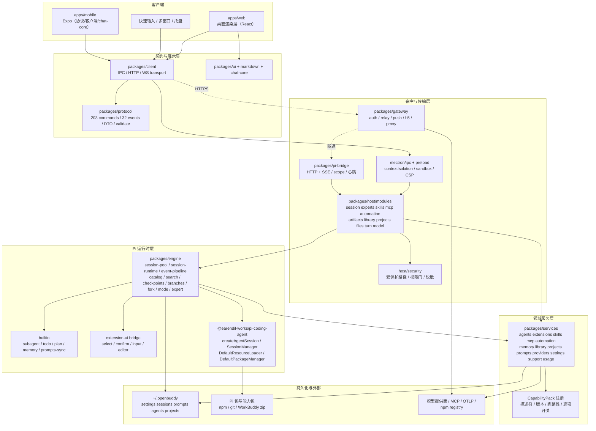
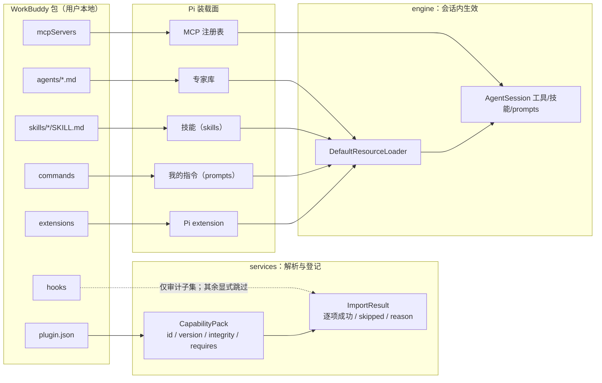
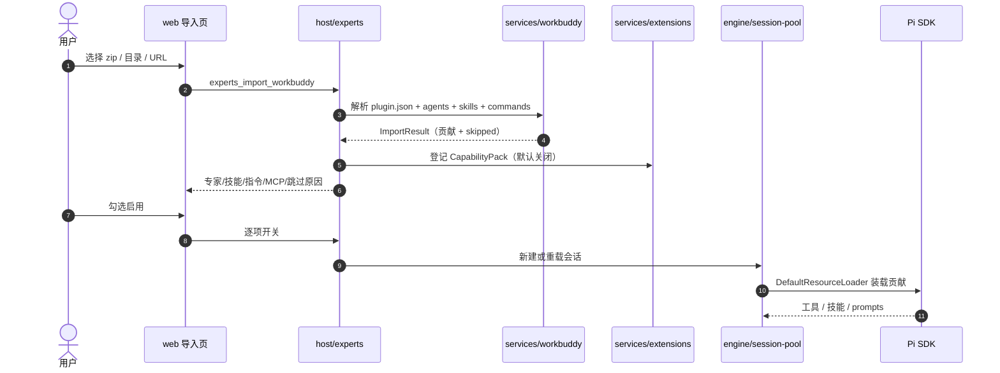
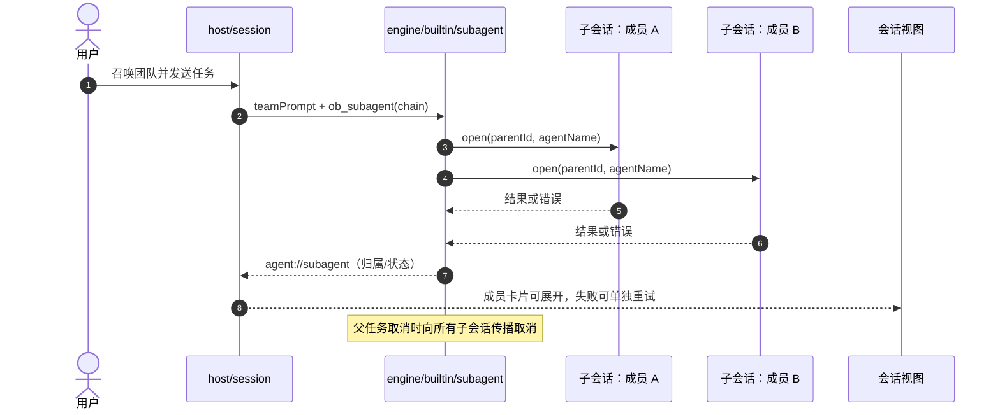
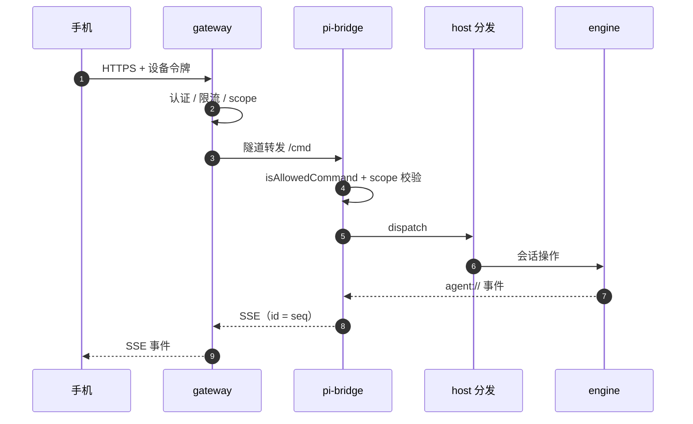
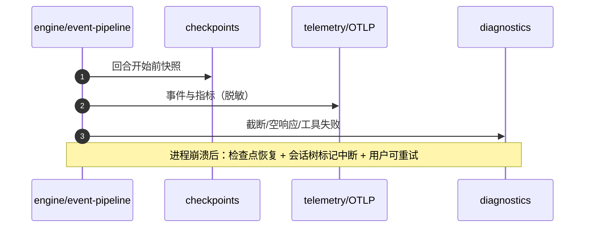
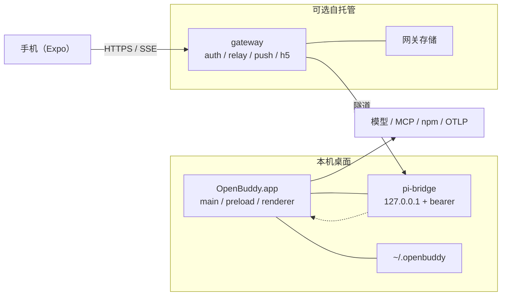

# 20261119 — OpenBuddy 下一阶段计划（Beta → GA）

> **日期**：2026-11-19
> **基线**：分支 `refactor/modularization`；工作区包含 S14–S21 与移动端并行改动（部分未提交）。
> **方法**：代码/配置实测 + 全量测试 / 类型检查 / 边界门禁 / IPC 契约 + 真机 Electron E2E + 既有计划（`20261118.md`、`20261117-mobile.md`）交叉验证 + WorkBuddy 5.11.3 静态产物对照。
> **关系**：`20261118.md` 记录评估与 S14–S21 实施；本文只定义**下一阶段计划**，不重复已完成项。
> **说明**：`docs/` 在 `.gitignore` 中，本文件入库需要 `git add -f`。本文不含代码改动。
> **度量口径**：百分比按计划条目加权估算，不是时间/工作量承诺；"计划完成度"与"GA 就绪"不是一回事。

---

## §0 结论先行

**一句话**：OpenBuddy 的功能面与 Pi 插件生态已到 **Beta+（单用户可用、可演示、可内部试点）**；距离公开 GA 仍差 **可观测、可恢复、可分发** 三件工程化的事。

**当前进度（加权，详见 §6）**

| 维度 | 完成度 |
|---|---:|
| 核心功能 | 88% |
| Pi 插件生态 | 74% |
| WorkBuddy 专家兼容 | 80% |
| UI 对标 WorkBuddy | 60% |
| 质量门禁 | 92% |
| 可观测 / 数据恢复（P0） | 25% |
| 发布工程（P0） | 10% |
| i18n / 无障碍 | 25% |
| 文档与支持 | 30% |
| **加权总体** | **约 60%** |

**下一阶段策略：双线并行，P0 为主**

1. **主线（P0，阻塞 GA）**：可观测 → 数据恢复 → 签名/自动更新 → 性能预算 → 三平台发布流程。
2. **并行线（P1，限时/限额）**：Pi 生态收尾、WorkBuddy 深度兼容、UI 系统化、i18n/无障碍、文档与支持。
3. **P2 差异化**：市场后端、协作、企业、移动/P2P、创意产物、SaaS —— P0 完成前不投入主要精力。

**三个必须先解决的 P0**

1. **可诊断**：应用级 ErrorBoundary、主进程崩溃捕获、结构化日志与轮转、脱敏诊断包。
2. **可恢复**：schemaVersion + 顺序迁移、升级前快照、损坏自愈、全量导出/恢复。
3. **可分发**：macOS 签名/公证、Windows 签名、自动更新、灰度与回滚、关于页。

---

## §1 基线证据（2026-11-19 实测）

| 维度 | 结果 | 来源 |
|---|---|---|
| 全量测试 | **235 个文件 / 1729 项全绿** | `pnpm test` |
| 类型检查 | 渲染层 + 主进程 0 错误 | `pnpm typecheck` |
| 边界门禁 | `BOUNDARIES_OK`：layer 1、forbidden 0、bridge 27、feature-deep 44、feature-edge 20、cycle 1、unreachable 76、size 4 | `node tools/check-boundaries.mjs --check` |
| IPC 契约 | `missingHandlers: []`，`deferred_not_whitelisted: 19` | `pnpm audit:ipc` |
| 宿主命令 / 事件 | 桌面 203 条命令 / 32 个事件 | 真机 `host_capabilities` |
| 真机 E2E | **E2E_PASS，58 步 / 645 次 IPC / 101 个命令** | `tools/verify/e2e-shots.mjs` |
| 构建产物 | `dist/` 7.3 MB，`dist-electron/` 1.6 MB | `du -sh` |
| Pi / Electron | `@earendil-works/pi-coding-agent` 1.5.2；Electron 45.3.0 | `package.json` |
| 发布流水线 | macOS/Windows 未签名打包；**无签名、无公证、无自动更新、无 Linux** | `.github/workflows/release.yml`、`electron-builder.yml` |
| 可观测缺口 | 应用级 ErrorBoundary 0 处；无 `electron-updater`；无 schemaVersion/迁移 | 代码检索 |
| 工作区 | `refactor/modularization`，含未提交的 S18–S21 与移动端改动 | `git status` |

**已完成基线（S14–S21，详见 `20261118.md`）**

- S14 Pi 包安装/移除/更新；S15 npm `pi-package` 市场搜索；S16 包声明持久化、包内技能/指令加载、分页排序；S17 逐包资源开关；S18 WorkBuddy 专家包导入；S19 统一页头/页签；S20 首页对标 WorkBuddy；S21 WorkBuddy 团队包 → 团队指令。
- **B1b（2026-11-19）**：WorkBuddy 包内 `skills` / `commands` / `mcpServers` 解析并落到 Pi 装载面；`hooks` / `extensions` 显式跳过并给出原因。验证见 §10.12。
- **B2a（2026-11-19）**：`ob_subagent` 支持 `steps[]`，每个子会话绑定自己的专家（模型/思考/工具/人设）；团队事件带 `team/role/index`，内置专家 id 可解析。验证见 §10.13。

---

## §2 现状盘点

### 2.1 核心能力

| 能力 | 状态 | 证据 / 说明 |
|---|---|---|
| 对话 / 流式 / 工具审批 | ✅ | 真机 E2E 主链路 |
| 产物工作台（文件树/预览/版本/批注） | ✅ | E2E 覆盖 |
| 专家 / 技能 / 连接器 | ✅ | 12 位内置专家、技能目录、真实 MCP |
| 自动化（定时/文件触发/托盘） | ✅ | E2E 覆盖 |
| 记忆 / 资料库 / 项目 | ✅ | E2E 覆盖 |
| 本地模型 / OpenAI 兼容 | ✅ | 本地模型设置与探测 |
| 多窗口 / 全局快速输入 | ✅ | E2E 覆盖 |
| 移动端 / P2P | ◐ | Expo + Gateway 并行开发，未随桌面发布 |

### 2.2 Pi 插件生态

| 能力 | 状态 | 缺口 |
|---|---|---|
| 安装 / 移除 / 更新 | ✅ | — |
| 市场搜索 / 分页 / 排序 | ✅ | 评分体系、服务端稳定排序 |
| 包资源汇总 / 逐包开关 | ✅ | 自定义 glob 编辑 UI |
| 包声明持久化 / 资源真正加载 | ✅ | — |
| 完整性 / 来源审查 | ◐ | 展示 npm 完整性、维护者、仓库；无自定义签名体系 |
| 离线 / 镜像 | ✗ | 离线包缓存与镜像 |
| 市场后端 / 商店 | ✗ | 模板/专家商店、安装量、评分 |
| 包更新日志 | ✗ | Pi changelog 读取与展示 |

### 2.3 WorkBuddy 兼容

| 能力 | 状态 | 缺口 |
|---|---|---|
| ZIP / 目录导入 | ✅ | 远程 URL 导入 |
| `plugin.json` / `agents/*.md` / `avatars/` | ✅ | `maxTurns`、工具/技能/连接器引用 |
| 包内 `skills/` / `commands/` / `mcpServers/` | ✅ | B1b：技能写入 `capability-packs/` 并进 `skillPaths`；指令写入 `prompts/`；MCP 注册为禁用态（§10.12） |
| `hooks/` / `extensions/` | ◐ | 显式跳过并返回原因；不静默执行第三方生命周期代码 |
| 团队包（`expertType: "team"`） | ✅ | 成员已绑定真实 Pi 子会话；角色/工具随专家生效（§10.13）；团队管理页与 `maxTurns` 待补 |
| 分类 / 标签 / 示例 / 头像 | ✅ | profession 独立字段 |
| 导入预览 / 冲突处理 | ◐ | 覆盖/跳过策略 UI |
| 内置能力包（Word/表格/幻灯片/设计/财务等） | ◐ | 可导入 WorkBuddy 包内技能；尚未自研随包分发的办公能力包（§10.4） |

### 2.4 UI 对标

| 能力 | 状态 | 缺口 |
|---|---|---|
| 52px 页头 / 18px 文本页签 | ✅ | 设置页未统一 |
| 首页标题层级 / 场景 pill / 免责声明 | ✅ | 引导卡、最近列表细节、Composer 品牌/语音入口 |
| 动效 / reduced-motion | ✅ | 空态插画、页面切换细节 |
| 设计令牌完整度 | ◐ | 490 条 vs WorkBuddy 2,113 条；缺 3xl/4xl 圆角、48px 控件与数值字号阶（§10.2） |
| 页面/面板覆盖 | ◐ | 缺项目看板、产物分享、设备连接、后台任务详情等表面（§10.2） |
| 图标 / 截图 / 品牌规范 | ◐ | 系统化规范 |
| 移动端 H5 | ◐ | 桌面页头改动后的回归 |

§10 给出本轮 REA 证据、逐流程差距、Pi 插件选型与 B1–B3 的实施顺序。§1 的测试和截图沿用原基线。

### 2.5 质量 / 发布 / 可观测

| 维度 | 状态 | 缺口 |
|---|---|---|
| 测试 / 类型 / 边界 / 契约 / E2E | ✅ | 覆盖率阈值、Windows/Linux E2E、flake 治理 |
| 应用级错误恢复 | ✗ | ErrorBoundary、崩溃捕获 |
| 日志 / 诊断 | ◐ | 诊断报告本地导出；无结构化日志/轮转/脱敏 |
| 数据 schema / 迁移 | ✗ | schemaVersion、快照、自愈 |
| 签名 / 公证 / 自动更新 | ✗ | 全部 |
| 性能预算 | ✗ | 冷启动/首 token/内存/包体门禁 |
| 依赖审计 / SBOM | ✗ | `pnpm audit`/OSV、CycloneDX |
| i18n / 无障碍 | ◐ | 现有 aria 基线；无 i18n、无读屏/对比度审计 |
| 文档 / 支持 | ◐ | 计划文档齐全；用户手册/FAQ/隐私政策未做 |

---

## §3 差距与优先级

### 3.1 P0（GA 前必须完成）

#### O1 可观测与错误恢复

- **现状**：应用级 ErrorBoundary 未实现；主进程无 `uncaughtException` / `unhandledRejection` / `render-process-gone` 统一捕获；日志仅零散 `console.*`。
- **影响**：白屏无法自救、线上问题无法定位、更新后故障无法快速回滚判断。
- **要做什么**
  - 根级 + 路由级 ErrorBoundary：重载 / 导出诊断 / 返回首页，保留草稿。
  - 主进程统一异常捕获 + 滚动日志（按大小/日期轮转，默认 7 天）。
  - 日志分级 + 脱敏（路径、Key、`Bearer`、邮箱）；合并现有诊断报告。
  - 可选崩溃上报（默认关闭、明确授权、含隐私说明）。
- **验收**：注入渲染层/主进程异常各一次，界面可恢复且诊断包完整；诊断包无密钥/绝对路径。

#### R1 数据恢复与迁移

- **现状**：`JsonStore` 原子写；无 schemaVersion / 迁移 / 快照；损坏 JSON 仅 ENOENT 回退。
- **影响**：升级/手改文件导致配置丢失，且无法跨机恢复。
- **要做什么**
  - `openbuddy.json` / `providers.json` / `projects.json` / `automations.json` / `mcp.json` / `pi-settings.json` 增加 schemaVersion 与顺序迁移。
  - 首次启动与升级前快照（保留最近 3 份）；损坏时回退最近可用快照并提示。
  - 设置 · 数据管理：一键导出/恢复全部用户数据。
  - 密钥不可用时的降级/退出策略，不静默丢 Key。
- **验收**：破坏任一 JSON 可启动并恢复；迁移幂等；导出包可在另一台机器恢复。

#### D1 分发：签名、公证、自动更新

- **现状**：`electron-builder.yml` `notarize: false`；CI `CSC_IDENTITY_AUTO_DISCOVERY=false`；无 `electron-updater`；无更新通道/回滚。
- **要做什么**
  - macOS Developer ID 签名 + notarytool 公证 + stapling；Windows Authenticode。
  - `electron-updater`（或自建源）+ 差分包；更新前检查运行中任务。
  - 灰度：内部 → 5% → 25% → 100%，每档有停止条件。
  - 失败自动回滚；保留上一个可用版本。
  - 设置 · 关于：版本、通道、检查更新、更新日志。
- **验收**：干净 macOS/Windows 安装并自动升级一次；断网/磁盘满/权限不足可恢复；回滚演练通过。

#### P1 性能预算

- **现状**：主 chunk 1.1 MB；mermaid 743 KB、katex 523 KB 已分包；无预算与 CI 门禁。
- **要做什么**
  - 预算：冷启动 p95 ≤ 2.5 s；首 token p95（云端）≤ 3 s；空闲内存 ≤ 400 MB / 长会话 ≤ 800 MB；首屏 JS gzip ≤ 400 KB；INP p95 ≤ 200 ms。
  - mermaid/katex/cytoscape 按需加载；大文件预览分块。
  - CI bundle 门禁；`stress.js` 纳入发布前。
- **验收**：预算写入 CI；连续 3 次长会话压测无内存失控；冷启动达标。

#### Q1 发布流程

- **现状**：`release.yml` 仅 macOS/Windows，未签名，无 Linux、无依赖审计/SBOM、无三平台 E2E。
- **要做什么**
  - CI 增加 Linux 打包与三平台 E2E 冒烟（启动 + 首页 + 一轮对话）。
  - `pnpm audit` / OSV 扫描 + CycloneDX SBOM；高危阻断。
  - 锁定 Node/pnpm/Electron；产物哈希与来源记录。
  - 发布说明模板与升级注意事项。
- **验收**：三平台流水线绿；高危漏洞 0；从 tag 到产物哈希可复现。

### 3.2 P1（规模化与体验）

#### E1 Pi 生态收尾

- 市场：展示 npm `score`（quality/popularity/maintenance）与下载量排序；按能力分类筛选；分页稳定。
- 完整性：展示 npm `integrity`/维护者/仓库；git 包展示 commit；不臆造"官方签名"。
- 离线：包缓存目录、离线安装/更新提示。
- 包更新日志：读取 Pi `pi.changelogPath`，在更新后展示。
- 自定义资源过滤：对象表单的 glob 编辑 UI（当前只有全开/全关）。
- 能力包：安装/禁用/回退三态，按贡献逐项开关；兼容矩阵记录 SDK/包版本与失败原因（§10.6/10.7）。

#### W1 WorkBuddy 深度兼容

- 远程 URL 导入：仅 https、大小/超时限制、禁止私网地址（SSRF 防护）、导入预览。
- `maxTurns` / 工具 / 技能 / 连接器引用映射；`profession` 独立字段。
- 包内 `skills/` / `commands/` / `hooks/` / `mcpServers/` 映射到 Pi 的 skills / prompts / 扩展 / MCP，逐项显示"已导入/已跳过/原因"（§10.5）。
- 团队：负责人/成员角色卡；成员绑定真实 Pi 子会话；导入冲突（覆盖/跳过/重命名）。
- 办公能力包：docx / xlsx / pptx 生成、排版与模板，产物进入工作台（§10.4/10.8）。

#### U1 UI 系统化

- 设置页并入统一页头；空态插画与插图规范；最近列表状态点/「查看更多」。
- 设计令牌补齐：3xl/4xl 圆角、48px 控件、数值字号阶与尺寸阶；新增样式禁止裸 px（§10.2.1）。
- 设备码授权、专家链接、自动化修订、产物独立阅读、项目置顶与任务来源 chip（§10.2.3）。
- Composer 模型品牌标识、语音入口（有真实能力才上）；右侧主动建议卡（有真实规则才上）。
- 移动端 H5 跟随桌面页头回归。

#### I1 i18n / 无障碍

- 抽取文案，`zh-CN` / `en-US`；日期/数字格式；错误码文案。
- 键盘全链路、焦点陷阱、对比度、读屏标签、减少动效。

#### S1 文档与支持

- 用户手册、故障排查、隐私政策、更新说明、FAQ；新用户 15 分钟完成首个任务。

### 3.3 P2（差异化，P0 后投入）

- 市场后端（评分/安装量/审核）、模板/专家商店。
- 协作（共享会话、评论、团队空间、权限）。
- 企业（SSO/SCIM、审计、策略、配额）。
- 移动/P2P（手机审批、推送、弱网、桌面中继）。
- 创意产物（画布/演示稿/多模态，需 Muse 调研校准）。
- SaaS（`apps/server`、租户隔离、对象存储、沙箱工作区）。

---

## §4 计划（工作流与任务）

> 不使用时间估算；以里程碑和验收为准。P0 完成前不对外 GA。

### Phase A — 可发布（P0 主线）

| ID | 工作流 | 任务 | 验收 |
|---|---|---|---|
| A1 | 可观测 | ErrorBoundary（根/路由）、主进程异常捕获、结构化日志+轮转+脱敏、诊断包 | 注入异常可恢复；诊断包无密钥/绝对路径 |
| A2 | 数据恢复 | schemaVersion+迁移、升级前快照、损坏自愈、全量导出/恢复、Key 降级 | 破坏任一 JSON 可启动；跨机恢复成功 |
| A3 | 分发 | 签名、公证、自动更新、灰度、回滚、关于页 | 干净机器安装+升级+回滚演练通过 |
| A4 | 性能 | 预算、懒加载、bundle 门禁、stress 发布前 | 冷启动/首 token/内存/包体达标 |
| A5 | 发布流程 | 三平台 CI、E2E 冒烟、依赖审计、SBOM、可复现 | 三平台绿；高危 0；哈希一致 |

### Phase B — 生态、兼容与体验（P1 并行）

| ID | 工作流 | 任务 | 验收 |
|---|---|---|---|
| B1 | Pi 生态 | npm score/分类筛选、完整性展示、离线缓存、包 changelog、glob 过滤；能力包描述符与兼容矩阵（§10.6/10.7） | 市场可按能力筛选；离线可装；更新后可见变更；安装/禁用/回退三态可复现 |
| B2 | WorkBuddy | URL 导入（SSRF 防护）、`maxTurns`/工具映射、团队角色卡、冲突策略；包内 skills/commands/hooks/mcpServers 映射；办公能力包 docx/xlsx/pptx（§10.5/10.8） | 远程包可预览并导入；团队 UI 可读；真实包导入后贡献逐项可见；三格式产物可生成并预览 |
| B3 | UI | 设置页统一页头、空态插画、最近列表细节、Composer/建议卡、移动端回归；项目置顶、设备码授权、自动化修订、产物阅读、令牌补齐（§10.2/10.8） | 主要页面视觉一致；动效尊重 reduced-motion；授权/编辑/产物路径取消后可恢复 |
| B4 | i18n/a11y | zh-CN/en-US、键盘全链路、对比度、读屏 | 自动审计 0 严重项；关键流程纯键盘可用 |
| B5 | 文档 | 用户手册、FAQ、隐私政策、更新说明 | 新用户 15 分钟完成首个任务 |

### Phase C — 差异化（P2）

| ID | 工作流 | 任务 | 验收 |
|---|---|---|---|
| C1 | 市场后端 | 搜索/评分/安装量/审核、模板/专家商店 | 可从市场安装并测试通过 |
| C2 | 协作 | 共享会话、评论、团队空间、权限 | 两人可协作同一任务 |
| C3 | 企业 | SSO/SCIM、审计、策略、配额 | 管理员可下发策略并审计 |
| C4 | 移动/P2P | 手机审批、推送、弱网、桌面中继 | 手机上批准桌面任务 |
| C5 | 创意产物 | 画布/演示稿/多模态（Muse 校准后） | 按调研结论定义 |
| C6 | SaaS | `apps/server`、租户隔离、对象存储、沙箱 | 浏览器连服务器跑通完整一轮 |

---

## §5 顺序、依赖与里程碑

**推荐顺序**：A1 → A2 → A3 → A4 → A5；B1–B5 与 A 线并行，但**每个迭代只允许一个 P1 工作流**，避免挤占 P0。

**依赖**

- A3 依赖 A1/A2（更新失败要能回滚、问题要能定位）。
- A5 依赖 A3/A4（签名产物 + 性能预算进 CI）。
- B2 依赖 A1（导入失败的诊断）与 B1（包缓存）；B2b 办公能力包依赖 B1a 的资源装载。
- B4 依赖 B3（页面结构稳定后再抽文案）。

**里程碑**

| 里程碑 | 内容 | 判定 |
|---|---|---|
| M0 基线 | 本文与 `20261118.md` 对齐；工作区提交/清理 | 基线可复现 |
| M1 可诊断/可恢复 | A1 + A2 | 注入异常可恢复；破坏 JSON 可启动 |
| M2 可分发 | A3 + A5 | 干净机器安装/升级/回滚；三平台绿 |
| M3 GA Gate | A4 + B4 + B5 | 预算达标；i18n/a11y 基线；文档发布 |
| M4 扩展 | B1/B2/B3 收尾 | 生态与 UI 达到 Beta+ 稳定 |

---

## §6 进度度量

**方法**：按 §0 的九个维度加权；每个维度按计划条目完成数（含验收通过）估算；权重：核心 20%、生态 15%、兼容 10%、UI 10%、质量 10%、可观测/恢复 15%、发布 10%、i18n/a11y 5%、文档 5%。

**当前**

| 维度 | 权重 | 完成度 | 加权 |
|---|---:|---:|---:|
| 核心功能 | 20% | 88% | 17.6 |
| Pi 生态 | 15% | 74% | 11.1 |
| WorkBuddy 兼容 | 10% | 80% | 8.0 |
| UI | 10% | 60% | 6.0 |
| 质量门禁 | 10% | 92% | 9.2 |
| 可观测/恢复 | 15% | 25% | 3.75 |
| 发布工程 | 10% | 10% | 1.0 |
| i18n/a11y | 5% | 25% | 1.25 |
| 文档 | 5% | 30% | 1.5 |
| **合计** | 100% | — | **59.7 → 约 60%** |

> §10 的插件清单与 UI 令牌实测后，本表按证据重估：Pi 生态 72→74（B2a 用 Pi 子会话 + 专家绑定验证了运行时能力；插件兼容仍未实测）、WorkBuddy 兼容 76→80（B1b + B2a；办公能力包与远程 URL 仍未完成）、UI 65→60（令牌与表面覆盖缺口）、可观测/恢复 10→25（已有遥测契约与 OTLP provider，但缺应用级 ErrorBoundary、崩溃捕获与日志轮转）。
>
> 上一版 §19 为 62%；本版按更严格的权重（可观测/恢复 15%）重算约 60%。两者差异来自权重，不是回退。

**更新规则**：每次迭代结束更新本表与 `20261118.md` 的 §19；只有验收通过才计入完成度。

---

## §7 风险登记

| 风险 | 影响 | 对策 |
|---|---|---|
| 签名/公证证书与流程未配置 | 无法 GA | 提前申请证书；CI secrets；本地演练 |
| 自动更新破坏运行中任务 | 数据/任务丢失 | 更新前检查 `tasks_list`；可延迟；失败回滚 |
| 日志含敏感路径/Key | 隐私事故 | 统一脱敏；测试覆盖；诊断包审计 |
| schema 迁移失败 | 配置丢失 | 快照 + 幂等迁移 + 回滚；夹具测试 |
| 大依赖拖慢首屏 | 体验差 | 按需加载；预算门禁 |
| WorkBuddy 远程导入 SSRF | 内网探测 | 仅 https、DNS/IP 校验、禁私网、大小/超时限制 |
| 移动端并行分支冲突 | 合并回归 | 合并前 `test:mobile` + 弱网 e2e |
| P1 工作挤占 P0 | GA 延期 | 每迭代只允许一个 P1 工作流；里程碑门禁 |
| 竞品快速迭代 | 差异化不足 | 先完成 P0，再按调研投入 P2 |

---

## §8 验证与复现命令

```bash
pnpm install --frozen-lockfile
pnpm test
pnpm typecheck
node tools/check-boundaries.mjs --check
pnpm audit:ipc
pnpm build:electron
node tools/verify/e2e-shots.mjs docs/plan/shots-latest
```

**新增/待接入的门禁**

- 覆盖率阈值（packages ≥ 70%）。
- 三平台 E2E 冒烟。
- bundle 体积预算与冷启动/内存采样。
- `pnpm audit` / OSV + SBOM。

---

## §9 本轮不做 / 待决策

- 不引入新的状态库或 UI 框架。
- P0 阶段不做 SaaS 多租户与实时协作。
- 不在未核验竞品的情况下复制功能。
- 待决策：自动更新通道（GitHub Releases / 自建 / 对象存储）；崩溃上报供应商；i18n 首批语言；移动端发布节奏；团队角色卡/轮数上限是否作为默认编排；办公能力包是否随安装包分发（当前仅市场可选）。

---

## §10 WorkBuddy 交付产物与 Pi 实施设计

### 10.1 证据与覆盖边界

本机 WorkBuddy `CFBundleShortVersionString` 为 `5.11.3`，`app.asar` SHA-256 为 `45965c389b9674ef359fb5fc331a40ca0c0777c8380104f2e9ea8950bced614f`。包头索引 12,186 个条目（含 unpacked）；渲染层 3,076 个 JS、184 个 CSS。整包 REA 需解析 9,354 个源码，进程在解析早期退出（日志停在 82/9,354），未产出 Evidence，因此本文不使用整包结论，改用两批定向样本：

| 样本 | 内容 | Subject SHA-256 | Evidence ID |
|---|---|---|---|
| S-FLOW（6 模块） | 引导、专家链接、设备码、自动化编辑、独立产物面板 | `dfe1cdcf22e2631b9b462e7b5a212d6ac9ff68f65b55b49f234c833dcdebb391` | `ev_d84f1f37999f487ffc3a79413cd741b11cff8f7f884c7a388911f031b7174ec0` |
| S-UI（16 模块） | 首页、聊天、设置、资料库、项目列表/详情、自动化、专家/技能选择器、连接器、产物、命令面板、后台任务、账号与额度、侧栏状态 | `644ef4e729e59059393802ab82a2230afbd2232d669379517876b7ab0ddc4559` | `ev_864fc4dd2aa1cce4309f1605a2957d8dfb0c63e66b9675f959491734a680a478` |
| S-IPC（3 模块） | `preload/index.js`、`main/expert-executor.js`、`main/expert-summon-guard.js` | `a19f1a1db9d6d956cff72f788e5bde81836a9dc3ce9dc476db73d1ca1b541507` | `ev_068deada504a1de217f4fdbe62eccff30c853775bfdf111979a21a7e07724b41` |

S-IPC 的 REA 结果含 70 个 `ipc-channel`、65 个 context-bridge API、7 个 handler；同时 REA 明确记录"动态通道表达式无法解析"，因此通道总量改用预加载脚本的字符串盘点：**776 个唯一 `domain:action` 通道、40+ 域**。通道存在不等于可达或启用，运行时仍以真机为准。

补充静态盘点（unpacked 资源，非 REA）：`resources/plugins/workbuddy-builtin/` 共 921 个文件、8 个顶层组——`builtin-plugins`（473 文件 / 13 个插件）、`skills`（372 文件 / 25 个技能包）、`interactionmode`（craft / ask / expert / plan / quick）、`welcomemode`（design / claw / code / work）、`prompt-common`、`mcps`、`hooks`、`.codebuddy-plugin/marketplace.json`。`plugin.json` 常见字段为 `skills`(9)、`hooks`(6)、`mcpServers`(4)、`commands`(3)、`agents`(3)、`extensions`(1)、`defaultEnabled`(2)；`curated-experts.json` 为 `version: 1` 的候选清单，含 `priority` 排序。S-FLOW 的模块级观察见下表；S-UI 主要用于 §10.2 的界面盘点。

| 模块 | 可复查的静态观察 |
|---|---|
| `DataImportOnboardingHost` | `getAccount`、`claimOnboarding`、订阅清理 |
| `onboarding-DHGAP_9S` | 按服务解析引导内容（文档/IMA/Ardot 等）、`openExternal` |
| `expert-url-entry-coordinator` | `consumeExpertIdFromUrl`、`markConsumedOnce`、`replaceState` |
| `connector-device-code-modal` | 复制、剩余时间、关闭、`cancelMcpConnector` |
| `automation-run-group-edit-dialog` | draft/patch、工作区、显式权限、提权确认、交付通道可用性 |
| `standalone-artifact-panel` | 独立产物面板入口 |

以上均为静态证据：i18n 文案在语言包中，运行时灰度、服务端分享、真实授权成功率与像素尺寸不在样本内。视觉回归可复用 `docs/plan/shots-20261118-s20/`，像素差异必须补同视口、缩放、主题的 WorkBuddy 截图。

### 10.2 UI 差距

#### 10.2.1 令牌级（可直接量化）

| 维度 | WorkBuddy（`common-B2YH9b6_.css`，2.17 MB） | OpenBuddy（`packages/ui/src/styles/tokens.css`） | 影响 |
|---|---|---|---|
| CSS 自定义属性 | 2,113 条 `--wb-*` 声明（最大样式表） | 约 490 条（`tokens.css`） | 缺少组件级语义令牌，样式散落在页面 CSS |
| 圆角 | xs 2 / sm 4 / md 6 / lg 8 / xl 12 / 2xl 16 / 3xl 20 / 4xl 24 | 到 2xl 16，另有 full | 大卡片、弹层无法与 WorkBuddy 对齐 |
| 控件尺寸 | 24 / 32 / 40 / 48（`size-control-*`） | 24 / 32 / 40 | 主操作 48px 场景缺失 |
| 字号阶 | 8/10/12/13/14/16/18/20/24/28/32 | 语义阶 14/16/20/24/32 | 10–13px 元信息与 18px 页签只能写魔法数 |
| 尺寸阶 | 12–68 共 14 档 | 未系统化 | 头像、图标、行高易漂移 |

结论：**不是"没有令牌"，而是令牌覆盖不足以支撑 WorkBuddy 的密度**。应以增量方式补 `3xl/4xl`、`size-control-xl`、数值字号阶与尺寸阶，不重写现有色板。

#### 10.2.2 表面级（页面/面板覆盖）

| 表面 | WorkBuddy 证据 | OpenBuddy | 处理 |
|---|---|---|---|
| 侧栏分组 | `use-sidebar-state`：pinned / assistant / enterprise 分区 | 最近/任务分组 | 补置顶与分区折叠状态持久化 |
| 首页 | `app-home`：hero、场景、模板、项目/部署卡 | 已有场景/模板/草稿 | 仅补引导与空态（B3） |
| 会话与回合 | `chat`、审批、分支、后台任务终端输出 | 已覆盖主链路 | 补后台任务详情与终端输出折叠 |
| 产物 | `artifact`：预览 URL、下载、分享详情、可见性 | 文件树/预览/版本/批注 | 补分享与可见性（C2 前置：本地导出） |
| 项目 | `project-list-page` / `project-detail-page`：配额守卫、置顶、模板、任务来源 | 项目 + 模板 | 补置顶/配额/任务来源 chip |
| 市场 | `skill-picker`：marketplaces、无限滚动、已安装 provider；`expert-picker`：市场专家、云遥测 | npm Pi 市场 + 专家中心 | 补服务端目录/评分/安装量（C1） |
| 连接器 | `connector` + 设备码弹层 + token 门禁 | MCP 服务/测试/工具规则 | 补设备码授权尝试（B3） |
| 设置 | 20 个 Panel/Dialog（账号、额度、实验室、设备、数据、记忆、模型、个性化、安全等） | 15 个设置面板（含账号/额度/移动访问/帮助） | 缺实验室、反馈与外部代理接入；设备与额度已有基础 |
| 账号/计费 | `AccountPanel`、`CreditsUsageEmbedPanel`、`SubscriptionUsagePanel`、签到 | BYOK，无计费 | **不复制**；提供 token/费用面板 |
| 帮助/反馈 | `GetHelpPanel`、`FeedbackModal`、`HelpFeedbackPanel` | 帮助设置页 | 补反馈入口（B3） |

#### 10.2.3 组件与交互细节

- **设备码授权**：WorkBuddy 的弹层包含复制、剩余时间、关闭即取消；OpenBuddy 目前只有 MCP 测试连接。目标：服务端持有尝试 ID/到期时间，关窗调用取消，授权完成回到原任务。
- **专家链接**：`consumeExpertIdFromUrl` + `markConsumedOnce` 防重复消费；OpenBuddy 无链接入口。目标：同一链接幂等，已安装 ID 直接打开详情。
- **自动化编辑**：WorkBuddy 在编辑对话框内做 draft/patch、提权确认与交付通道可用性；OpenBuddy 已有 `AutomationPermissionConfirmDialog`，但缺"编辑不影响运行中任务"的修订语义。目标：保存生成新修订，旧执行记录保持原配置。
- **项目**：WorkBuddy 有配额守卫与置顶；OpenBuddy 无。目标：先做置顶与空态，配额在 C 线。
- **市场**：WorkBuddy 无限滚动 + marketplace 分组；OpenBuddy S15 为分页/排序。目标：统一分页契约，服务端稳定排序后再做无限滚动。
- **后台任务**：WorkBuddy 有独立终端输出模块；OpenBuddy 的 bash 输出在回合内。目标：长任务可折叠/展开，不阻塞对话。
- **无障碍与键盘**：WorkBuddy 弹层有 ESC/遮罩关闭；OpenBuddy 已有 `aria-modal` 基础。目标：设备码、分享、市场三处补焦点陷阱与 ESC。

#### 10.2.4 验收方式

1. 令牌 lint：新增样式必须引用令牌，禁止裸 `px` 字号/圆角（白名单除外）。
2. 同视口截图对照：1440×900、1280×800、1024×768，亮/暗主题，100%/125% 缩放。
3. 组件状态清单：默认/悬停/聚焦/禁用/加载/错误/空态/长文本，逐项截图。
4. 键盘与读屏：Tab 顺序、ESC、焦点归位、`aria-live` 播报。

### 10.3 按用户任务拆解差距

| 用户任务 | OpenBuddy 现状与差距 | 工作项和可操作的验收 |
|---|---|---|
| 从首页开始工作 | `features/home/HomePage.tsx` 已把场景、模板和草稿接到共享 Composer。W1/W2 的引导随上下文变化 | B3 在空工作区显示接入模型或导入资料的下一步。配置完成后消失，返回时恢复原草稿，键盘能走完全程 |
| 恢复上次任务 | 已有 `session-search.ts` 和侧栏，最近列表视觉细节待核对 | B3 复用会话索引和稳定 ID。用同名会话、已归档会话和长标题验证选中、定位与焦点恢复 |
| 语音输入 | `features/composer/voice-contract.ts` 有 provider 契约，首页实际使用共享 Composer。示例按钮不足以验证录音可用 | B3 以提供方、麦克风权限和录音状态驱动入口。转写追加到草稿供编辑，拒绝授权或取消时保留原文 |
| 导入并召唤专家 | 已有预览、角色详情和召唤。W3 提示链接重复消费风险。专家链接与远程 ZIP 是两种输入 | B2 先解析意图，已安装 ID 打开详情，远程包走下载、预览及冲突处理。重复打开同一链接只执行一次导入 |
| 让团队分工 | `services/src/agents/workbuddy.ts` 输出 lead 和成员，S21 安装团队指令。`engine/src/builtin/subagent.ts` 已创建内存 Pi 子会话，截图 36/37 已有执行卡 | B2 展示角色、有效工具和轮数。用两个成员验证结果归属、部分失败和父任务取消。重点核对 `pi-engine.ts` 的 `open` 转发是否保留 `parentId/agentName` |
| 连接外部工具 | 原有 MCP 服务、会话工具开关和测试入口可复用。W4 给出了授权等待期间的细节 | B3 由服务端持有授权尝试 ID、到期时间和取消状态。复制设备码、过期重试、关窗取消、授权后回原任务分别验收 |
| 创建并修改自动化 | 已有定时、文件触发、执行记录和通知。W5 将运行位置、权限和交付目标放在编辑流程中 | B3 编辑时回显生效配置，扩大权限需确认。取消编辑不改变旧任务，目标不可用时保留运行记录和重试入口 |
| 从对话查看产物 | 已有文件树、版本、批注、外部变动提示与多窗口。W6 支持评估独立阅读入口 | B3 从产物卡打开同一版本，验证两处刷新、关闭后焦点归位及文件删除态。云分享转 C2 单独验证权限与撤销 |
| 安装扩展、跨端使用 | 已有 S14–S17 的包管理和资源开关。桌面扩展可能依赖终端 UI，手机通过 Gateway 工作 | B1 显示包贡献的资源、所需宿主和不可用原因。B4 在窄屏、读屏、暗色下验证安装失败、审批及重连后的任务状态 |

表内 `features/` 指 `apps/web/src/features/`，`engine/`、`services/` 位于 `packages/`。语音、最近列表和跨端项目来自仓库核查与产品设计，尚待 WorkBuddy 运行时对照。项目、资料库、记忆、模型选择和用量沿用 §2 基线，按回归项维护。企业服务与协作见 Phase C。

### 10.4 功能差距（能力域）

WorkBuddy 的内置能力以插件与技能包形式随包分发：`builtin-plugins/` 有 13 个插件、473 个文件（`workbuddy-docx` 136、`tencent-docs-plugin` 76、`tencent-private-docs-plugin` 85、`ardot` 41、`workbuddy-sheetagent` 39、`workbuddy-pptx` 33、`workbuddy-creative` 16 等）；`skills/` 另有 25 个技能包、372 个文件（`library` 130、`workbuddy-finance-skill` 63、`paper` 41、`mini-program-development` 36、`cloud-service` 20、`expert-manager` 14、`workbuddy-local-office-edit` 9、`skill-creator` 6、`workbuddy-pdf` 4 等）。下表按能力域对照；"不复制"指腾讯账号、计费与微信生态等绑定产品，不是能力缺口。

| 能力域 | WorkBuddy 证据 | OpenBuddy | 决策 |
|---|---|---|---|
| Word 文档 | `workbuddy-docx` 136 文件：`tdoc-orchestrator`、`doc-typeset`、`design-token`、9 类文档专家 | 仅预览，无生成依赖（无 docx/pptx/xlsx 库） | **B2b 办公能力包**：以 Pi skill 形式实现生成/排版/模板，产物进工作台 |
| 表格 | `workbuddy-sheetagent` 39 文件 + MCP `sheetagent`；`workbuddy-smartsheet` | 无 | 同上；本地 xlsx 优先，云表格走可选 MCP |
| 幻灯片 | `workbuddy-pptx` 33 文件 | 无 | 同上 |
| 思维导图 | `tencent-xmind` | 无 | P2 可选包 |
| PDF / 本地 Office 编辑 | `workbuddy-pdf` 4 文件、`workbuddy-local-office-edit` 9 文件 | 文件类型可识别，预览依赖本地能力 | B2b 一并覆盖导出/编辑；云编辑不复制 |
| 运行模式 | `interactionmode`：craft / ask / expert / plan / quick；`welcomemode`：design / claw / code / work | 引擎有 craft/只读模式，首页 3 场景 | B3 对齐模式命名与欢迎模式文案，不新增运行时 |
| 设计与创意 | `ardot` 41 文件（UI/海报/幻灯片/设计转代码）、`workbuddy-creative` 16 文件（品牌/图像/视频）、`miora-*` | 无 | P2；需模型与版权策略，不随主包默认启用 |
| 知识库 | `library` 130 文件、腾讯文档/IMA 插件、书/邮件/日历检索 | 资料库（本地） | 保留本地为默认；云文档作可选连接器 |
| 财务/研报 | `workbuddy-finance-skill` 63 文件；内置专家含股票研究 | 有研究类专家，无财务包 | 作为可选专家包/技能包，不内置数据源 |
| 项目管理 | `project-list/detail`：模板、置顶、配额、任务来源、云任务 | 项目 + 模板 | 补置顶/任务来源；配额与云任务进 C 线 |
| 团队与待办 | `builtin-teams-todo`、`expert-manager`、团队角色卡 | 团队 = 我的指令 + `ob_subagent` 链 | **B2a**：成员→真实子会话、角色/工具/轮数可见 |
| 市场 | `skill-picker`（marketplace、无限滚动）、付费技能、已购专家、插件市场、连接器商店 | npm Pi 市场 + 专家中心 | B1 补服务端目录/评分/安装量；C1 建后端 |
| 技能创建/推荐 | `skill-creator` 6 文件、`recommend-connectors` / `recommend-experts` | 可导入技能，无创建向导与能力推荐 | B1 做创建向导；推荐只基于本地已装能力，避免营销位 |
| 账号/计费 | 积分、订阅、签到、企业提示 | BYOK 无计费 | **不复制**；改为 token/费用面板（pi-token-usage 可参考） |
| 渠道 | 企微机器人、公众号、IM 频道、agent-mail | agent-mail 设置、移动网关 | P2；先做通知渠道，不做平台代运营 |
| 分享/协作 | 产物分享、可见性、分享追踪 | 无 | C2；先本地导出，后做 ACL 与服务端分享 |
| 设备/跨端 | `DeviceConnectionsPanel`、OneID、手机配对 | 移动端配对（v3） | C4 补设备管理与弱网恢复 |
| 引导/导入 | `onboarding` 按服务、`DataImportOnboardingHost` | 无统一引导 | B3 做上下文引导（模型/资料/专家） |
| 运行时可观测 | 遥测/性能/额度面板 | 遥测契约 + OTLP provider，无崩溃捕获 | A1 接入崩溃/回合恢复，复用现有 telemetry |

**优先级判据**：用户任务重复发生、Pi 能表达、产物可验证——三者同时满足才进入 B 线。办公产物（docx/xlsx/pptx）是唯一同时满足且 WorkBuddy 有强证据的域，列为 B2b 第一优先。

### 10.5 WorkBuddy 插件格式 → Pi 能力映射

WorkBuddy 的 `plugin.json` 是能力清单；OpenBuddy 的导入器目前只消费 `agents` 与头像，其余字段被静默忽略。目标是把每个字段映射到 Pi 的真实装载面，并给出逐项状态。

| `plugin.json` 字段 | Pi 对应面 | OpenBuddy 现状 | 目标与验收 |
|---|---|---|---|
| `agents[]` / `agents/*.md` | 专家（人设 Markdown） | ✅ 导入为我的专家 | 保持；补 `maxTurns` 与 `profession` |
| `settings.json { agent }` | 团队 Lead | ✅ 团队包 | 保持；校验 Lead 必须存在 |
| `skills[]` / `skills/*/SKILL.md` | Pi skills（`DefaultResourceLoader` 装载） | ✅ 写入 `capability-packs/<pack>/skills/` 并进 `skillPaths` | E2E：`skills_list` 可读回；`enabled` 受 `defaultEnabled` 控制 |
| `commands[]` | Pi prompts（`promptsOverride` 合并包内 prompts） | ✅ 写入 `<pi>/prompts/<name>.md` | 同名文件不覆盖用户版本，返回 `skipped` 原因 |
| `hooks` | 生命周期命令；Pi 侧对应 extension 或宿主钩子 | ◐ 显式跳过 | 显示"需要宿主权限"，不静默执行 |
| `mcpServers` | MCP 服务注册 | ✅ 注册到 `mcp.json`，`enabled: false` | 同名服务保留用户配置；授权由连接器页完成 |
| `extensions` | Pi extension 路径 | ◐ 显式跳过 | 提示到扩展中心单独确认 |
| `defaultEnabled` | 资源默认开关 | ◐ 全局开关 | 改为逐贡献默认值，用户覆盖优先 |
| `category` / `keywords` | 市场元数据 | ◐ 部分 | 统一到能力包描述符 |
| `workbuddy.requiresProductFeature` | 能力门禁 | ✗ 忽略 | 映射为 capability 描述符，缺失时禁用并说明 |
| `${VAR}` 占位符 | 环境变量/配置 | ✗ 未解析 | 仅白名单变量；日志与诊断包脱敏 |

**2026-11-19 已实现**：`skills` / `commands` / `mcpServers` 三类映射已落地（`services/agents/capability-pack.ts`）。真实 `workbuddy-docx` 导入 3 位专家 + 8 个技能；E2E 读取到禁用的 MCP 条目。`hooks` / `extensions` 仍显式跳过。验证见 §10.12。

**导入结果契约**：`ImportResult { packId, version, contributions: { experts[], skills[], prompts[], mcpServers[], extensions[], hooks[] }, skipped: [{ item, reason }], requires: string[] }`。任一贡献失败不影响其余；UI 必须显示"导入了什么、跳过了什么、为什么"。

**验收夹具**：用真实 `workbuddy-docx` 包验证 9 位专家 + 4 个技能 + prompts 全部落库；用 `workbuddy-sheetagent` 验证 MCP 条目注册为禁用态；用缺字段的合成包验证 `skipped` 原因可读。仅解析用户本地提供的包，不随应用分发第三方内容。

### 10.6 Pi 插件生态与选型

本轮扩大检索到公开 registry 的 `pi-coding-agent extension` 结果（273,034 条中取前 60 条），再对候选核对版本、`pi` manifest 与 peer 范围。分组如下；所有候选都**不默认捆绑**，以市场条目 + 兼容记录的方式提供。

| 分组 | 候选（版本 / manifest / peer） | 与 OpenBuddy 的关系 | 决策 |
|---|---|---|---|
| 多代理/团队 | [pi-clankers 2.0.0](https://registry.npmjs.org/pi-clankers/2.0.0)（extensions；TUI peer）、[pi-godview 0.2.0](https://registry.npmjs.org/pi-godview/0.2.0)（extensions）、[pi-subagents 0.89.0](https://registry.npmjs.org/pi-subagents/0.89.0)（extensions/skills/prompts） | 内置 `ob_subagent` 已可运行真实子会话；这些包提供编排板/脚本流程 | 先贯通 B2a；仅当脚本工作流或并行看板成为刚需时做对照试验，检查重名工具与取消 |
| 回合恢复 | [pi-continuity 0.5.0](https://registry.npmjs.org/pi-continuity/0.5.0)（extensions）、[pi-context-persistence 0.1.1](https://registry.npmjs.org/pi-context-persistence/0.1.1)、[pi-condense 2.18.0](https://registry.npmjs.org/pi-condense/2.18.0) | 对应 A1 的截断/失败流恢复与长上下文压缩 | **优先评估 pi-continuity**；行为并入 A1 的恢复策略，不直接依赖 |
| 记忆 | [pi-memory 0.4.2](https://registry.npmjs.org/pi-memory/0.4.2)（extensions；`pi-ai >=0.81.1`） | 已有记忆/资料库 | 作为记忆后端候选；先验证数据落盘位置与检索质量 |
| 可观测/成本 | [@raindrop-ai/pi-agent 0.2.9](https://registry.npmjs.org/@raindrop-ai/pi-agent/0.2.9)、[pi-phoenix-otel 0.3.0](https://registry.npmjs.org/pi-phoenix-otel/0.3.0)、[pi-token-usage 0.2.1](https://registry.npmjs.org/pi-token-usage/0.2.1) | 已有 telemetry 契约 + OTLP exporter | 复用现有契约；仅借鉴事件模型；token/费用面板可参考 pi-token-usage |
| 移动/跨端 | [pi-hail 0.8.0](https://registry.npmjs.org/pi-hail/0.8.0) | 已有 Gateway + pi-bridge + 手机配对 | 不替换现有桥；作为"手机旁观会话"交互参考，C4 评估 |
| 沙箱/浏览器/LSP | [@daytona/pi 0.191.2](https://registry.npmjs.org/@daytona/pi/0.191.2)、[pi-chrome-use 1.1.1](https://registry.npmjs.org/pi-chrome-use/1.1.1)、[pi-lsp-extension 1.4.0](https://registry.npmjs.org/pi-lsp-extension/1.4.0) | 本地工具已覆盖 bash/编辑；无远程沙箱与浏览器 | P2 可选；沙箱涉及凭据出网，需单独安全评审 |
| 通用工具 | [pi-web-access 0.48.0](https://registry.npmjs.org/pi-web-access/0.48.0)、[pi-mcp-adapter 7.0.1](https://registry.npmjs.org/pi-mcp-adapter/7.0.1)、[pi-interactive-shell 0.18.0](https://registry.npmjs.org/pi-interactive-shell/0.18.0)、[pi-voice 0.4.0](https://registry.npmjs.org/pi-voice/0.4.0) | 已有 MCP 服务与 Composer 契约 | web-access 可试点；MCP adapter 仅做外部配置导入；interactive-shell 标注终端限制；pi-voice registry 未列 `pi` manifest，暂缓 |

**准入夹具**（B1 统一执行）：`DefaultPackageManager` 安装固定版本 → `DefaultResourceLoader` 装载贡献 → 创建真实会话 → 触发工具与 `agent://ui-request` → 禁用后新建会话确认消失 → 回退上一版本。记录加载错误、所需宿主、版本、权限与数据去向，形成 `tools/compat/pi-matrix.json`。第三方 JS 以宿主权限运行，工具审批只覆盖经引擎发起的调用；试点使用独立工作区与无生产凭据的进程。

### 10.7 架构总览

目标结构不新增运行时，只把"能力包"提升为一等公民。图按当前代码分层绘制；`tools/check-boundaries.mjs` 是边界的唯一判据，图与代码不一致时以门禁为准。

#### 10.7.1 分层图（现状 + 规划）



实线为进程内导入，虚线为网络边界。手机不导入 `gateway`：它通过 HTTPS/SSE 访问网关，网关再把请求转给桌面内的 `pi-bridge`。

#### 10.7.2 依赖不变量（摘自边界门禁）

| 层 | 允许导入 | 禁止 | 说明 |
|---|---|---|---|
| `protocol` | 无 | `node:*` / react / electron / Pi SDK | 纯类型与校验，桌面与手机共用 |
| `kernel` | protocol | electron / react | 平台无关基础能力 |
| `services` | kernel / protocol | electron / react | 领域状态与持久化 |
| `engine` | services / kernel / protocol | electron / react | 唯一持有 Pi 会话的地方 |
| `host` | engine / services / kernel / protocol | react | 命令分发与安全门 |
| `desktop`（electron） | host / engine / services / kernel / protocol | react | 主进程与预加载 |
| `client` / `platform` / `chat-core` | protocol（chat-core 另可 client） | `node:*` / react / electron | 可跑在 Web、手机与测试环境 |
| `ui` / `markdown` | ui（markdown→ui） | `node:*` / electron | 纯展示 |
| `web` | chat-core / client / platform / ui / markdown / protocol | `node:*` / electron | 不得直接触达主进程 |
| `mobile` | protocol / client / chat-core | `node:*` / electron | 不导入 gateway 或 host |

Feature 之间只允许登记的 DAG 边：`chat→{composer,approvals,workbench,models}`、`home→{composer,models}`、`composer→{approvals,models}`、`settings→{models,agent-resources}`、`projects|experts|automation|library|assistant→{composer,models}`。新增跨 feature 依赖必须先改这份 DAG 与门禁，不能靠深层相对路径绕过。

#### 10.7.3 能力包映射图



映射原则：**声明归声明，执行归 Pi**。`services` 只负责解析、校验、落库与开关；真正的资源装配由 `DefaultResourceLoader` 在会话创建时完成，避免出现"UI 显示已启用、会话里却没有"的第二套真相。

#### 10.7.4 关键时序

**导入能力包**



**团队子代理**



**手机远程**



**恢复与可观测**



#### 10.7.5 部署拓扑



桌面单机不依赖网关；手机接入时才启动网关。桥只绑定回环地址，网关负责设备认证与转发；手机端的命令白名单与 scope 在 `pi-bridge/scopes.ts`，桌面原生能力（窗口、对话框、写盘、配对管理）在桥前即被拒绝。

#### 10.7.6 契约、安全与演进

| 契约 | 归属 | 内容 |
|---|---|---|
| `CapabilityPack` | `services/extensions` | `{ id, source, version, contributions, requires, defaults, integrity }`；安装前解析贡献与依赖 |
| `ImportResult` | `services/agents` | 逐项成功/跳过/原因；团队 Lead 与成员映射 |
| `TeamPlan` | `protocol/teams` + `engine/builtin/subagent` | `lead/members{role,tools,maxTurns}`；执行事件带 `parentId/agentName` |
| `AuthAttempt` | `services/mcp` | 尝试 ID、到期、取消、状态机（pending/authorized/expired/cancelled） |
| `AutomationRevision` | `services/automation` | 每次保存生成修订；运行中任务锁定旧修订 |
| `TurnRecovery` | `engine` | 截断/空响应/流失败的可恢复状态，写入会话树而非仅提示 |
| `HostCapability` | `host` + `protocol` | 当前表面实际提供的命令/事件；手机按 scope 再收窄 |

**安全与边界**

- 能力包 JS 以宿主权限运行：安装页必须显示来源、版本与权限；默认不启用。
- `mcpServers` 只注册不自动连接；凭据由现有密钥存储持有，诊断包剔除。
- 导入/远程拉取：仅 https、限制大小与超时、拒绝私网地址、禁止 `..` 路径。
- 扩展 UI 请求沿用 `extension-ui/bridge.ts` 的 request/dismiss 语义；设备码、分享等新弹层复用同一超时/取消模型。
- 兼容矩阵按 `{ sdkVersion, packageVersion, contributions, failures }` 记录，随发布归档。

**演进顺序**：先补契约（`CapabilityPack`/`ImportResult`/`AuthAttempt`），再改装载（`session-pool` 装配贡献），最后做 UI 与 E2E；不先动 `engine` 的内部结构，避免把兼容问题混进运行时重构。

### 10.8 交付顺序与验收

| 任务 | 内容 | 验收 |
|---|---|---|
| B1a | 能力包描述符 + 兼容矩阵 + 一个声明式包/一个 JS 扩展试点 | 安装、禁用、回退三态可复现；`pi-matrix.json` 有记录 |
| B1b | WorkBuddy 包字段映射（skills/commands/hooks/mcpServers/extensions/defaultEnabled） | ✅ 2026-11-19：真实 `workbuddy-docx` 导入 3 专家 + 8 技能；E2E 导入 1 技能 + 1 指令 + 1 禁用 MCP；hooks/extensions 跳过有原因（§10.12） |
| B1c | 技能市场安装配置、版本展示、导出 ZIP | 安装配置可批量启停；版本可见；导出包可再次导入 |
| B2a | 团队纵向流程：成员→真实子会话、角色/工具/轮数、部分失败与父取消 | ✅ 2026-11-19：`steps[]` 逐成员绑定专家；E2E 团队卡片显示“深度调研员（调研）/ 代码审查员（审阅）”；`maxTurns` 待 Pi SDK 支持 |
| B2b | 办公能力包：docx / xlsx / pptx 生成与排版 | 从对话生成三格式产物，工作台可预览/版本/导出；模板可选 |
| B3a | 设备码授权尝试（复制/到期/取消/回到原任务） | 四条路径截图 + 事件；关窗即取消 |
| B3b | 专家链接导入幂等 + 远程包下载预览 | 同一链接重复打开只导入一次；失败可诊断 |
| B3c | 自动化修订语义 + 交付目标不可用提示 | 编辑不改变运行中任务；失败保留记录与重试 |
| B3d | 产物独立阅读与分享前态（本地） | 同版本双处刷新；删除态可读；分享留 C2 |
| B3e | UI 令牌补齐（3xl/4xl、control-xl、数值字号阶）+ 表面细节 | 令牌 lint 通过；三种视口截图对照；无裸 px 新增 |
| B4 | 键盘/读屏/暗色/窄屏回归 | 关键流程纯键盘可用；0 严重 a11y 问题 |

顺序：B1a → B1b → B2b（与 B2a 并行，B2b 依赖 B1a 的装载能力）→ B3a → B3b → B3c → B3d → B3e → B4。每个任务完成后更新 §6 与本节状态；未通过验收不计完成。

### 10.9 对评分的修订

| 维度 | 原值 | 新值 | 依据 |
|---|---:|---:|---|
| Pi 生态 | 72% | 74% | 子代理逐成员绑定专家、内置专家解析经真机 E2E 验证；插件加载/回退仍未实测 |
| WorkBuddy 兼容 | 82% | 80% | B1b + B2a 已落地；办公能力包、远程 URL 与团队管理页仍未实现 |
| UI 对标 | 65% | 60% | 令牌 490 vs 2,113；缺项目置顶/产物分享/设备连接等表面 |
| 可观测/恢复 | 10% | 25% | 已有 telemetry 契约与 OTLP provider；仍缺应用级 ErrorBoundary、崩溃捕获、日志轮转 |

加权合计约 60%，变化来自结构调整、证据校正与 B1b/B2a 落地。后续只在验收通过时上调。

### 10.10 IPC 级功能面对照

OpenBuddy 现有 **203 条命令 / 32 个事件**（`packages/protocol`）；WorkBuddy 预加载脚本暴露 **776 个唯一通道**。数量不是目标，但域分布能指出缺的"动词"。下表只列与产品能力相关的域：

| 域 | WorkBuddy 通道（去重） | OpenBuddy 命令 | 差距与工作项 |
|---|---:|---:|---|
| 会话 | 57：`create/load/list/archive/move`、`getSubagentList/getTeamRuntime/getMessageQueue/getPersistedUsage`、`answer*Question` | 61（`agent_*` 58 + `session_*` 3） | 主链路对齐；缺团队运行时快照、云服务确认、POI/插件推荐问答 → B2a/B3 |
| 专家 | 29：`importFromUrl/previewFromUrl/exportZip/cloudSync/summonExpert/getUseRequirements` | 16 | 缺 URL 导入/预览、导出、云同步、分享安全扫描 → B2/B3b |
| 技能 | 40：marketplace 安装配置、`installFromUrl`、版本、`import/exportZip`、c2c 分享 | 8 + 6 包命令 | 缺市场安装配置、版本展示、导出 → B1c |
| 连接器 / MCP | 51 + 14：`authStart/authStatus/cancelConnect/getOauthUser/listRegistry`、`mcp:beginAuthorization/approve` | 12 MCP + 5 连接器 | 缺授权尝试状态机与取消、OAuth 用户信息、注册表 → B3a |
| 分享 / 协作 | 41：`createLink/getPublicPermission/invitePermission/...` | 0 | 缺口明确；C2 前先做本地导出（B3d） |
| 云代理 / 沙箱 | 46 + 5：云代理、实例、配额、沙箱会话 | 0 | C6；需租户隔离与安全评审 |
| 安全中心 | 19：审计日志、敏感保护规则、沙箱规则、工具控制、IPC trace | 6 权限 + 受保护路径 | 缺审计日志/导出、沙箱规则、工具控制 → A1/P1 |
| 自动化 | 7 | 8 | 基本对齐；补修订语义与交付目标校验 → B3c |
| 记忆 | 7 | 5 | 对齐；补来源与重写审计 |
| 项目 | `worktreeTask` 9 + 会话内项目字段 | 4 | 缺任务看板/来源 chip → B3e |
| 资料 / 文件 | `myFiles` 10 + `file` 12 + `storage` 6 | 3 资料库 + 文件命令 | 本地对齐；云知识库归 C2 |
| 插件 / 能力包 | 15：marketplace 增删/刷新/自动更新/命令列表 | 6 包命令 + 2 资源开关 | 缺市场源管理、自动更新、已装命令视图 → B1 |
| 账号 / 认证 | 26 | 2 + BYOK | **不复制**；保留 API Key 与本地模型 |
| 更新 / 迁移 / 保留 | `update` 9 + `migration` 5 + `dataRetention` 5 | 0 | A3（自动更新）/A2（迁移、保留策略） |
| 可观测 | `telemetry` 4 + `perf` 5 | telemetry 契约 + 诊断报告 | A1：接 OTLP、崩溃捕获、性能采样 |
| 窗口 / 系统 | `window` 29 + `app` 16 + `config` 16 | 7 + 设置 2 | 缺多标签页、电源保持、缩放快捷键 → B3e/B4 |
| 腾讯生态 | `claw` 31 + `agentIm` 15 + `tencentDocs` 24 + 微信 | 0 | **不复制** |

**结论**：差距不在"对话命令"，而在**授权生命周期、分享 ACL、市场安装配置、审计与迁移**。这四类恰好是 B1/B3/A1/A2 的交叉点。

### 10.11 实施改动地图与测试

| 改动 | 目标文件 | 内容 | 测试 |
|---|---|---|---|
| 包解析 | `packages/services/src/agents/workbuddy.ts` | 解析 skills/commands/hooks/mcpServers/extensions/defaultEnabled，产出逐项贡献 | `packages/services/test/workbuddy-import.test.ts` |
| 包落库 | `packages/services/src/agents/store.ts` | 专家写入幂等；返回 `ImportResult` | 同上 + 冲突夹具 |
| 能力包注册 | `packages/services/src/extensions/registry.ts` | `CapabilityPack` 描述符、版本、默认开关、完整性 | 新增 registry 单测 |
| 技能导入 | `packages/services/src/skills/catalog.ts` | 读取包内 `SKILL.md`，合并去重，保留来源 | catalog 测试 |
| MCP 注册 | `packages/services/src/mcp/mcp.ts`、`packages/host/src/modules/mcp.ts` | 注册但默认禁用；首次使用授权 | mcp 单测 + 真机连接 |
| 会话装载 | `packages/engine/src/session-pool.ts` | `DefaultResourceLoader` 装配包贡献；开关生效 | 真实 `SessionManager` 测试 |
| 团队执行 | `packages/engine/src/builtin/subagent.ts`、`features/expert.ts` | 成员→子会话、`parentId/agentName`、轮数上限 | 双成员/取消测试 |
| 宿主命令 | `packages/host/src/modules/extensions.ts`、`packages/protocol/src/{commands,validate}.ts` | 导入/开关/回退命令与契约 | 契约测试（`missingHandlers: []`） |
| 导入 UI | `apps/web/src/features/experts/*` | 预览"专家/技能/指令/MCP/跳过原因"，逐项勾选 | 组件测试 |
| 资源 UI | `apps/web/src/features/agent-resources/*`、设置 sections | 能力包详情、来源、权限提示、回退 | 组件测试 + 截图 |
| 端到端 | `tools/verify/e2e-shots.mjs` | 导入真实包 → 启用技能 → 跑团队 → 取消 → 回退 | E2E 步骤与截图 |

**完成判据**：`pnpm test`、`pnpm typecheck`、`BOUNDARIES_OK`、`missingHandlers: []` 全绿；真实 `workbuddy-docx` 与双成员团队包各跑一遍；回退后新建会话不再出现被禁用的贡献。

**2026-11-19 状态**：B1b 与 B2a 已按此表落地（包解析、能力包安装、MCP 注册、团队子会话、宿主与 UI 反馈、单测与 E2E），验证见 §10.12 / §10.13。

### 10.12 实现与验证（B1b，2026-11-19）

**实现**

- `services/agents/workbuddy.ts`：解析 `skills` / `commands` / `mcpServers` / `hooks` / `extensions` / `defaultEnabled` / `requiresProductFeature`；允许无 `agents` 的能力包；所有路径做穿越检查与大小上限。
- `services/agents/capability-pack.ts`：技能写入 `<pi>/capability-packs/<pack>/skills/` 并注册 `skillPaths`；指令写入 `<pi>/prompts/`（同名保留用户版本）；MCP 交给宿主注册。
- `services/mcp/mcp.ts`：`registerFromPack` 只注册不连接、一律 `enabled: false`、同名不覆盖。
- `host/modules/experts.ts`：`experts_import_workbuddy` 合并 `contributions` / `skippedContributions` / `requires`；UI toast 显示逐项结果。
- `protocol/experts.ts`：`WorkBuddyContribution` / `WorkBuddySkippedContribution` 与结果字段。

**验证**

| 项 | 结果 |
|---|---|
| 单测 | `workbuddy-import.test.ts` 8 项：贡献解析、落盘、Prompt 冲突、Pi `loadSkills` 发现、skills-only 包 |
| 全量 | **235 文件 / 1727 项全绿**（当轮；当前 1729） |
| 类型 / 边界 / 契约 | `pnpm typecheck` 0 错误；`BOUNDARIES_OK`；`missingHandlers: []` |
| 真实包 | `workbuddy-docx`：3 位专家 + 8 个技能；SKILL.md 与 references 实际写入；`hooks` 跳过并给出原因 |
| 真机 E2E | **E2E_PASS，57 步 / 620 IPC / 101 命令**（当轮；当前 58 步）；导入步骤返回 `skill:e2e-skill`、`prompt:e2e-report`、`mcp:e2e`，`skills_list` / `prompts_list` / `mcp_list` 均读回 |
| 证据 | `docs/plan/shots-20261119-b1b/e2e-report.json`、`b1b-summary.json` |

**仍未覆盖**

- 远程 URL 导入、`sheetagent` 的真实 MCP 握手、办公产物生成（B2b）。
- `hooks` / `extensions` 仍不执行；需要单独的安全评审与权限模型。
- 技能卸载：目前通过逐项开关停用；删除整个能力包目录与 `skillPaths` 的回收留到 B1c。

### 10.13 实现与验证（B2a，2026-11-19）

**实现**

- `engine/builtin/subagent.ts`：新增 `steps[]`（`task/agent/role`），兼容旧 `task/tasks/agent`；每个子会话用 `setSessionExpert` 绑定专家，模型 / 思考 / 工具白名单 / 人设与用户手动绑定走同一条路径；事件与详情带 `team/role/index`，`chain` 继续串联上一步结果。
- `services/agents/teams.ts`：内置专家团 prompt 输出显式 `steps` JSON，不再只给自然语言分工。
- `services/agents/workbuddy.ts`：新增 `workBuddyTeamChainPrompt`；导入团队按“负责人 → 成员 → 汇总”生成 steps。
- `engine/builtin/subagent.ts` 的 `expertFor` 改用 `ExpertStore.get`：原 `list()` 只含“我的专家”，内置专家 id（`deep-researcher` 等）从未解析。
- `protocol/subagent.ts` + `features/chat/{state/subagent-store.ts,SubagentCards.tsx}`：卡片显示专家名与角色。

**验证**

| 项 | 结果 |
|---|---|
| 单测 | `subagent.test.ts` 4 项：并行、失败隔离、逐成员专家绑定 + 工具收窄、内置专家解析；teams/workbuddy prompt 断言 |
| 全量 | **235 文件 / 1729 项全绿** |
| 类型 / 边界 / 契约 | `pnpm typecheck` 0 错误；`BOUNDARIES_OK`；`missingHandlers: []` |
| 真机 E2E | **E2E_PASS，58 步 / 645 IPC / 101 命令**；团队步骤卡片标题 `深度调研员（调研）`、`代码审查员（审阅）` |
| 证据 | `docs/plan/shots-20261119-b2a/{e2e-report.json,b2a-summary.json,36b-team-subagent-cards.png}` |

**附带修复**：文件 watcher 用例在全量并发下 1 秒内收不到事件，`vi.waitFor` 放宽到 5 秒；隔离运行本就通过，属测试时序 flake。

**未覆盖**

- `maxTurns`：Pi SDK 1.5.2 没有该选项；当前以 10 分钟超时 + 父取消兜底。
- 团队管理页（成员槽位、编辑、单成员重跑）、远程 URL 导入、办公产物生成（B2b）。
- 子会话继承父会话的 `sessionMcpDisabled` 与会话级技能开关尚未单测覆盖。

## §11 变更记录

| 日期 | 变更 |
|---|---|
| 2026-11-19 | 实现 B2a：`ob_subagent` 逐成员绑定专家、团队 steps、内置专家解析与角色卡片；真机 E2E 58 步；新增 §10.13，更新 §1/§2.3/§6/§10.8/§10.9 |
| 2026-11-19 | 实现 B1b：WorkBuddy 包内 skills/commands/mcpServers 映射；真实 `workbuddy-docx` 与真机 E2E 验证；新增 §10.12，更新 §1/§2.3/§6/§10.5/§10.9 |
| 2026-11-19 | 第四版：重写 §10.7 架构总览，补分层图、依赖不变量、能力包映射图、四条关键时序与部署拓扑 |
| 2026-11-19 | 第三版：补 IPC 级功能面对照（776 通道 / 203 命令 / 32 事件）、S-IPC 证据、文件级实施改动地图与 B1c |
| 2026-11-19 | 第二版：补 WorkBuddy 能力包盘点（921 文件 / 8 组，13 插件 + 25 技能包）、UI 令牌与表面量化、插件字段→Pi 映射、扩展插件候选、B1/B2/B3 细分任务与评分修订 |
| 2026-11-19 | 增补 WorkBuddy 5.11.3 渲染模块 REA 抽样、用户任务差距、npm 插件候选和 Pi 分层实施设计 |
| 2026-11-19 | 初版：基于 S14–S21 与实测基线，定义 Beta → GA 的 P0/P1/P2 计划、里程碑与进度口径 |
