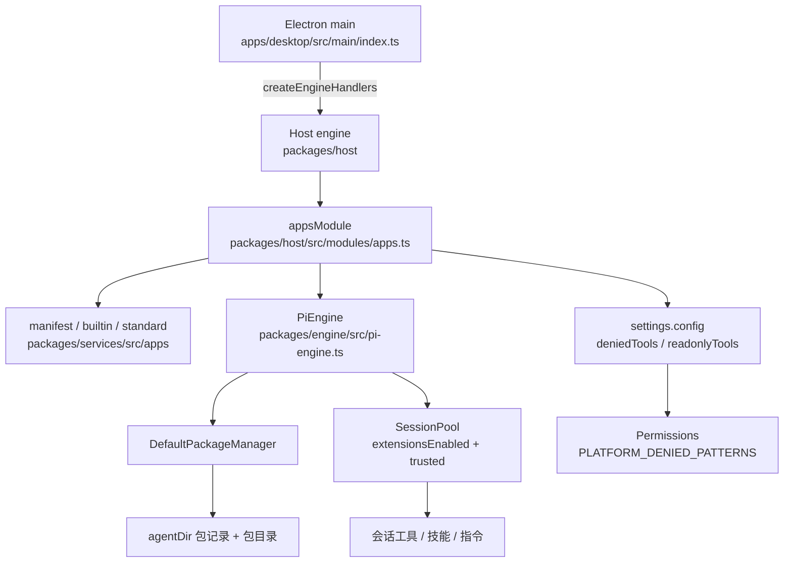
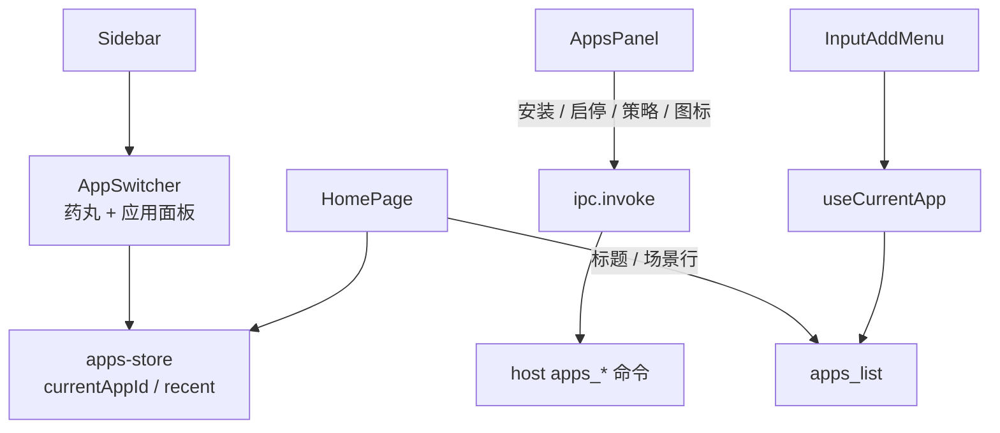
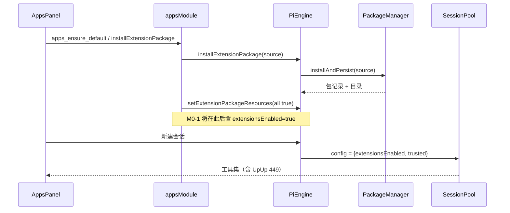

# 20261127-upup2 — 应用平台全面体检、标准化接入与后续计划

> 日期：2026-11-27
> 状态：体检 + 规划（UpUp 接入优先）
> 关联：`20261126-upup.md`（35 项原始计划）、`20261127-upup.md`（内置应用 + Git 安装）
> 结论口径：只写「代码里有、真机跑过」的事实；未做的明确标注为计划。

---

## §0 结论先行

1. **UpUp 接入主链路已经真实跑通**：Git 源预演 48.1 s、安装 28.8 s（282 个依赖），`apps_list` 输出 `openbuddy(builtin) → upup(pi)`，会话工具 **449**，真机走查 `ELECTRON_UI_PASS 41`、`consoleErrors []`。
2. **但「装完即用」还差一步 P0**：全局扩展开关 `extensionsEnabled` 默认 `false`（`packages/engine/src/pi-engine.ts:471`，`packages/engine/src/session-pool.ts:83`）。`apps_ensure_default` 只打开了**包级资源过滤器**，没有打开**全局开关**，所以默认安装完成后，新会话仍可能不加载 UpUp 扩展，用户要去扩展中心手动开启。
3. **标准化目前只做了「结构校验」**：`packages/services/src/apps/standard.ts` 定义了 `validateAppEntry()` / `isStandardApp()` 和默认安装源，但**安装链路没有调用校验**，也没有「应用接入 SDK / 生命周期 / 健康状态」。
4. **WorkBuddy 外壳已对齐 A/B/E 三条具名差距**（应用药丸、首页标题跟随、输入卡应用快捷图标），C/D/F 是有意不做（见 §8）。
5. 本计划的优先级：**先把 UpUp 从「能装」推到「装完即用、可解释、可回滚」，再把同一套能力开放成标准化第三方应用接入**。

---

## §1 现状盘点（真实读数，带代码位置）

| 能力 | 实现位置 | 状态 |
|---|---|---|
| 内置通用应用（OpenBuddy） | `packages/services/src/apps/builtin.ts` | ✅ 已完成，`source:"builtin"`、不可启停、3 个通用场景 |
| 标准结构定义 | `packages/services/src/apps/standard.ts` | ✅ 已完成（结构 + 校验函数） |
| manifest 读取与降级 | `packages/services/src/apps/manifest.ts` | ✅ 已完成（坏 JSON 降级为扩展包，不抛错） |
| 应用注册 / 排序 / 去重 | `packages/host/src/modules/apps.ts` `apps_list` | ✅ 已完成（builtin(0) → app(1) → extension(2)） |
| 默认安装 UpUp（幂等） | `apps.ts` `apps_ensure_default` + `apps/desktop/src/main/index.ts:224` | ✅ 已完成（失败不抛错；`OPENBUDDY_DEFAULT_APPS=off` 可关） |
| 整体启停 | `apps.ts` `apps_set_enabled` | ⚠️ 只写**包级**资源过滤器 |
| 全局扩展开关 | `pi-engine.ts:468-475` `extensionsConfig()` | ❌ 默认 `false`，安装流程未打开 |
| 目录信任 | `pi-engine.ts:193` `trusted()` | ⚠️ 仅 inbox 恒可信，工作区需显式信任 |
| 更新 / 卸载 | `apps.ts` `apps_update` / `apps_uninstall` | ⚠️ 能执行，无版本对比 / 回滚 / 残留检测 |
| 图标 | `apps.ts` `apps_icon`（≤512 KB、包内相对路径） | ✅ 已完成 |
| 工具策略 | `apps_tool_policy_get/set` + `PLATFORM_DENIED_PATTERNS` | ✅ 红线最前置，配置只增不减 |
| UpUp 子包开关 | `packages/services/src/apps/upup-settings.ts` | ✅ 已完成（默认关 4 个重复子包） |
| 场景 | `manifest.ts` `readAppScenes` + `HomePage.tsx` | ⚠️ 只填输入框，无应用级 prompt 注入 |
| WorkBuddy 应用药丸 / 面板 | `apps/web/src/features/apps/AppSwitcher.tsx` | ✅ 已完成 |
| 输入卡应用快捷图标（Gap E） | `composer/InputAddMenu.tsx:446` + `useCurrentApp.ts` | ✅ 已在 HEAD 完成 |
| 应用管理页 | `apps/web/src/features/apps/AppsPanel.tsx` | ✅ 已完成（Git 安装 / 启停 / 策略 / 图标） |
| 契约命令数 | `packages/protocol/src/commands.ts` | **239** |
| 全量单测 | — | **2097 passed / 17 skipped** |
| 真机走查 | — | **41 项通过，0 console error** |

依赖版本：`@earendil-works/pi-coding-agent` / `pi-mcp` **1.6.1**，`pi-matrix.json` 记录 `2026-11-27`，`PI_MATRIX_OK`（4 包，3 verified，1 marketOnly）。

---

## §2 问题清单

### 2.1 P0 — 阻断「装完即用」

| # | 问题 | 证据 | 影响 |
|---|---|---|---|
| P0-1 | **全局扩展开关未自举** | `pi-engine.ts:471` `extensionsEnabled ?? false`；`session-pool.ts:83` `noExtensions: !(config.extensionsEnabled && trusted)` | 默认安装 UpUp 后，新会话可能仍无工具，用户以为安装失败 |
| P0-2 | **目录信任未引导** | `pi-engine.ts:193` `trusted()` 只认 inbox 和 `trustedFolders` | 在工作区开会话时不加载包扩展 |
| P0-3 | **没有「安装 → 开新会话」提示** | `apps/desktop/src/main/index.ts:224` 后台安装后只写日志 | 用户不知道要重启/新建会话才生效 |
| P0-4 | **没有应用健康状态** | `apps_list` 只看包记录，不看已加载扩展/工具 | 无法解释「装了但没工具」 |

### 2.2 P1 — 影响可用性与可维护性

| # | 问题 | 说明 |
|---|---|---|
| P1-1 | **UP-4.2 应用级根 prompt 注入缺失** | 场景点击只 `fillComposer(prompt)`（`HomePage.tsx:284`），没有把应用身份/边界作为 system 级指令装配进会话 |
| P1-2 | **更新无版本对比、无回滚** | `apps_update` 直接调 `updateExtensionPackages`；失败/变坏后只能重装 |
| P1-3 | **卸载不清残留** | 不检查包目录、锁文件、子包设置以外的状态 |
| P1-4 | **校验未进安装链路** | `validateAppEntry()` 仅在 `standard.test.ts` 使用；坏 manifest 仍能装 |
| P1-5 | **工具策略语义偏弱** | 只有 `deny` / `readonly`，缺「应用声明需要哪些工具」「缺工具时的可读诊断」 |
| P1-6 | **多应用上下文切换无会话级状态** | `apps-store` 只持久化 `currentAppId`，不记录该应用下已开会话 |
| P1-7 | **安装错误不可读** | 克隆失败 / 私有仓库 / 无网络统一 `String(error)`；UI 无法给出下一步 |

### 2.3 P2 — 平台化与体验

| # | 问题 |
|---|---|
| P2-1 | UP-5 投研数据卡（行情/持仓/图表）未做 |
| P2-2 | UP-6 推荐闭环与上下文治理未做 |
| P2-3 | 无应用市场 / 搜索 / 评分 / 来源标记 |
| P2-4 | 无应用级审计与遥测（谁装了什么、跑了哪些工具） |
| P2-5 | 无样例应用与接入文档（第三方无法自助接入） |
| P2-6 | WorkBuddy 分组语义（C）/ 账号积分（D）/ 引导轮播（F）刻意不做，需要写入兼容说明避免误判为缺口 |

---

## §3 优先级与路线图

> 原则：**UpUp 接入优先**。先把 UpUp 打磨到「装完即用」，同一套机制再对第三方开放。

### M0 收口（P0，优先）

| 任务 | 做法 | 验收 |
|---|---|---|
| M0-1 默认应用自举 | `apps_ensure_default` 成功后，若 `extensionsEnabled` 为 `false` 则置 `true`（可用 `OPENBUDDY_DEFAULT_APPS=off` 或设置项关闭自举） | 全新 `userData` 启动 → `apps_list` 有 upup → 新会话工具数 > 0 |
| M0-2 信任引导 | 安装完成时返回 `needsTrust`；UI 给出「在当前空间启用」按钮，调用现有 `setFolderTrust` | 工作区会话加载 UpUp 扩展 |
| M0-3 安装完成引导条 | 应用页 / 首页提示「已安装 UpUp，新建会话即可使用」 | 走查脚本断言提示出现 |
| M0-4 应用健康状态 | `apps_list` 每条增加 `health: {installed, resourcesEnabled, extensionsEnabled, trusted, loadedTools?}` | 单测 + 真机均为 `healthy` |

### M1 UpUp 接入完成

| 任务 | 做法 | 验收 |
|---|---|---|
| M1-1 应用级 prompt 注入 | 会话装配时读取当前应用，把 `tagline` + 场景边界作为额外 system 指令；不覆盖用户指令 | 会话里 `agent_session_tools` / system 提示可验证 |
| M1-2 场景 → 会话组装 | 从首页场景进入时携带 `appId + sceneId`，而非只填文本 | 会话元数据记录来源 |
| M1-3 检查更新 / 回滚 | 复用 `agent_extensions_check_updates`；记录 `{source, version}`；回滚 = 重装指定 tag/commit | Git 源实测 |
| M1-4 卸载清理 | 删除包记录 + 清理 `upupPlugins` + 提示残留目录 | 卸载后工具数回落 |
| M1-5 错误可读化 | 映射克隆失败 / 鉴权失败 / 无网络 / 磁盘不足 | 单测覆盖错误映射 |

### M2 标准化开放

| 任务 | 做法 | 验收 |
|---|---|---|
| M2-1 校验进链路 | 安装前预演后调用 `validateAppEntry`；违规拒绝并给字段级错误 | 坏 manifest 装不上 |
| M2-2 应用模板 | `examples/hello-app`：package.json + scenes.json + 一个 extension + 一个 skill | `pi install <本地目录>` 后出现在应用页 |
| M2-3 接入文档 | 本文件 §4/§5 作为对外规范 | 文档门禁通过 |
| M2-4 应用级诊断 | `apps_diagnose` 返回资源/工具/错误明细 | UI 展示 |

### M3 可定制与生态

- 数据卡（P2-1）、推荐闭环（P2-2）、市场（P2-3）、审计（P2-4）。

---

## §4 标准化接入规范 v1

### 4.1 目录结构

```
<app root>/
  package.json          # name/version + pi.{extensions,skills,prompts,themes} + pi.app
  scenes.json           # 可选；pi.app.scenes 指向它
  icon.png|svg|webp     # 可选；pi.app.icon 指向它
  extensions/           # Pi 扩展入口（package.json#pi.extensions）
  skills/               # Pi 技能
  prompts/              # Pi 指令模板
```

- 内置应用没有目录，用同一 `AppEntry` 形状在内存构造（`builtinApp()`）。
- 没有 `pi.app` = 普通扩展包（`kind:"extension"`），仍可安装，但不作为「应用」展示。

### 4.2 `package.json` 字段

| 字段 | 必填 | 语义 |
|---|---|---|
| `name` | ✅ | 应用 id（去重键之一） |
| `version` | 建议 | 更新/回滚依据 |
| `pi.extensions` | 可选 | Pi 扩展入口数组 |
| `pi.skills` / `pi.prompts` / `pi.themes` | 可选 | Pi 资源 |
| `pi.app.kind` | ✅（声明 `pi.app` 时） | `app` / `connector` / `skill-pack` / `extension` |
| `pi.app.tagline` | ✅ `kind=app` | 一句话定位（首页标题） |
| `pi.app.category` | 可选 | 分类（`finance` / `general` …） |
| `pi.app.icon` | 可选 | **包内相对路径**，不得绝对路径或 `..` |
| `pi.app.scenes` | 可选 | 指向 `scenes.json` |
| `pi.app.toolPolicy` | 可选 | `{ deny?: string[], readonly?: string[] }` |

### 4.3 `scenes.json`

```json
[
  { "id": "stock-deep-dive", "name": "个股深度研究", "group": "研究", "prompt": "…" }
]
```

- 最多读取 24 条；`id` ≤ 64、`name` ≤ 40、`group` ≤ 24 字符。
- 坏文件 / 坏结构返回空数组，绝不抛错。
- 点击场景 = 把 `prompt` 填入输入框，由用户确认后发送（当前行为）；M1-1 会再叠加应用级 system 指令。

### 4.4 `icon`

- 相对包根、≤ 512 KB；支持 png/svg/jpeg/webp/gif。
- 宿主返回 data URI；越界路径直接拒绝（`apps_icon`）。

### 4.5 `toolPolicy` 与平台红线

- 平台红线 `PLATFORM_DENIED_PATTERNS`（交易类）永远最前置，应用/用户配置**只能加不能减**。
- `deny`：会话内不可调用；`readonly`：只读约束。
- M1-5 / P1-5：未来支持 `requires`（应用声明所需工具），缺工具时给可读诊断。

### 4.6 启停语义（四级门控）

```
全局 extensionsEnabled ──► 目录 trusted ──► 包资源 filter ──► 应用级开关
        (P0-1)              (P0-2)        (apps_set_enabled)   (AppsPanel)
```

- 任一级关闭，扩展都不加载。
- `apps_set_enabled` 同时切换 `extensions/skills/prompts`，`themes` 保持关闭。
- 内置应用不参与此链路。

### 4.7 校验规则（`standard.ts`）

`validateAppEntry()` 已覆盖：id/name 非空；builtin 不得带安装路径；外部应用必须有 `packageSource` 或 `installedPath`；`kind=app` 必须有 `tagline`；icon 必须包内相对路径；场景三要素齐全；`toolPolicy` 工具名非空。
M2-1 将其接入安装预演。

### 4.8 安装源

- 默认应用：`DEFAULT_APP_SOURCE = https://gitcode.com/lumosaigroup/upup.git`（与 `pi install` 等价）。
- 支持 `npm:` / `git:` / `https?` / `ssh:` / `github:` / 本地绝对路径 / `file://`。
- 本地路径统一转绝对路径入库（`pi-engine.ts:503`），避免换 cwd 解析失败。

---

## §5 可定制化 App 开发指南

### 5.1 最小骨架

```
hello-app/
  package.json
  scenes.json
  extensions/hello.ts
  skills/hello/SKILL.md
```

```json
{
  "name": "hello-app",
  "version": "0.1.0",
  "pi": {
    "extensions": ["./extensions/hello.ts"],
    "skills": ["./skills"],
    "app": {
      "kind": "app",
      "tagline": "一个最小示例应用",
      "category": "general",
      "icon": "./icon.png",
      "scenes": "./scenes.json",
      "toolPolicy": { "deny": ["place_trade_order"] }
    }
  }
}
```

### 5.2 贡献点矩阵

| 贡献点 | 声明位置 | 作用 |
|---|---|---|
| 工具 | `pi.extensions` | 会话内可调用 |
| 技能 | `pi.skills` | 技能面板 / 指令 |
| 指令模板 | `pi.prompts` | 斜杠/快捷指令 |
| 场景 | `pi.app.scenes` | 首页场景行 → 填输入框 |
| 应用外观 | `pi.app.tagline/category/icon` | 应用药丸 / 卡片 / 首页标题 |
| 策略 | `pi.app.toolPolicy` | deny / readonly |

### 5.3 本地开发流程

```bash
# 1) 本地目录安装（自动转绝对路径）
#    应用内：更多 → 应用 → 本地目录…
#    命令行等价：在设置里添加包源后 pi install /path/to/hello-app

# 2) 确认资源开关
#    应用页 → 启用；扩展中心 → 打开全局开关；工作区 → 允许信任

# 3) 新建会话，检查工具
#    agent_session_tools → 应包含 hello 工具
```

### 5.4 调试与健康检查

- `apps_list` / `apps_icon` / `apps_tool_policy_get`：结构与策略。
- `agent_session_tools`：会话真实工具集。
- `agent_check_tool`：单工具可达性。
- 安装过程事件：`agent://extension-progress`。

### 5.5 发布清单

- `validateAppEntry` 0 违规。
- icon 包内、≤ 512 KB。
- 场景 prompt 可独立使用（不依赖隐藏上下文）。
- 工具策略不试图绕过平台红线。
- 版本号语义化；更新可回滚。

### 5.6 反模式

- 把绝对路径写进 `pi.app.icon`。
- 用坏 JSON 兜底（宿主会降级为扩展包，应用页看不到卡片）。
- 在应用里重复 OpenBuddy 已提供的手机接入 / 通知 / 技能桥（UpUp 已默认关掉 4 个子包）。
- 依赖其它子包的内部路径而不 pin 版本。

---

## §6 统一架构图

### 6.1 宿主侧



### 6.2 UI 侧



### 6.3 时序：安装 → 装配 → 会话



### 6.4 数据契约

- `AppEntry`：`id/name/version/kind/source/installedPath/packageSource/tagline/category/icon/toolPolicy/scenes/sceneList`（`manifest.ts`）。
- `ToolPolicy`：`{ platformDenied, denied, readonly }`（`apps_tool_policy_get`）。
- 健康状态（M0-4）：`{installed, resourcesEnabled, extensionsEnabled, trusted, loadedTools?}`。

---

## §7 充分基于 Pi 插件生态

### 7.1 资源通道映射

| OpenBuddy 概念 | Pi 机制 | 说明 |
|---|---|---|
| 应用工具 | `pi.extensions` | 复用 Pi 扩展加载，不另造运行时 |
| 应用技能 | `pi.skills` | 进入技能面板 |
| 指令模板 | `pi.prompts` | 斜杠指令 |
| 主题 | `pi.themes` | 应用级默认不开 |
| 安装/更新 | `DefaultPackageManager` | npm/git/本地统一 |
| 资源开关 | 对象式 filters | `setExtensionPackageResources` |

### 7.2 dispatcher 与子包

- UpUp 用 dispatcher 从 `<agentDir>/settings.json#upupPlugins` 读取子包开关；`UPUP_CODING_AGENT_DIR` 已指向本应用 settings 目录。
- OpenBuddy 只**合并键**，不覆盖其它字段；默认关 4 个重复子包（portfolio/notify/mobile-host/openminis-skills-bridge）。
- 交易工具 `place_trade_order` / `cancel_trade_order` 由平台红线拦截，不依赖应用自律。

### 7.3 信任与沙箱

- 扩展加载 = `extensionsEnabled && trusted`；inbox 恒信，其它目录需显式信任。
- 工具调用仍走 `Permissions.decision()`，内容风险、命令风险、工作区访问各自独立门控。

### 7.4 版本矩阵

- `tools/compat/pi-matrix.json` 记录 Pi 1.6.1、4 个包、3 verified、1 marketOnly。
- `pnpm audit:compat` 校验；升级 Pi 时同步 OpenBuddy 与 UpUp。

### 7.5 与上游协同

- UpUp 走 Git 源拿上游最新；OpenBuddy 不 vendor、不复制源码。
- 兼容性由 `pi-matrix` + 集成测试（`OPENBUDDY_UPUP=1` / `OPENBUDDY_UPUP_GIT=1`）守卫。

---

## §8 WorkBuddy 兼容矩阵

### 8.1 已 1:1 对齐

| 项 | 实现 |
|---|---|
| 侧栏「当前应用」药丸 + 应用面板 | `AppSwitcher.tsx`（搜索 / 最近使用带绿点 / 推荐） |
| 首页标题跟随应用 | `HomePage.tsx:256` `应用名 · 一句话定位` |
| 第三方应用场景行替换模式 tab | `HomePage.tsx:273-310` |
| 输入卡 `+` 旁应用快捷图标（Gap E） | `InputAddMenu.tsx:446` + `useCurrentApp` |
| 侧栏最近任务「查看更多 (N)」 | `Sidebar.tsx` `RECENT_COLLAPSED` |
| 应用管理页（安装/启停/策略/图标） | `AppsPanel.tsx` |

### 8.2 刻意不做

| 项 | 原因 |
|---|---|
| C 应用分组语义 | WorkBuddy 的分组是运营位；OpenBuddy 以 Pi 包为应用边界，语义不同 |
| D 账号 / 积分 | 商业化体系，OpenBuddy 不做账户积分 |
| F 首次引导轮播 | 运营内容；保留「先连接模型」的功能性引导即可 |

### 8.3 结构差异

| 维度 | WorkBuddy | OpenBuddy |
|---|---|---|
| 应用本体 | 运营单元（含内容/权益） | Pi 包（`pi.app` manifest） |
| 安装 | 商店/账号绑定 | Pi 包管理器（Git/npm/本地） |
| 启停 | 平台控制 | 四级门控（全局/信任/包/应用） |
| 工具 | 平台内置 | Pi 扩展生态（449 工具） |

### 8.4 兼容策略

- 保持「应用」对用户的心智一致（药丸、标题、场景、卡片）。
- 不复制 WorkBuddy 的商业化结构，避免语义错位。
- 走查脚本以 WorkBuddy 截图（`release/wb-home-full.png`、`wb-app-panel.png`）为视觉基线。

### 8.5 后续可对齐项

- 应用面板「推荐」区接入真实来源（当前为内置/已安装应用）。
- 首页「最近使用」应用排序与 WorkBuddy 的绿点语义对齐。

---

## §9 验收与门禁

```bash
# 类型与单测
pnpm exec tsc --noEmit -p tsconfig.json
pnpm test

# 门禁
pnpm check:boundaries
pnpm check:ui-tokens
pnpm check:docs
pnpm audit:ipc
pnpm audit:compat

# UpUp 真链路
OPENBUDDY_UPUP=1 pnpm exec vitest run packages/host/test/upup-plugin.integration.test.ts
OPENBUDDY_UPUP_GIT=1 pnpm exec vitest run packages/host/test/upup-git.integration.test.ts

# 真机（走查时保持默认安装关闭，避免联网克隆）
OPENBUDDY_DEFAULT_APPS=off pnpm test:electron-ui
```

当前基线：`2097 passed / 17 skipped`、`BOUNDARIES_OK`、`UI_TOKENS_OK`、`DOCS_OK`、`audit:ipc missingHandlers: []`、`ELECTRON_UI_PASS 41`。

---

## §10 进度口径（诚实）

| 范围 | 现在 | 目标 |
|---|---:|---:|
| UpUp 插件落地（UP-0/1） | **~92%** | 100%（M0 + M1） |
| 应用外壳（UP-2..6） | **~70%** | 90% |
| 标准化接入（§4/§5） | **~35%**（有结构，无链路/SDK/样例） | 100% |
| 平台化整体 | **~84%** | 95% |
| 20261126 计划 35 项 | ~53–57% | — |
| 本计划 M0–M2 | 0%（刚立项） | — |

> 下一刀切在 **M0-1**：默认安装后自动打开全局扩展开关，把「装完即用」补上；这是 UpUp 接入从 92% 到 100% 的最后一公里。

---

## §11 附录：文件索引

| 主题 | 文件 |
|---|---|
| 内置应用 | `packages/services/src/apps/builtin.ts` |
| 标准结构 / 校验 | `packages/services/src/apps/standard.ts` |
| manifest 读取 | `packages/services/src/apps/manifest.ts` |
| UpUp 子包开关 | `packages/services/src/apps/upup-settings.ts` |
| 应用命令 | `packages/host/src/modules/apps.ts` |
| 扩展装配 | `packages/engine/src/pi-engine.ts:468-547` |
| 会话门控 | `packages/engine/src/session-pool.ts:83` |
| 权限红线 | `packages/engine/src/permissions/permissions.ts:19` |
| 应用切换器 | `apps/web/src/features/apps/AppSwitcher.tsx` |
| 应用管理页 | `apps/web/src/features/apps/AppsPanel.tsx` |
| 当前应用 hook | `apps/web/src/features/apps/useCurrentApp.ts` |
| 输入卡快捷图标 | `apps/web/src/features/composer/InputAddMenu.tsx:446` |
| 默认安装接线 | `apps/desktop/src/main/index.ts:222-233` |
| 边界门禁 | `tools/check-boundaries.mjs` |
| 兼容矩阵 | `tools/compat/pi-matrix.json` |
